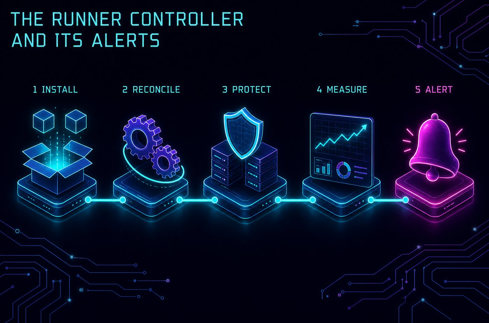
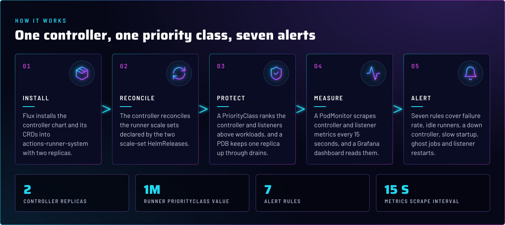
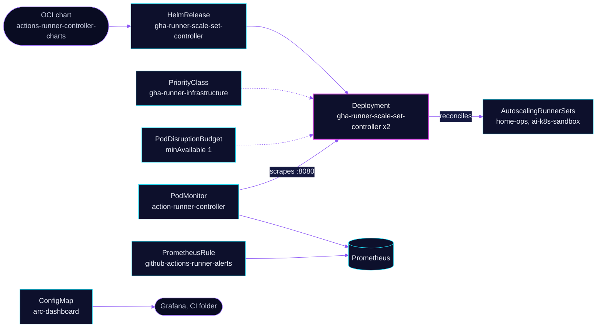

<p align="center">
  
</p>

> **The controller that creates runners.** It reconciles the runner scale sets in `actions-runner-system` into pods,
> runs with a priority class so pressure evicts workloads before it, and carries the seven alerts that page when jobs
> queue, fail or stop starting. Its two replicas are the only thing that can start a runner.

## At a glance

<!-- glance:start -->
<!-- Generated by `readme.py sync`; edit the manifests, not this table. -->
| | |
|---|---|
| **Namespace** | `actions-runner-system` |
| **Deployed by** | [`gha-runner-scale-set-controller`](../../../main/actions-runner-system/gha-runner-scale-set-controller.yaml) (Flux Kustomization) |
| **Helm chart** | `gha-runner-scale-set-controller` from `oci://ghcr.io/actions/actions-runner-controller-charts/gha-runner-scale-set-controller`, values in [`helmrelease.yaml`](app/helmrelease.yaml) |
| **Depends on** | `security/onepassword-store` |
| **Needed by** | `actions-runner-system/actions-runner-maintenance`, `actions-runner-system/gha-runner-scale-set` |
| **Alerts** | 7: `GithubActionsRunnerJobFailureRateHigh`, `GithubActionsRunnerZeroIdleRunners`, `GithubActionsRunnerControllerDown`, `GithubActionsRunnerJobStartupSlow`, `GithubActionsRunnerShortLifetimeDetected`, `GithubActionsRunnerListenerDisconnected`, `GithubActionsRunnerAssignedJobsStuck` |
<!-- glance:end -->

## What it does

- **Reconciles** the `AutoscalingRunnerSet` objects that the two scale-set HelmReleases create. It also starts the
  listener pods that long-poll GitHub for each set.
- **Exposes** metrics on port 8080 for the controller and the listeners. The PodMonitor `action-runner-controller`
  scrapes both every 15 seconds.
- **Alerts** through the `github-actions-runner-alerts` PrometheusRule: failure rate, idle capacity, controller
  scrape, startup time, ghost jobs and listener restarts.
- **Charts** the controller in Grafana from the `arc-dashboard` ConfigMap, in the `CI` folder.

## Why it is built this way

| Choice | Why |
|---|---|
| **Two replicas and a PDB** | A node drain takes one replica at a time, so the controller never drops to zero. With zero controllers no runner pod is created and every queued job waits. |
| **Priority class `gha-runner-infrastructure`** | The controller and the listeners rank above ordinary pods. Under node pressure the scheduler evicts workloads first, so the queue keeps moving. The class is not `globalDefault`, so only the ARC pods carry it. |
| **Stable name with `fullnameOverride`** | The Deployment, PodMonitor and health check all use `gha-runner-scale-set-controller`. The alert rules key on the PodMonitor name, not the HelmRelease name. |
| **Alert on absence, not only failure** | `GithubActionsRunnerControllerDown` uses `count(up{...} == 1) or vector(0)`, so a missing scrape fires the same as a failing one. A `up{job="gha-runner-scale-set-controller"}` query would be empty and silently never fire. |

## How it works

<p align="center">
  
</p>

<p align="center">
  
</p>

<details>
<summary><b>Resource graph</b>: every object involved, by name</summary>



</details>

In more detail:

1. Flux waits for the 1Password store in `security`, then applies the chart, which installs the ARC CRDs and the
   controller Deployment.
2. The controller watches the scale sets. For each, it creates the listener pod, and when a job is queued it creates a
   runner pod from that set's template.
3. Each listener exports `gha_*` gauges and counters, and the controller exports its own. The PodMonitor picks up both
   series, and the rules read `gha_completed_jobs_total`, `gha_idle_runners` and the startup histogram.
4. Restarts and evictions show up as `kube_pod_*` series, which the listener and ghost-job rules read.

## Settings that matter

Values are in [`app/helmrelease.yaml`](app/helmrelease.yaml). The chart version is in
[`app/ocirepository.yaml`](app/ocirepository.yaml); Renovate bumps it.

| Setting | Value | Why |
|---|---|---|
| `replicaCount` | `2` | With a PDB of `minAvailable: 1`, a drain never removes the last controller. |
| `priorityClassName` | `gha-runner-infrastructure` (value `1000000`, not global) | See Why. Set on the controller and, by the scale sets, on the listeners. |
| `fullnameOverride` | `gha-runner-scale-set-controller` | Stable Deployment name for the health check and the PodMonitor. |
| `metrics.controllerManagerAddr`, `metrics.listenerAddr` | `:8080` | The port the PodMonitor scrapes. |
| `metrics.listenerEndpoint` | `/metrics` | The path the listener pods serve. |
| `resources` | requests `100m` / `128Mi`, limits `500m` / `512Mi` | Burstable: each memory limit sits above its request ([`app/helmrelease.yaml`](app/helmrelease.yaml)). Skill `node-scheduling` has the sizing rules. |
| `install.crds` / `upgrade.crds` | `CreateReplace` | The chart owns the ARC CRDs, so upgrades bring their schema changes with them. |
| [`app/pdb.yaml`](app/pdb.yaml) `minAvailable` | `1` | Keeps one controller up through a drain. |

## Alerts

From [`app/prometheusrule.yaml`](app/prometheusrule.yaml). The `alerts` component routes them.

| Alert | Severity | Fires when | First look |
|---|---|---|---|
| `GithubActionsRunnerJobFailureRateHigh` | warning | over 20% of jobs failed in the last hour, for 15 min | The failing job's log. A broken secret or base image fails every job at once. |
| `GithubActionsRunnerZeroIdleRunners` | warning | no idle runner while jobs are assigned, for 10 min | `maxRunners` reached, or runner pods Pending. Check node pressure and Ceph. |
| `GithubActionsRunnerControllerDown` | critical | no healthy controller scrape for 5 min | Controller logs, `flux -n actions-runner-system get hr`. |
| `GithubActionsRunnerJobStartupSlow` | warning | 95th-percentile job startup over 120 s, for 15 min | Image pulls, pod scheduling, and the sandbox set's Ceph claim. |
| `GithubActionsRunnerShortLifetimeDetected` | warning | more than 3 runner pods finished in under 30 s, within 5 min | Ghost job assignments. The `github-ci` playbook has the cleanup. |
| `GithubActionsRunnerListenerDisconnected` | critical | a listener restarted more than 3 times in 15 min | Broker connection. `task actions-runner:restart-listener` (skill `github-ci`). |
| `GithubActionsRunnerAssignedJobsStuck` | warning | jobs assigned, none running, no idle runner, for 10 min | Ghost job state. `task actions-runner:cancel-stuck-runs`. |

## Operate it

```bash
flux -n actions-runner-system get hr gha-runner-scale-set-controller
kubectl -n actions-runner-system get pods -l app.kubernetes.io/name=gha-rs-controller
kubectl -n actions-runner-system logs deploy/gha-runner-scale-set-controller --tail=50
```

The controller's health series is `up{job="actions-runner-system/action-runner-controller"}`.
`up{job="gha-runner-scale-set-controller"}` is empty. The `github-ci` skill has the full playbook.

## Known gaps

- **Upgrade retries are lowered by a local patch.** [`app/kustomization.yaml`](app/kustomization.yaml) sets
  `upgrade.remediation.retries: 2` and `RemediateOnFailure`. [`app/helmrelease.yaml`](app/helmrelease.yaml) says
  `retries: 3`, and the patch wins, so the effective value is 2. The scale-set base has the same patch with the same
  effect. Found while writing; not fixed here.

## Files

| File | Holds |
|---|---|
| [`app/helmrelease.yaml`](app/helmrelease.yaml) | Chart values: replicas, priority class, metrics, resources |
| [`app/ocirepository.yaml`](app/ocirepository.yaml) | Chart source and version |
| [`app/pdb.yaml`](app/pdb.yaml) | Controller PodDisruptionBudget |
| [`app/priorityclass.yaml`](app/priorityclass.yaml) | `gha-runner-infrastructure` PriorityClass |
| [`app/pod-monitor.yaml`](app/pod-monitor.yaml) | Scrapes controller and listener metrics |
| [`app/prometheusrule.yaml`](app/prometheusrule.yaml) | Seven alert rules |
| [`app/arc-dashboard.json`](app/arc-dashboard.json) | Grafana dashboard, loaded by the ConfigMap generator |
| [`app/kustomization.yaml`](app/kustomization.yaml) | Dashboard generator and the HelmRelease remediation patch |
| [`../../../main/actions-runner-system/gha-runner-scale-set-controller.yaml`](../../../main/actions-runner-system/gha-runner-scale-set-controller.yaml) | Flux Kustomization |

Upstream: [actions-runner-controller](https://github.com/actions/actions-runner-controller)

<!-- branded-readme v1 sources=6d06614bea26 -->
