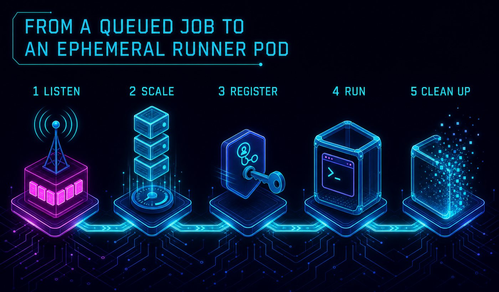
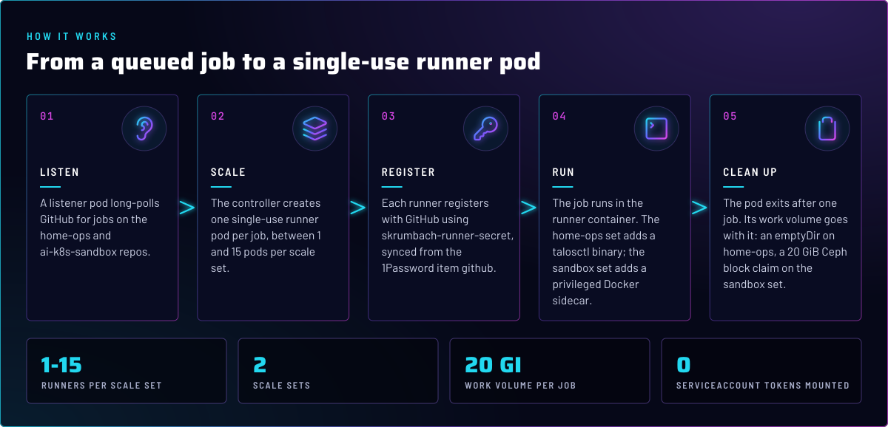
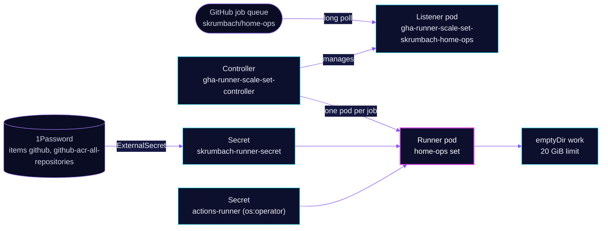

<p align="center">
  
</p>

> **Two runner pools, one job per pod.** Each GitHub repo gets its own scale set: one warm runner at rest, up to fifteen
> under load. Every runner pod takes one job and exits, so no job sees another job's files or processes. Nothing here
> talks to the Kubernetes API.

## At a glance

<!-- glance:start -->
<!-- Generated by `readme.py sync`; edit the manifests, not this table. -->
| | |
|---|---|
| **Namespace** | `actions-runner-system` |
| **Deployed by** | [`gha-runner-scale-set`](../../../main/actions-runner-system/gha-runner-scale-set.yaml) (Flux Kustomization) |
| **Helm chart** | `gha-runner-scale-set` from `oci://ghcr.io/actions/actions-runner-controller-charts/gha-runner-scale-set`, values in [`helmrelease.yaml`](app/skrumbach/ai-k8s-sandbox/helmrelease.yaml) |
| **Helm chart** | `gha-runner-scale-set` from `oci://ghcr.io/actions/actions-runner-controller-charts/gha-runner-scale-set`, values in [`helmrelease.yaml`](app/skrumbach/home-ops/helmrelease.yaml) |
| **Depends on** | `actions-runner-system/gha-runner-scale-set-controller`, `rook-ceph/rook-ceph-cluster` |
| **Needed by** | `actions-runner-system/actions-runner-maintenance` |
| **Secret** | `skrumbach-runner-secret` from onepassword item `github`, `github-acr-all-repositories` |
<!-- glance:end -->

## What it does

- **Runs** two runner pools from one chart: `gha-runner-scale-set-skrumbach-home-ops` for `skrumbach/home-ops`, and
  `gha-rs-ac-ai-k8s-sandbox` for `skrumbach/ai-k8s-sandbox`.
- **Scales** each set between `minRunners: 1` and `maxRunners: 15`. The listener pod asks GitHub how many jobs are
  queued, and the controller starts one runner pod per job.
- **Gives** the home-ops runner a Talos client credential and a `talosctl` binary, so workflows can run
  `talosctl image pull`. The Talos ServiceAccount `actions-runner` is `os:operator`, the least role that can do that.
- **Runs** a privileged Docker-in-Docker sidecar on the sandbox set, so its workflows can build images. The home-ops
  set has no Docker.
- **Holds** the GitHub credential in the Secret `skrumbach-runner-secret`, synced from 1Password items `github` and
  `github-acr-all-repositories`. Both scale sets reference it as `githubConfigSecret`, and Reloader restarts their pods when it changes.

## Why it is built this way

| Choice | Why |
|---|---|
| **One scale set per repo** | A runner registers against one repository, so each repo gets its own queue, its own `maxRunners` ceiling and its own metrics series. The privileged sandbox pods never share a pod with the home-ops Talos credential. |
| **No Kubernetes API for either set** | `automountServiceAccountToken: false`, and no `serviceAccountName`, so the chart's no-permission ServiceAccount is used. No workflow here calls the API. A future workflow that does gets its own namespaced Role on its own scale set, never a shared `cluster-admin` binding (skill `github-ci`). |
| **Single-use pods** | A reused runner keeps state between jobs: files, env, background processes. A fresh pod and a fresh work volume per job remove that whole class of cross-job leak. |
| **`ACTIONS_RUNNER_REQUIRE_JOB_CONTAINER: "false"`** | Jobs run directly on the runner container, not inside a job container, so `docker`, `talosctl` and other host-side tools are on the `PATH` a workflow expects. |
| **Priority class on the listener** | `gha-runner-infrastructure` keeps the listener running under node pressure. A listener that gets evicted stops the queue from being read, and the jobs wait. |
| **Work volume per set** | The home-ops set uses an `emptyDir` with a 20 GiB `sizeLimit`, which the kubelet enforces. The sandbox set uses an ephemeral `ceph-block` claim of the same size. The settings table has the cost of each. |

## How it works

<p align="center">
  
</p>

<p align="center">
  
</p>

<details>
<summary><b>Resource graph</b>: every object involved, by name</summary>



</details>

In more detail:

1. Flux applies two HelmReleases, both from the one `gha-runner-scale-set` OCIRepository. Each has its own name, which
   is also the `runs-on` label a workflow uses.
2. The listener long-polls GitHub for jobs on its repo. A queued job makes the controller create one runner pod from
   that set's template.
3. The home-ops pod's init container copies `talosctl` into a shared `emptyDir`. The runner then registers with GitHub
   and takes the job.
4. When the job ends, the runner deregisters and the pod exits. Its work volume goes with it.

## Settings that matter

Values are in [`app/skrumbach/home-ops/helmrelease.yaml`](app/skrumbach/home-ops/helmrelease.yaml) and
[`app/skrumbach/ai-k8s-sandbox/helmrelease.yaml`](app/skrumbach/ai-k8s-sandbox/helmrelease.yaml). The chart version is in
[`app/ocirepository.yaml`](app/ocirepository.yaml), and Renovate bumps both the chart and the runner image.

| Setting | Value | Why |
|---|---|---|
| `minRunners` / `maxRunners` | `1` / `15`, both sets | One warm pod means the first job of a burst skips a cold start. Fifteen is the queue ceiling per repo, and it leaves headroom for other workloads. |
| `automountServiceAccountToken` | `false` | No token in the pod, because no workflow uses the Kubernetes API. |
| `securityContext.fsGroup` | `1001` | The runner's group, applied to the work volume. The volume is ephemeral, so the ownership is not carried forward. |
| `ACTIONS_RUNNER_REQUIRE_JOB_CONTAINER` | `"false"` | Jobs run on the runner itself. See above. |
| `ACTIONS_ALLOW_USE_UNSECURE_NODE_VERSION` | `"true"`, sandbox only | Lets an action that still targets an end-of-life Node runtime run. Remove it once the sandbox repo's actions are updated. |
| `DOCKER_HOST` and `DOCKER_TLS_*` | `tcp://localhost:2376`, TLS, sandbox only | The runner talks to the dind sidecar over TLS on the pod's loopback. Certificates come from a shared `emptyDir`. |
| `dind` container `securityContext.privileged` | `true`, sandbox only | Docker's daemon needs it. A privileged container is root on the node, so only the sandbox repo's workflows reach it. |
| `resources.requests.cpu` | `1` home-ops, `200m` sandbox | The home-ops comment explains the request: runners tolerate the control-plane taint, and a low request packs them onto one node. See Known gaps for the sandbox value. |
| `resources.limits` | `2` CPU, `8Gi` memory (runner) | Hard ceiling per job. The dind container adds `4Gi`. |
| `work` volume | `emptyDir` `sizeLimit: 20Gi` home-ops; ephemeral `ceph-block` `20Gi` sandbox | The kubelet evicts past the `emptyDir` limit. The home-ops comment records that a Ceph claim cost 50 to 95 seconds of RBD provisioning per job. |
| `tolerations` | `node-role.kubernetes.io/control-plane` `NoSchedule` | Lets runners land on every node. Without it, a set can only schedule where the taint is absent. |
| `annotations` `secret.reloader.stakater.com/reload` | `skrumbach-runner-secret` | Restarts runner pods when the credential rotates. |
| `listenerTemplate.spec.priorityClassName` | `gha-runner-infrastructure` | See Why. |

## Operate it

```bash
flux -n actions-runner-system get ks gha-runner-scale-set          # Flux view of both sets
flux -n actions-runner-system get hr -A                            # per-set HelmRelease state
kubectl -n actions-runner-system get pods -o wide                  # listeners and runner pods
kubectl -n actions-runner-system get autoscalingrunnersets         # ARC's view of each set
task actions-runner:diagnose                                       # the status entry point (skill github-ci)
```

The alerts for both sets come from the controller app; see
[`../gha-runner-scale-set-controller/`](../gha-runner-scale-set-controller/README.md). The maintenance CronJob is
documented in [`../maintenance/`](../maintenance/README.md).

## Known gaps

- **The sandbox set requests 200m CPU.** [`app/skrumbach/ai-k8s-sandbox/helmrelease.yaml`](app/skrumbach/ai-k8s-sandbox/helmrelease.yaml)
  keeps the low request that the home-ops set's comment blames for packing runners onto one node. That risk to the
  apiserver and an OSD applies to the sandbox set too. Found while writing; not fixed here.
- **Stale sandbox registrations are not swept.** The maintenance CronJob has `REPO_NAME` fixed to `home-ops`. Offline
  sandbox runners need a manual check: `gh api repos/skrumbach/ai-k8s-sandbox/actions/runners`.

## Files

| File | Holds |
|---|---|
| [`app/ocirepository.yaml`](app/ocirepository.yaml) | Chart source and version |
| [`app/rbac.yaml`](app/rbac.yaml) | Talos ServiceAccount `actions-runner`, `os:operator`, and why there is no RoleBinding |
| [`app/kustomization.yaml`](app/kustomization.yaml) | Shared HelmRelease install and upgrade remediation |
| [`app/skrumbach/externalsecret.yaml`](app/skrumbach/externalsecret.yaml) | `skrumbach-runner-secret` from 1Password |
| [`app/skrumbach/home-ops/`](app/skrumbach/home-ops/) | Scale set for `skrumbach/home-ops`, with its PodMonitor |
| [`app/skrumbach/ai-k8s-sandbox/`](app/skrumbach/ai-k8s-sandbox/) | Scale set for `skrumbach/ai-k8s-sandbox`, with its PodMonitor |
| [`../../../main/actions-runner-system/gha-runner-scale-set.yaml`](../../../main/actions-runner-system/gha-runner-scale-set.yaml) | Flux Kustomization, dependencies |

Upstream: [actions-runner-controller](https://github.com/actions/actions-runner-controller)

<!-- branded-readme v1 sources=c66cd30b1a3b -->
