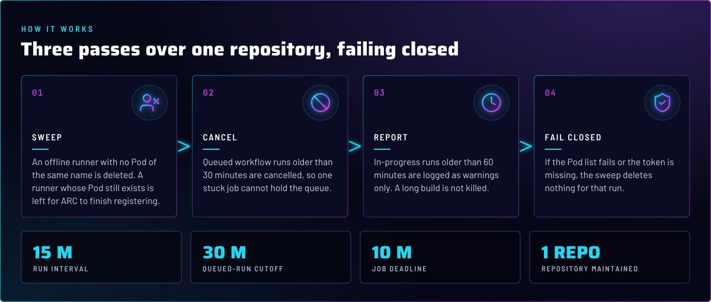
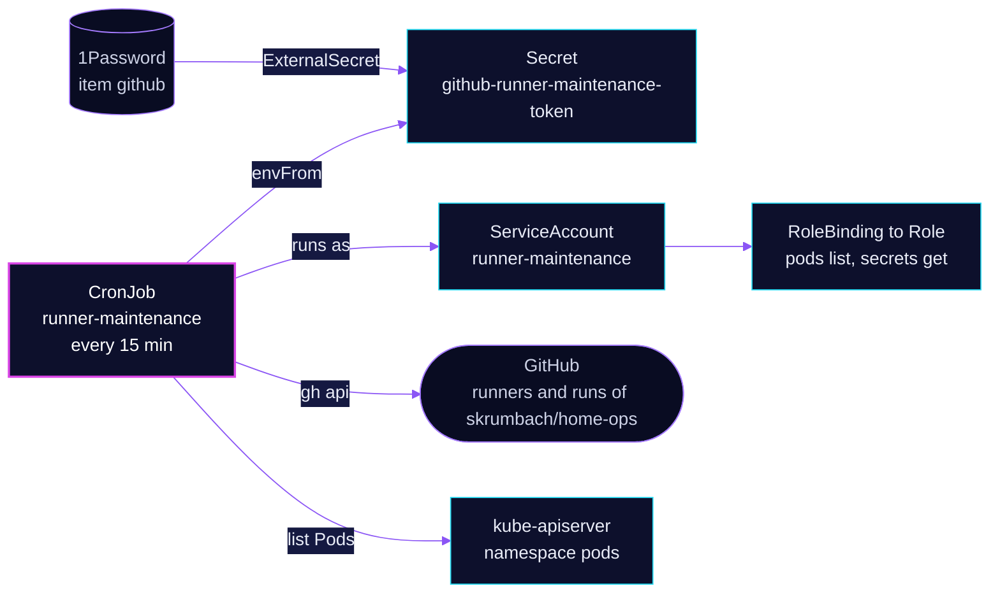

<p align="center">
  
</p>

> **Sweeps what ARC cannot.** A runner pod that dies without deregistering leaves an offline runner behind on GitHub,
> and a job assigned to it waits forever. This CronJob deletes those orphaned registrations, cancels queued runs that
> have waited too long, and reports long builds. It deletes nothing it cannot prove is orphaned, and when it cannot read the Pod list it
> deletes no runner. Queued-run cancellation still runs.

## At a glance

<!-- glance:start -->
<!-- Generated by `readme.py sync`; edit the manifests, not this table. -->
| | |
|---|---|
| **Namespace** | `actions-runner-system` |
| **Deployed by** | [`actions-runner-maintenance`](../../../main/actions-runner-system/maintenance.yaml) (Flux Kustomization) |
| **Images** | `ghcr.io/home-operations/actions-runner` |
| **Depends on** | `actions-runner-system/gha-runner-scale-set`, `actions-runner-system/gha-runner-scale-set-controller`, `security/external-secrets` |
| **Secret** | `github-runner-maintenance-token` from onepassword item `github` |
<!-- glance:end -->

## What it does

- **Deletes** an offline, non-busy runner registration on `skrumbach/home-ops` when no Pod of the same name exists in
  `actions-runner-system`. ARC names each ephemeral runner after its Pod, so the name is the join key.
- **Cancels** a queued workflow run older than 30 minutes (`STUCK_RUN_MINUTES`). A queued job with no runner to take it
  is the usual cause.
- **Reports** an in-progress run older than 60 minutes as a warning. It does not cancel one, because a long build is
  legitimate.
- **Uses** a GitHub token from the 1Password item `github`, property `GITHUB_RUNNER_MAINTENANCE_PAT`. The PAT has
  Actions read and write and Administration read.

## Why it is built this way

| Choice | Why |
|---|---|
| **Pod existence, not age, decides staleness** | The GitHub runners API has no `last_connected_at`, so elapsed time cannot be measured. The Pod is the honest signal: a runner whose Pod still exists is mid-registration and is left alone. |
| **Fail closed on the Pod list** | A missing token, an unreachable API or a non-200 response sets `PODS_LOOKUP_OK=false`. Then no offline runner is deleted. A failed lookup is never read as "no Pods exist", which would delete live registrations. |
| **`concurrencyPolicy: Forbid`, a 600 s deadline** | Runs cannot overlap, and a hung `gh` call is killed after ten minutes. The next 15-minute run is the retry. |
| **`backoffLimit` not set, `restartPolicy: OnFailure`** | The script is idempotent. A failed container restarts in place; the next scheduled run does the work again. |
| **Runs on the runner image** | The script expects `gh`, `jq` and `curl` in the image. Reusing the scale-set image means no extra image to pin, and Renovate bumps both with the same annotation. |

## How it works

<p align="center">
  
</p>

<details>
<summary><b>Resource graph</b>: every object involved, by name</summary>



</details>

In more detail:

1. Flux applies the CronJob after the controller, both scale sets and `external-secrets` are ready. The overlay's
   `dependsOn` lists them.
2. The job lists the runners on the repo. For each offline, non-busy one, it lists the Pods in its own namespace, and
   deletes the runner only if no Pod of that name exists.
3. It lists queued runs and cancels any older than the cutoff. It then lists in-progress runs and logs the old ones.
4. The job prints a summary and exits. The last three successful and three failed Jobs are kept, and each is deleted an hour after it finishes.

## Settings that matter

Values are in [`cronjob.yaml`](cronjob.yaml).

| Setting | Value | Why |
|---|---|---|
| `schedule` | `*/15 * * * *` | Frequent enough that a ghost job waits at most a quarter hour. The cost is a handful of GitHub API calls per run. |
| `STUCK_RUN_MINUTES` | `30` | A queued run normally starts within minutes. Thirty minutes in the queue means no runner is taking it. |
| `activeDeadlineSeconds` | `600` | A hung `gh` or `curl` is killed. The next run is the retry. |
| `concurrencyPolicy` | `Forbid` | Two sweeps racing over the same runner list could each delete what the other is checking. |
| `ttlSecondsAfterFinished` | `3600` | Finished Jobs are deleted an hour after they end, so `kubectl logs job/<name>` works only within that hour. Read a failed run's log soon after it fails. |
| `successfulJobsHistoryLimit` / `failedJobsHistoryLimit` | `3` / `3` | Enough history to read the last few runs' logs. |

The in-progress threshold of 60 minutes is hardcoded in the script, not a setting. It is a warning only.

## Operate it

```bash
flux -n actions-runner-system get ks actions-runner-maintenance
kubectl -n actions-runner-system get cronjob runner-maintenance
kubectl -n actions-runner-system get jobs                    # pick a run
kubectl -n actions-runner-system logs job/<job-name>         # its sweep, cancel and report lines
```

A run that prints `Could not read service account token`, or a Pod-list HTTP status other than 200, deleted no runners.
That is the fail-closed path, not an error to clear. Cancellation of stuck queued runs still runs.

## Known gaps

- **The Role grants more than the script uses.** [`rbac.yaml`](rbac.yaml) grants `delete` on Pods and `get` on Secrets
  to the `runner-maintenance` ServiceAccount. The script only lists Pods and reads its own token from the mounted
  file, so `delete pods` in this namespace is unused reach: a leaked ServiceAccount token could delete ARC runner pods.
  Dropping `delete` and `get secrets` is the least-privilege fix. Found while writing; not fixed here.
- **Only `skrumbach/home-ops` is swept.** `REPO_NAME` is fixed to `home-ops`, so the sandbox scale set's orphaned
  registrations are not cleaned. The `github-ci` skill has the manual check.

## Files

| File | Holds |
|---|---|
| [`cronjob.yaml`](cronjob.yaml) | The CronJob and the sweep script |
| [`externalsecret.yaml`](externalsecret.yaml) | `github-runner-maintenance-token` from the 1Password item `github` |
| [`rbac.yaml`](rbac.yaml) | ServiceAccount, Role and RoleBinding for the job |
| [`kustomization.yaml`](kustomization.yaml) | Resource list for this directory |
| [`../../../main/actions-runner-system/maintenance.yaml`](../../../main/actions-runner-system/maintenance.yaml) | Flux Kustomization `actions-runner-maintenance`, dependencies |

Upstream: [GitHub REST API, self-hosted runners](https://docs.github.com/en/rest/actions/self-hosted-runners)

<!-- branded-readme v1 sources=e1006c6f700a -->
