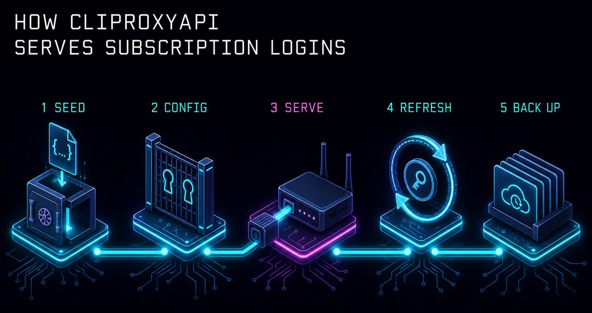
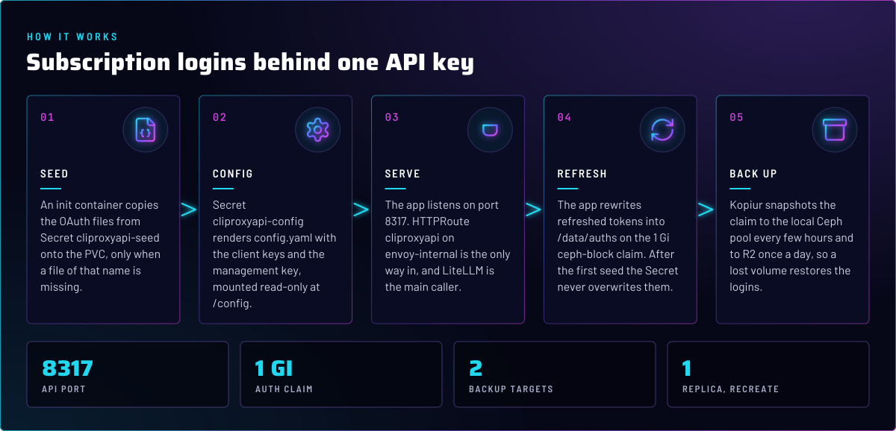
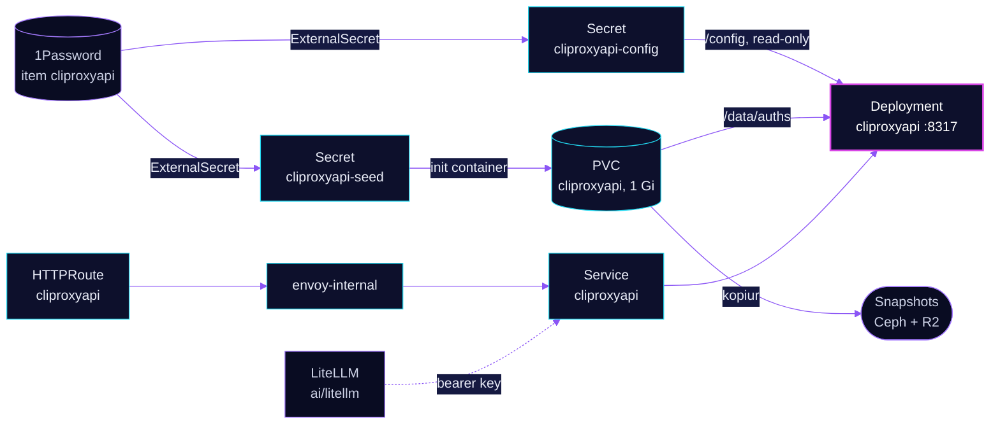

<p align="center">
  
</p>

> **Subscription logins, one API.** CLIProxyAPI holds the OAuth tokens for the Claude and Grok subscriptions and serves
> them as an OpenAI-compatible endpoint on the internal network. LiteLLM is its only regular client. Nothing else in
> the cluster needs to know the logins exist.

## At a glance

<!-- glance:start -->
<!-- Generated by `readme.py sync`; edit the manifests, not this table. -->
| | |
|---|---|
| **Namespace** | `ai` |
| **Deployed by** | [`cliproxyapi`](../../../main/ai/cliproxyapi.yaml) (Flux Kustomization) |
| **Helm chart** | `app-template`, values in [`helmrelease.yaml`](app/helmrelease.yaml) |
| **Images** | `docker.io/eceasy/cli-proxy-api` |
| **Depends on** | `security/onepassword-store`, `system/kopiur-repository` |
| **Route** | `cliproxyapi.${SECRET_DOMAIN}` via `envoy-internal` (Gatus probed) |
| **Secret** | `cliproxyapi-config` from onepassword item `cliproxyapi` |
| **Secret** | `cliproxyapi-seed` from onepassword item `cliproxyapi` |
| **Backup** | kopiur component on the overlay (skill `kopiur-backups`) |
| **Health checks** | `Deployment/cliproxyapi` |
<!-- glance:end -->

## What it does

- **Serves** an OpenAI-compatible API on port 8317 through the `cliproxyapi` Service, reachable at
  `cliproxyapi.${SECRET_DOMAIN}` on `envoy-internal` only.
- **Holds** the OAuth token files in `/data/auths` on a 1 Gi `ceph-block` claim. The app rewrites refreshed tokens there
  by itself.
- **Seeds** first-run tokens from Secret `cliproxyapi-seed`. Each file is copied once, only when a file of that name is
  not already on the claim.
- **Renders** its own `config.yaml` from Secret `cliproxyapi-config`: the client API keys, the management-panel key and
  the retry count. The file is mounted read-only at `/config`.
- **Backs up** the claim with kopiur: a local Ceph snapshot every few hours and a daily copy to R2. The overlay
  ([`cliproxyapi.yaml`](../../../main/ai/cliproxyapi.yaml)) includes `components/kopiur`.

## Why it is built this way

| Choice | Why |
|---|---|
| **OAuth held in a PVC, not a Secret** | The app refreshes tokens while it runs, and a Secret is read-only to it. The claim is the only place a refreshed token survives a restart. |
| **Seed once, never overwrite** | The seed init container skips any file that already exists. After the first run the app owns the token, so a stale Secret value cannot roll a refreshed token back. |
| **`Recreate` strategy, one replica** | The claim is `ReadWriteOnce` on `ceph-block`. A rolling update would start the new pod while the old one still holds the volume. |
| **Internal route, no Authentik policy** | API clients authenticate with bearer keys, and the management panel has its own secret key. An SSO redirect would break every non-browser caller. |
| **Read-only root filesystem, `WRITABLE_PATH=/tmp`** | The image writes its management-panel assets to `/tmp`, so the root filesystem can stay read-only. |
| **Kopiur, not VolSync** | The claim was born on kopiur. The component adds a local and an R2 target, and VolSync is retired (skill `kopiur-backups`). |

## How it works

<p align="center">
  
</p>

<p align="center">
  
</p>

<details>
<summary><b>Resource graph</b>: every object involved, by name</summary>



</details>

In more detail:

1. Flux applies the Kustomization `cliproxyapi` after `security/onepassword-store` and `system/kopiur-repository`.
   The HelmRelease renders one Deployment, one Service and the claim. The two ExternalSecrets sit beside it.
2. The `seed` init container runs first. It creates `/data/auths` and copies each `*.json` file from `/seed` if the
   name is free on the claim.
3. The app starts with `/config/config.yaml`. The health probes hit `/healthz` on 8317.
4. LiteLLM reaches the app at `cliproxyapi.ai.svc.cluster.local:8317` for the Claude models it lists in
   `ai/litellm`, and the image-generation route uses the Grok login through the same endpoint. The client sends the
   bearer key that LiteLLM reads from the same 1Password item (`ai/litellm` ExternalSecret).
5. Kopiur runs two schedules against the claim: `cliproxyapi-ceph` (local, odd hours, from the component default) and
   `cliproxyapi-r2` (daily, `H 19 * * *` set in the overlay).

## Settings that matter

All values are in [`app/helmrelease.yaml`](app/helmrelease.yaml) unless noted.

| Setting | Value | Why |
|---|---|---|
| `controllers.cliproxyapi.strategy` | `Recreate` | The auth claim is `ReadWriteOnce`. A rolling update would deadlock on the attach. |
| `defaultPodOptions.securityContext` | `runAsUser: 1000`, `fsGroup: 1000`, `fsGroupChangePolicy: OnRootMismatch` | Matches the image user. `OnRootMismatch` skips a recursive chown on each start (skill `app-workloads`). |
| `automountServiceAccountToken` | `false` | The app never talks to the Kubernetes API. |
| `containers.app.securityContext.readOnlyRootFilesystem` | `true` | With `WRITABLE_PATH=/tmp` (an `emptyDir`), the image still runs. |
| `persistence.data` | 1 Gi `ceph-block`, RWO | Small by design: it holds a few JSON token files. |
| `persistence.config`, `persistence.seed` | Secret mounts, `/config` read-only, `/seed` | Config and seed never land on the claim. |
| `containers.app.resources` | requests 10m CPU, 64 Mi; memory limit 256 Mi | Every limit has a request (skill `node-scheduling`). |
| `reloader.stakater.com/auto` | `"true"` | A changed config Secret restarts the pod. |
| `TZ` | `America/New_York` | Log timestamps. |
| `KOPIUR_SCHEDULE_R2` (overlay) | `H 19 * * *` | Moves the R2 copy off the default 04:00 slot. |

## Operate it

```bash
flux -n ai get ks cliproxyapi
kubectl -n ai get deploy,pvc,externalsecret -l app.kubernetes.io/name=cliproxyapi
kubectl -n ai get snapshotschedule cliproxyapi-ceph cliproxyapi-r2
```

A new login is not picked up by a seed Secret change once the token file exists on the claim. To replace a token, the
owner removes the stale file from `/data/auths` with the admin kubeconfig and owner approval, and the next pod start
seeds the new one.

## Known gaps

- **The seed is one-way.** `cliproxyapi-seed` only fills missing files (see the init container). Editing the 1Password
  item does not replace a token the claim already holds. The behaviour is intended, but the 1Password edit alone looks
  like it did nothing. Found while writing; not changed here.

## Files

| File | Holds |
|---|---|
| [`app/helmrelease.yaml`](app/helmrelease.yaml) | Deployment, seed init container, Service, claim |
| [`app/externalsecret.yaml`](app/externalsecret.yaml) | `cliproxyapi-config` (rendered `config.yaml`) and `cliproxyapi-seed` (OAuth files) |
| [`app/httproute.yaml`](app/httproute.yaml) | Internal route, Homepage and Gatus annotations |
| [`app/kustomization.yaml`](app/kustomization.yaml) | Base resources |
| [`../../../main/ai/cliproxyapi.yaml`](../../../main/ai/cliproxyapi.yaml) | Flux Kustomization, kopiur include, substitutions |
| [`../litellm/app/models/`](../litellm/app/models/) | The LiteLLM models that call this endpoint |

Upstream: [CLIProxyAPI](https://github.com/router-for-me/CLIProxyAPI) •
Skill [`kopiur-backups`](../../../../../.agents/skills/kopiur-backups/SKILL.md)

<!-- branded-readme v1 sources=bcff207f8578 -->
