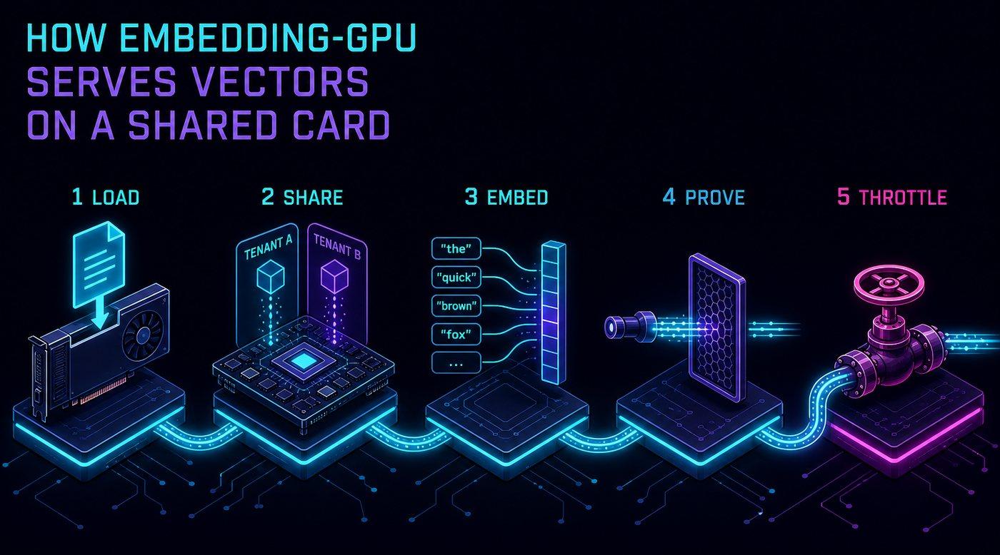
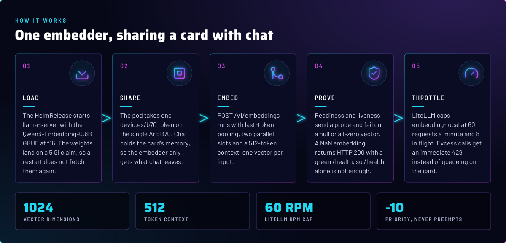
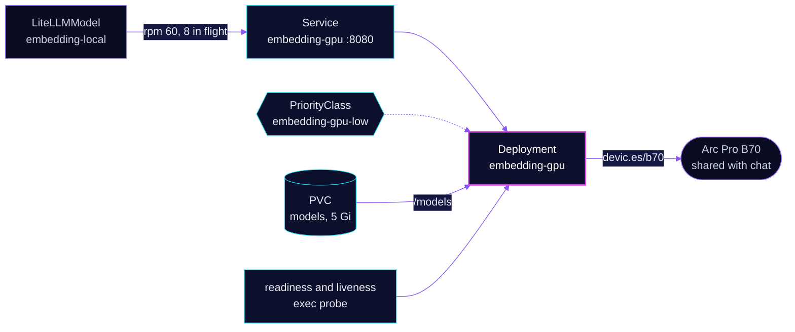

<p align="center">
  
</p>

> **Local vectors, no cloud call.** embedding-gpu runs Qwen3-Embedding-0.6B on the Arc Pro B70 that also runs chat. LiteLLM
> is the only client, through the `embedding-local` alias, and it caps the request rate so chat keeps its share of the
> card. The pod is the lowest-priority workload on talos-3 and is the first one evicted under memory pressure.

## At a glance

<!-- glance:start -->
<!-- Generated by `readme.py sync`; edit the manifests, not this table. -->
| | |
|---|---|
| **Namespace** | `ai` |
| **Deployed by** | [`embedding-gpu`](../../../main/ai/embedding-gpu.yaml) (Flux Kustomization) |
| **Helm chart** | `app-template`, values in [`helmrelease.yaml`](app/helmrelease.yaml) |
| **Images** | `ghcr.io/ggml-org/llama.cpp` |
| **Health checks** | `Deployment/embedding-gpu` |
<!-- glance:end -->

## What it does

- **Embeds** text with llama.cpp `llama-server` in embedding mode, `--pooling last`, on port 8080 (Service
  `embedding-gpu`, in-cluster only).
- **Runs** one replica on the B70 through the `devic.es/b70` device plugin resource (skill `intel-gpu`).
- **Caches** the GGUF on a 5 Gi `ceph-block` claim mounted at `/models`. It is re-downloadable, so the claim is not
  in a kopiur include.
- **Gates** its own health on the output. Readiness and liveness post a probe to `/v1/embeddings` and fail on a null or
  all-zero vector, because a NaN embedding still returns HTTP 200.

## Why it is built this way

| Choice | Why |
|---|---|
| **A separate HelmRelease from chat** | A change here must not restart the chat server. Each one has its own pod, claim and probe. |
| **`Recreate` strategy** | The `devic.es/b70` resource is a share token, not a fence. Two copies would both load weights onto one card. |
| **Lowest priority, `preemptionPolicy: Never`** | `embedding-gpu-low` (value -10) yields to every other talos-3 workload under memory pressure and never displaces one. GPU contention is handled by the rate cap, not by scheduling. |
| **Memory request 1 Gi, limit 4 Gi** | The request is deliberately small so the pod is cheap to place. The limit is headroom, not a bound: `--cache-ram 0` is what stops the host-memory leak that chat hits with the default cache. |
| **`--parallel 2` and `--kv-unified` pinned** | Without `--parallel`, auto mode picks a different slot layout. `--kv-unified` is required with `--parallel`, or the per-slot context halves to 256. Chat does not pin these (skill `b70-llm-serving`). |
| **`--ctx-size 512`, `-b 512`, `-ub 512` as one triple** | Matches LiteLLM's `maxInputTokens: 512`. Over-length input fails loudly with a 400 instead of being truncated. |
| **`--pooling last`** | The manifest pins last-token pooling, and skill `b70-llm-serving` warns that mean pooling is a different vector space that the stored vectors would not match. Whether the model card recommends last-token pooling is not verified here. |
| **Probes that assert finite values** | `/health` stays green while the model emits NaN (skill `b70-llm-serving`, `references/embeddings.md`). The probe greps the response for `null` and for a non-zero number. |
| **Rate cap in LiteLLM, not on the server** | `--timeout 30` is only a socket timeout. It does not bound a queued request, so the 60 rpm and 8 in-flight caps live on the `embedding-local` LiteLLMModel. |

## How it works

<p align="center">
  
</p>

<p align="center">
  
</p>

<details>
<summary><b>Resource graph</b>: every object involved, by name</summary>



</details>

In more detail:

1. Flux applies the Kustomization `embedding-gpu` (HelmRelease, PriorityClass and the claim). Health is checked on the
   `Deployment/embedding-gpu`, not the HelmRelease, so a crashloop shows up as not Ready.
2. The B70 sits on talos-3, which carries a `PreferNoSchedule` taint. The `home-operations.com/dedicated` toleration
   lets the pod land there (skill `node-scheduling`).
3. The startup probe waits up to about 10 minutes for `/health`, which covers the first model download. Readiness and
   liveness then send the probe request and check the vector.
4. LiteLLM sends `openai/Qwen/Qwen3-Embedding-0.6B` to `embedding-gpu.ai.svc.cluster.local:8080/v1`. Consumers call the
   `embedding-local` alias, never the backend name.

## Settings that matter

All values are in [`app/helmrelease.yaml`](app/helmrelease.yaml) unless noted.

| Setting | Value | Why |
|---|---|---|
| `containers.app.image.tag` | pinned, the same tag as `ai/vllm` | Re-measure both workloads before a bump (skill `b70-llm-serving`). |
| `--parallel` and `--kv-unified` | `2`, set | Required together for two slots at full context. |
| `--cache-ram` | `0` | Absence restores an 8192 MiB default with no log line. Chat uses `4096` instead, and the two must not be copied across. |
| `--ctx-size`, `-b`, `-ub` | `512` each | One triple. The model's `maxInputTokens` in LiteLLM matches it. |
| `--pooling` | `last` | The training pooling of the model. |
| `--no-cont-batching`, `--timeout` | set, `30` | Socket timeout only (image default is 3600). |
| `ONEAPI_DEVICE_SELECTOR` | `level_zero:0` | Picks the B70 by the Level Zero index, not `/dev/dri/card0` (skill `intel-gpu`). |
| `priorityClassName` | `embedding-gpu-low` | Evicted first, never preempts (`priorityclass.yaml`). |
| `resources.requests.memory` | `1024Mi` | Deliberately small; raising it changes the talos-3 arithmetic (skill `node-scheduling`). |
| `strategy` | `Recreate` | One card, one copy (see the table above). |

## Operate it

```bash
flux -n ai get ks embedding-gpu
kubectl -n ai get deploy embedding-gpu -o wide
kubectl -n ai logs deploy/embedding-gpu --tail=50       # startup banner: n_slots, n_ctx_slot, kv_unified
```

Verify with a finite-value check, not a status code: a 200 with a `null` vector is the failure mode this endpoint has
shown (skill `b70-llm-serving`).

## Known gaps

- **The LiteLLM timeout is not the server timeout.** `embedding-local` sets `timeout: 5` per attempt in LiteLLM, and
  the server sets `--timeout 30`. The server value does not bound a queued request, so a stuck backend holds callers
  for the LiteLLM retry budget. Documented in the manifest comments; not changed here.
- **The NaN root cause is open.** The probes catch it, and a pod restart clears it, but the cause is still unattributed
  (skill `b70-llm-serving`, `references/embeddings.md`).

## Files

| File | Holds |
|---|---|
| [`app/helmrelease.yaml`](app/helmrelease.yaml) | llama-server args, probes, resources, the models claim |
| [`app/priorityclass.yaml`](app/priorityclass.yaml) | `embedding-gpu-low` |
| [`app/kustomization.yaml`](app/kustomization.yaml) | Base resources |
| [`../../../main/ai/embedding-gpu.yaml`](../../../main/ai/embedding-gpu.yaml) | Flux Kustomization and health check |
| [`../litellm/app/models/embedding-local.yaml`](../litellm/app/models/embedding-local.yaml) | The LiteLLM alias, rate caps and `maxInputTokens` |

Upstream: [llama.cpp server](https://github.com/ggml-org/llama.cpp/tree/master/tools/server) •
[Qwen3-Embedding-0.6B](https://huggingface.co/Qwen/Qwen3-Embedding-0.6B)

<!-- branded-readme v1 sources=e8a59e56aec2 -->
