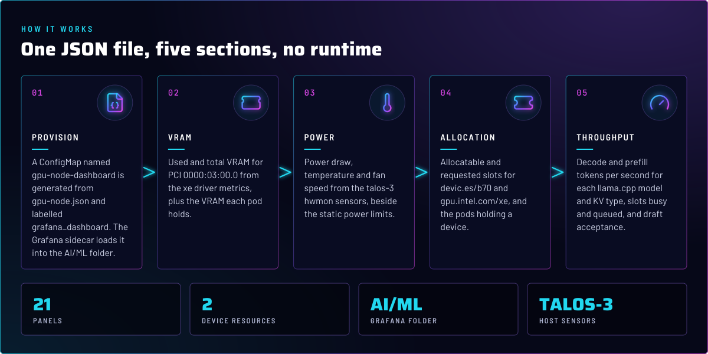
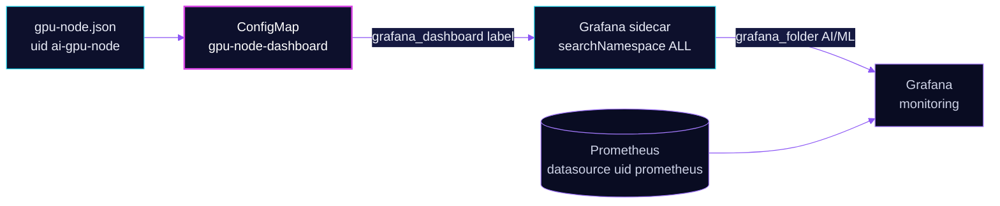

<p align="center">
  
</p>

> **One screen for the B70.** The dashboard puts the Arc Pro B70 on talos-3 beside the iGPU fleet and the chat server's
> llama.cpp throughput. It is a single Grafana JSON file. It runs nothing and holds no state.

## At a glance

<!-- glance:start -->
<!-- Generated by `readme.py sync`; edit the manifests, not this table. -->
| | |
|---|---|
| **Namespace** | `ai` |
| **Deployed by** | [`gpu-node-dashboard`](../../../main/ai/gpu-node-dashboard.yaml) (Flux Kustomization) |
<!-- glance:end -->

## What it does

- **Shows VRAM** used against capacity for the B70 (`pdev="0000:03:00.0"`) and the VRAM each pod holds.
- **Shows power and heat** for the same card from the talos-3 hwmon sensors: draw, temperature, fan speed and the static
  power caps.
- **Shows allocation** of the two device resources, `devic.es/b70` (the B70) and `gpu.intel.com/xe` (the iGPU fleet),
  against what is allocatable on each node, and lists the pods that hold a device.
- **Shows host pressure** on talos-3: CPU busy and memory used. CPU busy shows contention with other CPU work on the node.
  Memory used is the number that matters for eviction, which follows memory pressure and priority (`embedding-gpu-low`
  is -10, so the embedding pod goes first).
- **Shows chat throughput** per model and KV type: decode and prefill tokens per second, slots busy and queued, and the
  speculative-decode acceptance rate. Chat runs `--spec-type ngram-mod`, so the panel fills; it is empty only when
  speculative decoding is off. The panel title still says MTP, which chat does not use.

## Why it is built this way

| Choice | Why |
|---|---|
| **A ConfigMap from a generated JSON file** | Grafana loads dashboards from labelled ConfigMaps. `configMapGenerator` with `disableNameSuffixHash` keeps the name stable, so the dashboard is a plain file in Git. |
| **`grafana_dashboard: "true"` and `grafana_folder: AI/ML`** | The Grafana sidecar watches all namespaces (`searchNamespace: ALL`) and places the dashboard by the folder annotation. |
| **The B70 is addressed by PCI address and hwmon chip ID** | The card is one device on one node. Matching the PCI bus and the `chip` label is exact, so the panels cannot pick up the iGPU (`/sys/class/drm/card0` is the iGPU, skill `intel-gpu`). |
| **Datasource UID `prometheus`** | Matches the Prometheus datasource that the Grafana HelmRelease provisions. |
| **No Flux health checks, no `wait`** | There is no workload here. A missing dashboard shows up in Grafana, not in Flux status. |

## How it works

<p align="center">
  
</p>

<details>
<summary><b>Resource graph</b>: every object involved, by name</summary>



</details>

In more detail:

1. Flux applies the Kustomization `gpu-node-dashboard`. Its only resource is the ConfigMap that `kustomization.yaml`
   generates from `gpu-node.json`, with the two labels above.
2. The Grafana sidecar in `monitoring` picks the ConfigMap up from any namespace and places it in the AI/ML folder.
3. Each panel queries Prometheus. The `xe_gpu_*` series come from the xe GPU exporter in `system/xe-gpu-exporter`, the
   `node_hwmon_*` and `node_cpu` series from the node exporter, and the `llamacpp:*` series from the llama.cpp `/metrics`
   endpoint, scraped by the `vllm` ServiceMonitor, which also stamps the `model` and `kv` labels (skill `observability`).
4. Grafana draws the dashboard on refresh. Nothing in the cluster reads it back.

## Settings that matter

The dashboard has no runtime settings. These values are fixed in [`app/gpu-node.json`](app/gpu-node.json) and are the
ones to check when a panel goes empty.

| Setting | Value | Why |
|---|---|---|
| `uid` | `ai-gpu-node` | A stable link target for the dashboard. Changing it breaks any saved links. |
| `pdev` label | `0000:03:00.0` | The B70's PCI address. The iGPU has a different address. |
| `instance` label | `talos-3` | Host panels are pinned to the node the B70 sits on. Move the card and every host panel goes empty. |
| hwmon `chip` label | `0000:02:01_0_0000:03:00_0` | The sensor chip that belongs to the B70 on talos-3. |
| `resource` label | `devic_es_b70`, `gpu_intel_com_xe` | Kube-state-metrics names of the two device resources, with dots turned into underscores. |
| `namespace` label | `ai` | Limits the llama.cpp panels to the chat and embedding server pods. |

## Operate it

```bash
flux -n ai get ks gpu-node-dashboard
kubectl -n ai get configmap gpu-node-dashboard -o jsonpath='{.metadata.labels}'
```

## Known gaps

- **Host and card panels are hardcoded to talos-3.** The `instance` and hwmon `chip` labels name the node and the sensor
  chip. A change of node or card empties those panels without an error.
- **The `kv` label on the throughput panels is a constant.** The `vllm` ServiceMonitor sets `kv: f16` on every scrape.
  Its comment says nothing checks it against `--cache-type-k/v`, so a KV change in the chat HelmRelease must update the
  label in the same change or the series is mislabelled.

Both were found while writing; not changed here.

## Files

| File | Holds |
|---|---|
| [`app/gpu-node.json`](app/gpu-node.json) | The dashboard: 21 panels, uid `ai-gpu-node` |
| [`app/kustomization.yaml`](app/kustomization.yaml) | ConfigMap generator and the Grafana labels and annotation |
| [`../../../main/ai/gpu-node-dashboard.yaml`](../../../main/ai/gpu-node-dashboard.yaml) | Flux Kustomization |

Upstream: [Grafana dashboard JSON model](https://grafana.com/docs/grafana/latest/dashboards/build-dashboards/view-dashboard-json-model/) •
[Grafana sidecar](https://github.com/grafana/helm-charts/tree/main/charts/grafana#sidecar-for-dashboards)

<!-- branded-readme v1 sources=675c88130644 -->
