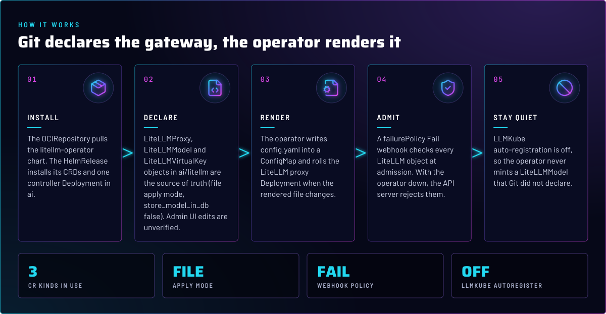
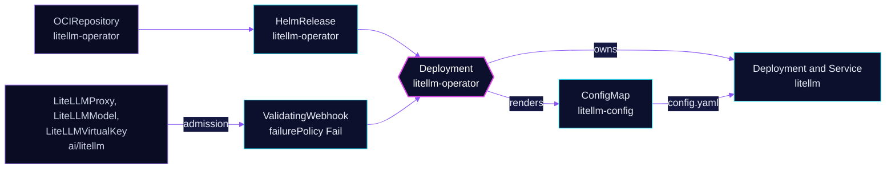

<p align="center">
  
</p>

> **The gateway is a rendered file.** The operator turns the LiteLLM custom resources in `ai/litellm` into the proxy's
> `config.yaml` and its Deployment. Git holds the models, keys and fallbacks. The operator's admission webhook refuses
> any LiteLLM object it cannot validate, so a broken or missing operator stops changes instead of letting them through.

## At a glance

<!-- glance:start -->
<!-- Generated by `readme.py sync`; edit the manifests, not this table. -->
| | |
|---|---|
| **Namespace** | `ai` |
| **Deployed by** | [`litellm-operator`](../../../main/ai/litellm-operator.yaml) (Flux Kustomization) |
| **Helm chart** | `litellm-operator` from `oci://ghcr.io/home-operations/charts/litellm-operator`, values in [`helmrelease.yaml`](app/helmrelease.yaml) |
| **Needed by** | `ai/litellm` |
| **Health checks** | `Deployment/litellm-operator` |
<!-- glance:end -->

## What it does

- **Installs** the litellm-operator chart from `oci://ghcr.io/home-operations/charts/litellm-operator`, including its
  CRDs (`LiteLLMProxy`, `LiteLLMModel`, `LiteLLMVirtualKey`).
- **Renders** the LiteLLM proxy: its Deployment, Service and the `litellm-config` ConfigMap. None of those appear in
  Git. The proxy is declared by the `LiteLLMProxy` CR in `ai/litellm`.
- **Validates** every LiteLLM kind at admission through a `failurePolicy: Fail` webhook.
- **Runs** one controller replica (the chart default) with leader election on. The chart ships its own hardening for this pod.

## Why it is built this way

| Choice | Why |
|---|---|
| **`applyMode: file`, not `api`** | Models render into `config.yaml`, and the Deployment rolls when the rendered hash changes. In `api` mode the running database would become the source of truth, not Git. |
| **`applyMode: file`, `store_model_in_db: false`** | Set on the proxy CR, not here. Models render from the CRs in Git, not from a database. How the Admin UI behaves with model edits is not verified against upstream. |
| **`llmkube.autoRegister: false`** | LLMKube is not installed. A chart default flip must not start creating `LiteLLMModel` objects that nobody declared. |
| **`failurePolicy: Fail`** | With the operator down, the API server rejects LiteLLM objects. A stale or unvalidated gateway config never gets through silently. The cost is that the operator must be up before any LiteLLM change lands. |
| **`dependsOn` in `ai/litellm`** | The LiteLLM Kustomization depends on this one and health-checks the operator Deployment. A HelmRelease health check would stay Ready through a crashloop, so the Deployment is checked instead. |
| **`wait` left unset (false)** | The overlay gates on the Deployment health check instead of `wait: true`. See Known gaps: the skill's rule for operator gates points the other way. |

## How it works

<p align="center">
  
</p>

<details>
<summary><b>Resource graph</b>: every object involved, by name</summary>



</details>

In more detail:

1. Flux pulls the chart through the OCIRepository, then the HelmRelease installs the CRDs and the controller in `ai`.
   The overlay health-checks `Deployment/litellm-operator`, and `ai/litellm` waits on that.
2. The controller watches the LiteLLM CRs. Each change is validated by the webhook at admission, before it is stored.
3. The operator renders `config.yaml` (`litellm-config`) and the proxy Deployment. Only a changed rendered hash rolls the
   proxy.
4. Models, fallbacks and virtual keys are then served by the rendered proxy. Keys are minted per consumer by their
   `LiteLLMVirtualKey` objects (skill `litellm-proxy`).

## Settings that matter

All values are in [`app/helmrelease.yaml`](app/helmrelease.yaml) unless noted. The chart version is pinned in the
`OCIRepository` in the same file, and Renovate bumps it.

| Setting | Value | Why |
|---|---|---|
| `controller.leaderElection.enabled` | `true` | One active controller, so two replicas never render the same config at once. |
| `llmkube.autoRegister` | `false` | LLMKube is not installed here. See the table above. |
| `resources` | requests 25m CPU, 128 Mi; memory limit 256 Mi | Every limit has a request (skill `node-scheduling`). |
| `interval` (HelmRelease) | `30m` | Drift correction. Git changes apply on the Kustomization interval, not this one. |

## Alerts

No alerts are defined in this directory. Operator health shows up as the `litellm-operator` Deployment in the overlay's
health checks, and as admission failures on the LiteLLM objects.

## Operate it

```bash
flux -n ai get ks litellm-operator
kubectl -n ai get deploy litellm-operator
kubectl get crd | grep litellm.home-operations.com
kubectl -n ai get litellmproxy,litellmmodel,litellmvirtualkey
```

## Known gaps

- **The rendered proxy pod has no hardening.** The chart hardens the operator pod. The proxy Deployment the operator
  renders has no securityContext, because the CRD has no field for one. The skill notes the workaround and what
  would reopen it (skill `litellm-proxy`, `references/platform.md`). Found while writing; not changed here.
- **The gate and the health check disagree on shape.** `ai/litellm` depends on this Kustomization, and the overlay
  checks `Deployment/litellm-operator` with `wait` unset (false). The `flux-gitops` skill says an operator that other
  Kustomizations depend on sets `wait: true`, but Flux then ignores `healthChecks`. Which one is intended needs a decision.
  Found while writing; not changed here.
- **`routerSettings` is a free-form passthrough.** The CRD preserves unknown fields, so a typo in the settings is
  accepted at admission and dropped silently in the rendered config. Found while writing; not changed here.

## Files

| File | Holds |
|---|---|
| [`app/helmrelease.yaml`](app/helmrelease.yaml) | `OCIRepository` and HelmRelease: chart source, controller values |
| [`app/kustomization.yaml`](app/kustomization.yaml) | Base resources |
| [`../../../main/ai/litellm-operator.yaml`](../../../main/ai/litellm-operator.yaml) | Flux Kustomization and health check |
| [`../litellm/app/`](../litellm/app/) | The `LiteLLMProxy`, `LiteLLMModel` and `LiteLLMVirtualKey` objects this operator renders |

Upstream: [home-operations litellm-operator](https://github.com/home-operations/litellm-operator) •
[LiteLLM proxy docs](https://docs.litellm.ai/docs/proxy/quick_start)

<!-- branded-readme v1 sources=b12f12610307 -->
