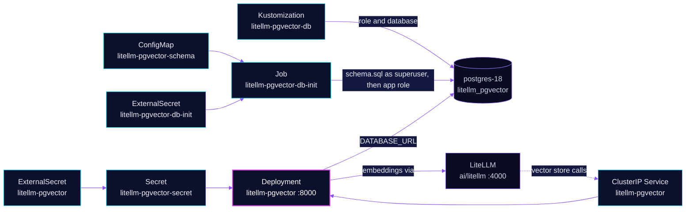

<p align="center">
  
</p>

> **The server holds no data.** litellm-pgvector is the OpenAI-style vector-store server that LiteLLM calls for search.
> Every embedding lives in the `litellm_pgvector` database on the shared Postgres 18 cluster. Restarting or replacing
> the pod loses nothing, and the schema is re-applied by a Job on every change.

## At a glance

<!-- glance:start -->
<!-- Generated by `readme.py sync`; edit the manifests, not this table. -->
| | |
|---|---|
| **Namespace** | `ai` |
| **Deployed by** | [`litellm-pgvector`](../../../main/ai/litellm-pgvector.yaml) (Flux Kustomization) |
| **Helm chart** | `app-template`, values in [`helmrelease.yaml`](app/helmrelease.yaml) |
| **Images** | `ghcr.io/home-operations/postgres-init`, `ghcr.io/skrumbach/litellm-pgvector` |
| **Depends on** | `ai/litellm`, `ai/litellm-pgvector-db`, `database/cloudnative-pg`, `security/onepassword-store` |
| **Secret** | `litellm-pgvector-secret` from onepassword item `litellm-consumer-litellm-pgvector`, `litellm-pgvector` |
| **Secret** | `litellm-pgvector-db-init` from onepassword item `cloudnative-pg`, `litellm-pgvector` |
| **Health checks** | `Deployment/litellm-pgvector` |
<!-- glance:end -->

## What it does

- **Serves** the vector-store API on port 8000 as a ClusterIP Service `litellm-pgvector`. There is no HTTPRoute, so the
  server is not reachable from outside the cluster or through the gateways.
- **Stores** vectors in the `embeddings` table at 2000 dimensions, with an HNSW index on cosine distance. The vector
  store `default` is seeded in the same schema, so its id is fixed in Git.
- **Embeds** search queries through LiteLLM, with `openai/qwen/qwen3-embedding-8b` as the model and the server's own
  LiteLLM key.
- **Creates** its role, database and schema from Git. The `litellm-pgvector-db` Kustomization creates the role and
  database, and the `litellm-pgvector-db-init` Job applies [`schema.sql`](app/resources/schema.sql).

## Why it is built this way

| Choice | Why |
|---|---|
| **2000 dimensions** | pgvector's HNSW index caps `vector` at 2000 dimensions. The model's native 4096 cannot be indexed. The width is set in three places (`EMBEDDING__DIMENSIONS`, `schema.sql`, the LiteLLM key allow-list) and CI checks they agree. |
| **Stateless server, data in Postgres** | The image never creates its own tables and talks to them through raw SQL. Keeping the data in the shared cluster means backups and restores follow the database, not the pod. |
| **Schema applied by a Job, as superuser then app role** | Only a superuser can `CREATE EXTENSION vector`. The Job runs as the superuser, then `SET ROLE` to the app role, so the app owns every object it reads and writes. |
| **The ConfigMap hash suffix is kept** | A `schema.sql` edit renames `litellm-pgvector-schema`, which changes the Job's spec. Flux then recreates the Job and the new SQL runs. Without the suffix, an edit would apply nothing. |
| **`force: enabled` on the Job annotation** | Jobs are immutable. `enabled` is the only value Flux honours for recreating one. |
| **Two Secrets, one per job** | The server gets its connection string and API key. The Job gets only `INIT_POSTGRES_*`, which is the contract `postgres-init` reads. The Job's Secret carries no libpq `PG*` variables, because `postgres-init` loads it too and would silently leave the role without a password. |
| **`/health` is static** | It reports that the process is up. A database outage shows as HTTP 500 on search, not as a failed probe. |
| **`connection_limit=5` in the connection string** | Caps Prisma's pool so one server cannot take most of the shared cluster's connections. |
| **`LITELLM_LOCAL_MODEL_COST_MAP: "True"`** | The server does not fetch the cost map from GitHub at import. Nothing in this app is priced. |

## How it works

<p align="center">
  
</p>

<details>
<summary><b>Resource graph</b>: every object involved, by name</summary>



</details>

In more detail:

1. Flux applies `litellm-pgvector-db` first. It creates the role and database on `postgres-18` with the `vector`
   extension. The Kustomization waits for the `DatabaseRole` and `Database` to report applied.
2. The `litellm-pgvector-db-init` Job runs an init container (`postgres-init`, which reads the `INIT_POSTGRES_*` contract),
   then `psql` on `schema.sql`. The script is idempotent: every statement is `IF NOT EXISTS` or
   `ON CONFLICT DO NOTHING`.
3. The server starts with `DATABASE_URL` and `SERVER_API_KEY` from `litellm-pgvector-secret`. It serves `/health` on
   port 8000 and the vector-store routes behind the same port.
4. LiteLLM reaches the server at `litellm-pgvector.ai.svc.cluster.local:8000`. Its `pg_vector` store uses the `default`
   vector store. Any virtual key with search access can query it (skill `litellm-proxy`).

## Settings that matter

All values are in [`app/helmrelease.yaml`](app/helmrelease.yaml) unless noted.

| Setting | Value | Why |
|---|---|---|
| `EMBEDDING__DIMENSIONS` | `"2000"` | The HNSW limit. Must equal the width in `schema.sql` and stay at or below 2000 while the index exists. CI enforces it. |
| `EMBEDDING__MODEL` | `openai/qwen/qwen3-embedding-8b` | Served by LiteLLM. Changing the model means re-embedding every row, because vectors from two models are not comparable. |
| `EMBEDDING__BASE_URL` | `http://litellm.ai.svc.cluster.local:4000` | In-cluster LiteLLM, never the public listener. |
| `LITELLM_LOCAL_MODEL_COST_MAP` | `"True"` | No network fetch at import. |
| `connection_limit` (in `DATABASE_URL`, from [`app/externalsecret.yaml`](app/externalsecret.yaml)) | `5` | Caps the pool on the shared Postgres cluster. |
| `containers.app.securityContext` | read-only root filesystem, no privilege escalation, all capabilities dropped | Prisma and Python need a writable `/tmp`, which is an `emptyDir`. |
| `defaultPodOptions.securityContext.runAsUser` | `65534` | The image's own non-root user. No `fsGroup`, because there is no owned volume. |
| `resources` | requests 10m CPU, 320 Mi; memory limit 768 Mi | Every limit has a request (skill `node-scheduling`). |
| `install.remediation.retries` | `-1` | Retries the install without a limit. The manifest records no reason for it. |

## Alerts

No alerts are defined in this directory. A database outage appears as HTTP 500 on search, so watch the LiteLLM
logs for vector-store errors (skill `litellm-proxy`).

## Operate it

```bash
flux -n ai get ks litellm-pgvector-db litellm-pgvector
kubectl -n ai get job litellm-pgvector-db-init
kubectl -n ai logs job/litellm-pgvector-db-init -c init-schema
kubectl -n ai get deploy litellm-pgvector
```

Schema edits go through Git only. A Job re-run is the Flux recreate that a `schema.sql` change causes, not a manual
`psql`.

## Known gaps

- **The skill reference names the wrong Postgres.** `litellm-proxy` `references/vector-store.md` says the store lives on
  `postgres-17`. The manifests use `postgres-18-rw` for both the server and the Job. The manifests are the truth; the
  reference is not updated here. Found while writing.

## Files

| File | Holds |
|---|---|
| [`app/helmrelease.yaml`](app/helmrelease.yaml) | Server Deployment, Service, probes, resources |
| [`app/externalsecret.yaml`](app/externalsecret.yaml) | `litellm-pgvector-secret`: connection string, server API key, embedding key |
| [`app/dbinit.yaml`](app/dbinit.yaml) | The schema Job (`force: enabled`) |
| [`app/resources/schema.sql`](app/resources/schema.sql) | Tables, HNSW index, the seeded `default` store |
| [`app/kustomization.yaml`](app/kustomization.yaml) | Base resources and the hashed schema ConfigMap |
| [`../../../main/ai/litellm-pgvector.yaml`](../../../main/ai/litellm-pgvector.yaml) | Flux Kustomization, `litellm-pgvector-db` and dependencies |

Upstream: [BerriAI/litellm-pgvector](https://github.com/BerriAI/litellm-pgvector) •
[pgvector](https://github.com/pgvector/pgvector#hnsw)

<!-- branded-readme v1 sources=bd58ffdfc5c8 -->
