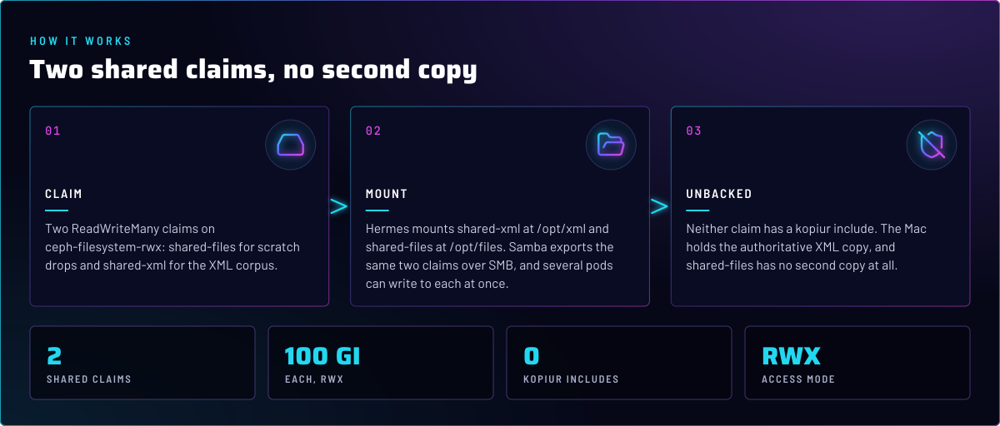
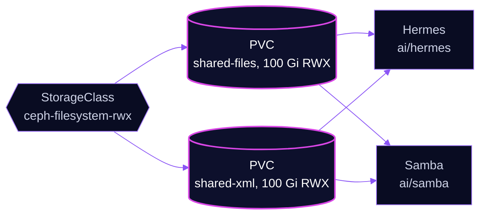

<p align="center">
  
</p>

> **Shared, and not backed up on purpose.** `ai-pvc` creates two ReadWriteMany claims on CephFS. Hermes and Samba mount
> them to share files over the network. Neither claim has a backup, so anything that must survive belongs on a claim that
> does.

## At a glance

<!-- glance:start -->
<!-- Generated by `readme.py sync`; edit the manifests, not this table. -->
| | |
|---|---|
| **Namespace** | `ai` |
| **Deployed by** | [`ai-pvc`](../../../main/ai/pvc.yaml) (Flux Kustomization) |
| **Depends on** | `rook-ceph/rook-ceph-cluster` |
| **Needed by** | `ai/hermes`, `ai/samba` |
| **Volume** | `shared-files` 100Gi on `ceph-filesystem-rwx` |
| **Volume** | `shared-xml` 100Gi on `ceph-filesystem-rwx` |
<!-- glance:end -->

## What it does

- **Creates** `shared-files` (scratch drop folder, exported as `smb://10.50.0.55/files`) and `shared-xml` (the XML
  corpus), both 100 Gi, on `ceph-filesystem-rwx`.
- **Holds** no workload. The claims are mounted by Hermes (`ai/hermes`) and by the Samba pod (`ai/samba`).

## Why it is built this way

| Choice | Why |
|---|---|
| **ReadWriteMany on CephFS** | Hermes and Samba mount the same files at once. A `ceph-block` claim is ReadWriteOnce, so it cannot be shared this way. |
| **No kopiur include** | Both claims are unbacked on purpose. The Mac holds the authoritative XML copy, and `shared-files` is scratch with no second copy. Adding a backup is a decision for the owner, and the manifests say not to add one unasked. |
| **Own Flux Kustomization, `dependsOn` `rook-ceph-cluster`** | The claims cannot bind until the Ceph cluster and its CephFS storage class exist. Hermes and Samba depend on this Kustomization in turn. |
| **`wait: false`** | The claims are created and kept; no other Kustomization waits on their health. |
| **`ceph-filesystem-rwx`, not `ceph-filesystem`** | The RWX storage class for the shared claims. The plain `ceph-filesystem` class is not used for new claims (skill `rook-ceph`). |

## How it works

<p align="center">
  
</p>

<details>
<summary><b>Resource graph</b>: every object involved, by name</summary>



</details>

In more detail:

1. Flux applies the `ai-pvc` Kustomization after `rook-ceph-cluster`. The two claims bind on `ceph-filesystem-rwx`.
2. Hermes mounts `shared-xml` at `/opt/xml` and `shared-files` at `/opt/files`.
3. The Samba pod mounts the same two claims at `/shared` and `/files`, and its init container sets their owner and mode
   (`ai/samba`).
4. Neither claim is in a backup Kustomization. Recovery is whatever the Mac or the source of the files holds.

## Settings that matter

All values are in [`app/shared-files.yaml`](app/shared-files.yaml) and [`app/shared-xml.yaml`](app/shared-xml.yaml).

| Setting | Value | Why |
|---|---|---|
| `accessModes` | `ReadWriteMany` | Several pods mount each claim at once. |
| `storageClassName` | `ceph-filesystem-rwx` | The RWX class. |
| `resources.requests.storage` | `100Gi` on each | A request, not a measured need. The manifests do not record how the size was chosen. |
| No `kopiur` component | (absent) | Deliberate, see above. |

## Alerts

No alerts are defined in this directory.

## Operate it

```bash
flux -n ai get ks ai-pvc
kubectl -n ai get pvc shared-files shared-xml
```

## Known gaps

None found while writing. The two claims are unbacked by design, and the hermes-agent skill owns that decision
(`references/shared-storage.md`).

## Files

| File | Holds |
|---|---|
| [`app/shared-files.yaml`](app/shared-files.yaml) | Scratch drop claim, unbacked |
| [`app/shared-xml.yaml`](app/shared-xml.yaml) | XML corpus claim, unbacked |
| [`app/kustomization.yaml`](app/kustomization.yaml) | Base resources |
| [`../../../main/ai/pvc.yaml`](../../../main/ai/pvc.yaml) | Flux Kustomization and its dependency on Rook |

Upstream: [Rook CephFS storage](https://rook.io/docs/rook/latest-release/Storage-Configuration/Shared-Filesystem-CephFS/filesystem-storage/)

<!-- branded-readme v1 sources=fb3f68be7dfe -->
