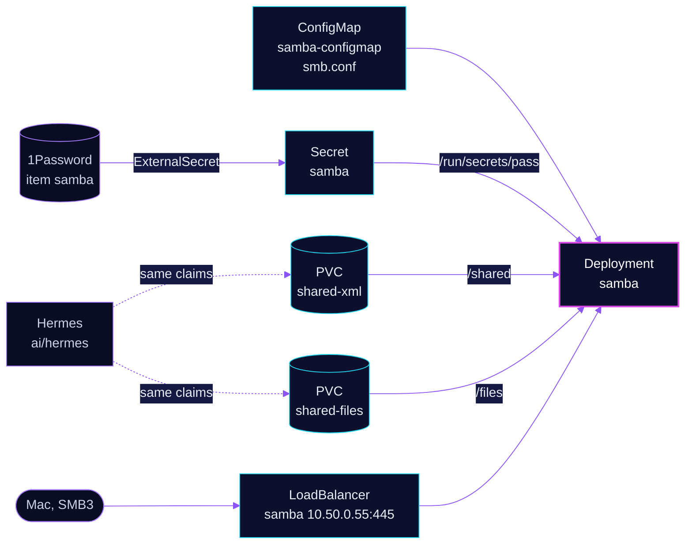

<p align="center">
  
</p>

> **Two folders, one identity.** samba exports the two shares the Hermes agent works in, `/shared` (the XML corpus) and
> `/files` (the scratch drop), over SMB3 on the LAN. Every session authenticates as one account, and every file it writes
> is forced to uid and gid 10000, the same identity the agent runs as. A file the Mac creates is indistinguishable from one
> the agent created.

## At a glance

<!-- glance:start -->
<!-- Generated by `readme.py sync`; edit the manifests, not this table. -->
| | |
|---|---|
| **Namespace** | `ai` |
| **Deployed by** | [`samba`](../../../main/ai/samba.yaml) (Flux Kustomization) |
| **Helm chart** | `app-template`, values in [`helmrelease.yaml`](app/helmrelease.yaml) |
| **Images** | `docker.io/library/alpine`, `ghcr.io/dockur/samba` |
| **Depends on** | `ai/ai-pvc`, `security/onepassword-store` |
| **Secret** | `samba` from onepassword item `samba` |
| **Health checks** | `Deployment/samba` |
<!-- glance:end -->

## What it does

- **Exports** `[xml]` (`/shared`, claim `shared-xml`) and `[files]` (`/files`, claim `shared-files`) from
  [`resources/smb.conf`](app/resources/smb.conf). Both are `valid users = hermes` with guest access off.
- **Listens** on port 445 only, through a `LoadBalancer` Service at the Cilium BGP address `10.50.0.55`. There is no
  HTTPRoute and no envoy listener, so SMB is not reachable from the internet.
- **Authenticates** the single `hermes` account. The password comes from 1Password item `samba` (field `SMB_PASSWORD`)
  and is mounted as a file at `/run/secrets/pass`.
- **Keeps** the file modes right. An init container sets both roots to owner 10000 and setgid `2770`. A postStart hook
  sets them again once smbd is up.

## Why it is built this way

| Choice | Why |
|---|---|
| **One account, one identity** | `force user = hermes` and `force group = smb` resolve to uid and gid 10000. The agent process runs as the same ids, so both sides agree on ownership without ACLs. |
| **`nfs_aces = no`** | With NFS ACEs on (the default), Finder's Get Info can write owner and mode through them. That would undo the forced identity. Load-bearing. |
| **Password as a file, not an env var** | The image reads `/run/secrets/pass` when it is non-empty and falls back to the `PASS` variable otherwise. A file keeps the credential out of the container environment. |
| **Runs as root** | smbd creates the uid-10000 account at boot and switches identity per session to honour `force user`. An unprivileged container cannot do either. This is a deliberate exception to the repo's non-root convention, which is why the exposure is kept to the LAN with no HTTPRoute. |
| **`Recreate`, one replica** | smbd keeps per-file locks in its own process. A second replica would not share that state across the two volumes. |
| **`LoadBalancer` on a Cilium pool address, not envoy** | SMB is not HTTP, and the address is for the LAN only. |
| **No kopiur include** | Both claims are unbacked by design. The overlay says so, and the shares are scratch and corpus data with no second copy (skill `hermes-agent`, `references/shared-storage.md`). |
| **Substitution disabled on `samba-configmap`** | `smb.conf` contains no Flux variables, and the annotation keeps `envsubst` away from the file so a `$` in the config cannot break the Kustomization. |

## How it works

<p align="center">
  
</p>

<details>
<summary><b>Resource graph</b>: every object involved, by name</summary>



</details>

In more detail:

1. Flux applies the `samba` Kustomization after `security/onepassword-store` and `ai/ai-pvc`. Without its volumes the
   share is empty, so the dependency is hard.
2. The init container runs as root, runs `chown` and `chmod` on both roots, and exits. It is not recursive, so a large
   corpus does not block the start.
3. The entrypoint creates the `hermes` account and the `smb` group at uid and gid 10000, reads `smb.conf` verbatim, and
   starts smbd.
4. The postStart hook waits up to 60 seconds for smbd, then sets `2770` on both roots.
5. Clients connect on 445 with SMB3. Writes are forced to 10000:10000 with mode `0664`, directories `0775`.

## Settings that matter

All values are in [`app/helmrelease.yaml`](app/helmrelease.yaml) and [`app/resources/smb.conf`](app/resources/smb.conf)
unless noted.

| Setting | Value | Why |
|---|---|---|
| `USER`, `UID`, `GID` | `hermes`, `10000`, `10000` | The entrypoint creates the account at these ids. They must match the agent's runtime ids, and changing one breaks the contract silently. |
| `force user` / `force group` | `hermes` / `smb` | Every session writes as the agent's identity. |
| `create mask` / `force create mode` | `0664` | Group 10000 keeps write access even when a client asks for less. |
| `directory mask` / `force directory mode` | `0775` | As above, for directories. |
| `inherit permissions` | `no` | Forced modes are the whole contract. The parent's mode is not copied. |
| `fruit:nfs_aces` | `no` | Stops Finder from changing owner and mode through NFS ACEs. |
| `fruit:metadata` | `stream` | AppleDouble metadata goes in an xattr, not a `._` sidecar per file. The corpus has about 300k files. |
| `server min protocol` | `SMB3` | macOS mounts SMB3 on 445 directly. Older dialects are refused. |
| `disable netbios`, `smb ports` | `yes`, `445` | Keeps the LoadBalancer on one port. NetBIOS could not answer anyway. |
| `netbios name` | `HOMELAB-XML` | Kept stable so the Mac's saved mounts do not change. |
| `fsGroup` | `10000`, `OnRootMismatch` | Matches the hermes pod, so the share root converges to gid 10000 whichever pod mounts it first. |
| `lbipam.cilium.io/ips` | `10.50.0.55` | The LAN address the Mac mounts. |
| `CONFIG_TIMEZONE` (overlay) | `America/New_York` | Log timestamps. |
| `resources` | requests 50m CPU, 128 Mi; memory limit 1 Gi | Every limit has a request (skill `node-scheduling`). |

## Alerts

No alerts are defined in this directory. The Deployment is the health check in the overlay. A TCP probe on 445 is the
liveness and readiness check.

## Operate it

```bash
flux -n ai get ks samba
kubectl -n ai get deploy samba -o wide
kubectl -n ai get svc samba -o wide              # EXTERNAL-IP should be 10.50.0.55
```

A share that mounts but shows files the agent cannot read is an ownership problem. Check the modes and owners under
`/shared` and `/files` from inside the pod before changing the config (skill `hermes-agent`, `references/shared-storage.md`).

## Known gaps

None found while writing. The ownership contract is repeated in both share sections on purpose, because smbd has no
share-level include.

## Files

| File | Holds |
|---|---|
| [`app/helmrelease.yaml`](app/helmrelease.yaml) | Deployment, init container, LoadBalancer Service, mounts |
| [`app/resources/smb.conf`](app/resources/smb.conf) | Shares, the ownership contract, macOS interop |
| [`app/externalsecret.yaml`](app/externalsecret.yaml) | `samba` Secret with the password file |
| [`app/kustomization.yaml`](app/kustomization.yaml) | Base resources and the `samba-configmap` generator |
| [`../../../main/ai/samba.yaml`](../../../main/ai/samba.yaml) | Flux Kustomization, health check, dependencies |
| [`../pvc/`](../pvc/) | The `shared-xml` and `shared-files` claims |

Upstream: [dockur/samba](https://github.com/dockur/samba) •
[Samba `vfs_fruit`](https://www.samba.org/samba/docs/current/man-html/vfs_fruit.8.html)

<!-- branded-readme v1 sources=6efe88912c4b -->
