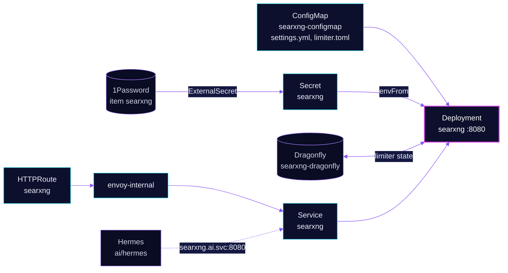

<p align="center">
  
</p>

> **Search without a paid API.** SearXNG aggregates results from the enabled search engines and returns one page. Hermes
> calls it as its web-search backend, and people can use the same UI on the internal gateway. No route is on the public listener, and the
> limiter stops a runaway client from exhausting the upstream engines.

## At a glance

<!-- glance:start -->
<!-- Generated by `readme.py sync`; edit the manifests, not this table. -->
| | |
|---|---|
| **Namespace** | `ai` |
| **Deployed by** | [`searxng`](../../../main/ai/searxng.yaml) (Flux Kustomization) |
| **Helm chart** | `app-template`, values in [`helmrelease.yaml`](app/helmrelease.yaml) |
| **Images** | `ghcr.io/searxng/searxng` |
| **Depends on** | `database/dragonfly-operator`, `security/onepassword-store` |
| **Secret** | `searxng` from onepassword item `searxng` |
| **Health checks** | `Deployment/searxng` |
<!-- glance:end -->

## What it does

- **Serves** the SearXNG UI and JSON API on port 8080. Hermes uses the in-cluster Service `searxng` at
  `searxng.ai.svc.cluster.local:8080`.
- **Routes** `search.${SECRET_DOMAIN}` and `searxng.${SECRET_DOMAIN}` through `envoy-internal` only. There is no
  external listener.
- **Limits** requests with the built-in limiter and bot detection. Counters are kept in Dragonfly through
  `SEARXNG_REDIS_URL`, and the LAN ranges `10.0.0.0/8` and `192.168.0.0/16` are passed through.
- **Proxies** images (`image_proxy: true`) so the browser does not fetch from the engines' image hosts directly.
- **Checks** itself with Gatus against `https://search.${SECRET_DOMAIN}/stats`.

## Why it is built this way

| Choice | Why |
|---|---|
| **Internal gateway only** | Search is a LAN service for Hermes and the household. The route is on `envoy-internal`, which is not the public listener. |
| **`public_instance: false`** | Set in `settings.yml`. What the flag changes upstream is not verified here. Exposure is controlled by the route, which is on `envoy-internal` only. |
| **Limiter on, with LAN ranges passed** | The limiter protects the upstream engines from a runaway client. Clients in the LAN and `10/8` ranges bypass bot detection and the limiter, so Hermes and the household are not throttled. |
| **Dragonfly for limiter state** | The limiter needs a Redis-protocol store. The `dragonfly` component gives this app its own Dragonfly instance, `searxng-dragonfly`, with two replicas and a 512 MiB cache cap. |
| **Read-only root filesystem, `/tmp` on `emptyDir`** | The image writes only to `/tmp`. The config is a read-only ConfigMap. |
| **`RollingUpdate`, not `Recreate`** | The app has no volume, so a new pod can start before the old one stops. |
| **Settings from a ConfigMap, not from env** | `settings.yml` holds the engine list and UI choices. It is a file so that the change is one reviewed diff, and Reloader restarts the pod on change. |
| **Secret key as an env var** | Only `SEARXNG_SECRET` is needed at runtime. It is rendered from the 1Password item and not written to Git. |

## How it works

<p align="center">
  
</p>

<details>
<summary><b>Resource graph</b>: every object involved, by name</summary>



</details>

In more detail:

1. Flux applies the `searxng` Kustomization after `dragonfly-operator` and `security/onepassword-store`. The `dragonfly`
   component adds the `searxng-dragonfly` instance that the limiter uses.
2. The pod starts with the ConfigMap files at `/etc/searxng/` and the secret key in its environment. The `/tmp` mount is
   the only writable path.
3. A query reaches uWSGI on port 8080. The limiter checks the client IP first, using the `X-Forwarded-For` value that
   Envoy sets, then the enabled engines are queried in parallel.
4. Gatus requests `/stats` through the search hostname, so DNS and the gateway are part of the check.

## Settings that matter

All values are in [`app/helmrelease.yaml`](app/helmrelease.yaml) unless noted. The engine and UI choices are in
[`app/resources/settings.yml`](app/resources/settings.yml) and the limiter in
[`app/resources/limiter.toml`](app/resources/limiter.toml).

| Setting | Value | Why |
|---|---|---|
| `server.limiter` | `true` (settings.yml) | Protects the upstream engines from a runaway client. |
| `server.public_instance` | `false` (settings.yml) | Set explicitly. The upstream effect is not verified here. |
| `server.image_proxy` | `true` (settings.yml) | Images are fetched through SearXNG, not from the engines' hosts. |
| `server.method` | `GET` (settings.yml) | Pinned to GET. The inline comment links the upstream pull request the setting follows. |
| `botdetection.ip_lists.pass_ip` | `10.0.0.0/8`, `192.168.0.0/16` (limiter.toml) | Clients in these ranges bypass bot detection and the limiter. |
| `real_ip.x_for` | `1` (limiter.toml) | Trusts one forwarded hop, the Envoy gateway. |
| `SEARXNG_REDIS_URL` | `redis://searxng-dragonfly:6379` | The limiter's store, the app's own Dragonfly instance from the `dragonfly` component. |
| `UWSGI_WORKERS`, `UWSGI_THREADS` | `4`, `2` | Concurrency for the web process. |
| `containers.main.securityContext.capabilities` | drop `ALL`, add `CHOWN`, `SETGID`, `SETUID`, `DAC_OVERRIDE` | The image's entrypoint needs these to change ownership and drop privileges. The manifest does not record which step needs which capability. |
| `resources` | requests 10m CPU, 512 Mi; memory limit 2 Gi | Every limit has a request (skill `node-scheduling`). |
| `strategy` | `RollingUpdate` | No volume, so a rolling update is safe. |

## Alerts

No alerts are defined in this directory. Gatus is the availability signal: the route check is on `/stats` with status
200.

## Operate it

```bash
flux -n ai get ks searxng
kubectl -n ai get deploy searxng
kubectl -n ai logs deploy/searxng --tail=50
curl -s https://search.${SECRET_DOMAIN}/stats | head        # from the LAN
```

## Known gaps

- **The Gatus group is hardcoded.** The overlay substitutes `GATUS_GROUP`, but the route annotation writes `group: ai`
  as a literal, so the substitution does nothing. Found while writing; not changed here.

## Files

| File | Holds |
|---|---|
| [`app/helmrelease.yaml`](app/helmrelease.yaml) | Deployment, Service, route, Gatus annotation, mounts |
| [`app/externalsecret.yaml`](app/externalsecret.yaml) | `searxng` Secret with `SEARXNG_SECRET` |
| [`app/resources/settings.yml`](app/resources/settings.yml) | Engines, UI, plugins, hostname priorities |
| [`app/resources/limiter.toml`](app/resources/limiter.toml) | Limiter, bot detection, LAN pass list |
| [`app/kustomization.yaml`](app/kustomization.yaml) | ConfigMap generator and the Flux-required install and upgrade patch |
| [`../../../main/ai/searxng.yaml`](../../../main/ai/searxng.yaml) | Flux Kustomization, `dragonfly` component, dependencies |

Upstream: [SearXNG docs](https://docs.searxng.org/) •
[SearXNG settings reference](https://docs.searxng.org/admin/settings/index.html)

<!-- branded-readme v1 sources=e8ebfa1222ee -->
