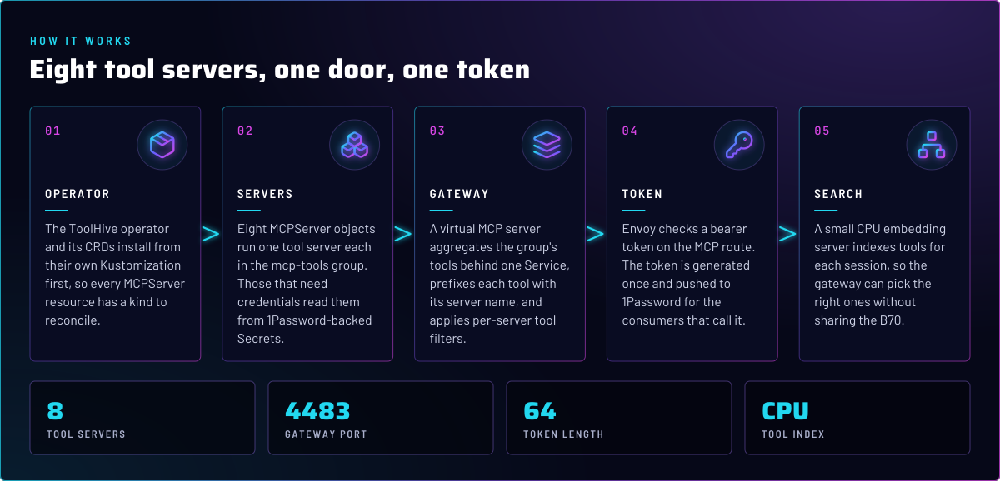
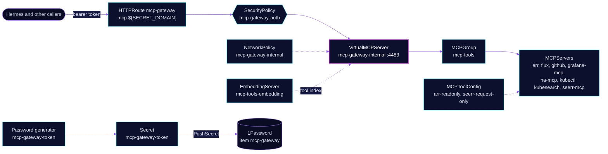

<p align="center">
  
</p>

> **One door for the agent's tools.** ToolHive runs eight MCP tool servers in the `mcp-tools` group and puts a virtual
> MCP server (vmcp) in front of them. Hermes and other callers reach every tool through one bearer-protected route on the
> internal gateway. Each server exposes only the tools its filter allows, and the gateway needs no static token of its
> own.

## At a glance

<!-- glance:start -->
<!-- Generated by `readme.py sync`; edit the manifests, not this table. -->
| | |
|---|---|
| **Namespace** | `ai` |
| **Deployed by** | [`toolhive-crds`](../../../main/ai/toolhive.yaml), [`toolhive`](../../../main/ai/toolhive.yaml), [`toolhive-config`](../../../main/ai/toolhive.yaml), [`toolhive-mcp-servers`](../../../main/ai/toolhive.yaml) (Flux Kustomization) |
| **Helm chart** | `toolhive-operator` from `oci://ghcr.io/stacklok/toolhive/toolhive-operator`, values in [`helmrelease.yaml`](app/helmrelease.yaml) |
| **Helm chart** | `toolhive-operator-crds` from `oci://ghcr.io/stacklok/toolhive/toolhive-operator-crds`, values in [`helmrelease.yaml`](crds/helmrelease.yaml) |
| **Depends on** | `ai/toolhive`, `ai/toolhive-config`, `ai/toolhive-crds`, `security/onepassword-store` |
| **Needed by** | `ai/toolhive`, `ai/toolhive-config`, `ai/toolhive-mcp-servers` |
| **Route** | `mcp.${SECRET_DOMAIN}` via `envoy-internal` (Gatus probed) |
| **Secret** | `mcp-gateway-token` generated in-cluster by `Password/mcp-gateway-token` |
| **Secret** | `toolhive-sonarr` from onepassword item `sonarr` |
| **Secret** | `toolhive-radarr` from onepassword item `radarr` |
| **Secret** | `toolhive-prowlarr` from onepassword item `prowlarr` |
| **Secret** | `toolhive-lidarr` from onepassword item `lidarr` |
| **Secret** | `toolhive-github` from onepassword item `hermes` |
| **Secret** | `toolhive-grafana` from onepassword item `grafana-mcp` |
| **Secret** | `toolhive-home-assistant` from onepassword item `home-assistant` |
| **Secret** | `toolhive-seerr` from onepassword-automation item `seerr-api` |
| **Pushes to 1Password** | `mcp-gateway` |
| **Health checks** | `Deployment/arr`, `Deployment/flux`, `Deployment/github`, `Deployment/grafana-mcp`, `Deployment/ha-mcp`, `Deployment/kubectl`, `Deployment/kubesearch`, `Deployment/mcp-gateway-internal`, `Deployment/seerr-mcp`, `Deployment/toolhive-operator`, `StatefulSet/arr`, `StatefulSet/flux`, `StatefulSet/github`, `StatefulSet/grafana-mcp`, `StatefulSet/ha-mcp`, `StatefulSet/kubectl`, `StatefulSet/kubesearch`, `StatefulSet/mcp-tools-embedding`, `StatefulSet/seerr-mcp` |
| **Alerts** | 2: `MCPGatewayMemoryGrowth`, `MCPGatewayMemoryNearLimit` |
<!-- glance:end -->

## What it does

- **Runs** the ToolHive operator (`toolhive-operator` chart) and its CRDs (`toolhive-operator-crds`), in a separate
  `toolhive-crds` Kustomization that everything else waits on.
- **Runs** eight `MCPServer` objects in the `mcp-tools` `MCPGroup`: `arr`, `flux`, `github`, `grafana-mcp`, `ha-mcp`,
  `kubectl`, `kubesearch` and `seerr-mcp`. Each runs as a proxy Deployment plus a backend StatefulSet, behind a Service.
- **Aggregates** their tools in one `VirtualMCPServer`, `mcp-gateway-internal`, on port 4483. Tool names are prefixed
  with the server name (`{workload}_`), so two servers can ship a tool with the same name.
- **Filters** tools per server with `MCPToolConfig` objects. `arr-readonly` allows the read tools plus several `*_search` tools (unverified, see Known gaps), and
  `seerr-request-only` allows search, details and request but never approve or delete.
- **Exposes** the gateway as `mcp.${SECRET_DOMAIN}` on `envoy-internal`. A `SecurityPolicy` checks the bearer token on the
  `mcp` rule. The `health` rule stays open for Gatus.
- **Indexes** tools with a `mcp-tools-embedding` EmbeddingServer (`BAAI/bge-small-en-v1.5`, CPU).

## Why it is built this way

| Choice | Why |
|---|---|
| **Bearer token enforced by Envoy, not vmcp** | vmcp has no static-token mode, so the `SecurityPolicy` on the route is the only check. A `NetworkPolicy` admits the internal gateway and Prometheus to port 4483, and admits DNS, ToolHive pods and the embedding server with no port limit (their replies arrive on ephemeral ports). The NetworkPolicy selects only the `virtualmcpserver` pods, so it protects the gateway's port 4483 and nothing else. The Service therefore cannot be used to skip the token from elsewhere. |
| **Token generated, not stored** | A `Password` generator makes a 64-character token once (`refreshPolicy: CreatedOnce`). A `PushSecret` writes it to 1Password item `mcp-gateway` for consumers. Git holds neither the token nor a value to derive it from. |
| **`deletionPolicy: None` on the PushSecret** | Pruning this object must never delete the item consumers read. |
| **Per-server tool filters** | `arr` is read-only and Seerr cannot approve or delete a request. Hermes queues titles through Seerr only, so there is one audited write path. |
| **Read-only `kubectl` and `flux` identities** | Both bind to `kubectl-mcp-readonly`, a ClusterRole that grants `get`, `list` and `watch` and omits core Secrets. The `flux` server runs with `--read-only` as well. |
| **Telemetry on the gateway** | `MCPTelemetryConfig` `prometheus` serves `/metrics` on the main port 4483, and the PodMonitor scrapes every 15 s. |
| **Memory alerts before the limit** | `MCPGatewayMemoryGrowth` predicts a limit breach 48 h ahead. The gateway has shown a slow climb, so a restart or a limit change should come before an OOMKill drops every session. |
| **CPU embedder, not the B70** | The tool index is a small CPU model. Qwen3-Embedding is too slow for a 30-second session handshake, and the GPU is shared with chat (skill `ai-stack`). |
| **`tmp` emptyDir on vmcp** | The optimizer builds a SQLite FTS5 index per session. The root filesystem is read-only, so without `/tmp` the index fails with a disk I/O error. |

## How it works

<p align="center">
  
</p>

<details>
<summary><b>Resource graph</b>: every object involved, by name</summary>



</details>

In more detail:

1. Flux applies `toolhive-crds` first, then `toolhive` (the operator). `toolhive-config` depends on the operator and on
   `security/onepassword-store`. `toolhive-mcp-servers` depends on the config.
2. Each MCPServer runs in its own Deployment and Service, and joins `mcp-tools` through `groupRef`. Servers that need
   credentials get them from per-server ExternalSecrets.
3. The VirtualMCPServer lists the group's tools and serves them on 4483 with the server-name prefix. It accepts anonymous
   callers inside the cluster, which is why the NetworkPolicy matters.
4. The route checks the bearer token for the `mcp` rule. The `health` rule answers without a token, so Gatus can probe it.
5. The gateway's `/health` only shows that the process and the route are up. Session health is a separate Gatus check
   (`ToolHive MCP Session`), because a healthy gateway can still fail to open a session.

## Settings that matter

All values are in the files named in the Files table. Pod-level values are in
[`config/virtualmcpserver.yaml`](config/virtualmcpserver.yaml) and the MCP servers under
[`mcp-servers/`](mcp-servers/).

| Setting | Value | Why |
|---|---|---|
| `aggregation.conflictResolution` | `prefix`, `{workload}_` | Tools from different servers never collide. |
| `incomingAuth.type` | `anonymous` | vmcp has no static-token mode. The token check lives on the route. |
| `resources` (vmcp) | requests 256 Mi memory; limit 2 Gi | The optimizer's session index and the tool list grow with the group. |
| `arr-readonly` filter | read tools (`get_*`, queue, calendar, status) plus `*_search` tools | No `add_*` and nothing that deletes. The `*_search` tools are not verified as lookups (see Known gaps). Hermes queues titles through Seerr. |
| `seerr-request-only` filter | `search_media`, `get_media_details`, `request_media` | Approve, decline and delete are never exposed. |
| `GITHUB_READ_ONLY` | `"1"` | The second read-only layer on top of the read-only token. |
| `--disable-write` (grafana-mcp) | set | Defence in depth on top of a Viewer-scoped service account token. |
| `kubectl-mcp` `MCP_ALLOW_UNAUTHENTICATED` | `"true"` | The server refuses a non-loopback bind without auth, and the proxy reaches the pod IP. The read-only ServiceAccount (`kubectl-mcp-readonly`, [`mcp-servers/kubectl-mcp/rbac.yaml`](mcp-servers/kubectl-mcp/rbac.yaml)) and `--read-only` are the controls. The NetworkPolicy does not cover this pod. |
| `EmbeddingServer` resources | request 1 CPU; limit 4 CPU | The request keeps a saturated node inside the 30-second handshake budget. |
| Gateway token | 64 characters, `CreatedOnce` | Generated once. Rotation is a deliberate delete of the ExternalSecret, which mints a new token. |

## Alerts

| Alert | Fires when | First look |
|---|---|---|
| `MCPGatewayMemoryGrowth` | the vmcp working set is projected to reach its limit within 48 h, for 1 h | A leak-like climb. Restart the pod or raise the limit in [`config/virtualmcpserver.yaml`](config/virtualmcpserver.yaml). |
| `MCPGatewayMemoryNearLimit` | the working set is above 80% of the limit, for 15 min | An OOMKill would drop every open MCP session. |

## Operate it

```bash
flux -n ai get ks toolhive-crds toolhive toolhive-config toolhive-mcp-servers
kubectl -n ai get mcpserver,virtualmcpserver,embeddingserver,mcpgroup
kubectl -n ai get pods -l app.kubernetes.io/instance=mcp-gateway-internal
```

Session health is not visible in these objects. Check the `ToolHive MCP Session` Gatus endpoint, and the wider runbook is
skill `ai-stack` (`references/toolhive.md`).

## Known gaps

- **Some tool images are not pinned.** `github-mcp` names `ghcr.io/github/github-mcp-server` with no tag and no digest, so
  each restart pulls whatever is current. `ha-mcp` has a version tag and no digest. The `node:26-alpine` image used by
  `arr` and `seerr-mcp` has a tag only. Renovate can track the tagged ones, not the untagged one. Found while writing;
  not changed here.
- **Two servers install their npm package at start.** `arr` pins its npm package version, but `seerr-mcp` runs
  `npx -y "@jhomen368/overseerr-mcp"` with no version, so each start installs the current release. Found while writing;
  not changed here.
- **`talos-mcp` is defined but not deployed.** Its directory has an MCPServer and a Talos ServiceAccount, and the
  `mcp-servers/kustomization.yaml` comment marks it as commented out until its prerequisites exist. The glance table
  lists it; the cluster does not run it.

- **The `arr-readonly` filter contradicts its own comment.** The `MCPToolConfig` comment says no indexer-search triggers,
  but the filter list includes `sonarr_search`, `radarr_search`, `lidarr_search` and `arr_search_all`.
  Whether those tools trigger searches is unverified. Found while writing; not changed here.
- **The kustomization comment names the wrong 1Password item field.** `mcp-servers/kustomization.yaml` says `seerr-mcp`
  needs the item `seerr` to carry `SEERR_API_KEY`, but `seerr-mcp/externalsecret.yaml` reads item `seerr-api`. Found
  while writing; not changed here.

## Files

| File | Holds |
|---|---|
| [`app/helmrelease.yaml`](app/helmrelease.yaml) | The operator chart source and values |
| [`crds/helmrelease.yaml`](crds/helmrelease.yaml) | The CRD chart |
| [`config/virtualmcpserver.yaml`](config/virtualmcpserver.yaml) | The gateway: group, auth mode, telemetry, `/tmp` |
| [`config/mcpgroup.yaml`](config/mcpgroup.yaml) | The `mcp-tools` group |
| [`config/embeddingserver.yaml`](config/embeddingserver.yaml) | The CPU tool index |
| [`config/httproute.yaml`](config/httproute.yaml) | The `mcp.${SECRET_DOMAIN}` route, Homepage and Gatus annotations |
| [`config/securitypolicy.yaml`](config/securitypolicy.yaml) | The bearer-token check on the `mcp` rule |
| [`config/networkpolicy.yaml`](config/networkpolicy.yaml) | Who can reach port 4483 |
| [`config/pushsecret.yaml`](config/pushsecret.yaml) and [`config/externalsecret.yaml`](config/externalsecret.yaml) | The generated gateway token and its 1Password item |
| [`config/prometheusrule.yaml`](config/prometheusrule.yaml), [`config/podmonitor.yaml`](config/podmonitor.yaml), [`config/mcp-telemetry.yaml`](config/mcp-telemetry.yaml) | Gateway metrics and alerts |
| [`mcp-servers/`](mcp-servers/) | One directory per MCPServer, with its ExternalSecret and tool filter |
| [`../../../main/ai/toolhive.yaml`](../../../main/ai/toolhive.yaml) | The four Flux Kustomizations and their dependencies |

Upstream: [ToolHive docs](https://docs.stacklok.com/toolhive/) •
[Model Context Protocol](https://modelcontextprotocol.io/)

<!-- branded-readme v1 sources=72ada1d64f97 -->
