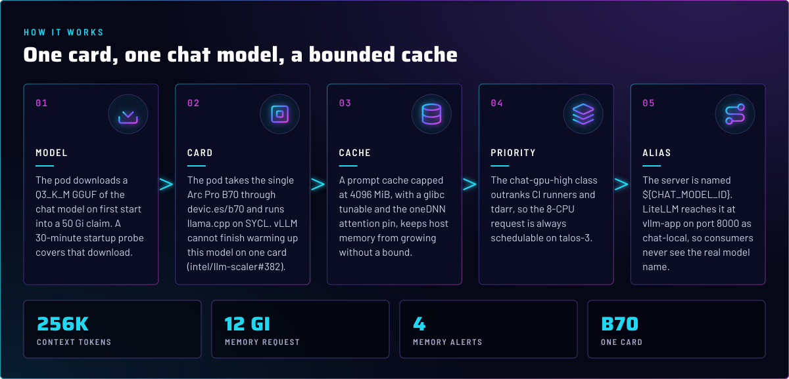
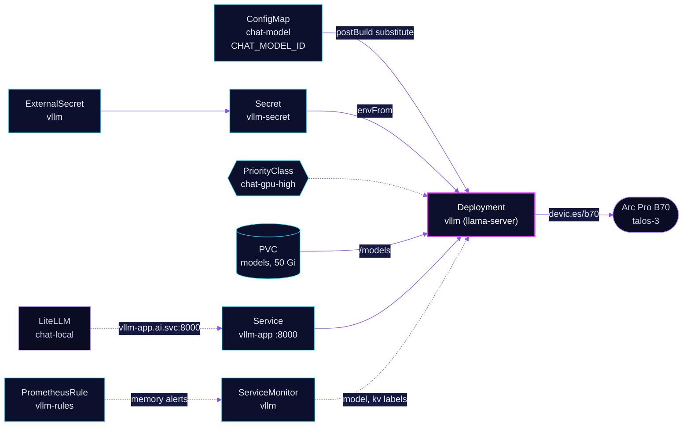

<p align="center">
  
</p>

> **The chat model, on one card.** The `vllm` workload runs the household chat model on the Arc Pro B70 in talos-3, using
> llama.cpp's SYCL backend. The `vllm` name is kept so consumers do not move; the server is llama.cpp, not the vLLM engine. LiteLLM is the
> only client, and it reaches the model through the `chat-local` alias. Memory is bounded on purpose, and the alerts
> exist because the bounds are the part that fails quietly.

## At a glance

<!-- glance:start -->
<!-- Generated by `readme.py sync`; edit the manifests, not this table. -->
| | |
|---|---|
| **Namespace** | `ai` |
| **Deployed by** | [`vllm`](../../../main/ai/vllm.yaml) (Flux Kustomization) |
| **Helm chart** | `app-template`, values in [`helmrelease.yaml`](app/helmrelease.yaml) |
| **Images** | `docker.io/intel/llm-scaler-vllm`, `ghcr.io/ggml-org/llama.cpp` |
| **Depends on** | `rook-ceph/rook-ceph` |
| **Needed by** | `ai/litellm` |
| **Secret** | `vllm-secret` from onepassword item `vllm` |
| **Health checks** | `Deployment/vllm` |
| **Alerts** | 4: `VLLMMemoryApproachingLimit`, `VLLMMemoryExceedsRequest`, `VLLMMemoryRetainedAboveBound`, `VLLMMemoryCriticalLimit` |
<!-- glance:end -->

## What it does

- **Serves** the chat model with llama.cpp `llama-server` on port 8000, with `--jinja` chat templates, `--metrics` and
  a 262144-token context (the model's maximum).
- **Downloads** the GGUF once into the 50 Gi `models` claim (`LLAMA_CACHE=/models/llama`). The download runs on first start.
- **Names** the loaded model with `--alias ${CHAT_MODEL_ID}`, from the `chat-model` ConfigMap. The real name is never typed
  in this directory (skill `ai-stack` and [`ai/AGENTS.md`](../AGENTS.md)).
- **Holds** a `vllm-embed` controller at `replicas: 0`. It runs `intel/llm-scaler-vllm` (real vLLM) with an embedding model
  and is not live. Re-enabling it is a live re-test, not a one-line change. It is excluded from the health check and the
  memory alerts.
- **Alerts** on host memory. Four rules in [`prometheusrule.yaml`](app/prometheusrule.yaml) cover the approach to the
  limit, use above the request, retained memory above the cache bound, and a critical ratio.

## Why it is built this way

| Choice | Why |
|---|---|
| **llama.cpp, not vLLM** | vLLM cannot finish warming up this model on one B70 (intel/llm-scaler#382). llama.cpp SYCL runs it. The controller name `vllm` stays so the Service does not move. |
| **`--cache-ram 4096` and the glibc tunable together** | With `--cache-ram` absent, llama.cpp restores an 8192 MiB default with no log line. A memory limit cannot stop that, because the kernel kills the pod at the page fault. The tunable is the second half of the fix, and the two are not used separately. |
| **`GGML_SYCL_FA_ONEDNN: "0"`** | The oneDNN attention path leaks host memory with no OOM. The value must be numeric: `"false"` and `"off"` leave the leak on (manifest comment; skill `b70-llm-serving` tripwire 2). |
| **`f16` KV, not `q8_0`** | Decode is 12 to 16% faster at 16K context and above, and about 9 GiB of VRAM stays free. The `kv` label on the ServiceMonitor follows this flag. |
| **Q3_K_M, not the IQ3_XXS build** | The K-quant decodes faster on SYCL at the same quality on the graded suite, so the faster file is the one shipped. The model is not abliterated. |
| **No `--parallel` or `--kv-unified` pin** | Auto selects four slots and a unified KV, and an explicit pin overcommits KV and collapses decode. |
| **`--ubatch-size 4096`, `--batch-size 8192`** | Prefill is faster at 16K and 64K, decode is unchanged, and concurrent requests finish sooner. The image tag is re-measured before any bump. |
| **`--spec-type ngram-mod`, no draft model** | Drafts come from n-grams already in the context, so there is no VRAM cost. Draft-MTP was slower at short context and under concurrency. |
| **`-t 8`, CPU request 8** | Without `-t`, llama.cpp starts one thread per hardware thread on talos-3, and the spinning extras thrash when tdarr holds cores. The request is the CFS weight against tdarr on the same node. |
| **`chat-gpu-high` priority (1100000)** | Outranks CI runners and tdarr, so a runner burst cannot leave the chat pod Pending on restart. `PreemptLowerPriority` lets it displace them. |
| **`Recreate` strategy** | The card is one device. Two copies would both load weights. |
| **Memory request 12 Gi, limit 48 Gi** | The request is the reservation: baseline plus the cache bound. The limit is headroom so a prefill spike is not an OOMKill. Raising the request to silence a retained-memory alert hides a leak. |
| **`timeout: 30m` on the HelmRelease** | The first download takes about 16 GiB over five minutes, and the Helm default of five minutes rolled a model swap back mid-download. |

## How it works

<p align="center">
  
</p>

<details>
<summary><b>Resource graph</b>: every object involved, by name</summary>



</details>

In more detail:

1. Flux applies the `vllm` Kustomization after `rook-ceph`. The HelmRelease renders the chat controller, the
   `vllm-embed` controller at zero replicas, two Services, and the two claims.
2. The chat pod starts, downloads the GGUF if it is not on the claim, loads the weights to the card, and opens port 8000.
   The startup probe allows 30 minutes, then readiness and liveness poll `/health` every 10 seconds.
3. LiteLLM's `chat-local` alias points at `vllm-app.ai.svc.cluster.local:8000/v1`. Consumers pick `chat-local`, so a model
   swap changes one ConfigMap value and one HelmRelease argument.
4. The ServiceMonitor scrapes `/metrics` every 30 seconds and stamps the `model` and `kv` labels that the dashboards group
   by (skill `observability`).

## Settings that matter

All values are in [`app/helmrelease.yaml`](app/helmrelease.yaml) unless noted. The flag pins and their measured reasons
are in skill `b70-llm-serving`, `references/flags.md`.

| Setting | Value | Why |
|---|---|---|
| `-hf` | the chat model's Hugging Face repo and quant, `Q3_K_M` | The swap point, paired with `CHAT_MODEL_ID`. The real repo name is kept in the HelmRelease only, per [`ai/AGENTS.md`](../AGENTS.md). |
| `--alias` | `${CHAT_MODEL_ID}` | The real name, defined once in the `chat-model` ConfigMap. |
| `--ctx-size` | `262144` | The model's maximum. |
| `--cache-type-k`, `--cache-type-v` | `f16`, `f16` | Faster decode at long context than `q8_0`. |
| `--cache-ram` | `4096` | Bounds the prompt cache. Absence restores an 8192 MiB default with no log line. |
| `--cache-reuse` | `256` | No effect while the mmproj is loaded. Dropping the mmproj removes vision. |
| `-b`, `-ub` | `8192`, `4096` | Prefill speed at long context. |
| `--spec-type` | `ngram-mod` | Draft from context, no draft model. |
| `-t` | `8` | Threads, matched to the CPU request. |
| `GLIBC_TUNABLES` | `glibc.malloc.mmap_threshold=131072` | The second half of the `--cache-ram` fix. Do not ship one without the other. |
| `GGML_SYCL_FA_ONEDNN` | `"0"` | Numeric only. Stops the oneDNN attention leak. |
| `SYCL_PI_LEVEL_ZERO_USE_IMMEDIATE_COMMANDLISTS` | `1` | Set with the other Level Zero variables in the manifest. |
| `resources.requests` | `cpu: 8`, `memory: 12Gi`, `devic.es/b70: 1` | CFS weight against tdarr, the memory reservation, and the card. |
| `resources.limits.memory` | `48Gi` | Headroom for a prefill spike, not a bound on the leak. |
| `strategy` | `Recreate` | One card. |
| `timeout` | `30m` | The first download (about 16 GiB) outlasts the Helm default. |
| `terminationGracePeriodSeconds` | `60` | Grace period before the pod is killed on a restart. |
| `vllm-embed` `replicas` | `0` | Not live. It shares the one card with chat. |

## Alerts

From [`app/prometheusrule.yaml`](app/prometheusrule.yaml). The rules exclude `vllm-vllm-embed-*` pods.

| Alert | Fires when | First look |
|---|---|---|
| `VLLMMemoryApproachingLimit` | the working set is projected past the limit within 24 h, and is above 60% of it, for 1 h | Recent growth. Plan capacity or find the source before the critical threshold. |
| `VLLMMemoryExceedsRequest` | the working set is above the memory request for 30 min | Either the request is wrong or host memory is leaking. If the retained-memory alert is firing too, it is a leak. |
| `VLLMMemoryRetainedAboveBound` | the lowest working set over 3 h is above 8 GiB, and the current value is too, for 1 h | The oneDNN leak is the first suspect. Check that the running image honours `GGML_SYCL_FA_ONEDNN=0`. |
| `VLLMMemoryCriticalLimit` | the working set is above 85% of the limit for 15 min | Act now. This is the critical backstop. |

The thresholds are tied to `--cache-ram`. Move the 8 GiB floor with the flag, in the same change.

## Operate it

```bash
flux -n ai get ks vllm
kubectl -n ai get deploy vllm -o jsonpath='{.spec.template.spec.containers[0].args}'   # look for --alias
kubectl -n ai get cm chat-model -o jsonpath='{.data.CHAT_MODEL_ID}'
kubectl -n ai port-forward svc/vllm-app 18080:8000 &
curl -s localhost:18080/v1/models | jq '.data[].id'
```

A swap is a two-line change: the `-hf` repo in the HelmRelease and `CHAT_MODEL_ID` in `chat-model.yaml`, merged
together. The chat pod restarts once, which takes about four minutes (skill `b70-llm-serving`, `references/flags.md`, and
[`ai/AGENTS.md`](../AGENTS.md)).

## Known gaps

- **The skill disagrees with itself on the Service name.** `b70-llm-serving` `SKILL.md` line 10 says the Service is
  still named `vllm`, while `references/flags.md` line 34 says the backend is `vllm-app`. Git uses `vllm-app`: the
  HelmRelease key is `app`, LiteLLM's `apiBase` uses `vllm-app.ai.svc.cluster.local`, and [`ai/AGENTS.md`](../AGENTS.md)
  uses `svc/vllm-app`. Use `vllm-app` in commands. Found while writing; the skill is not changed here.
- **The `kv` label is a constant.** The ServiceMonitor sets `kv: f16` on every scrape. A KV change in the HelmRelease must
  change it in the same commit, because nothing checks it (see the `ai/gpu-node-dashboard` README). Found while writing.

## Files

| File | Holds |
|---|---|
| [`app/helmrelease.yaml`](app/helmrelease.yaml) | Chat and embed controllers, flags, env, probes, claims |
| [`app/priorityclass.yaml`](app/priorityclass.yaml) | `chat-gpu-high` |
| [`app/prometheusrule.yaml`](app/prometheusrule.yaml) | The four memory alerts |
| [`app/servicemonitor.yaml`](app/servicemonitor.yaml) | `/metrics` scrape, the `model` and `kv` labels |
| [`app/externalsecret.yaml`](app/externalsecret.yaml) | `vllm-secret` from 1Password item `vllm` |
| [`app/kustomization.yaml`](app/kustomization.yaml) | Base resources and the Flux-required HelmRelease patch |
| [`../../../main/ai/vllm.yaml`](../../../main/ai/vllm.yaml) | Flux Kustomization, `chat-model` substitution |
| [`../embedding-gpu/`](../embedding-gpu/) | The embedding endpoint on the same card |
| [`../litellm/app/models/chat-local.yaml`](../litellm/app/models/chat-local.yaml) | The LiteLLM alias that consumers use |

Upstream: [llama.cpp server](https://github.com/ggml-org/llama.cpp/tree/master/tools/server) •
[llama.cpp SYCL backend](https://github.com/ggml-org/llama.cpp/blob/master/docs/backend/SYCL.md)

<!-- branded-readme v1 sources=1b4cf39f5828 -->
