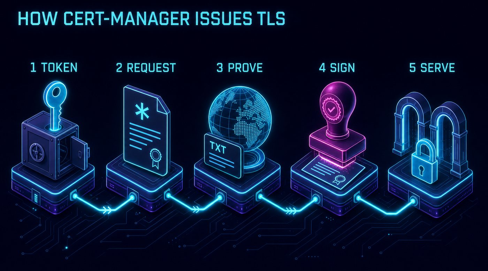
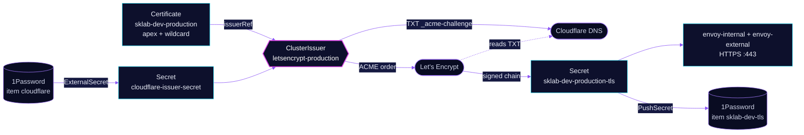

<p align="center">
  
</p>

> **One certificate, never expired.** cert-manager gets a Let's Encrypt wildcard certificate for the lab domain,
> renews it before it ages out, and hands it to both Envoy Gateways. Nobody runs `certbot`, and no app carries its
> own TLS.

## At a glance

<!-- glance:start -->
<!-- Generated by `readme.py sync`; edit the manifests, not this table. -->
| | |
|---|---|
| **Namespace** | `cert-manager` |
| **Deployed by** | [`cert-manager`](../../../main/cert-manager/cert-manager.yaml) (Flux Kustomization) |
| **Helm chart** | `cert-manager` from `oci://quay.io/jetstack/charts/cert-manager`, values in [`helmrelease.yaml`](app/helmrelease.yaml) |
| **Needed by** | `database/barman-cloud`, `system-controller/k8tz` |
| **Secret** | `cloudflare-issuer-secret` from onepassword item `cloudflare` |
| **Health checks** | `ClusterIssuer/letsencrypt-production`, `Deployment/cert-manager`, `Deployment/cert-manager-cainjector`, `Deployment/cert-manager-webhook` |
| **Alerts** | 7: `CertManagerAbsent`, `CertManagerCainjectorHighRestarts`, `CertManagerCainjectorHighMemory`, `CertManagerCainjectorOOMKilled`, `CertManagerCertExpirySoon`, `CertManagerCertNotReady`, `CertManagerRenewalOverdue` |
<!-- glance:end -->

## What it does

- **Issues** one certificate, `sklab-dev-production`, covering the apex `${SECRET_DOMAIN}` and `*.${SECRET_DOMAIN}`.
  The `Certificate` lives with its consumers in `network`
  ([`certificate.yaml`](../../network/certificates/export/certificate.yaml)); this app provides the issuer that signs it.
- **Proves domain ownership** with the ACME DNS-01 challenge: it writes a `_acme-challenge` TXT record through the
  Cloudflare API, Let's Encrypt reads it, and the record is removed.
- **Renews** automatically about 30 days before the 90-day certificate expires, and rewrites the Secret
  `sklab-dev-production-tls` in place. The `envoy-internal` and `envoy-external` HTTPS listeners read that Secret, so
  a renewal needs no restart.
- **Serves internal PKI** for workloads that need their own CA. `system-controller/k8tz` builds a self-signed CA for
  its webhook, and the CloudNativePG `barman-cloud` plugin gets its mTLS certificates from here.

## Why it is built this way

| Choice | Why |
|---|---|
| **DNS-01, not HTTP-01** | HTTP-01 cannot issue wildcards, and it needs every hostname reachable from the internet. Most routes here sit on `envoy-internal` only. DNS-01 needs neither. |
| **One wildcard, not one certificate per route** | One issuance and one renewal to watch. It stays far below Let's Encrypt rate limits, and Certificate Transparency logs show `*.domain` instead of an inventory of every app hostname. |
| **A `ClusterIssuer`, not a namespaced `Issuer`** | Any namespace can request a certificate without copying the Cloudflare token around. The token Secret exists once, here. |
| **Let's Encrypt production only** | There is no staging issuer. One certificate renewing once every 60 days is not at rate-limit risk, and a staging issuer would be one more thing to drift. |
| **Cloudflare token from 1Password** | ExternalSecret `cloudflare-issuer` extracts `CLOUDFLARE_DNS_TOKEN` from item `cloudflare`. Nothing secret is in Git (skill `secrets-1password`). |

## How it works

<p align="center">
  
</p>

<p align="center">
  
</p>

<details>
<summary><b>Resource graph</b>: every object involved, by name</summary>



</details>

In more detail:

1. Flux applies the HelmRelease. The chart installs the CRDs (`crds.enabled: true`) and three Deployments:
   the **controller** (orders and renewals), the **webhook** (validates cert-manager resources at admission) and the
   **cainjector** (writes CA bundles into webhook and APIService configs).
2. The `Certificate` in `network` asks the `ClusterIssuer` for a certificate. The controller creates an ACME order,
   and one `Challenge` per name. The apex and the wildcard each get a TXT value.
3. Before telling Let's Encrypt to check, the controller verifies the TXT record itself. It asks Cloudflare's public
   resolvers over DNS-over-HTTPS (`dns01RecursiveNameservers`), not the cluster's resolver chain, which is split
   horizon here (`network/unifi-dns`) and can answer for the zone without the public TXT record.
4. Let's Encrypt validates, signs, and cert-manager writes `sklab-dev-production-tls`. The Gateways pick it up live.
5. `certificates-export` pushes the issued pair to 1Password item `sklab-dev-tls`, so a rebuilt cluster can start
   from a valid certificate instead of spending an issuance. The restore side does not reach the Gateways today, see
   [Known gaps](#known-gaps).

## Settings that matter

All values are in [`app/helmrelease.yaml`](app/helmrelease.yaml) unless noted. The chart version is pinned in
[`app/ocirepository.yaml`](app/ocirepository.yaml) and Renovate bumps it.

| Setting | Value | Why |
|---|---|---|
| `crds.enabled` | `true` | The chart owns the CRDs, so upgrades bring CRD changes with them. `cluster-apps` patches in CRD `CreateReplace`. |
| `replicaCount`, `webhook.replicaCount`, `cainjector.replicaCount` | `2` each | A Talos upgrade drains one node at a time. With one webhook replica, every cert-manager resource apply fails during that drain. |
| PDBs ([`app/pdb.yaml`](app/pdb.yaml), `webhook.podDisruptionBudget`) | `minAvailable: 1` | Keeps one copy of each component through a drain. The webhook PDB comes from the chart, the other two from this directory. |
| `dns01RecursiveNameservers` | `https://1.1.1.1:443/dns-query,https://1.0.0.1:443/dns-query` | The propagation self-check sees the public zone, over port 443, and avoids the split-horizon internal DNS. |
| `dns01RecursiveNameserversOnly` | `true` | Never fall back to the authoritative-nameserver walk, which takes the same internal path. |
| `prometheus.servicemonitor.enabled` | `true` | Feeds the certificate expiry and renewal metrics the alerts below use. |
| `resources` | requests 10m CPU each; memory 64/32/128Mi requested, 128/64/256Mi limit (controller/webhook/cainjector) | Every limit has a request (skill `node-scheduling`). cainjector gets the most memory because it watches every webhook and CRD. |
| `solvers[].selector.dnsZones` ([`app/clusterissuer.yaml`](app/clusterissuer.yaml)) | `${SECRET_DOMAIN}` | The Cloudflare solver answers only for the lab zone, and Flux substitutes the domain from `cluster-secrets`. |

## Alerts

From [`app/prometheusrule.yaml`](app/prometheusrule.yaml), routed by the `alerts` component.

| Alert | Fires when | First look |
|---|---|---|
| `CertManagerCertExpirySoon` | under 21 days left | Renewal starts at 30 days, so it has been failing for over a week. Check the `Challenge` objects. |
| `CertManagerRenewalOverdue` | 6 h past the scheduled renewal, for 1 h | A blocked renewal while the cert is still Ready: rate limit, DNS-01 failure or issuer. The ACME 429 counter is not emitted, so this is the only signal. |
| `CertManagerCertNotReady` | a Certificate is not Ready for 5 min | `kubectl describe certificate` shows the failing condition. |
| `CertManagerAbsent` | the controller left Prometheus discovery | Flux or the Deployment. |
| `CertManagerCainjector{HighRestarts,HighMemory,OOMKilled}` | cainjector restarting, above 80% of its limit, or OOM-killed | Raise its memory limit; it scales with the number of CRDs and webhooks. |

## Operate it

```bash
flux -n cert-manager get ks cert-manager                 # Flux view
kubectl get clusterissuer letsencrypt-production         # READY True = ACME account registered
kubectl -n network get certificate,certificaterequest,order,challenge
kubectl -n network describe certificate sklab-dev-production
kubectl -n network get secret sklab-dev-production-tls -o jsonpath='{.data.tls\.crt}' \
  | base64 -d | openssl x509 -noout -subject -enddate
```

Force a renewal (a write, so it needs the admin kubeconfig and owner approval): annotate the Certificate, or delete
its Secret and cert-manager reissues it. Each one spends a Let's Encrypt issuance, and there are five per week for
the same set of names.

## Known gaps

- **The restore path writes the wrong Secret name.** `certificates-import`
  ([`externalsecret.yaml`](../../network/certificates/import/externalsecret.yaml)) restores 1Password item
  `sklab-dev-tls` into Secret `sklab-dev-tls`, annotated as Certificate `sklab-dev`. The live Certificate is
  `sklab-dev-production` and writes `sklab-dev-production-tls`, which the Gateways read. On a rebuild, cert-manager
  therefore issues a fresh certificate instead of adopting the restored one. That works, but it spends an issuance.

## Files

| File | Holds |
|---|---|
| [`app/helmrelease.yaml`](app/helmrelease.yaml) | Chart values |
| [`app/ocirepository.yaml`](app/ocirepository.yaml) | Chart source and version |
| [`app/clusterissuer.yaml`](app/clusterissuer.yaml) | `letsencrypt-production`, DNS-01 via Cloudflare |
| [`app/externalsecret.yaml`](app/externalsecret.yaml) | Cloudflare API token from 1Password |
| [`app/pdb.yaml`](app/pdb.yaml) | Controller and cainjector PDBs |
| [`app/prometheusrule.yaml`](app/prometheusrule.yaml) | Alerts |
| [`../../../main/cert-manager/cert-manager.yaml`](../../../main/cert-manager/cert-manager.yaml) | Flux Kustomization, health checks |

Upstream: [cert-manager docs](https://cert-manager.io/docs/) •
[DNS-01 Cloudflare](https://cert-manager.io/docs/configuration/acme/dns01/cloudflare/) •
[Let's Encrypt rate limits](https://letsencrypt.org/docs/rate-limits/)

<!-- branded-readme v1 sources=5f63ff0a037a -->
