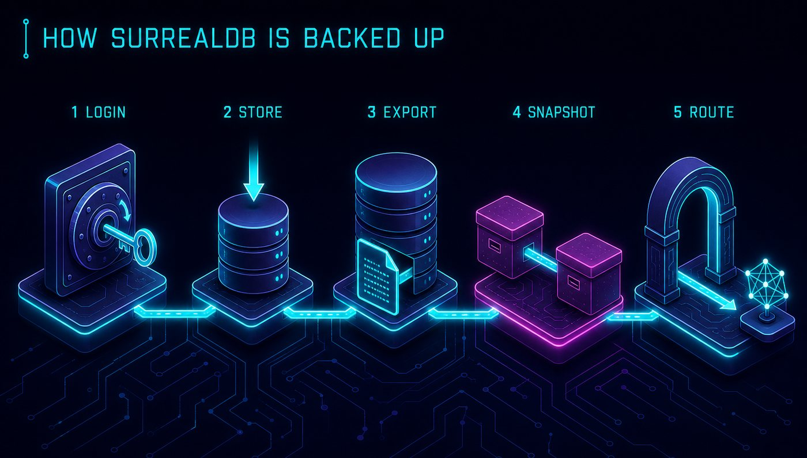
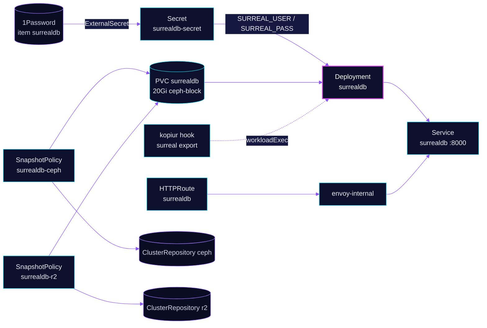

<p align="center">
  
</p>

> **One writer, exported before every snapshot.** SurrealDB runs on RocksDB with exactly one replica, because the
> data directory takes a single lock. Ceph RBD provides the durability, and kopiur runs a logical `surreal export`
> inside the pod before each snapshot, so a restore never depends on RocksDB's crash recovery alone.

## At a glance

<!-- glance:start -->
<!-- Generated by `readme.py sync`; edit the manifests, not this table. -->
| | |
|---|---|
| **Namespace** | `database` |
| **Deployed by** | [`surrealdb`](../../../main/database/surrealdb.yaml) (Flux Kustomization) |
| **Helm chart** | `surrealdb` from `surrealdb`, values in [`helmrelease.yaml`](app/helmrelease.yaml) |
| **Images** | `surrealdb/surrealdb` |
| **Depends on** | `security/external-secrets` |
| **Needed by** | `database/surrealdb-kopiur` |
| **Route** | `surrealdb.${SECRET_DOMAIN}`, `sdb.${SECRET_DOMAIN}` via `envoy-internal` (Gatus probed) |
| **Secret** | `surrealdb-secret` from onepassword item `surrealdb` |
| **Alerts** | 4: `SurrealDBHighMemoryUsage`, `SurrealDBPodDown`, `SurrealDBReplicasUnavailable`, `SurrealDBHighCPU` |
<!-- glance:end -->

## What it does

- **Serves** the SurrealDB API on port 8000 as the Service `surrealdb`, behind the HTTPRoute `surrealdb` on
  `surrealdb.${SECRET_DOMAIN}` and `sdb.${SECRET_DOMAIN}`, through `envoy-internal` only. Nothing is published
  externally.
- **Stores** RocksDB data at `rocksdb:///data/surrealdb` on a 20Gi claim `surrealdb`, the cluster default
  `ceph-block`. The chart creates the claim.
- **Authenticates** every connection. The root user and password come from the ExternalSecret `surrealdb-secret`,
  which reads the 1Password item `surrealdb`. The pod gets them as `SURREAL_USER` and `SURREAL_PASS`.
- **Backs up** through two kopiur policies, `surrealdb-ceph` (4-hourly, in-cluster) and `surrealdb-r2` (daily, offsite).
  Both run the `beforeSnapshot` hook: the `production` database in the `open_notebook` namespace is exported to
  `/data/kopiur-hook-open_notebook-production.surql`, and a throw-away `test` namespace is exported after it.

## Why it is built this way

| Choice | Why |
|---|---|
| **`replicaCount: 1`, no second writer** | RocksDB allows one process to hold the data-directory lock. Ceph RBD is the replication. The alert `SurrealDBReplicasUnavailable` fires on `< 1`, not `< 2`, for that reason. |
| **`strategy: Recreate`** | The claim is RWO. A rolling update would start the new pod while the old one still holds the volume. |
| **`upgrade.remediation.strategy: uninstall`** | The last release before the move to RocksDB pointed at TiKV. A Helm rollback would restore `tikv://` against a cluster that no longer exists. |
| **Logical export in the snapshot hook** | A snapshot of a live RocksDB directory is crash-consistent: it starts clean and can still be stale. The `surreal export` is a consistent logical copy taken by the engine itself. |
| **Production export without `continueOnFailure`** | If the real export fails, the snapshot fails. A silent fall-back to a bare crash-consistent copy would look healthy. |
| **Test export with `continueOnFailure: true`** | The `test` database is a throw-away. A deleted or renamed one must never abort the production export. |
| **Internal gateway only** | No app outside the cluster needs the database API, so there is no external route. |
| **Gatus checks `/health`, not `/`** | The bare root returns a redirect to a third-party site, so the check would depend on a host this repo does not control. |

## How it works

<p align="center">
  
</p>

<p align="center">
  
</p>

<details>
<summary><b>Resource graph</b>: every object involved, by name</summary>



</details>

In more detail:

1. Flux applies the `surrealdb` Kustomization after `external-secrets`, and waits for the Deployment to be fully
   available. The chart renders the Deployment, Service, PVC and ServiceMonitor from the HelmRelease.
2. The pod reads the root credentials from `surrealdb-secret` and serves `rocksdb:///data/surrealdb`
   with `--allow-all --allow-funcs` and `unauthenticated: false`. `fsGroup: 65532` makes the Ceph mount writable for
   the image's UID.
3. The separate `surrealdb-kopiur` Kustomization, which does not wait, adds the two SnapshotPolicies and their schedules
   from `components/kopiur/backup`. The `beforeSnapshot` hook patches both policies with the two `surreal export`
   commands, so the export happens in the pod, immediately before the Ceph snapshot is cut.
4. The Ceph copy is taken on schedule (`H 1-23/4` in `America/New_York`). The R2 copy runs daily at `H 7`. Both keep the
   kopia data on `onScheduleDelete: Retain`.

## Settings that matter

All values are in [`app/helmrelease.yaml`](app/helmrelease.yaml) unless noted. The chart version is pinned there
(`spec.chart.spec.version`), and Renovate bumps it.

| Setting | Value | Why |
|---|---|---|
| `replicaCount` | `1` | One writer. See the RocksDB lock above. |
| `strategy.type` | `Recreate` | RWO claim. The old pod must release the volume first. |
| `podSecurityContext.fsGroup` | `65532` | The image runs as UID 65532. Without the fsGroup the Ceph mount is root-owned and unwritable. |
| `surrealdb.path` | `rocksdb:///data/surrealdb` | Local RocksDB. The old TiKV path must never come back, see the upgrade rule above. |
| `surrealdb.unauthenticated` | `false` | Every connection authenticates. |
| `surrealdb.extraArgs` | `--allow-all`, `--allow-funcs` | Set explicitly in Git. Authentication stays on, so these flags do not open the API to anonymous callers. |
| `upgrade.remediation.strategy` | `uninstall` | A rollback restores TiKV, which is gone. |
| `persistence.size` | `20Gi`, `ReadWriteOnce`, `/data` | The data directory. `storageClassName` is left unset on purpose (the chart renders it twice when set, see Known gaps). |
| `resources.requests` | `100m` CPU, `512Mi` memory | The CPU request is the baseline the alerts divide by. It was sized from a 14-day series at `[14d:30s]`, because coarser sampling under-reads the peak. |
| `resources.limits` | `memory: 2Gi` | No CPU limit, so CPU alerts use the request. |
| `affinity.podAntiAffinity` | preferred, weight 100, by hostname | Prefers another node on a rollout. It does not add a replica. |
| `topologySpreadConstraints` | `ScheduleAnyway`, `nodeTaintsPolicy: Honor` | `Honor` makes the spread count only the taints the filter honours (`NoSchedule`, `NoExecute`). It does not count the `PreferNoSchedule` taint on `talos-3`; the TaintToleration score keeps the pod off that node. Skill `node-scheduling`. |
| `livenessProbe`, `readinessProbe` | `GET /health` on 8000 | Whether `/health` returns non-200 on an unhealthy server is unverified. The root path is not used. |
| `persistence` `storageClassName` | unset | Not a default; a deliberate omission. |
| Snapshot hook timeouts (`surrealdb-kopiur` overlay) | `2m` each | A slow export fails the snapshot instead of hanging the backup window. |

## Alerts

From [`app/prometheusrule.yaml`](app/prometheusrule.yaml), routed by the `alerts` component.

| Alert | Fires when | First look |
|---|---|---|
| `SurrealDBPodDown` | a pod is not Ready for 2 min | `kubectl -n database describe pod -l app.kubernetes.io/name=surrealdb`. Logs show whether the RocksDB lock or the volume is the blocker. |
| `SurrealDBReplicasUnavailable` | no replica available for 5 min | The Deployment, or the claim not attaching after a node drain. |
| `SurrealDBHighMemoryUsage` | working set over 80% of the 2Gi limit for 5 min | Query load or a large export. Raise the limit before the OOM. |
| `SurrealDBHighCPU` | CPU use over 80% of the request for 10 min | Load, or the request is now too small. Re-measure before changing it. |

## Operate it

```bash
flux -n database get ks surrealdb surrealdb-kopiur           # Flux view
kubectl -n database get deploy,pvc,svc -l app.kubernetes.io/name=surrealdb
kubectl get snapshotpolicy,snapshotschedule,restore -n database   # kopiur state for surrealdb-ceph and surrealdb-r2
kubectl -n database logs deploy/surrealdb --tail=50
```

Restores and the hook's export file are in [`kopiur-backups`](../../../../../.agents/skills/kopiur-backups/SKILL.md).
Engine notes, the replica rule and the chart traps are in skill `databases`, reference `surrealdb.md`.

## Known gaps

- **The ServiceMonitor may scrape nothing useful.** `serviceMonitor.enabled: true` makes the chart render a ServiceMonitor. Git sets no metrics path. The only evidence of a problem is the comment in [`prometheusrule.yaml`](app/prometheusrule.yaml) (lines 34-38), which says `/metrics` returns 404 on port 8000. That makes the target likely unhealthy. This is unverified against the live target.
- **The chart comments may be stale.** `helmrelease.yaml` and skill `databases` say chart 0.4.0 renders
  `storageClassName` twice, but the pinned chart is 0.5.0. The duplicate-key behaviour was not re-checked after the
  bump, so the `storageClassName` omission rests on an old observation.
- **The route carries an ignored DNS annotation.** `httproute.yaml` sets `external-dns.kubernetes.io/target` on the
  route. The parent Gateway's annotation decides the record (`envoy-internal` already targets `internal`), so the
  route annotation does nothing. It is harmless but misleading.

## Files

| File | Holds |
|---|---|
| [`app/helmrelease.yaml`](app/helmrelease.yaml) | Chart values, upgrade strategy, probes, affinity |
| [`app/externalsecret.yaml`](app/externalsecret.yaml) | Root user and password from 1Password item `surrealdb` |
| [`app/httproute.yaml`](app/httproute.yaml) | Internal route and Gatus endpoint |
| [`app/prometheusrule.yaml`](app/prometheusrule.yaml) | Four alerts |
| [`../../../main/database/surrealdb.yaml`](../../../main/database/surrealdb.yaml) | Flux Kustomizations `surrealdb` (health gate) and `surrealdb-kopiur` (export hooks, second document) |

Upstream: [SurrealDB docs](https://surrealdb.com/docs) •
[SurrealDB Helm repository](https://helm.surrealdb.com)

<!-- branded-readme v1 sources=1e9b4d53462c -->
