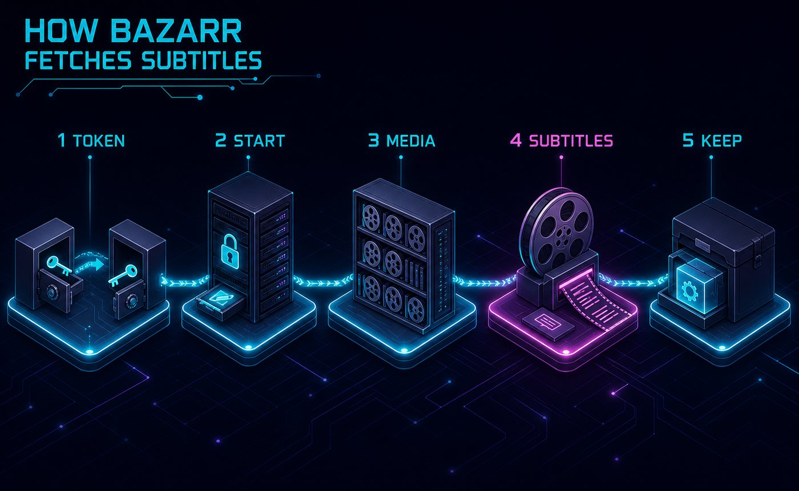
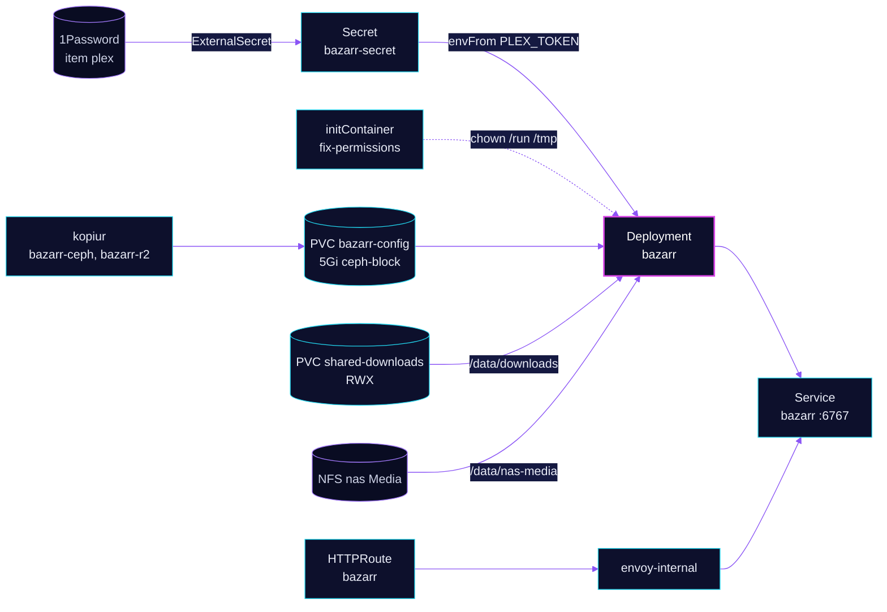

<p align="center">
  
</p>

> **Subtitles without a writable image.** Bazarr runs the linuxserver build as UID 2000 on a read-only root filesystem.
> Its config is a 5Gi kopiur-backed claim. It reads the Plex library over NFS and the download share, and it never
> needs a writable path outside `/run`, `/tmp` and its config.

## At a glance

<!-- glance:start -->
<!-- Generated by `readme.py sync`; edit the manifests, not this table. -->
| | |
|---|---|
| **Namespace** | `downloads` |
| **Deployed by** | [`bazarr`](../../../main/downloads/bazarr.yaml) (Flux Kustomization) |
| **Helm chart** | `app-template`, values in [`helmrelease.yaml`](app/helmrelease.yaml) |
| **Images** | `docker.io/library/busybox`, `ghcr.io/linuxserver/bazarr` |
| **Depends on** | `downloads/downloads-pvc`, `security/onepassword-store`, `system/kopiur-repository` |
| **Secret** | `bazarr-secret` from onepassword item `plex` |
| **Backup** | kopiur component on the overlay (skill `kopiur-backups`) |
<!-- glance:end -->

## What it does

- **Searches** subtitle providers for every media item it knows about, using the Plex library it reads from the NAS
  share mounted at `/data/nas-media`.
- **Writes** the chosen subtitle files beside the media. It also mounts the shared claim `shared-downloads` at
  `/data/downloads`, the same path the *arr apps use.
- **Reads Plex** through the `PLEX_TOKEN` in `bazarr-secret`, which is copied from the 1Password item `plex` (the same
  item plex-exporter reads).
- **Keeps state** in `/config`, the `bazarr-config` claim: the SQLite database, the provider settings and the Plex
  connection. kopiur backs it up to Ceph and R2.
- **Exposes** the UI as `bazarr.${SECRET_DOMAIN}` on `envoy-internal` only, with a Homepage tile in the Downloads group.

## Why it is built this way

| Choice | Why |
|---|---|
| **linuxserver image, not home-operations** | The home-operations build ships Python 3.14, which upstream Bazarr does not support. It hangs before binding its HTTP port. linuxserver's Alpine Python 3.12 is inside Bazarr's supported range. |
| **`LSIO_NON_ROOT_USER` and `LSIO_READ_ONLY_FS` both `"true"`** | The pod already runs as the target UID with a read-only root. The s6 init's root-only `usermod` and `chown` steps would fail under this security context, and have nothing to do. Skill `app-workloads` covers the convention. |
| **busybox `chown` init container** | `/run` and `/tmp` are `emptyDir` volumes, which start root-owned. s6-overlay refuses to start unless `/run` belongs to the UID it runs as. |
| **Startup probe with a 15-minute budget** | The first boot runs an Alembic migration over the SQLite database, single-threaded, and can take minutes. The liveness and readiness probes only start after the startup probe passes, so the migration cannot cause a restart loop. |
| **NFS media behind a supplemental group** | `supplementalGroups: [65542]` is the NAS group `gladius:external-services`. The media share is readable by that group, not by UID 2000 alone. |

## How it works

<p align="center">
  
</p>

<p align="center">
  
</p>

<details>
<summary><b>Resource graph</b>: every object involved, by name</summary>



</details>

In more detail:

1. Flux applies `bazarr` after `downloads-pvc`, `onepassword-store` and `kopiur-repository`. The overlay includes the
   kopiur component and the `pvc` component, which creates `bazarr-config` from a kopiur `Restore` on first install.
2. The pod's `fix-permissions` init container chowns `/run` and `/tmp`. The main container starts as UID 2000 with
   `readOnlyRootFilesystem`, and the s6 init skips its root steps because of the two LSIO variables.
3. Bazarr waits for the startup probe (`/health` on 6767, up to 15 minutes), then serves the UI. Liveness and readiness
   use the same path.
4. Bazarr reads the Plex library and the NAS media, searches providers, and writes subtitle files into the media
   folders. Its state is in `/config`, which the two kopiur policies back up (Ceph every 4 hours, R2 daily).

## Settings that matter

All values are in [`app/helmrelease.yaml`](app/helmrelease.yaml) unless noted.

| Setting | Value | Why |
|---|---|---|
| `pod.securityContext` | UID and GID `2000`, `runAsNonRoot`, `fsGroup: 2000`, `fsGroupChangePolicy: OnRootMismatch` | The app identity. `OnRootMismatch` skips the recursive chown when the claim root already matches. Adding `fsGroup` to an existing claim still re-owns its content once (skill `app-workloads`). |
| `supplementalGroups` | `65542` | The NAS group the media share is readable by. See the table above. |
| `initContainers.fix-permissions` | the image pinned in [`helmrelease.yaml`](app/helmrelease.yaml), root, `chown -R 2000:2000 /run /tmp` | s6-overlay needs `/run` owned by the running UID. `emptyDir` starts root-owned. |
| `LSIO_NON_ROOT_USER`, `LSIO_READ_ONLY_FS` | `"true"` | linuxserver's opt-in for non-root and read-only roots. Both are required together. |
| `probes.startup` | `failureThreshold: 90`, period 10s | About 15 minutes for the first-boot migration. Liveness and readiness wait for it. |
| `probes.liveness`, `probes.readiness` | `/health` on 6767, timeout 3s, failure threshold 3 | Whether `/health` returns non-200 when Bazarr is down is unverified. |
| `resources` | requests 15m CPU and 256Mi; limit 512Mi memory | Every limit has a request. There is no CPU limit. |
| `persistence.config` | `existingClaim: bazarr-config` | The claim is created by the `pvc` component and backed up by kopiur (5Gi). |
| `persistence.downloads` | `shared-downloads` at `/data/downloads` | The common download share, RWX. |
| `persistence.media` | NFS `nas.${SECRET_DOMAIN}:/mnt/storage/Media` at `/data/nas-media` | The Plex library. Bazarr must see the same paths Plex does. |
| `reloader.stakater.com/auto` | `"true"` | Restarts the pod when `bazarr-secret` changes, so a new Plex token takes effect. |

## Alerts

There are no Bazarr alerts in this directory. Flux health is the Deployment, through the Kustomization.

## Operate it

```bash
flux -n downloads get ks bazarr                          # Flux view
kubectl -n downloads get pods -l app.kubernetes.io/name=bazarr
kubectl -n downloads get pvc bazarr-config
kubectl get snapshotpolicy,restore -n downloads | grep bazarr   # kopiur ceph and r2 policies
```

An empty `PLEX_TOKEN` still reports `SecretSynced`. Check the decoded length of the value in `bazarr-secret` before
blaming Bazarr for a Plex failure (skill `media-stack`, `references/plex.md`).

## Known gaps

- **No Gatus endpoint.** The route has no `gatus.home-operations.com/endpoint` annotation, so
  `bazarr.${SECRET_DOMAIN}` is not probed. Only `lidarr` and `shelfmark` in this namespace carry the annotation; sonarr,
  radarr, sabnzbd, prowlarr and cleanuparr do not either.
- **The route's DNS annotation does nothing.** `route.app.annotations` sets `external-dns.kubernetes.io/target`. The
  parent Gateway (`envoy-internal`) decides the record, so this line is inert.
- **No Flux health gate.** The overlay sets `wait: false` and no `healthChecks`, so nothing in Flux waits on the Deployment.

## Files

| File | Holds |
|---|---|
| [`app/helmrelease.yaml`](app/helmrelease.yaml) | Chart values: pod security, probes, persistence, route |
| [`app/externalsecret.yaml`](app/externalsecret.yaml) | `PLEX_TOKEN` from 1Password item `plex` |
| [`../../../main/downloads/bazarr.yaml`](../../../main/downloads/bazarr.yaml) | Flux Kustomization, kopiur substitutions |

Upstream: [Bazarr wiki](https://wiki.bazarr.media/) •
[linuxserver Bazarr image](https://docs.linuxserver.io/images/docker-bazarr/)

<!-- branded-readme v1 sources=16ffe1c3222c -->
