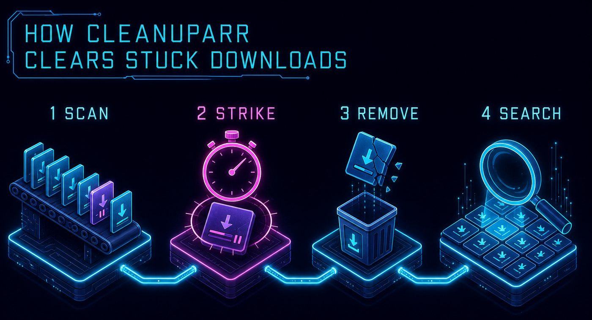
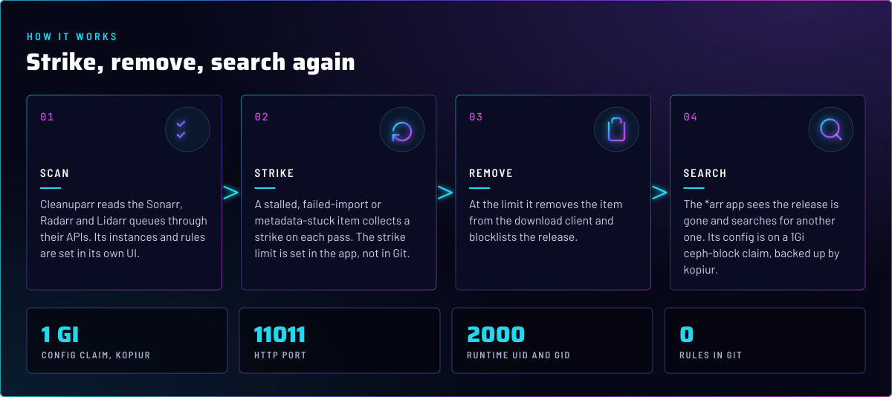
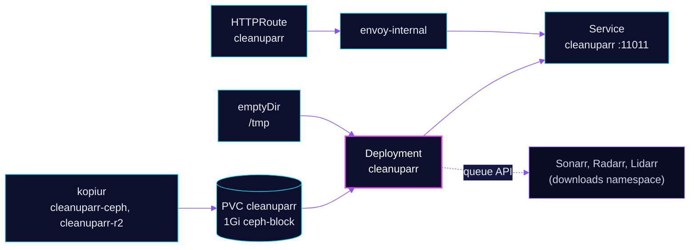

<p align="center">
  
</p>

> **The queue janitor for the *arr apps.** Cleanuparr watches the Sonarr, Radarr and Lidarr queues, strikes items that
> are stuck, removes them and blocklists the release, so the app searches for another one. Git defines only the pod.
> Everything the app does is configured in its own UI and stored in its config claim.

## At a glance

<!-- glance:start -->
<!-- Generated by `readme.py sync`; edit the manifests, not this table. -->
| | |
|---|---|
| **Namespace** | `downloads` |
| **Deployed by** | [`cleanuparr`](../../../main/downloads/cleanuparr.yaml) (Flux Kustomization) |
| **Helm chart** | `app-template`, values in [`helmrelease.yaml`](app/helmrelease.yaml) |
| **Images** | `ghcr.io/cleanuparr/cleanuparr` |
| **Depends on** | `system/kopiur-repository` |
| **Backup** | kopiur component on the overlay (skill `kopiur-backups`) |
<!-- glance:end -->

## What it does

- **Strikes** queue items that are stalled, failed to import or stuck fetching metadata, once per check. The strike
  limit and the check interval are app settings.
- **Removes** an item that reached the limit from its download client and blocklists the release in the *arr app.
  The app then searches again, which is the point.
- **Keeps its settings** (instances, the SABnzbd client, the rules) in SQLite on the `cleanuparr` claim, 1Gi on
  `ceph-block`. kopiur backs that claim up to Ceph and R2.
- **Serves** its UI and REST API as `cleanuparr.${SECRET_DOMAIN}` on `envoy-internal` only. The Homepage tile sits in
  the Downloads group.

## Why it is built this way

| Choice | Why |
|---|---|
| **Settings in the app, not in Git** | The HelmRelease comment records that instances, the SABnzbd client and the queue rules live in Cleanuparr's own database, set through the UI or REST API. The kopiur backup is the only copy of those rules. |
| **`Recreate` strategy** | One replica on an RWO claim. A rolling update would start a second pod that cannot mount the volume. |
| **No `downloads-pvc` dependency** | The pod does not mount `shared-downloads`, and the Kustomization does not depend on `downloads-pvc`. The reason is not recorded in Git. |
| **Read-only root, `/tmp` as `emptyDir`** | The image runs as UID 2000 with all capabilities dropped. Only the config claim and `/tmp` are writable. |
| **No ExternalSecret** | The *arr API keys are entered in the UI; no ExternalSecret exists in this directory. |

## How it works

<p align="center">
  
</p>

<p align="center">
  
</p>

<details>
<summary><b>Resource graph</b>: every object involved, by name</summary>



</details>

In more detail:

1. Flux applies `cleanuparr` after `kopiur-repository` and includes the kopiur component. The claim `cleanuparr` is
   created by the HelmRelease, because app-template names it after the release. No restore is wired in, so a rebuilt
   cluster starts with an empty claim and needs a manual restore from kopiur.
2. The pod starts as UID 2000 and listens on 11011. Liveness and readiness probe `/health`, with a 30-second period
   for liveness and a 10-second period for readiness.
3. Cleanuparr polls the configured instances. On each pass it checks each queue item, adds a strike to a stuck item,
   and at the limit removes it and blocklists the release.
4. Its settings are read from `/config`. The kopiur policies back that path up every 4 hours to Ceph and daily to R2.

## Settings that matter

All values are in [`app/helmrelease.yaml`](app/helmrelease.yaml) unless noted.

| Setting | Value | Why |
|---|---|---|
| `strategy` | `Recreate` | RWO claim. The old pod must release the volume first. |
| `pod.securityContext` | UID and GID `2000`, `fsGroup: 2000`, `fsGroupChangePolicy: OnRootMismatch` | The app identity. `OnRootMismatch` avoids a recursive chown on every start. |
| `env.PORT` | `11011` | The only env var set in [`helmrelease.yaml`](app/helmrelease.yaml). |
| `persistence.config` | `ReadWriteOnce`, 1Gi, `ceph-block` | The database and settings. Its size is the same as `KOPIUR_CAPACITY`. |
| `persistence.temp` | `emptyDir` at `/tmp` | The only other writable path on a read-only root. |
| `probes.liveness` | `/health`, every 30s, failure threshold 5 | The reason is not recorded in the file. |
| `probes.readiness` | `/health`, every 10s, failure threshold 3 | Removes the pod from the route when it stops answering. |
| `resources` | requests 15m CPU and 256Mi; limit 512Mi memory | Every limit has a request. |
| `securityContext` | `readOnlyRootFilesystem`, no privilege escalation, all capabilities dropped | The usual non-root hardening for this repo. |

## Alerts

There are no Cleanuparr alerts in this directory. The queue watchdog (`downloads/queue-watchdog`) is the alert path for
stuck queues, see skill `media-stack`.

## Operate it

```bash
flux -n downloads get ks cleanuparr                      # Flux view
kubectl -n downloads get pods -l app.kubernetes.io/name=cleanuparr
kubectl -n downloads get pvc cleanuparr
kubectl get snapshotpolicy,restore -n downloads | grep cleanuparr
```

Instances, the SABnzbd client and the strike rules are changed in the UI at `cleanuparr.${SECRET_DOMAIN}` or through its
REST API. Those are app state, not Git. The procedure is in
[`stuck-downloads.md`](../../../../../.agents/skills/media-stack/references/stuck-downloads.md).

## Known gaps

- **No Gatus endpoint.** The route has no `gatus.home-operations.com/endpoint` annotation, so `cleanuparr.${SECRET_DOMAIN}`
  is not probed. Only `lidarr` and `shelfmark` in this namespace carry the annotation.
- **No restore wiring for the config claim.** The `cleanuparr` claim is created by the HelmRelease, not by the `pvc`
  component, so there is no kopiur `Restore` as `dataSourceRef`. A rebuilt cluster creates an empty claim, and the
  rules come back only through a manual kopiur restore. Compare `bazarr` and `lidarr`, which use the `pvc` component.

## Files

| File | Holds |
|---|---|
| [`app/helmrelease.yaml`](app/helmrelease.yaml) | Chart values: pod security, probes, config claim, route |
| [`app/kustomization.yaml`](app/kustomization.yaml) | The HelmRelease resource |
| [`../../../main/downloads/cleanuparr.yaml`](../../../main/downloads/cleanuparr.yaml) | Flux Kustomization, kopiur substitutions |

Upstream: [Cleanuparr on GitHub](https://github.com/cleanuparr/cleanuparr)

<!-- branded-readme v1 sources=e83409f3c84b -->
