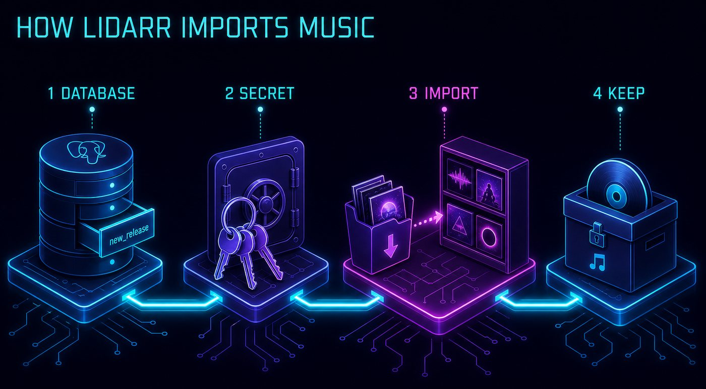
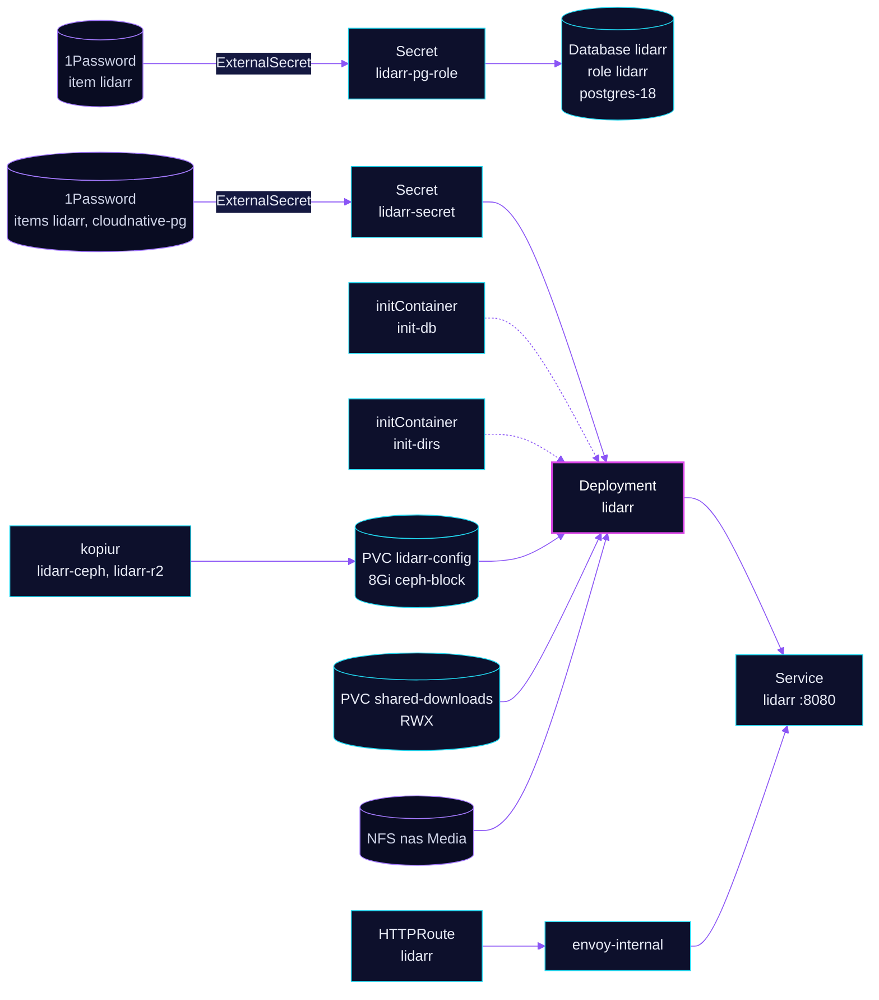

<p align="center">
  
</p>

> **Music manager with its state in PostgreSQL.** Lidarr keeps its database on the shared postgres-18 Cluster, not on
> its config claim. The config claim holds the rest of its state, and kopiur backs it up. It imports finished downloads
> into the NAS music library and never sees a torrent.

## At a glance

<!-- glance:start -->
<!-- Generated by `readme.py sync`; edit the manifests, not this table. -->
| | |
|---|---|
| **Namespace** | `downloads` |
| **Deployed by** | [`lidarr`](../../../main/downloads/lidarr.yaml) (Flux Kustomization) |
| **Helm chart** | `app-template`, values in [`helmrelease.yaml`](app/helmrelease.yaml) |
| **Images** | `ghcr.io/brunnels/lidarr-develop`, `ghcr.io/home-operations/postgres-init` |
| **Depends on** | `downloads/downloads-pvc`, `downloads/lidarr-db`, `security/onepassword-store`, `system/kopiur-repository` |
| **Secret** | `lidarr-secret` from onepassword item `cloudnative-pg`, `lidarr` |
| **Backup** | kopiur component on the overlay (skill `kopiur-backups`) |
<!-- glance:end -->

## What it does

- **Tracks** artists and albums and searches the Usenet indexers it gets from Prowlarr.
- **Imports** finished downloads from `/data/downloads` (the `shared-downloads` claim) into the NAS music library under
  `/data/nas-media/Music`. The `init-dirs` step creates that folder before Lidarr starts.
- **Stores its database** in PostgreSQL 18, database and role `lidarr`, on the shared `postgres-18` Cluster. The role
  and database come from the `lidarr-db` Kustomization.
- **Keeps its config** (the rest of its state, such as the add-ons folder and the config file) on the 8Gi
  `lidarr-config` claim. kopiur backs it up to Ceph and R2.
- **Exposes** the UI as `lidarr.${SECRET_DOMAIN}` on `envoy-internal`, with a Homepage tile and a Gatus probe of `/ping`.

## Why it is built this way

| Choice | Why |
|---|---|
| **PostgreSQL, not SQLite** | The app's database is on the shared CNPG Cluster, which is backed up with barman. The config claim is then small, and restoring the database does not depend on kopiur. |
| **Own Kustomization for the database** | `lidarr-db` runs before the app. Its `DatabaseRole` and `Database` are `retain`, so removing the app never drops the data. Skill `databases`. |
| **`init-db` runs first** | The `postgres-init` image runs before Lidarr starts, so a database connection problem shows in the init container rather than in the app's own logs. |
| **`init-dirs` creates the music folder** | `mkdir -p /data/nas-media/Music` runs before Lidarr starts, so the first import does not fail on a missing folder. |
| **Downloads and media on separate mounts** | `shared-downloads` (RWX, CephFS) is the working area. `/data/nas-media` (NFS) is the library. Imports copy across them, because hardlinks do not cross CephFS and NFS (skill `media-stack`). |

## How it works

<p align="center">
  
</p>

<p align="center">
  
</p>

<details>
<summary><b>Resource graph</b>: every object involved, by name</summary>



</details>

In more detail:

1. Flux applies `lidarr-db` first: a DatabaseRole and a Database on `postgres-18`, both retained. Then `lidarr` starts
   after `downloads-pvc`, `onepassword-store` and `kopiur-repository`.
2. `init-db` runs the `postgres-init` image with `lidarr-secret` as its environment, then `init-dirs` creates
   `/data/nas-media/Music` as UID 2000.
3. The main container starts with the `LIDARR__POSTGRES__*` settings from the same Secret, so the app uses PostgreSQL
   and not SQLite. It listens on 8080 and answers `/ping` for both probes.
4. Imports copy from `/data/downloads` into `/data/nas-media/Music`. The config claim is backed up by kopiur: to Ceph every 4 hours and to R2 daily.

## Settings that matter

All values are in [`app/helmrelease.yaml`](app/helmrelease.yaml) unless noted. The database role and database are in
[`../../../../components/cnpg-database`](../../../../components/cnpg-database) and in
[`lidarr-db`](../../../main/downloads/lidarr.yaml).

| Setting | Value | Why |
|---|---|---|
| `LIDARR__POSTGRES__*` | host `postgres-18-rw.database.svc.cluster.local`, port `5432` | The app database is on the shared Cluster, not SQLite. Set in `externalsecret.yaml`, not the HelmRelease. |
| `LIDARR__AUTH__METHOD` | `External` | Upstream behaviour, not verified here: Lidarr expects an authenticating proxy in front of it. No SecurityPolicy is attached to this route (see Known gaps). |
| `LIDARR__AUTH__REQUIRED` | `DisabledForLocalAddresses` | Login is required only from non-local addresses. |
| `LIDARR__LOG__DBENABLED` | `"False"` | Keeps log rows out of the database. |
| `pod.securityContext` | UID and GID `2000`, `fsGroup: 2000`, `fsGroupChangePolicy: OnRootMismatch` | The app identity, matching the other download apps. |
| `containers.app.securityContext` | `readOnlyRootFilesystem`, no privilege escalation, all capabilities dropped | The container runs read-only; `add-ons` and `tmp` are `emptyDir`. |
| `probes` | `/ping` on 8080, failure threshold 5 | Lidarr's own health endpoint. |
| `resources` | requests 100m CPU and 384Mi; limit 2Gi memory | The request is the idle baseline and the 2Gi limit is the ceiling. There is no CPU limit. |
| `timeout` | `10m` | Helm's wait for install and upgrade. The reason is not recorded in the file. |
| `persistence.config` | `existingClaim: lidarr-config` | 8Gi, kopiur-backed (`KOPIUR_CAPACITY`). |
| `persistence.downloads` | `shared-downloads` at `/data/downloads` for `init-dirs` and the app | The work area. |
| `persistence.media` | NFS `nas.${SECRET_DOMAIN}:/mnt/storage/Media` at `/data/nas-media` | The library. |

## Alerts

There are no Lidarr alerts in this directory. The queue watchdog (`downloads/queue-watchdog`) checks Lidarr's queue age
and feeds `KubeJobFailed`. Skill `media-stack`.

## Operate it

```bash
flux -n downloads get ks lidarr lidarr-db                # Flux view, both Kustomizations
kubectl -n downloads get pods -l app.kubernetes.io/name=lidarr
kubectl -n database get database,databaserole | grep lidarr
kubectl get snapshotpolicy,restore -n downloads | grep lidarr
```

## Known gaps

- **`init-dirs` uses a mutable image tag.** The tag is set in [`helmrelease.yaml`](app/helmrelease.yaml) under `initContainers.init-dirs`. A floating tag is not tracked by Renovate and can change under the pod on each pull. The janitor in `downloads/maintenance` pins its image by tag.
- **The superuser password reaches the app Secret.** `lidarr-secret` takes `POSTGRES_SUPER_PASS` from the
  `cloudnative-pg` item and exposes it as `INIT_POSTGRES_SUPER_PASS` to `init-db`. The role and database are already
  created by `lidarr-db`, so the superuser credential may not be needed. Check what `postgres-init` does with it before
  removing it. Prowlarr has the same pattern.
- **The image is a third-party develop build, and nothing in Git says why.** `ghcr.io/brunnels/lidarr-develop` is not the
  home-operations image the other *arr apps use, and `LIDARR__UPDATE__BRANCH` is `develop`. The reason is not recorded
  in the manifests.
- **No SecurityPolicy, and external auth.** `LIDARR__AUTH__METHOD` is `External`, which trusts an authenticating proxy, but
  the route has no SecurityPolicy. The only gate is that `lidarr.${SECRET_DOMAIN}` is reachable on `envoy-internal`.
  Confirm the internal network is the boundary you intend.
- **No Gatus check of the database path.** The Gatus probe checks `/ping`, whose answer without the database is unverified. A broken
  connection to `postgres-18` leaves the probe green.

## Files

| File | Holds |
|---|---|
| [`app/helmrelease.yaml`](app/helmrelease.yaml) | Chart values: init containers, probes, persistence, route |
| [`app/externalsecret.yaml`](app/externalsecret.yaml) | Database settings, API key, postgres-init credentials |
| [`../../../main/downloads/lidarr.yaml`](../../../main/downloads/lidarr.yaml) | Flux Kustomizations `lidarr` (kopiur) and `lidarr-db` (database) |

Upstream: [Lidarr](https://lidarr.audio/) •
[Servarr wiki for Lidarr](https://wiki.servarr.com/lidarr)

<!-- branded-readme v1 sources=883d503b510a -->
