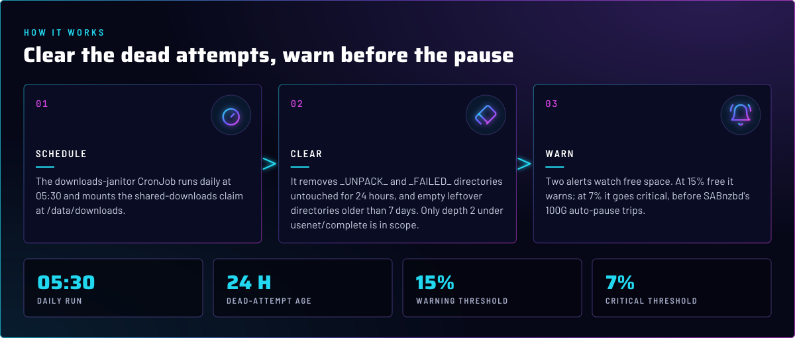
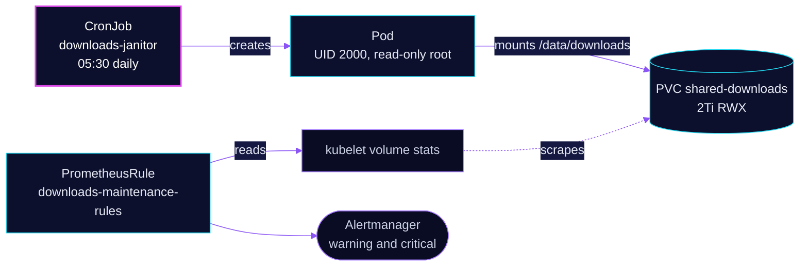

<p align="center">
  
</p>

> **Clears what SABnzbd leaves behind.** Failed unpacks are retried and never removed, so they fill the shared volume.
> The `downloads-janitor` CronJob removes only the dead attempts, at a narrow depth, every day. Two alerts fire before
> SABnzbd's free-space pause trips.

## At a glance

<!-- glance:start -->
<!-- Generated by `readme.py sync`; edit the manifests, not this table. -->
| | |
|---|---|
| **Namespace** | `downloads` |
| **Deployed by** | [`downloads-maintenance`](../../../main/downloads/maintenance.yaml) (Flux Kustomization) |
| **Images** | `mirror.gcr.io/alpine` |
| **Depends on** | `downloads/downloads-pvc` |
| **Alerts** | 2: `SharedDownloadsAlmostFull`, `SharedDownloadsAlmostFull` |
<!-- glance:end -->

## What it does

- **Deletes** `_UNPACK_*` and `_FAILED_*` directories under `usenet/complete` that have not changed for 24 hours. A live
  unpack keeps its modification time fresh, so anything older is a dead attempt.
- **Prunes** empty directories at the same depth that are older than 7 days.
- **Warns** when `shared-downloads` drops below 15% free for 30 minutes, and goes critical below 7% free for 15 minutes.

## Why it is built this way

| Choice | Why |
|---|---|
| **Depth 2 only, under `usenet/complete`** | Completed downloads sit at `complete/<category>/<dir>`. The janitor stays at that depth and never touches the `complete` root or a category directory. |
| **Only dead directories are removed** | Non-empty regular directories are never removed. Downloads flow through the *arr apps, which clean up completed items. Side-channel dumps are stopped by policy, see the runbook. |
| **Never `usenet/incomplete`** | It is SABnzbd's live assembly area, on a different volume anyway. |
| **Thresholds at 15% and 7%** | 100G is about 5% of the 2Ti volume. SABnzbd auto-pauses at 100G free, so the 15% warning fires first, and the 7% critical alert fires before the pause. |
| **Prints every path before it removes it** | The job log is the audit trail. `kubectl logs` on the job shows exactly what was deleted. |
| **`concurrencyPolicy: Forbid`, `activeDeadlineSeconds: 3600`** | One run at a time, and a hung run is killed after an hour. |

## How it works

<p align="center">
  
</p>

<details>
<summary><b>Resource graph</b>: every object involved, by name</summary>



</details>

In more detail:

1. Flux applies `downloads-maintenance` after `downloads-pvc`, once an hour (the Kustomization, not the job).
2. The CronJob runs at 05:30 daily as UID and GID `2000`, mounts `shared-downloads` at `/data/downloads` and runs two
   `find` passes. The first removes `_UNPACK_*` and `_FAILED_*` directories untouched for over 1440 minutes. The second
   removes empty directories older than 7 days, using `rmdir`, so a non-empty directory is never touched.
3. The container runs read-only with all capabilities dropped. It prints `df -h` at the end, which shows the volume's
   free space in the job log.
4. Prometheus evaluates the two `SharedDownloadsAlmostFull` rules from `kubelet_volume_stats_*` for the `shared-downloads`
   claim. Those metrics come from the kubelet, not the job.

## Settings that matter

All values are in [`app/cronjob.yaml`](app/cronjob.yaml) and [`app/prometheusrule.yaml`](app/prometheusrule.yaml).

| Setting | Value | Why |
|---|---|---|
| `schedule` | `30 5 * * *` | Once a day, early in the morning. |
| `concurrencyPolicy` | `Forbid` | Two janitors deleting the same tree is never useful. |
| `activeDeadlineSeconds` | `3600` | A hung `find` on CephFS is killed after an hour instead of blocking the next run. |
| `backoffLimit` | `2` | A transient failure is retried twice, then reported through `KubeJobFailed`. |
| `ttlSecondsAfterFinished` | `86400` | The finished pod goes after a day. The log is kept as long as the pod. |
| `securityContext` | UID and GID `2000`, `fsGroup: 2000` | The same identity the download apps write as. |
| `resources` | requests 10m CPU and 32Mi; limit 100m CPU and 128Mi | Small. The job is I/O on CephFS, not compute. |
| `image` | `mirror.gcr.io/alpine` | Pinned by tag in [`cronjob.yaml`](app/cronjob.yaml), with a Renovate annotation. The shell and `find` are all it needs. |
| Alert `for` | 30m warning, 15m critical | The level must hold for the whole window, so a short dip does not page. |

## Alerts

From [`app/prometheusrule.yaml`](app/prometheusrule.yaml). Both rules are named `SharedDownloadsAlmostFull` and differ by
severity.

| Alert | Fires when | First look |
|---|---|---|
| `SharedDownloadsAlmostFull` (warning) | under 15% free for 30 minutes | Check for `_UNPACK_` and `_FAILED_` orphans and side-channel dumps. Runbook in skill `media-stack`. |
| `SharedDownloadsAlmostFull` (critical) | under 7% free for 15 minutes | SABnzbd's 100G pause is imminent or already tripped. Reclaim space now. Ceph nearfull follows this pattern. |

## Operate it

```bash
flux -n downloads get ks downloads-maintenance           # Flux view
kubectl -n downloads get cronjob downloads-janitor
kubectl -n downloads get pods -l app.kubernetes.io/component=maintenance
kubectl -n downloads logs job/<downloads-janitor-job>    # the audit trail
```

The manual dry run and the full runbook are in
[`sabnzbd-disk-space.md`](../../../../../.agents/skills/media-stack/references/sabnzbd-disk-space.md). Do not measure
or delete `shared-downloads` from the SABnzbd pod: its RBD incomplete mount shadows the CephFS path.

## Known gaps

- **The janitor's `fsGroup` has no `fsGroupChangePolicy`.** The pod sets `fsGroup: 2000` and no
  `fsGroupChangePolicy`, so the kubelet default (`Always`) applies. On a `fsGroupPolicy: File` driver such as
  `ceph-filesystem-rwx`, that means a recursive chown of the whole 2Ti tree on each run, before the `find` starts. Its
  cost is not measured here. Compare with the `OnRootMismatch` the app pods use (skill `app-workloads`).
- **Both alerts share one name.** `SharedDownloadsAlmostFull` is used for the warning and the critical rule. A silence or
  inhibit rule keyed on the name silences both. Route by `severity` if they need to be separate.

## Files

| File | Holds |
|---|---|
| [`app/cronjob.yaml`](app/cronjob.yaml) | The janitor, its scope, its guards |
| [`app/prometheusrule.yaml`](app/prometheusrule.yaml) | Two capacity alerts |
| [`../../../main/downloads/maintenance.yaml`](../../../main/downloads/maintenance.yaml) | Flux Kustomization `downloads-maintenance` |

<!-- branded-readme v1 sources=f2643b18f9b1 -->
