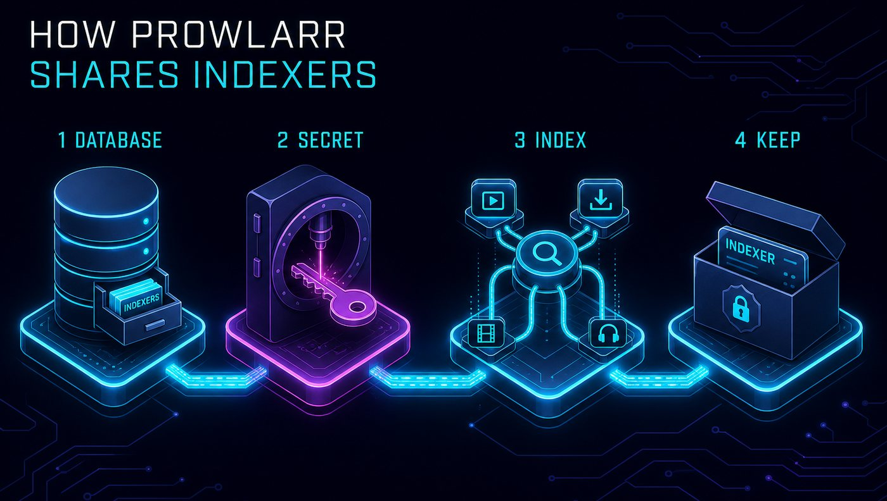
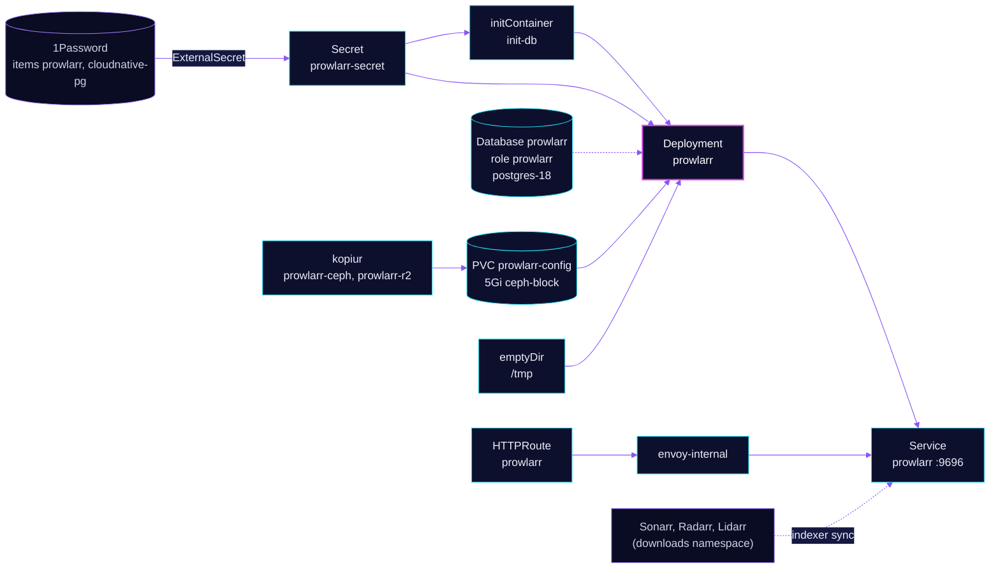

<p align="center">
  
</p>

> **Indexers defined once.** Prowlarr holds the Usenet indexers and syncs them to Sonarr, Radarr, Lidarr and the rest,
> so none of those apps carries its own list. Its database lives on the shared postgres-18 Cluster. Torrent indexers are
> not configured here, by decision (skill `media-stack`).

## At a glance

<!-- glance:start -->
<!-- Generated by `readme.py sync`; edit the manifests, not this table. -->
| | |
|---|---|
| **Namespace** | `downloads` |
| **Deployed by** | [`prowlarr`](../../../main/downloads/prowlarr.yaml) (Flux Kustomization) |
| **Helm chart** | `app-template`, values in [`helmrelease.yaml`](app/helmrelease.yaml) |
| **Images** | `ghcr.io/home-operations/postgres-init`, `ghcr.io/home-operations/prowlarr` |
| **Depends on** | `downloads/prowlarr-db`, `security/onepassword-store`, `system/kopiur-repository` |
| **Secret** | `prowlarr-secret` from onepassword item `cloudnative-pg`, `prowlarr` |
| **Backup** | kopiur component on the overlay (skill `kopiur-backups`) |
<!-- glance:end -->

## What it does

- **Holds** the indexer list and each indexer's credentials and settings. These are app state in PostgreSQL, not Git.
- **Syncs** the indexers to the *arr apps through their APIs. A search from Sonarr, Radarr or Lidarr goes through
  Prowlarr.
- **Stores its database** as role and database `prowlarr` on the shared `postgres-18` Cluster, created by the
  `prowlarr-db` Kustomization.
- **Keeps its config** on the 5Gi `prowlarr-config` claim, backed up by kopiur to Ceph and R2.
- **Exposes** the UI as `prowlarr.${SECRET_DOMAIN}` on `envoy-internal`, with a Homepage tile in the Downloads group.

## Why it is built this way

| Choice | Why |
|---|---|
| **Usenet indexers only** | Torrent indexers were deleted through the app's API, and no torrent client is deployed. The namespace has no torrent path by decision. Re-adding one is a new decision, not a leftover. |
| **One indexer manager, not one per app** | Each indexer is configured and rate-limited once. The *arr apps only need Prowlarr's URL and API key. |
| **PostgreSQL, not SQLite** | The app's database is on the shared CNPG Cluster, which barman backs up. The config claim holds the rest of its state. |
| **`PUID 3002`, `PGID 3000`** | The UID and GID differ. The group is not the UID's own group, so the kopiur mover and the pod both use `3002:3000` (skill `kopiur-backups`). |
| **`/tmp` as `emptyDir`** | The root filesystem is read-only. The HelmRelease comment says the app writes its data-protection key ring under `/tmp`. |

## How it works

<p align="center">
  
</p>

<p align="center">
  
</p>

<details>
<summary><b>Resource graph</b>: every object involved, by name</summary>



</details>

In more detail:

1. Flux applies `prowlarr-db` first, which creates role and database `prowlarr` on `postgres-18`. Then `prowlarr` starts
   after `onepassword-store` and `kopiur-repository`, with the kopiur component and `pvc` component for the claim.
2. `init-db` runs `postgres-init` with `prowlarr-secret` as its environment. The main container gets the same Secret, so
   it connects to PostgreSQL with `PROWLARR__POSTGRES__*`.
3. Prowlarr listens on 9696. Liveness and readiness probe `/ping`. The config claim and the `/tmp` emptyDir are writable; the rest of the root filesystem is read-only.
4. The config claim is backed up by kopiur: to Ceph every 4 hours and to R2 daily. The database is backed up by barman through the Cluster.

## Settings that matter

All values are in [`app/helmrelease.yaml`](app/helmrelease.yaml) unless noted. The database is in
[`../../../../components/cnpg-database`](../../../../components/cnpg-database) and [`prowlarr-db`](../../../main/downloads/prowlarr.yaml).

| Setting | Value | Why |
|---|---|---|
| `pod.securityContext` | UID `3002`, GID `3000`, `fsGroup: 3000`, `fsGroupChangePolicy: OnRootMismatch` | The uid and gid are not the same number, and the claim is group-owned by `3000`. Matches `KOPIUR_PUID` and `KOPIUR_PGID`. |
| `PROWLARR__AUTH__METHOD` | `External` | Upstream behaviour, not verified here: Prowlarr expects an authenticating proxy in front of it. No SecurityPolicy is attached to this route (see Known gaps). |
| `PROWLARR__LOG__DBENABLED` | `"False"` | Keeps the log out of the database. |
| `PROWLARR__LOG__LEVEL` | `info` | Set explicitly in Git, the level the other download apps use. |
| `probes` | `/ping` on 9696, failure threshold 3 | Prowlarr's own health endpoint. The 1s timeout ties Sonarr as the shortest in this namespace, so a busy pod can fail it. |
| `resources` | requests 18m CPU and 128Mi; limit 512Mi memory | Every limit has a request. There is no CPU limit. |
| `tmp` | `emptyDir` at `/tmp` | Writable path on the read-only root. See the Known gaps for the key ring that lives here. |
| `persistence.config` | `existingClaim: prowlarr-config` | 5Gi, kopiur-backed. |

## Alerts

There are no Prowlarr alerts in this directory.

## Operate it

```bash
flux -n downloads get ks prowlarr prowlarr-db            # Flux view, both Kustomizations
kubectl -n downloads get pods -l app.kubernetes.io/name=prowlarr
kubectl -n database get database,databaserole | grep prowlarr
kubectl get snapshotpolicy,restore -n downloads | grep prowlarr
```

## Known gaps

- **No Gatus endpoint.** The route has no `gatus.home-operations.com/endpoint` annotation, so `prowlarr.${SECRET_DOMAIN}` is
  not probed. Only `lidarr` and `shelfmark` in this namespace carry the annotation.
- **The data-protection key ring is on the `emptyDir`.** The HelmRelease comment says v3 writes its key ring under
  `/tmp`, and `/tmp` is an `emptyDir`, so pod recreation (not a container restart) resets it. Whether Prowlarr stores anything encrypted with the ring is unverified, and if it does, those values stop decrypting after a reset. Confirm whether the ring must survive a restart,
  and if so move it onto the `prowlarr-config` claim.
- **The superuser password reaches the app Secret.** `prowlarr-secret` carries `INIT_POSTGRES_SUPER_PASS` from the
  `cloudnative-pg` item, the same as Lidarr. The role and database come from `prowlarr-db`, so check whether `postgres-init`
  needs it before removing it.
- **No SecurityPolicy, and external auth.** `PROWLARR__AUTH__METHOD` is `External` and the route has no SecurityPolicy. The
  only gate is that `prowlarr.${SECRET_DOMAIN}` is reachable on `envoy-internal`.


## Files

| File | Holds |
|---|---|
| [`app/helmrelease.yaml`](app/helmrelease.yaml) | Chart values: pod security, probes, persistence, route |
| [`app/externalsecret.yaml`](app/externalsecret.yaml) | Database settings and API key from 1Password items `prowlarr` and `cloudnative-pg` |
| [`../../../main/downloads/prowlarr.yaml`](../../../main/downloads/prowlarr.yaml) | Flux Kustomizations `prowlarr` (kopiur) and `prowlarr-db` (database) |

Upstream: [Prowlarr](https://prowlarr.com/) •
[Servarr wiki for Prowlarr](https://wiki.servarr.com/prowlarr)

<!-- branded-readme v1 sources=bf4d7cf43dfa -->
