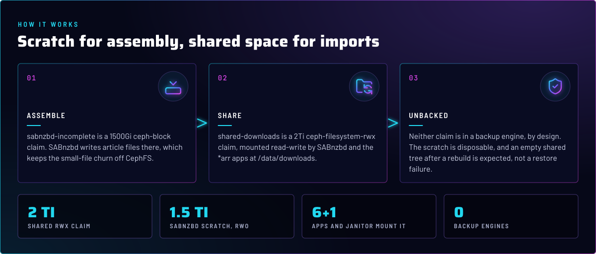
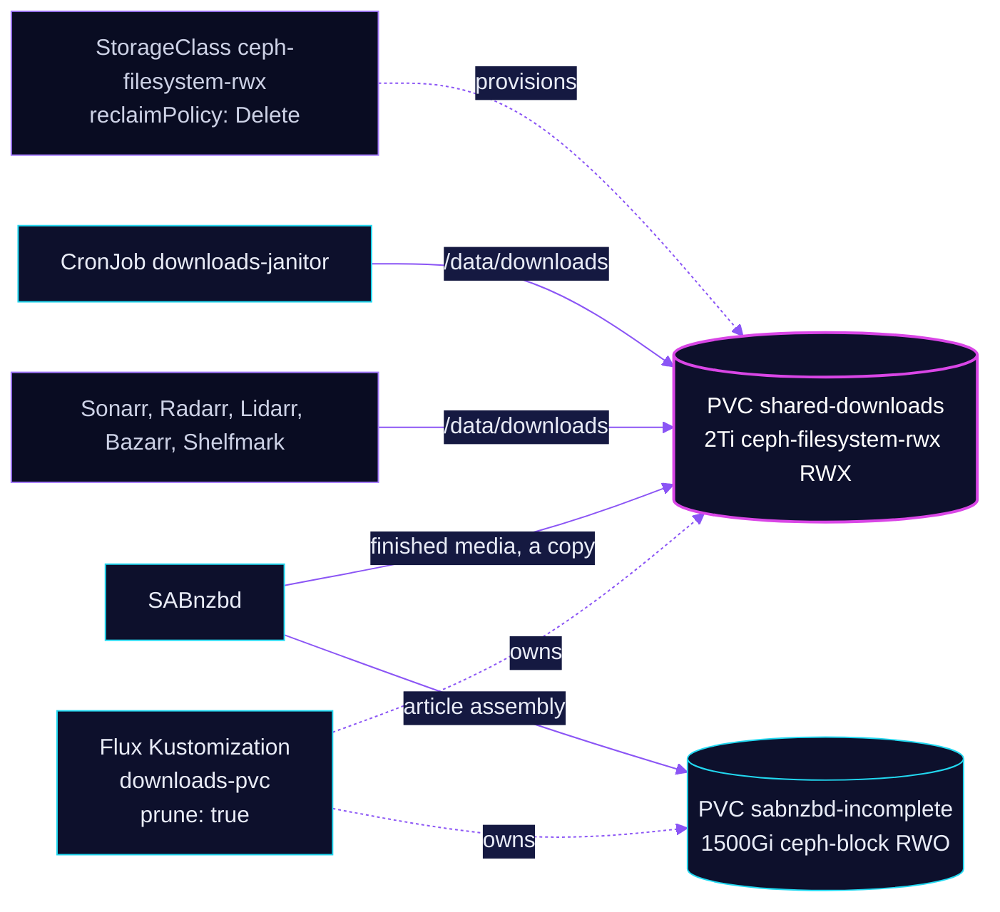

<p align="center">
  
</p>

> **Two claims, two jobs.** `shared-downloads` is the 2Ti RWX tree that SABnzbd and the *arr apps share. `sabnzbd-incomplete`
> is the 1500Gi RWO scratch where SABnzbd assembles articles. Neither is in a backup engine, by design: one is disposable,
> and the other is re-created by the downloads.

## At a glance

<!-- glance:start -->
<!-- Generated by `readme.py sync`; edit the manifests, not this table. -->
| | |
|---|---|
| **Namespace** | `downloads` |
| **Deployed by** | [`downloads-pvc`](../../../main/downloads/pvc.yaml) (Flux Kustomization) |
| **Depends on** | `rook-ceph/rook-ceph-cluster` |
| **Needed by** | `downloads/bazarr`, `downloads/downloads-maintenance`, `downloads/lidarr`, `downloads/radarr`, `downloads/sabnzbd`, `downloads/shelfmark`, `downloads/sonarr` |
| **Volume** | `sabnzbd-incomplete` 1500Gi on `ceph-block` |
| **Volume** | `shared-downloads` 2Ti on `ceph-filesystem-rwx` |
<!-- glance:end -->

## What it does

- **Declares** `shared-downloads`, a 2Ti `ReadWriteMany` claim on `ceph-filesystem-rwx`. Six apps and the janitor
  mount it: SABnzbd, Sonarr, Radarr, Lidarr, Bazarr and Shelfmark, plus the janitor CronJob.
- **Declares** `sabnzbd-incomplete`, a 1500Gi `ReadWriteOnce` claim on `ceph-block`, for SABnzbd's article assembly.
- **Owns** the claims in Git. The Kustomization `downloads-pvc` has `prune: true` and `wait: false`.

## Why it is built this way

| Choice | Why |
|---|---|
| **Scratch on RBD, not CephFS** | Assembly writes thousands of tiny `SABnzbd_article_*` files. On CephFS those storm the MDS metadata journal and can stall the filesystem. On RBD the churn stays inside the block device, and Ceph sees 4MB objects. |
| **Shared tree on CephFS RWX** | The *arr apps need one filesystem that SABnzbd, Sonarr and Radarr all write to. An RWX claim is the only way to share it across nodes. |
| **`ceph-filesystem-rwx`, group `csi-rwx`** | The default `csi` subvolume group fails with `EINVAL` (skill `rook-ceph`), so the claim uses `csi-rwx`. The revert condition is recorded in [`baseline.md`](../../../../../.agents/skills/rook-ceph/references/baseline.md) (line 73) and [`changelog.md`](../../../../../.agents/skills/rook-ceph/references/changelog.md) (line 16). |
| **No backup on either claim** | The scratch is disposable. The shared tree is the downloads themselves, and an empty shared tree after a rebuild is expected (skill `kopiur-backups`). |
| **1500Gi scratch** | Large UHD batches with par2 and multi-file assembly filled 500Gi and paused downloads. The claim only uses space while it is in use. |

## How it works

<p align="center">
  
</p>

<details>
<summary><b>Resource graph</b>: every object involved, by name</summary>



</details>

In more detail:

1. Flux applies `downloads-pvc` after `rook-ceph-cluster`. It creates both claims, and the storage class binds them.
2. SABnzbd mounts `sabnzbd-incomplete` at its incomplete directory and writes assembly there. Finished media moves to
   `complete` on `shared-downloads`. That crosses filesystems, so it is a copy, not a rename.
3. The *arr apps and the janitor mount `shared-downloads` at `/data/downloads`. SABnzbd mounts it too, with its RBD scratch
   shadowing `usenet/incomplete` on that path.
4. The `downloads-maintenance` Kustomization runs the janitor and the two capacity alerts against `shared-downloads`.

## Settings that matter

All values are in [`app/shared-downloads.yaml`](app/shared-downloads.yaml) and [`app/sabnzbd-incomplete.yaml`](app/sabnzbd-incomplete.yaml).

| Setting | Value | Why |
|---|---|---|
| `shared-downloads` `storageClassName` | `ceph-filesystem-rwx` | RWX on CephFS, group `csi-rwx`. The default group has the bug described in skill `rook-ceph`. |
| `shared-downloads` `storage` | `2Ti` | The SABnzbd `complete_free` pause is 100G, about 5% of 2Ti. The alerts are sized from this number. |
| `sabnzbd-incomplete` `storageClassName` | `ceph-block` | RBD keeps the assembly churn off the MDS. |
| `sabnzbd-incomplete` `storage` | `1500Gi` | Large UHD batches with par2 filled 500Gi. The reservation consumes space only when used. |
| `accessModes` | `ReadWriteMany` and `ReadWriteOnce` | Shared tree across apps, and a single-writer scratch. |

## Alerts

There are no alerts in this directory. The capacity alerts on `shared-downloads` live in `downloads/maintenance`.

## Operate it

```bash
flux -n downloads get ks downloads-pvc                   # Flux view
kubectl -n downloads get pvc shared-downloads sabnzbd-incomplete
kubectl -n downloads describe pvc shared-downloads       # bound, capacity, events
```

Do not measure or delete `shared-downloads` from the SABnzbd pod. Its RBD incomplete mount shadows the CephFS path there.
The runbook is in skill `media-stack`, `references/sabnzbd-disk-space.md`.

## Known gaps

- **Removing a claim from Git deletes its data.** `downloads-pvc` has `prune: true` ([`pvc.yaml`](../../../main/downloads/pvc.yaml)). `ceph-filesystem-rwx` has `reclaimPolicy: Delete` ([`cephfs-rwx-storageclass.yaml`](../../rook-ceph/rook-ceph/cluster/cephfs-rwx-storageclass.yaml), line 22). Deleting the claim YAML therefore deletes `shared-downloads`, which has no backup. Neither claim carries a retain annotation or the kopiur `ssa: IfNotPresent` label.
- **The no-backup decision is recorded in prose only.** No kopiur policy covers either claim, so nothing alerts if one is
  lost. The reason is in skill `kopiur-backups` and the claim comments.

## Files

| File | Holds |
|---|---|
| [`app/shared-downloads.yaml`](app/shared-downloads.yaml) | 2Ti RWX claim on `ceph-filesystem-rwx` |
| [`app/sabnzbd-incomplete.yaml`](app/sabnzbd-incomplete.yaml) | 1500Gi RWO scratch on `ceph-block` |
| [`app/kustomization.yaml`](app/kustomization.yaml) | The two resources |
| [`../../../main/downloads/pvc.yaml`](../../../main/downloads/pvc.yaml) | Flux Kustomization `downloads-pvc` |

<!-- branded-readme v1 sources=c6ee893b6acb -->
