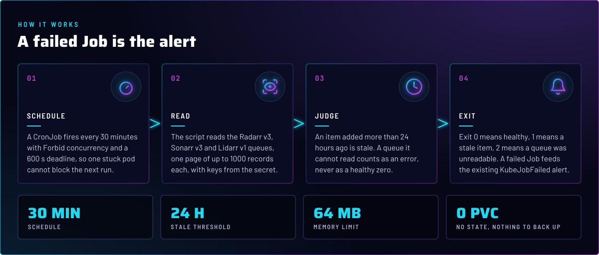
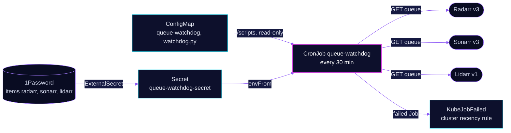

  

> **A failed Job is the alert.** Every 30 minutes a small Python script asks the Radarr, Sonarr and Lidarr queues for
> anything older than 24 hours. A stale item or an unreadable queue fails the Job, and the existing `KubeJobFailed`
> rule pages on it. The script is stdlib only and runs in a read-only container.

## At a glance

<!-- glance:start -->
<!-- Generated by `readme.py sync`; edit the manifests, not this table. -->
| | |
|---|---|
| **Namespace** | `downloads` |
| **Deployed by** | [`queue-watchdog`](../../../main/downloads/queue-watchdog.yaml) (Flux Kustomization) |
| **Helm chart** | `app-template`, values in [`helmrelease.yaml`](app/helmrelease.yaml) |
| **Images** | `mirror.gcr.io/python` |
| **Depends on** | `security/onepassword-store` |
| **Secret** | `queue-watchdog-secret` from onepassword item `lidarr`, `radarr`, `sonarr` |
<!-- glance:end -->

## What it does

- **Runs** as a CronJob every 30 minutes in `downloads`. The script lives in a ConfigMap generated from
  [`watchdog.py`](app/watchdog.py) and mounted read-only at `/scripts`.
- **Reads** each service's queue once, one page of up to 1000 records: Radarr v3, Sonarr v3 and Lidarr v1.
- **Judges** an item stale when its `added` time is more than 24 hours old.
- **Exits** 0 when every queue is clean, 1 when a stale item exists, and 2 when a queue could not be read. An
  unreadable queue is never reported as healthy.
- **Prints** counts and item ids only. The API keys and the exception text are left out of the log, because the
  exception text can contain a key.

## Why it is built this way

| Choice | Why |
|---|---|
| **A failed Job, not a metric** | Nothing new has to be scraped or alerted on. The cluster's `KubeJobFailed` recency rule pages on a failed Job after 15 minutes, so the watchdog adds one check and no alert rule. |
| **Exit 2 is its own code** | A queue the script cannot read would look healthy if it returned 0. A separate code keeps "unreadable" from passing as "empty". |
| **One page, and a fail if there is more** | If the queue has more records than one page, the script raises instead of checking only the first page. A partial read is an error, not a clean result. |
| **Python 3 stdlib only** | No pip install and no image beyond the stock interpreter. The script has nothing to drift. |

## How it works

  

<b>Resource graph</b>: every object involved, by name

In more detail:

1. Flux applies the ExternalSecret, the ConfigMap and the HelmRelease. The CronJob is the only workload.
2. Each run starts one pod with `runAsUser` 2000 and a read-only root filesystem. The pod gets the three API keys from
   the Secret and the three service URLs from the HelmRelease.
3. The script checks Radarr, Sonarr and Lidarr in turn. It prints one line per service and returns the worst code.
4. A Job that exits non-zero fails once (`backoffLimit: 0`). The next run is skipped only while a pod from the last one is
   still active (`Forbid`).

## Settings that matter

All values are in [`app/helmrelease.yaml`](app/helmrelease.yaml) unless noted.

| Setting | Value | Why |
|---|---|---|
| `concurrencyPolicy` | `Forbid` | A run that is still going blocks the next one. |
| `activeDeadlineSeconds` | `600` | A pod that never starts (for example, a missing Secret) fails the Job instead of blocking every later run under `Forbid`. |
| `startingDeadlineSeconds` | `600` | A run that cannot start within 10 minutes of its slot is skipped. |
| `backoffLimit` | `0` | One attempt per run. A stale item is not a transient error, so a retry would only fail again. |
| `successfulJobsHistory` | `1` | With no successful Job kept, the last failed Job is the only one left, and `KubeJobFailed` latches on it. |
| `ttlSecondsAfterFinished` | `86400` | A failed Job ages out after a day, as a backstop. |
| `runAsUser` / `fsGroup` | `2000` | Matches the other apps in the namespace. |
| `readOnlyRootFilesystem` | `true`, all capabilities dropped | The script writes nothing. `PYTHONDONTWRITEBYTECODE` keeps it from trying. |
| `resources` | request 5m CPU and 32M memory; limit 64M memory | The script is small. |

## Alerts

| Alert | Fires when | First look |
|---|---|---|
| `KubeJobFailed` (cluster recency rule) | a Job of this CronJob has been failed for 15 minutes, and stops 12 hours after the Job started. The chart's copy is disabled ([helmrelease](../../monitoring/kube-prometheus-stack/app/helmrelease.yaml), [rule](../../monitoring/kube-prometheus-stack/app/alerts/kubernetes-apps-recency.yaml)) | `kubectl -n downloads logs job/<name>`. The line says which service and how many items are stale, or that a queue was unreadable. |

## Known gaps

- **No ignore list.** A stale item fails every run until it leaves the queue. An item an owner has parked on purpose, such
  as one waiting for a manual import, keeps the alert firing. Clear the item in the app, because the script has no way to
  skip one.

## Files

| File | Holds |
|---|---|
| [`app/watchdog.py`](app/watchdog.py) | The check: queue reads, the 24-hour rule, the exit codes |
| [`app/helmrelease.yaml`](app/helmrelease.yaml) | CronJob settings, image, env, read-only mount |
| [`app/externalsecret.yaml`](app/externalsecret.yaml) | `queue-watchdog-secret`: the three API keys from 1Password items `radarr`, `sonarr`, `lidarr` |
| [`app/kustomization.yaml`](app/kustomization.yaml) | Resource list and the ConfigMap generator for `watchdog.py` |
| [`../../../main/downloads/queue-watchdog.yaml`](../../../main/downloads/queue-watchdog.yaml) | Flux Kustomization, `dependsOn` the secret store |

Upstream: [Kubernetes CronJob](https://kubernetes.io/docs/concepts/workloads/controllers/cron-jobs/) •
[Radarr API](https://radarr.video/docs/api/) • [Sonarr API](https://sonarr.tv/docs/api/) • [Lidarr API](https://lidarr.audio/docs/api/)

<!-- branded-readme v1 sources=defebba4df1f -->
