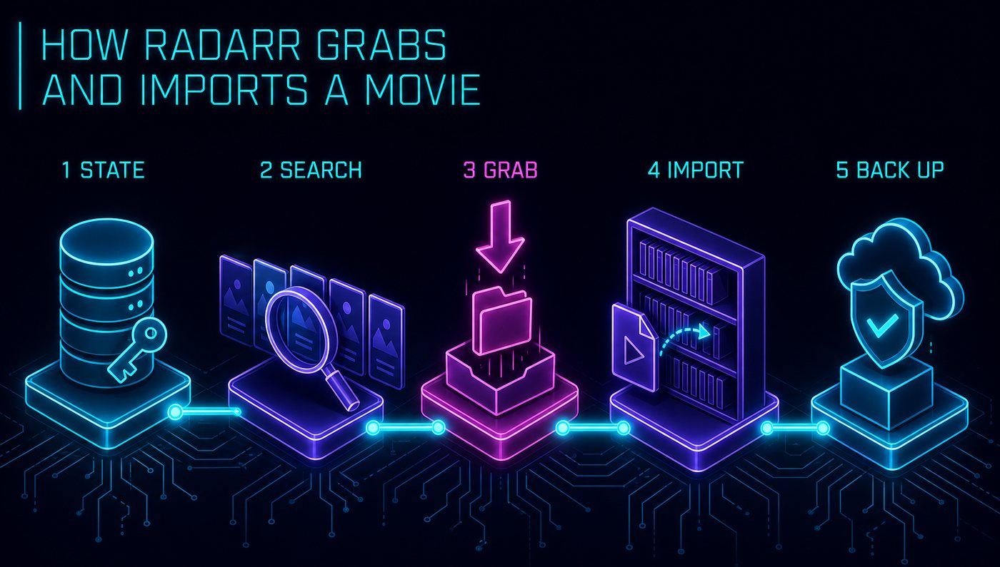
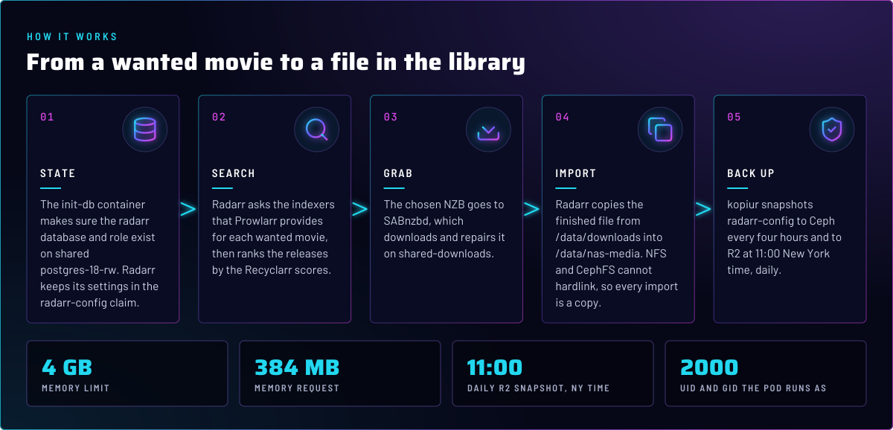
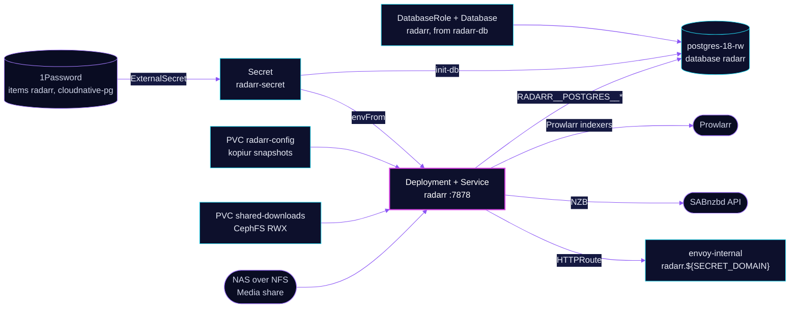

  

> **Usenet-only movie PVR.** Radarr keeps the wanted list, searches the indexers Prowlarr provides, sends the chosen
> release to SABnzbd, and copies the finished file to the NAS library. Its database is on the shared Postgres Cluster and
> its config is a kopiur claim. Both are backed up.

## At a glance

<!-- glance:start -->
<!-- Generated by `readme.py sync`; edit the manifests, not this table. -->
| | |
|---|---|
| **Namespace** | `downloads` |
| **Deployed by** | [`radarr`](../../../main/downloads/radarr.yaml) (Flux Kustomization) |
| **Helm chart** | `app-template`, values in [`helmrelease.yaml`](app/helmrelease.yaml) |
| **Images** | `ghcr.io/home-operations/postgres-init`, `ghcr.io/home-operations/radarr` |
| **Depends on** | `downloads/downloads-pvc`, `downloads/radarr-db`, `security/onepassword-store`, `system/kopiur-repository` |
| **Secret** | `radarr-secret` from onepassword item `cloudnative-pg`, `radarr` |
| **Backup** | kopiur component on the overlay (skill `kopiur-backups`) |
<!-- glance:end -->

## What it does

- **Tracks** the movie library in the `radarr` database on the shared `postgres-18` Cluster (`RADARR__POSTGRES__*`).
  The role and the database are declared by the `radarr-db` Flux Kustomization in the
  [overlay](../../../main/downloads/radarr.yaml), with `retain` on both, so removing the app never drops the data.
- **Searches** the indexers that Prowlarr syncs into it. There is no torrent client in the namespace. Radarr does not
  search for missing movies on its own; a backlog search is a deliberate step (skill `media-stack`).
- **Ranks** each release with the scores Recyclarr writes into the `[SQP] SQP-1` profiles, see [recyclarr](../recyclarr/README.md).
- **Hands** the chosen NZB to SABnzbd, then copies the finished file from `/data/downloads` to `/data/nas-media`, the
  `Media` share on the NAS over NFS.
- **Serves** its UI at `radarr.${SECRET_DOMAIN}` on `envoy-internal` only. The Homepage tile comes from the route annotations.

## Why it is built this way

| Choice | Why |
|---|---|
| **Postgres, not the bundled SQLite** | The database lives on the shared `postgres-18` Cluster, so its data is in the Cluster's backup destination and the pod keeps no database on its own volume. |
| **Copy on import, not hardlink** | The downloads share is CephFS and the library is NFS on the NAS. Neither can hardlink across the other, so every import copies and the copy window needs double the disk (skill `media-stack`). |
| **Library on the NAS, not on Ceph** | The movie library is mounted over NFS from the NAS. Ceph holds only the config claim and the downloads scratch, so the library is not stored twice. |
| **Recyclarr owns scores, not the UI** | Profile definitions and format scores come from Git, so a rebuild ranks releases the same way. Which movie uses which profile is still Radarr state and is not in Git. |
| **No node affinity; a taint keeps it off talos-3** | talos-3 carries a `PreferNoSchedule` taint and Radarr has no toleration, so the scheduler scores it away. A hard exclusion written per app would fail open for any app that forgets it (skill `node-scheduling`). |

## How it works

  

  

<b>Resource graph</b>: every object involved, by name

In more detail:

1. Flux applies `radarr-db` first. It waits for the `postgres-18` Cluster and the 1Password store, then creates the
   `DatabaseRole` and `Database`. The app's own Kustomization waits for that, for `downloads-pvc` and for the kopiur repository.
2. The `init-db` init container connects with the superuser password from the same Secret and makes sure the role and
   database exist before Radarr starts.
3. Radarr starts with its database pointed at `postgres-18-rw`, reads its config from `radarr-config`, and sees the
   downloads at `/data/downloads` and the library at `/data/nas-media`.
4. kopiur snapshots `radarr-config` to Ceph every four hours and to R2 once a day at 11:00 New York time. The claim's `dataSourceRef` points at a kopiur
   `Restore`, so a rebuilt cluster refills the claim from its backup.

## Settings that matter

All values are in [`app/helmrelease.yaml`](app/helmrelease.yaml) unless noted.

| Setting | Value | Why |
|---|---|---|
| `RADARR__AUTH__METHOD` / `RADARR__AUTH__REQUIRED` | `External` / `DisabledForLocalAddresses` | Login is left to whatever sits in front of the app. Local addresses skip it. See Known gaps. |
| `RADARR__LOG__DBENABLED` | `"False"` | Log rows stay out of the Postgres database. |
| `RADARR__UPDATE__BRANCH` | `develop` | Unrecorded decision. Git does not say why the in-app update channel is `develop`. Upgrades go through the pinned image tag, which Renovate bumps. |
| `init-db` init container | `postgres-init` image, `envFrom: radarr-secret` | Creates the role and database before first start, with the superuser password from the Secret. |
| Probes (`liveness`, `readiness`) | `httpGet /ping`, 5 failures at 10 s | `/ping` returns non-200 when the app is down, so the probe can fail (skill `app-workloads`). |
| `resources` | request 100m CPU and 384Mi memory; limit 4Gi memory | Only a memory limit, no CPU limit, so a scan or an import is not throttled. Every limit has a request (skill `node-scheduling`). |
| `pod.securityContext` | UID and GID `2000`, `fsGroup` `2000`, `OnRootMismatch` | The owner of the files on the claim. `KOPIUR_PUID` and `KOPIUR_PGID` in the overlay must match, or the backup fails closed (skill `kopiur-backups`). |
| `persistence.media` | NFS `nas.${SECRET_DOMAIN}:/mnt/storage/Media` at `/data/nas-media` | The library stays on the NAS. Imports copy, because NFS and CephFS cannot hardlink. |
| `persistence.downloads` | `shared-downloads` (CephFS RWX) at `/data/downloads` | The same path SABnzbd reports, so the paths in the queue match on both sides. |
| `persistence.config` | `radarr-config`, kopiur-backed | The Radarr config directory. The overlay sizes it at 5Gi on `ceph-block`. |
| Node placement | no affinity, no toleration | Keeps Radarr off talos-3 by score. See the Why table. |

## Known gaps

- **Login is delegated, and nothing in Git delegates it.** `RADARR__AUTH__METHOD` is `External`, so Radarr trusts the
  proxy in front to log users in. The only route is on `envoy-internal`, and the only `SecurityPolicy` in `network` is
  for `echo`. So the gate is reachability of the internal gateway. Confirm that is the intent (skill `networking`).

## Files

| File | Holds |
|---|---|
| [`app/helmrelease.yaml`](app/helmrelease.yaml) | Chart values: init container, probes, resources, mounts, route |
| [`app/externalsecret.yaml`](app/externalsecret.yaml) | `radarr-secret`: the Postgres variables, the API key, from 1Password item `radarr` and `cloudnative-pg` |
| [`app/kustomization.yaml`](app/kustomization.yaml) | Resource list |
| [`../../../main/downloads/radarr.yaml`](../../../main/downloads/radarr.yaml) | Flux Kustomizations `radarr` and `radarr-db`, the kopiur component and its `KOPIUR_*` values |
| [`../pvc/app/shared-downloads.yaml`](../pvc/app/shared-downloads.yaml) | The CephFS RWX claim Radarr, Sonarr and SABnzbd all mount |

Upstream: [Radarr](https://radarr.video/) • [Servarr wiki](https://wiki.servarr.com/radarr) • [Radarr API](https://radarr.video/docs/api/)

<!-- branded-readme v1 sources=95b9a9dc5d62 -->
