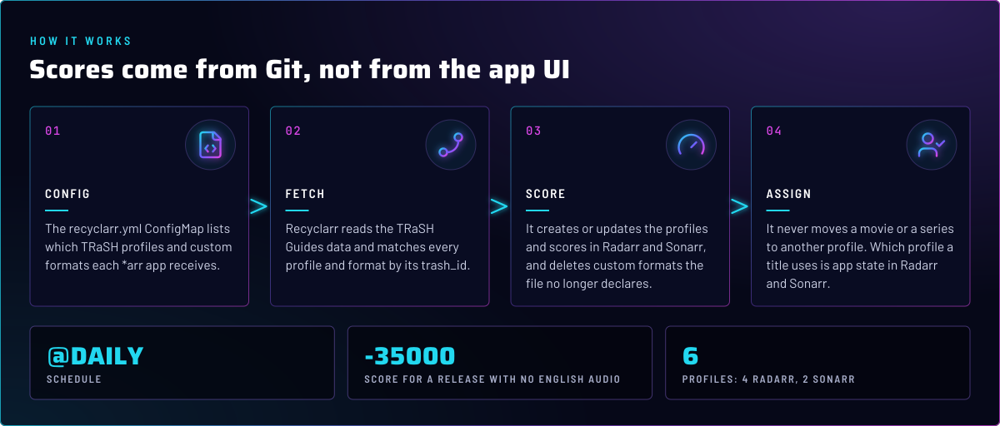
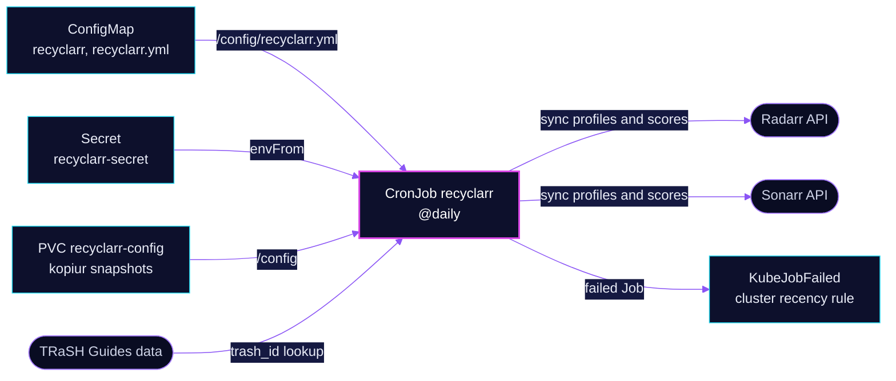

  

> **Release ranking lives in Git.** Once a day Recyclarr reads the TRaSH Guides data, creates or updates the quality
> profiles and custom-format scores in Radarr and Sonarr, and deletes the formats its file no longer names. It does not
> move any movie or series between profiles.

## At a glance

<!-- glance:start -->
<!-- Generated by `readme.py sync`; edit the manifests, not this table. -->
| | |
|---|---|
| **Namespace** | `downloads` |
| **Deployed by** | [`recyclarr`](../../../main/downloads/recyclarr.yaml) (Flux Kustomization) |
| **Helm chart** | `app-template`, values in [`helmrelease.yaml`](app/helmrelease.yaml) |
| **Images** | `ghcr.io/recyclarr/recyclarr` |
| **Depends on** | `security/onepassword-store`, `system/kopiur-repository` |
| **Secret** | `recyclarr-secret` from onepassword item `radarr`, `sonarr` |
| **Backup** | kopiur component on the overlay (skill `kopiur-backups`) |
<!-- glance:end -->

## What it does

- **Declares** six quality profiles in [`recyclarr.yml`](app/config/recyclarr.yml): two on Sonarr (`WEB-1080p`,
  `WEB-2160p`) and four on Radarr (`[SQP] SQP-1` at 2160p and 1080p, `HD Bluray + WEB`, `UHD Bluray + WEB`).
- **Scores** the custom formats for each profile, matching every profile and format by `trash_id`, not by name.
- **Enforces** the language policy: a release with no English audio is rejected on every Radarr profile.
- **Runs** as a CronJob at `@daily`. A manual run is a `kubectl create job --from=cronjob/recyclarr` away.

## Why it is built this way

| Choice | Why |
|---|---|
| **Match by `trash_id`** | A TRaSH rename changes a profile's name. A name match would leave the scores on the old profile and create an empty new one (skill `media-stack`). |
| **Reset unmatched scores** | `reset_unmatched_scores` makes the file the whole truth for those profiles. A score edited in the UI is overwritten at the next run. |
| **Delete formats no longer declared** | `delete_old_custom_formats` removes formats Recyclarr created earlier and the file no longer names. Without it, removed lines would keep scoring forever. |
| **Hard reject on non-English audio** | Every movie must carry an English track. A German-only release is rejected even though it is German (skill `media-stack`, Recyclarr reference). |
| **Small penalty for MULTi, not a block** | MULTi titles are more likely to defeat Radarr's import parser, so they score down by 25 and are still grabbed when they are the only match. |
| **Catalogue profiles at minimum score 0** | `HD Bluray + WEB` and `UHD Bluray + WEB` take titles that no TRaSH tier group released. The minimum score comes from the TRaSH data for each `trash_id`: 0 on those two, 1000 on `[SQP] SQP-1`. Git does not set a minimum, so new releases are unchanged. |

## How it works

  

<b>Resource graph</b>: every object involved, by name

In more detail:

1. Flux applies the ConfigMap generated from `config/recyclarr.yml`, the ExternalSecret and the HelmRelease. The
   ConfigMap's `substitute` annotation is disabled, so the file's text is used as it is.
2. At each run the pod reads the two API keys from `recyclarr-secret` through `!env_var`, so the keys never sit in the file.
3. Recyclarr syncs each app's profiles and formats, and prints what it created, updated and deleted.
4. The run ends. Nothing is written back to Git, and the next run repeats the same sync.

## Settings that matter

All values are in [`app/helmrelease.yaml`](app/helmrelease.yaml) and [`app/config/recyclarr.yml`](app/config/recyclarr.yml).

| Setting | Value | Why |
|---|---|---|
| `schedule` | `@daily` | Once a day. The repo records no reason for daily over another interval. |
| `concurrencyPolicy` | `Forbid` | Two syncs must not write to the same profiles at once. |
| `successfulJobsHistory` / `ttlSecondsAfterFinished` | `1` / `86400` | Keeps one success, and lets a failed Job age out, so `KubeJobFailed` does not latch on it. |
| `quality_definition` | `series` on Sonarr, `sqp-streaming` on Radarr | Each family's size limits match the TRaSH profile it uses. |
| `reset_unmatched_scores.enabled` | `true` on every profile | See the Why table. |
| `delete_old_custom_formats` | `true` on both apps | See the Why table. |
| Language formats `Language: Not English` and `German LQ` | score `-35000` on all four Radarr profiles | A release with no English audio is rejected outright. |
| `German DL` | score `+100` | A German dual-audio release with English is a small preference over a single track. |
| `MULTi` | score `-25` | Deprioritized, not blocked (see the Why table). |
| `resources` | request 5m CPU and 36M memory; limit 128M memory | The sync is small. |

## Alerts

| Alert | Fires when | First look |
|---|---|---|
| `KubeJobFailed` (cluster recency rule) | a Job of this CronJob has been failed for 15 minutes, and stops 12 hours after the Job started. The chart's copy is disabled ([helmrelease](../../monitoring/kube-prometheus-stack/app/helmrelease.yaml), [rule](../../monitoring/kube-prometheus-stack/app/alerts/kubernetes-apps-recency.yaml)) | `kubectl -n downloads logs job/<name>`. A failed profile or format usually shows as an API error from Radarr or Sonarr. |

## Known gaps

- **Backed up, but the state may be a cache.** `recyclarr-config` is a kopiur claim, which is backed up to Ceph and to
  R2. The config itself is in Git. If the claim holds only what Recyclarr caches under `/config`, the next sync rebuilds
  it, and the backup buys nothing. Confirm what the claim holds before keeping the R2 copy.

## Files

| File | Holds |
|---|---|
| [`app/config/recyclarr.yml`](app/config/recyclarr.yml) | Profiles, custom formats and scores, per app, by `trash_id` |
| [`app/helmrelease.yaml`](app/helmrelease.yaml) | CronJob settings, image, mounts, resources |
| [`app/externalsecret.yaml`](app/externalsecret.yaml) | `recyclarr-secret`: the Radarr and Sonarr API keys, from 1Password items `radarr` and `sonarr` |
| [`app/kustomization.yaml`](app/kustomization.yaml) | Resource list and the ConfigMap generator |
| [`../../../main/downloads/recyclarr.yaml`](../../../main/downloads/recyclarr.yaml) | Flux Kustomization, the kopiur component and its `KOPIUR_*` values |

Upstream: [Recyclarr](https://recyclarr.dev/) • [TRaSH Guides](https://trash-guides.info/) • [Recyclarr config reference](https://recyclarr.dev/reference/configuration/)

<!-- branded-readme v1 sources=d279fc1ba71e -->
