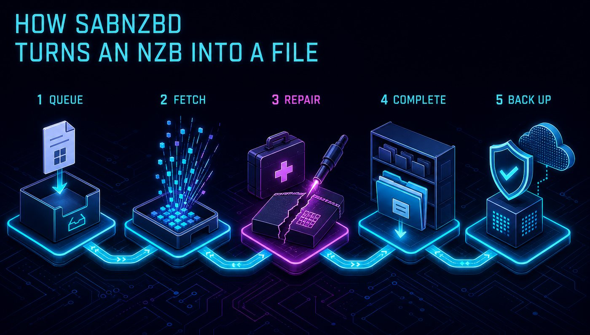
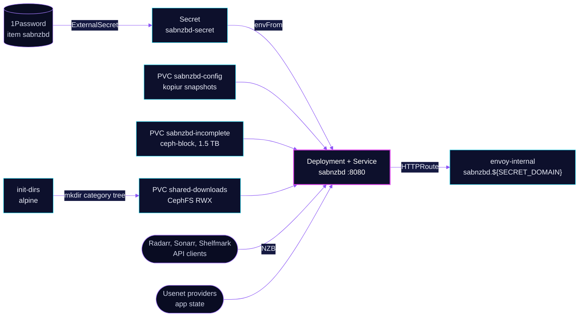

  

> **Usenet downloader for the whole downloads stack.** SABnzbd takes NZBs from Radarr, Sonarr and Shelfmark, fetches the
> articles, repairs and unpacks them, and files the result under `usenet/complete/<category>`. Article assembly runs on
> a Ceph block scratch volume, so the thousands of small article files never reach CephFS.

## At a glance

<!-- glance:start -->
<!-- Generated by `readme.py sync`; edit the manifests, not this table. -->
| | |
|---|---|
| **Namespace** | `downloads` |
| **Deployed by** | [`sabnzbd`](../../../main/downloads/sabnzbd.yaml) (Flux Kustomization) |
| **Helm chart** | `app-template`, values in [`helmrelease.yaml`](app/helmrelease.yaml) |
| **Images** | `ghcr.io/home-operations/sabnzbd` |
| **Depends on** | `downloads/downloads-pvc`, `security/onepassword-store`, `system/kopiur-repository` |
| **Secret** | `sabnzbd-secret` from onepassword item `sabnzbd` |
| **Backup** | kopiur component on the overlay (skill `kopiur-backups`) |
<!-- glance:end -->

## What it does

- **Accepts** NZBs over its API from Radarr, Sonarr, Shelfmark, or a manual add. The Usenet providers and their
  credentials are SABnzbd state, not Git.
- **Fetches** articles into `sabnzbd-incomplete`, the `download_dir` scratch, a `ceph-block` claim of 1.5 TiB. See
  [the PVC](../pvc/app/sabnzbd-incomplete.yaml).
- **Repairs and unpacks** the set with par2, unrar and 7zip, then moves the job to `usenet/complete/<category>` on
  `shared-downloads`. The `init-dirs` init container creates the category tree on every start, so the *arr apps find
  their folders.
- **Serves** its UI and API at `sabnzbd.${SECRET_DOMAIN}` on `envoy-internal` only.

## Why it is built this way

| Choice | Why |
|---|---|
| **Article scratch on `ceph-block`, not CephFS** | Assembly writes thousands of tiny `SABnzbd_article_*` files. On CephFS that storm hits the MDS metadata journal and can stall the whole filesystem. On RBD it stays inside the block device. |
| **Finished files on CephFS RWX** | The *arr apps read `complete/` from the same shared claim, so they see SABnzbd's output at the same path (skill `media-stack`). |
| **`Recreate`, not `RollingUpdate`** | Two RWO claims (config and incomplete) cannot attach to a second pod while the first one holds them. A rolling update would deadlock on Multi-Attach. |
| **Relaxed probes and a high CPU limit** | The API blocks while par2 and unrar run. A 1 s probe timeout restarted a busy process and dropped it from the Service, so only a dead process should be restarted. |
| **Host whitelist** | SABnzbd refuses a `Host` header that is not on its whitelist, which is its DNS-rebinding guard. The list is the service DNS names the *arrs use, plus the route host. |

## How it works

  

  

<b>Resource graph</b>: every object involved, by name

In more detail:

1. Flux applies the ExternalSecret and the HelmRelease. The Kustomization waits on `downloads-pvc` for the two shared
   claims, and on the kopiur repository for the backup.
2. `init-dirs` runs as UID `2000` and creates `usenet/complete/{movies,tv,music,books,audiobooks,comics,magazines,other}`
   and `usenet/incomplete` under `/data/downloads`. Those names are the categories the apps send.
3. SABnzbd starts with `download_dir` on `sabnzbd-incomplete` at `/data/downloads/usenet/incomplete`, and finished
   jobs are written to `complete` on `shared-downloads`.
4. kopiur snapshots `sabnzbd-config` to Ceph every four hours and to R2 once a day. The incomplete volume and the `/tmp` emptyDir are scratch.

## Settings that matter

All values are in [`app/helmrelease.yaml`](app/helmrelease.yaml) unless noted.

| Setting | Value | Why |
|---|---|---|
| `strategy` | `Recreate` | Two RWO claims. See the Why table. |
| `topologySpreadConstraints` | `maxSkew: 2`, `kubernetes.io/hostname`, `ScheduleAnyway`, `nodeTaintsPolicy: Honor` | Keeps talos-3 in the spread domains, so its `PreferNoSchedule` taint scores the pod away from it. |
| `SABNZBD__HOST_WHITELIST_ENTRIES` | short and cluster DNS names, plus `sabnzbd.${SECRET_DOMAIN}` | Requests with any other `Host` header are refused. |
| `probes.liveness` | `/api?mode=version`, every 30 s, 15 s timeout, 5 failures | The API stalls under post-processing. Only a dead process should restart. |
| `probes.readiness` | `/api?mode=version`, every 10 s, 10 s timeout, 3 failures | Keeps the pod out of the Service while it is busy, without restarting it. |
| `resources` | request 500m CPU and 2Gi memory; limit 4 CPU and 10Gi memory | 10Gi because post-processing 60 to 80 GB UHD remuxes OOM-killed below it. The CPU limit is high so par2 is not throttled. |
| `persistence.incomplete` | `sabnzbd-incomplete`, `ceph-block`, 1.5Ti | Article scratch. Disposable, so it has no backup. |
| `persistence.downloads` | `shared-downloads` at `/data/downloads` | The same path the *arr apps use. Finished jobs land in `complete/` here. |
| `KOPIUR_CACHE_CAPACITY` (overlay) | `10Gi` | Mover cache above the component's 2Gi default. A raise does not reach the standing `Restore`, so it applies only after that Restore is deleted (skill `kopiur-backups`). |
| Node placement | no toleration for the talos-3 dedicated taint | `PreferNoSchedule` keeps SABnzbd off talos-3 by score. |

## Known gaps

- **The init container uses an unpinned tag.** `init-dirs` runs `alpine:latest`. That tag is mutable, and Renovate
  has no version to track. Pin a version and digest, as `init-db` and `shelfmark` are pinned.

## Files

| File | Holds |
|---|---|
| [`app/helmrelease.yaml`](app/helmrelease.yaml) | Chart values: init container, probes, resources, mounts, route |
| [`app/externalsecret.yaml`](app/externalsecret.yaml) | `sabnzbd-secret`: the API keys, from 1Password item `sabnzbd` |
| [`app/kustomization.yaml`](app/kustomization.yaml) | Resource list |
| [`../../../main/downloads/sabnzbd.yaml`](../../../main/downloads/sabnzbd.yaml) | Flux Kustomization, the kopiur component and its `KOPIUR_*` values |
| [`../pvc/app/sabnzbd-incomplete.yaml`](../pvc/app/sabnzbd-incomplete.yaml) | The article scratch claim and why it is on `ceph-block` |
| [`../pvc/app/shared-downloads.yaml`](../pvc/app/shared-downloads.yaml) | The CephFS RWX claim with `complete/` |

Upstream: [SABnzbd docs](https://sabnzbd.org/wiki/) • [Servarr wiki, download clients](https://wiki.servarr.com/radarr/settings#download-clients)

<!-- branded-readme v1 sources=41970ca780a9 -->
