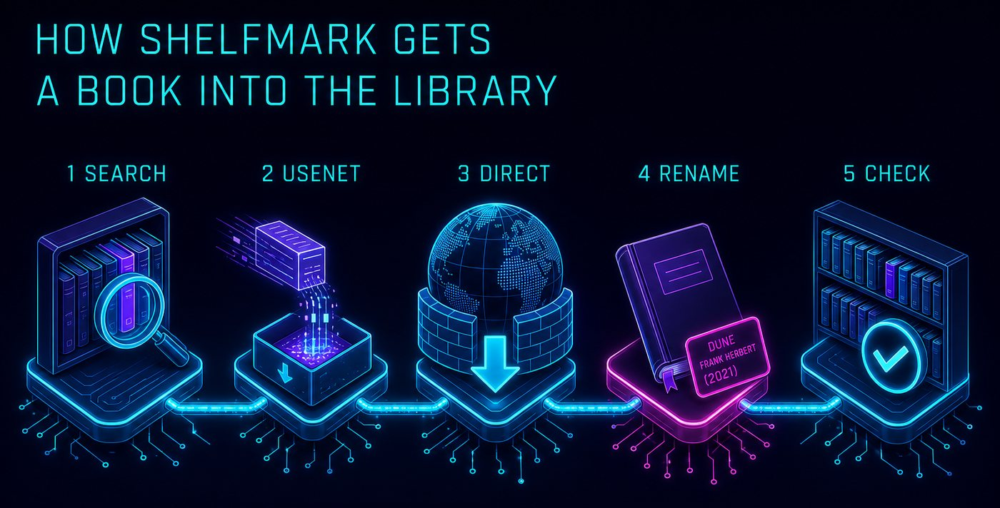
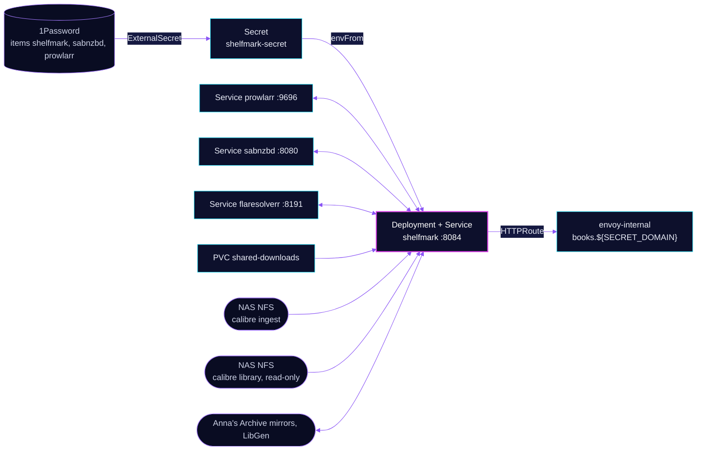

  

> **Book requests into the CWA ingest folder.** Shelfmark searches Prowlarr and the metadata providers, downloads over
> Usenet through SABnzbd or directly over HTTP, and writes renamed files where Calibre-Web Automated picks them up.
> Nothing it writes needs a backup: it keeps no state of its own.

## At a glance

<!-- glance:start -->
<!-- Generated by `readme.py sync`; edit the manifests, not this table. -->
| | |
|---|---|
| **Namespace** | `downloads` |
| **Deployed by** | [`shelfmark`](../../../main/downloads/shelfmark.yaml) (Flux Kustomization) |
| **Helm chart** | `app-template`, values in [`helmrelease.yaml`](app/helmrelease.yaml) |
| **Images** | `ghcr.io/calibrain/shelfmark-lite` |
| **Depends on** | `downloads/downloads-pvc`, `security/onepassword-store` |
| **Secret** | `shelfmark-secret` from onepassword item `prowlarr`, `sabnzbd`, `shelfmark` |
<!-- glance:end -->

## What it does

- **Searches** Prowlarr for Usenet releases, and the Hardcover, Google Books and Moly metadata providers for the title.
- **Downloads** a Usenet pick through SABnzbd in the `books` category, on `shared-downloads`.
- **Downloads directly** from Anna's Archive mirrors and LibGen search. Cloudflare-fronted pages go through FlareSolverr.
  The lite image has no browser of its own.
- **Renames** each file to `Author - Title (Year)` and writes it to `/cwa-book-ingest`, the NFS ingest folder that
  Calibre-Web Automated reads.
- **Checks** the read-only CWA library mount, so it can see which books are already held.
- **Serves** its UI at `books.${SECRET_DOMAIN}` on `envoy-internal`, with a Gatus check on `/api/health`.

## Why it is built this way

| Choice | Why |
|---|---|
| **All configuration in environment variables** | Shelfmark's settings come from env, so they are in Git rather than in an app database, and a rebuild restores them. |
| **No own PVC, no kopiur** | The app writes nothing it needs to keep. Its state directories are emptyDirs and restart clean. It mounts `shared-downloads` and the NFS paths, but owns no claim of its own. |
| **No torrents** | The namespace has no torrent path by decision (skill `media-stack`). Prowlarr finds Usenet releases only. |
| **FlareSolverr for Cloudflare pages** | The direct sources sit behind Cloudflare challenges. Solving them in a separate service keeps Chromium out of this image. |
| **`annas-archive.is` is left out** | That domain answers 200 with a different page layout, so the parser finds no results. The listed mirrors are the ones that answer properly. |
| **One emptyDir per path** | A `subPath` directory is created root-owned and ignores `fsGroup`, which left the non-root entrypoint unable to write `/tmp/shelfmark`. |

## How it works

  

  

<b>Resource graph</b>: every object involved, by name

In more detail:

1. Flux applies the ExternalSecret and the HelmRelease. The Kustomization waits on `downloads-pvc` for `shared-downloads`
   and on the 1Password store.
2. A request runs the search on Prowlarr and the metadata providers. A Usenet pick is sent to SABnzbd in the `books`
   category; SABnzbd saves it on `shared-downloads` at the path it reports back.
3. A direct pick is downloaded over HTTP. Challenge pages are solved by FlareSolverr at `/v1`.
4. The finished file is renamed and written to `/cwa-book-ingest`. Calibre-Web Automated imports from there.

## Settings that matter

All values are in [`app/helmrelease.yaml`](app/helmrelease.yaml) unless noted.

| Setting | Value | Why |
|---|---|---|
| `BOOKS_OUTPUT_MODE` / `DESTINATION` | `folder` / `/cwa-book-ingest` | Files go into a folder. Shelfmark does not manage the CWA library itself. |
| `FILE_ORGANIZATION` / `TEMPLATE_RENAME` | `rename` / `{Author} - {Title} ({Year})` | Each file is renamed from its metadata, not kept under the release name. |
| `SABNZBD_CATEGORY` | `books` | The SABnzbd category for books, saved on `shared-downloads` (skill `media-stack`). |
| `EXT_BYPASSER_URL` / `USING_EXTERNAL_BYPASSER` | `flaresolverr` service, path `/v1`, 60 s timeout | The lite image has no Chromium. Cloudflare challenges go to FlareSolverr. |
| `AA_MIRROR_URLS` | three Anna's Archive mirrors, `AA_BASE_URL: auto` | `annas-archive.is` is deliberately absent. See the Why table. |
| `HARDCOVER_ENABLED`, `GOOGLEBOOKS_ENABLED`, `MOLY_ENABLED` | `true` | Three metadata providers. Their API keys come from the secret, never from the env list. |
| `persistence.tmp`, `logs`, `app-state` | emptyDirs at `/tmp`, `/var/log/shelfmark`, `/config` | Nothing needs to survive a restart. `/app/downloaded_files` is a symlink into `/tmp`, so it is not mounted. |
| `persistence.library` | NFS `calibre/library`, `readOnly: true` | Shelfmark can read the library but never write to it. |
| `route.rules.timeouts.request` | `0s` | Turns off the gateway request timeout, so a long direct download is not cut off. |
| Probes | `/api/health` on 8084; liveness starts after a 30 s delay, 6 failures at 10 s | The health path is the app's own, and it is also the Gatus endpoint. |

## Known gaps

- **The homepage tile is Calibre-Web's.** `gethomepage.dev/icon` is `calibre-web.png` and `group` is `media`, which look
  copied from the Calibre-Web route. The other apps in this namespace sit in `Downloads`.
- **`runAsNonRoot: false` is set on the pod.** Every other app in this namespace sets it to `true`. The manifest gives no
  reason for the exception. The pod does run as UID `2000` through `runAsUser`, so check the reason before copying the
  pattern.

## Files

| File | Holds |
|---|---|
| [`app/helmrelease.yaml`](app/helmrelease.yaml) | Chart values: env, probes, mounts, route |
| [`app/externalsecret.yaml`](app/externalsecret.yaml) | `shelfmark-secret`: the donator, metadata and SABnzbd and Prowlarr API keys |
| [`app/kustomization.yaml`](app/kustomization.yaml) | Resource list |
| [`../../../main/downloads/shelfmark.yaml`](../../../main/downloads/shelfmark.yaml) | Flux Kustomization, `dependsOn` the PVC and the secret store |

Upstream: [Shelfmark](https://github.com/calibrain/shelfmark) • [FlareSolverr](https://github.com/FlareSolverr/FlareSolverr) • [Calibre-Web Automated](https://github.com/crocodilestick/Calibre-Web-Automated)

<!-- branded-readme v1 sources=5d49ee0edef3 -->
