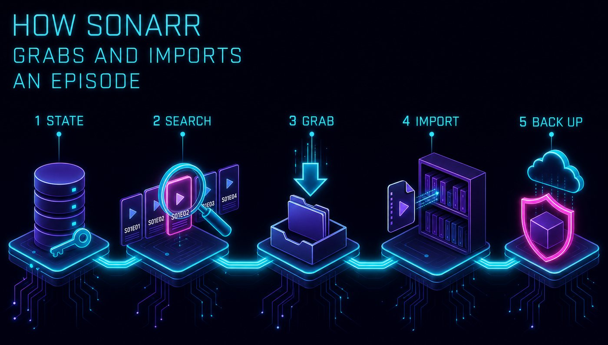
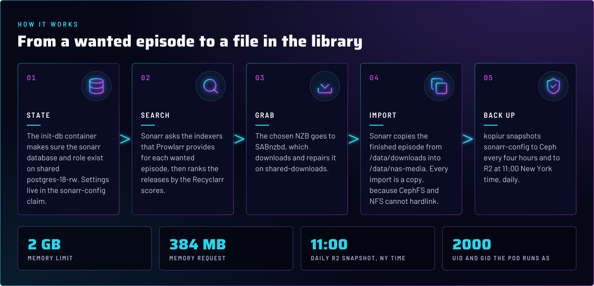
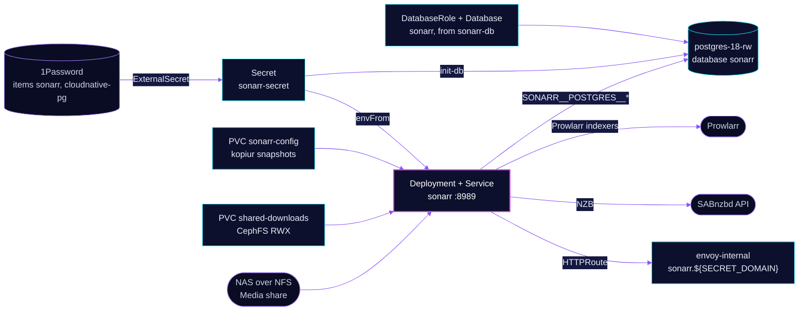

  

> **Usenet-only TV PVR.** Sonarr keeps the wanted list for series, searches the indexers Prowlarr provides, sends the
> chosen release to SABnzbd, and copies the episode to the NAS library. Its database is on the shared Postgres Cluster and
> its config is a kopiur claim. Both are backed up.

## At a glance

<!-- glance:start -->
<!-- Generated by `readme.py sync`; edit the manifests, not this table. -->
| | |
|---|---|
| **Namespace** | `downloads` |
| **Deployed by** | [`sonarr`](../../../main/downloads/sonarr.yaml) (Flux Kustomization) |
| **Helm chart** | `app-template`, values in [`helmrelease.yaml`](app/helmrelease.yaml) |
| **Images** | `ghcr.io/home-operations/postgres-init`, `ghcr.io/home-operations/sonarr` |
| **Depends on** | `downloads/downloads-pvc`, `downloads/sonarr-db`, `security/onepassword-store`, `system/kopiur-repository` |
| **Secret** | `sonarr-secret` from onepassword item `cloudnative-pg`, `sonarr` |
| **Backup** | kopiur component on the overlay (skill `kopiur-backups`) |
<!-- glance:end -->

## What it does

- **Tracks** series and episodes in the `sonarr` database on the shared `postgres-18` Cluster (`SONARR__POSTGRES__*`).
  The `sonarr-db` Flux Kustomization in the [overlay](../../../main/downloads/sonarr.yaml) declares the role and the
  database, with `retain` on both.
- **Searches** the indexers that Prowlarr syncs into it, and ranks the releases with the scores Recyclarr writes into
  the `WEB-1080p` and `WEB-2160p` profiles, see [recyclarr](../recyclarr/README.md).
- **Hands** the chosen NZB to SABnzbd, then copies the finished episode from `/data/downloads` to `/data/nas-media`,
  the `Media` share on the NAS over NFS.
- **Serves** its UI at `sonarr.${SECRET_DOMAIN}` on `envoy-internal` only. The Homepage tile comes from the route annotations.

## Why it is built this way

| Choice | Why |
|---|---|
| **Postgres, not the bundled SQLite** | The database lives on the shared `postgres-18` Cluster, so its data is in the Cluster's backup destination. The pod keeps no database on its own volume. |
| **Copy on import, not hardlink** | The downloads share is CephFS and the library is NFS. Neither can hardlink across the other, so every import copies (skill `media-stack`). |
| **Spread constraint, not an affinity** | `nodeTaintsPolicy: Honor` keeps talos-3 in the spread domains, so its `PreferNoSchedule` taint still scores the pod away from it. `ScheduleAnyway` means the constraint never refuses a node (skill `node-scheduling`). |
| **Recyclarr owns scores, not the UI** | Profile definitions and format scores come from Git, so a rebuild ranks episodes the same way. Which series uses which profile is Sonarr state. |

## How it works

  

  

<b>Resource graph</b>: every object involved, by name

In more detail:

1. Flux applies `sonarr-db` first, which waits for the `postgres-18` Cluster and the 1Password store, then the app's
   Kustomization, which waits for `downloads-pvc` and the kopiur repository.
2. The `init-db` init container connects with the superuser password from `sonarr-secret` and makes sure the role and
   database exist before Sonarr starts.
3. Sonarr starts with its database on `postgres-18-rw`, its config on `sonarr-config`, downloads on `/data/downloads`
   and the library on `/data/nas-media`.
4. kopiur snapshots `sonarr-config` to Ceph every four hours and to R2 once a day. A rebuilt cluster refills the claim from its `Restore`.

## Settings that matter

All values are in [`app/helmrelease.yaml`](app/helmrelease.yaml) unless noted.

| Setting | Value | Why |
|---|---|---|
| `SONARR__AUTH__METHOD` / `SONARR__AUTH__REQUIRED` | `External` / `DisabledForLocalAddresses` | Login is left to whatever sits in front of the app. Local addresses skip it. See Known gaps. |
| `SONARR__LOG__DBENABLED` | `"False"` | Log rows stay out of the Postgres database. |
| `SONARR__UPDATE__BRANCH` | `develop` | Unrecorded decision. Git does not say why the in-app update channel is `develop`. Upgrades go through the pinned image tag, which Renovate bumps. |
| `init-db` init container | `postgres-init` image, `envFrom: sonarr-secret` | Creates the role and database before first start, with the superuser password from the Secret. |
| Probes (`liveness`, `readiness`) | `httpGet /ping`, 3 failures at 10 s, 1 s timeout | `/ping` returns non-200 when the app is down. The 1 s timeout is the open question in Known gaps. |
| `resources` | request 20m CPU and 384Mi memory; limit 2Gi memory | Only a memory limit, no CPU limit. Every limit has a request (skill `node-scheduling`). |
| `pod.securityContext` | UID and GID `2000`, `fsGroup` `2000`, `OnRootMismatch` | The owner of the files on the claim. `KOPIUR_PUID` and `KOPIUR_PGID` in the overlay must match, or the backup fails closed (skill `kopiur-backups`). |
| `topologySpreadConstraints` | `maxSkew: 2`, `kubernetes.io/hostname`, `ScheduleAnyway`, `nodeTaintsPolicy: Honor` | Keeps talos-3 in the spread domains so its taint scores the pod away. See the Why table. |
| `persistence.media` | NFS `nas.${SECRET_DOMAIN}:/mnt/storage/Media` at `/data/nas-media` | The library stays on the NAS. Imports copy. |
| `persistence.downloads` | `shared-downloads` (CephFS RWX) at `/data/downloads` | The same path SABnzbd reports, so queue paths match. |
| `persistence.config` | `sonarr-config`, kopiur-backed | The Sonarr config directory. The overlay sizes it at 5Gi on `ceph-block`. |

## Known gaps

- **Liveness probe with a 1 s timeout.** The liveness and readiness probes time out after 1 s and the liveness probe
  restarts the pod after 3 failures at 10 s. SABnzbd's HelmRelease records a 1 s timeout killing a busy but healthy
  process, and that is why SABnzbd's probes are relaxed. Nothing in Git says this probe was measured under a large
  import, so check the restart history before copying the SABnzbd fix or leaving this as it is.
- **Login is delegated, and nothing in Git delegates it.** `SONARR__AUTH__METHOD` is `External`. The route is on
  `envoy-internal` with no `SecurityPolicy`. The gate is reachability of the internal gateway. Confirm that is the intent
  (skill `networking`).

## Files

| File | Holds |
|---|---|
| [`app/helmrelease.yaml`](app/helmrelease.yaml) | Chart values: init container, probes, resources, spread, mounts, route |
| [`app/externalsecret.yaml`](app/externalsecret.yaml) | `sonarr-secret`: the Postgres variables and the API key, from 1Password items `sonarr` and `cloudnative-pg` |
| [`app/kustomization.yaml`](app/kustomization.yaml) | Resource list |
| [`../../../main/downloads/sonarr.yaml`](../../../main/downloads/sonarr.yaml) | Flux Kustomizations `sonarr` and `sonarr-db`, the kopiur component and its `KOPIUR_*` values |
| [`../pvc/app/shared-downloads.yaml`](../pvc/app/shared-downloads.yaml) | The CephFS RWX claim Sonarr, Radarr and SABnzbd all mount |

Upstream: [Sonarr](https://sonarr.tv/) • [Servarr wiki](https://wiki.servarr.com/sonarr) • [Sonarr API](https://sonarr.tv/docs/api/)

<!-- branded-readme v1 sources=5b0a50a425f8 -->
