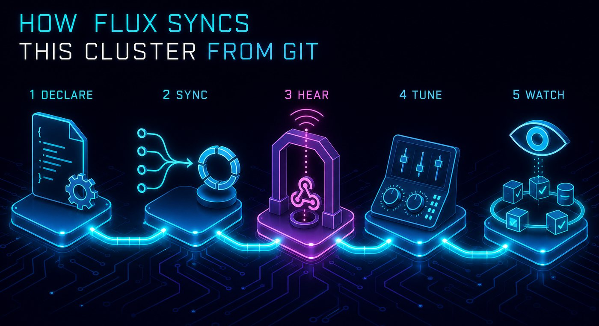
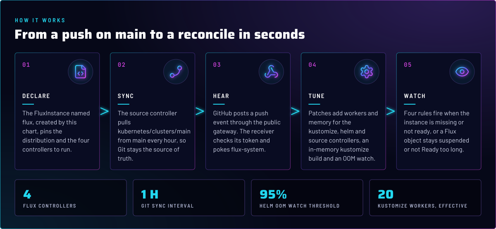
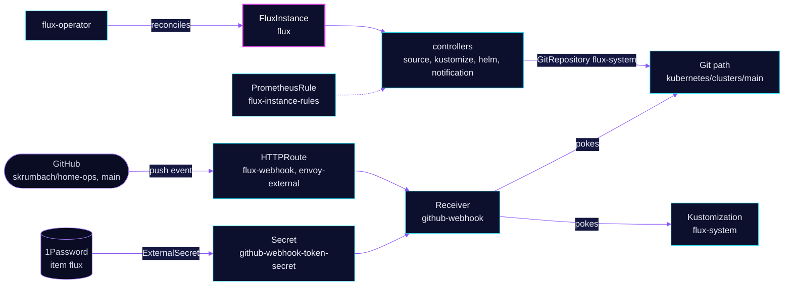

<p align="center">
  
</p>

> **Git is the source of truth for Flux itself.** One `FluxInstance` named `flux` declares which controllers run, which
> Git path they sync and how they are tuned. A push to `main` reaches the cluster in seconds through the webhook, and
> the hourly sync is the backstop if a webhook is lost.

## At a glance

<!-- glance:start -->
<!-- Generated by `readme.py sync`; edit the manifests, not this table. -->
| | |
|---|---|
| **Namespace** | `flux-system` |
| **Deployed by** | [`flux-instance`](../../../main/flux-system/flux-instance.yaml) (Flux Kustomization) |
| **Helm chart** | `flux-instance` from `oci://ghcr.io/controlplaneio-fluxcd/charts/flux-instance`, values in [`helmrelease.yaml`](app/helmrelease.yaml) |
| **Depends on** | `flux-system/flux-operator` |
| **Route** | `flux-webhook.${SECRET_DOMAIN}` via `envoy-external` (Gatus probed) |
| **Secret** | `github-webhook-token-secret` from onepassword item `flux` |
| **Alerts** | 4: `FluxInstanceAbsent`, `FluxInstanceNotReady`, `FluxResourceSuspendedTooLong`, `FluxResourceNotReadyTooLong` |
<!-- glance:end -->

## What it does

- **Declares** the `FluxInstance` named `flux`. The Flux Operator reads it and installs the four controllers
  `source-controller`, `kustomize-controller`, `helm-controller` and `notification-controller`.
- **Syncs** a `GitRepository` named `flux-system` from `https://github.com/skrumbach/home-ops.git`, branch `main`, path
  `kubernetes/clusters/main`, every hour. That path is the entry point that runs `cluster-meta` and `cluster-apps`.
- **Receives** GitHub push and ping events at `flux-webhook.${SECRET_DOMAIN}` on `envoy-external`, path `/hook/`. The
  receiver pokes the `GitRepository` and the `flux-system` Kustomization, so the reconcile starts at once.
- **Tunes** the controllers with the patches in the chart values: worker counts, memory limits, an in-memory kustomize
  build, a Helm cache, an OOM watch on Helm, and a few feature gates.
- **Alerts** on the instance and on stuck objects through the `flux-instance-rules` PrometheusRule.

## Why it is built this way

| Choice | Why |
|---|---|
| **A `FluxInstance`, not a hand-run `flux install`** | The operator reconciles the controllers from one object, so a Flux upgrade is a Git commit. The distribution artifact pins the controller manifests, and the instance follows the `2.x` line. |
| **Public webhook on `envoy-external`** | GitHub must reach it, so it is the one public Flux route. Its guard is the receiver: GitHub signs each event with the token, and the receiver rejects anything it cannot verify. The token is in 1Password item `flux`, property `FLUX_GITHUB_WEBHOOK_TOKEN`, extracted as `token`. |
| **Hourly sync stays on** | A lost webhook delivery costs at most an hour, not a missed change. The webhook is an accelerator, not the only path. |
| **Kustomize build in memory** | The `temp` volume on the kustomize controller is a `Memory` emptyDir, so a large build does not wait on disk. The memory limit is raised to 2 GiB on the three source and build controllers to hold it. |
| **OOM watch on `helm-controller` at 95%** | The controller stops a release when it nears its memory limit, so a Helm action fails cleanly instead of being killed midway through a write. |
| **`owner!=helm` label selector** | Controllers watch ConfigMaps and Secrets with that label, so Helm-owned objects do not trigger reconciles. |
| **`CancelHealthCheckOnNewRevision`** | A new revision cancels an in-flight health wait. Otherwise a stale health check holds a Kustomization on a revision that is no longer current. |
| **Chart `networkPolicy: false`** | The chart's controller policy is off. The flux-operator app carries its own DNS-reply policy for the operator web UI. |

## How it works

<p align="center">
  
</p>

<p align="center">
  
</p>

<details>
<summary><b>Resource graph</b>: every object involved, by name</summary>



</details>

In more detail:

1. Flux applies this Kustomization after `flux-operator`. The chart creates the `FluxInstance`, and the operator installs
   the controllers and pulls the distribution manifests named in the chart values.
2. The `source-controller` fetches `kubernetes/clusters/main` every hour. A GitHub push to the webhook route makes the
   receiver poke that `GitRepository` immediately.
3. The kustomize controller applies the path, and the Helm controller runs the HelmReleases it finds there.
4. Each controller exports its metrics, which the rules read. A `FluxInstance` that is not Ready, or an object that stays
   suspended or Not Ready too long, fires an alert with the `flux get` command to run.

## Settings that matter

Values are in [`app/helmrelease.yaml`](app/helmrelease.yaml). The chart version is in
[`app/ocirepository.yaml`](app/ocirepository.yaml).

| Setting | Value | Why |
|---|---|---|
| `distribution.artifact` | the `flux-operator-manifests` artifact, tag in [`app/helmrelease.yaml`](app/helmrelease.yaml) | The controller manifests. No `# renovate:` annotation, so Renovate does not bump it. See Known gaps. |
| `distribution.version` | `2.x` | The Flux release line the operator installs. |
| `components` | source, kustomize, helm, notification | Image automation is not installed. Renovate does version bumps, not Flux's image controllers. |
| `sync.url`, `sync.ref`, `sync.path` | this repo, `refs/heads/main`, `kubernetes/clusters/main` | The cluster entry point. Anything outside that path is invisible to Flux. |
| `sync.interval` | `1h` | The backstop when a webhook is lost. |
| `kustomize` patch: `--concurrent=10` / `--requeue-dependency=5s` | source, kustomize, helm controllers | More parallel reconciles. The dependency requeue is shorter so a waiting Kustomization does not sit for minutes. |
| `kustomize` patch: `--concurrent=20` and in-memory `temp` volume | kustomize controller | See Known gaps for the duplicate flag. The `Memory` medium keeps large builds off disk. |
| `kustomize` patch: `memory: 2Gi` limit | source, kustomize, helm controllers | Headroom for the in-memory build and the Helm cache. |
| `--helm-cache-max-size=10`, `--helm-cache-ttl=60m`, `--helm-cache-purge-interval=5m` | source controller | Caches Helm repository indexes for an hour instead of refetching on every chart. |
| `--feature-gates=OOMWatch=true`, `--oom-watch-memory-threshold=95` | helm controller | Stops a release at 95% of the limit, before the OOM killer does. |
| `--feature-gates=DisableChartDigestTracking=true` | helm controller | Turns off chart digest tracking in the helm controller. The reason is not recorded in Git. |
| `--watch-configs-label-selector=owner!=helm` | helm and kustomize controllers | ConfigMap and Secret changes trigger reconciles, except Helm-owned objects. |
| `--feature-gates=CancelHealthCheckOnNewRevision=true` | kustomize controller | A new revision cancels a stale health wait. |
| `install.remediation.retries` | `-1` | Install retries forever. A first install that fails keeps retrying until it works, and the stalled-object alert is the signal. |
| `instance.cluster.networkPolicy` | `false` | The chart's controller policy is off. |

## Alerts

From [`app/prometheusrule.yaml`](app/prometheusrule.yaml).

| Alert | Severity | Fires when | First look |
|---|---|---|---|
| `FluxInstanceAbsent` | critical | no `flux_instance_info` series for `flux` in `flux-system` for 5 min | `flux -n flux-system get all`, then the flux-operator pod. |
| `FluxInstanceNotReady` | critical | the instance reports `ready` other than `True` for 5 min | `kubectl -n flux-system describe fluxinstance flux` |
| `FluxResourceSuspendedTooLong` | warning | a Flux object has `spec.suspend: true` for 24 h | `flux resume` it, unless the suspension is intended. |
| `FluxResourceNotReadyTooLong` | warning | a Flux object is not Ready for 30 min | `flux get all -n <ns>`. A Stalled HelmRelease needs `flux reconcile hr <name> -n <ns> --reset` once fixed. |

## Operate it

```bash
flux -n flux-system get ks flux-instance
kubectl -n flux-system get fluxinstance flux
flux -n flux-system get all                              # every controller and source
flux -n flux-system reconcile source git flux-system     # force a sync from Git (a write)
```

The webhook route's Gatus check expects `404`; the annotation sits on the route in [`app/httproute.yaml`](app/httproute.yaml).

The `flux-gitops` skill covers the healthChecks, `wait` and `suspend` rules that apply to every Kustomization here.

## Known gaps

- **`kustomize-controller` gets `--concurrent` twice.** The first patch appends `--concurrent=10` to the source, kustomize
  and helm controllers. The later patch appends `--concurrent=20` to the kustomize controller. Go's flag parsing keeps the
  last value, so 20 is what runs, and the first flag is dead config. Remove the 10 for that controller.
- **The distribution artifact is not tracked by Renovate.** The `distribution.artifact` value in [`app/helmrelease.yaml`](app/helmrelease.yaml) has no `# renovate:` annotation, and no custom manager matches it. Renovate bumps the OCIRepository tags for this app and for [`flux-operator`](../flux-operator/README.md), but not the artifact. Bump the artifact by hand with each chart bump, or add an annotation.

## Files

| File | Holds |
|---|---|
| [`app/helmrelease.yaml`](app/helmrelease.yaml) | `FluxInstance` values: distribution, sync, components and patches |
| [`app/ocirepository.yaml`](app/ocirepository.yaml) | Chart source and version |
| [`app/receiver.yaml`](app/receiver.yaml) | GitHub webhook receiver |
| [`app/httproute.yaml`](app/httproute.yaml) | Public route for the webhook, with its Gatus check |
| [`app/externalsecret.yaml`](app/externalsecret.yaml) | Webhook token from the 1Password item `flux` |
| [`app/prometheusrule.yaml`](app/prometheusrule.yaml) | Four Flux alerts |
| [`../../../main/flux-system/flux-instance.yaml`](../../../main/flux-system/flux-instance.yaml) | Flux Kustomization, dependencies |

Upstream: [Flux Operator docs](https://fluxcd.control-plane.io/operator/) •
[FluxInstance reference](https://fluxcd.control-plane.io/operator/fluxinstance/) •
[Flux receivers](https://fluxcd.io/flux/components/notification/receiver/)

<!-- branded-readme v1 sources=8b5d283387c9 -->
