<p align="center">
  
</p>

> **The operator behind `FluxInstance`.** This chart runs the Flux Operator, which reads the `FluxInstance` named `flux`
> from [`flux-instance`](../flux-instance/README.md) and installs or upgrades the Flux controllers it declares. The
> controllers are not in this chart; the operator installs them from the `FluxInstance`.

## At a glance

<!-- glance:start -->
<!-- Generated by `readme.py sync`; edit the manifests, not this table. -->
| | |
|---|---|
| **Namespace** | `flux-system` |
| **Deployed by** | [`flux-operator`](../../../main/flux-system/flux-operator.yaml) (Flux Kustomization) |
| **Helm chart** | `flux-operator` from `oci://ghcr.io/controlplaneio-fluxcd/charts/flux-operator`, values in [`helmrelease.yaml`](app/helmrelease.yaml) |
| **Needed by** | `flux-system/flux-instance` |
| **Health checks** | `Deployment/flux-operator` |
<!-- glance:end -->

## What it does

- **Runs** one Deployment, `flux-operator`, in `flux-system`, from the `flux-operator` OCI chart.
- **Reconciles** the `FluxInstance` named `flux`, so the controllers follow the declared distribution and patches.
- **Exposes** the operator's metrics through a ServiceMonitor the chart creates (`serviceMonitor.create: true`).
- **Admits** DNS replies for the operator's pods through a supplemental NetworkPolicy. The chart's own policy, which
  covers its web UI, does not admit them.

No HTTPRoute in Git exposes the operator's web UI. Nothing in `flux-system` routes to it.

## Why it is built this way

| Choice | Why |
|---|---|
| **A separate app from `flux-instance`** | The operator and the instance it manages are two objects with two lifecycles. `flux-instance` `dependsOn` this app, so the operator's CRDs and Deployment exist before the instance is applied. |
| **A supplemental NetworkPolicy** | Policies on one pod OR-combine. The chart's policy does not admit kube-dns, so the operator's replies to DNS would drop. The supplement admits replies from `kube-dns` with no port restriction. A port rule would match the destination port, and a reply arrives on an ephemeral one, so `port: 53` would drop every reply. |
| **Health check on the Deployment** | A HelmRelease can stay Ready through a crash loop. The Deployment shows the real state (skill `flux-gitops`). |

## How it works

The chart installs the operator. The operator watches the `FluxInstance`, creates the Flux controller Deployments in
`flux-system`, and keeps them at the declared version and patches. `flux-instance` owns what the controllers sync.

## Settings that matter

Values are in [`app/helmrelease.yaml`](app/helmrelease.yaml). The chart version is in
[`app/ocirepository.yaml`](app/ocirepository.yaml). Renovate bumps the chart. The matching manifests tag in
`flux-instance` is a separate pin; see that README's Known gaps.

| Setting | Value | Why |
|---|---|---|
| `serviceMonitor.create` | `true` | Scrapes the operator's metrics so the Flux alerts have a source. |
| `networkPolicy` (chart) | default, not overridden | The chart's policy stays on. The supplement in [`app/networkpolicy.yaml`](app/networkpolicy.yaml) adds to it and does not replace it. |

## Operate it

```bash
flux -n flux-system get ks flux-operator
kubectl -n flux-system get deploy flux-operator
kubectl -n flux-system get networkpolicy
```

## Files

| File | Holds |
|---|---|
| [`app/helmrelease.yaml`](app/helmrelease.yaml) | Chart values: the ServiceMonitor |
| [`app/ocirepository.yaml`](app/ocirepository.yaml) | Chart source and version |
| [`app/networkpolicy.yaml`](app/networkpolicy.yaml) | DNS-reply admission for the operator pod |
| [`../../../main/flux-system/flux-operator.yaml`](../../../main/flux-system/flux-operator.yaml) | Flux Kustomization, health check |

Upstream: [Flux Operator docs](https://fluxcd.control-plane.io/operator/)

<!-- branded-readme v1 sources=f2dd8c7ab8a4 -->
