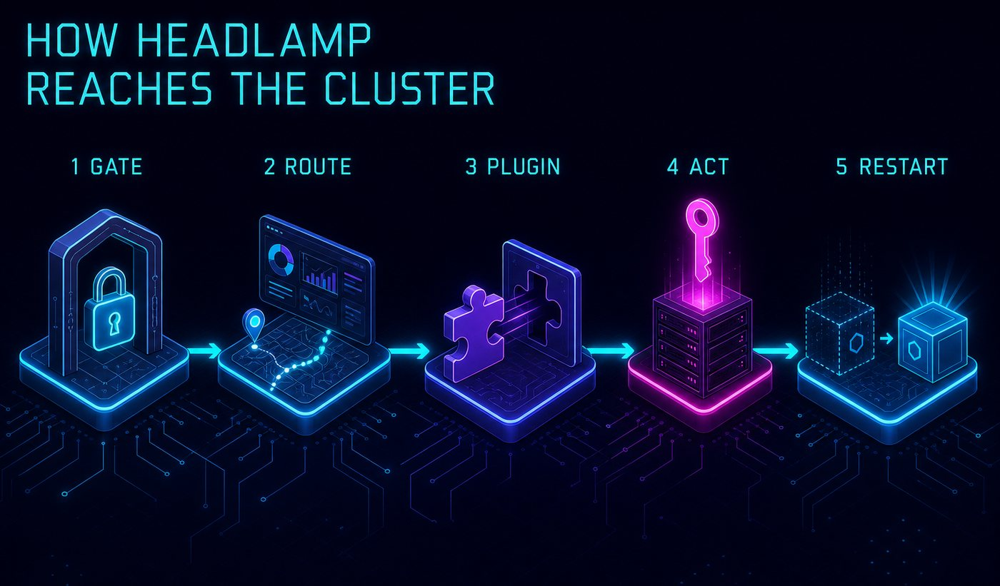
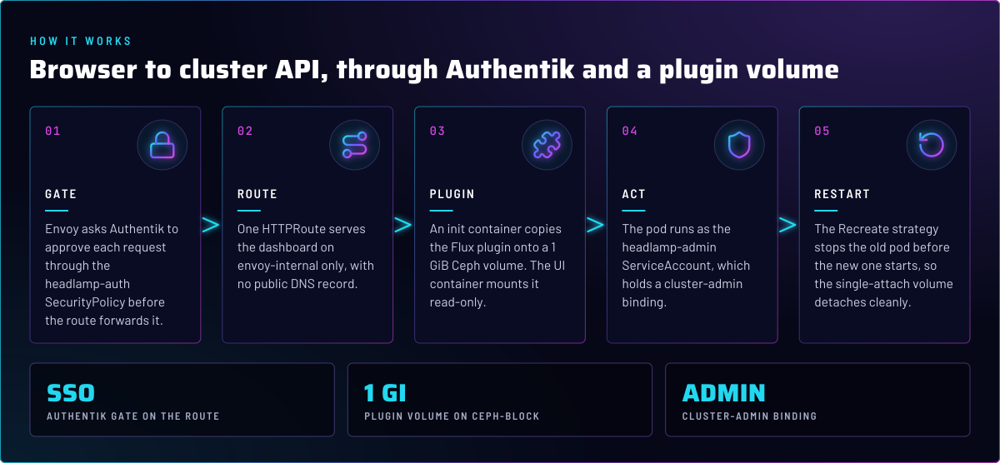
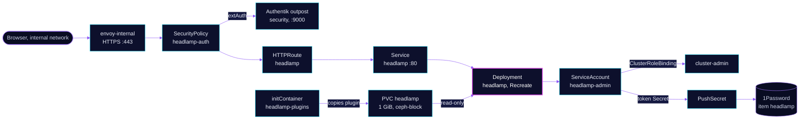

<p align="center">
  
</p>

> **A dashboard that is cluster-admin on purpose.** Headlamp browses Kubernetes and Flux objects through the Flux plugin.
> It is reachable only on the internal gateway, Authentik approves each request before the app sees it, and the pod
> runs as a ServiceAccount bound to `cluster-admin`. Anyone who passes the gate can read and change the cluster.

## At a glance

<!-- glance:start -->
<!-- Generated by `readme.py sync`; edit the manifests, not this table. -->
| | |
|---|---|
| **Namespace** | `flux-system` |
| **Deployed by** | [`headlamp`](../../../main/flux-system/headlamp.yaml) (Flux Kustomization) |
| **Helm chart** | `headlamp` from `oci://ghcr.io/home-operations/charts-mirror/headlamp`, values in [`helmrelease.yaml`](app/helmrelease.yaml) |
| **Route** | `headlamp.${SECRET_DOMAIN}` via `envoy-internal` |
| **Pushes to 1Password** | `headlamp` |
<!-- glance:end -->

## What it does

- **Serves** the dashboard at `headlamp.${SECRET_DOMAIN}` on `envoy-internal`, through the HTTPRoute `headlamp`. The
  route has no public DNS record.
- **Gates** every request with Authentik through the `headlamp-auth` SecurityPolicy, which is `extAuth` to the embedded
  outpost in `security`.
- **Loads** the Flux plugin from an init container that copies it onto the 1 GiB `headlamp` volume. The UI container
  mounts that volume read-only.
- **Runs** as the ServiceAccount `headlamp-admin`, which holds a `ClusterRoleBinding` to `cluster-admin`.
- **Publishes** that ServiceAccount's token through a PushSecret to the 1Password item `headlamp`, property `token`.
- **Appears** on the homepage through the `gethomepage.dev` annotations on the route.

## Why it is built this way

| Choice | Why |
|---|---|
| **Internal gateway, not external** | The dashboard is not for the internet. An internal-only route removes the DNS and the exposure, and the Authentik gate sits in front of the app. |
| **Authentik before the app** | `extAuth` runs in Envoy, so an unauthenticated request never reaches Headlamp. The headers forwarded are the cookie, authorization and the forwarded-host set; Authentik returns the username, email, name and UID for the app to see. |
| **`cluster-admin` for `headlamp-admin`** | A dashboard that can read everything but change nothing is a different tool. This is a single-operator lab, and the owner chose full reach. The cost is that anyone who passes the gate is root on the cluster. See Known gaps. |
| **`Recreate` deployment strategy** | The `headlamp` PVC is `ReadWriteOnce`. A `RollingUpdate` starts the new pod before the old one releases the volume, so the new pod cannot attach it. |
| **Init container for the plugin** | The plugin is copied as root into the volume. The UI container only reads it, so a compromised UI cannot rewrite the plugin. `pvc-writable-check` expects that read-only mount (skill `pvc-integrity-checks`). |
| **Token pushed to 1Password** | The ServiceAccount token is a long-lived Secret in the cluster. The PushSecret copies it to 1Password, so the owner can read it from the vault without a `kubectl` call. The token is a cluster-admin credential in the vault. |

## How it works

<p align="center">
  
</p>

<p align="center">
  
</p>

<details>
<summary><b>Resource graph</b>: every object involved, by name</summary>



</details>

In more detail:

1. Flux applies the HelmRelease with a kustomize postRenderer. The renderer changes the Deployment's strategy to
   `Recreate` and replaces its arguments with in-cluster mode, the `main` context name and the plugin directory.
2. The init container runs the Flux plugin image and copies its plugin files into the PVC. It runs as root, and only it
   has a writable mount.
3. The main container starts with the PVC mounted read-only at `/build/plugins`, and in-cluster mode gives it the
   `headlamp-admin` identity.
4. A request reaches the route only after Envoy gets an allow from Authentik. Headers from the outpost, including the
   username, pass through to Headlamp.

## Settings that matter

Values are in [`app/helmrelease.yaml`](app/helmrelease.yaml). The chart is an OCI mirror in
[`app/ocirepository.yaml`](app/ocirepository.yaml).

| Setting | Value | Why |
|---|---|---|
| `postRenderers` strategy | `Recreate` | The `headlamp` PVC is ReadWriteOnce. See Why. |
| `postRenderers` args | `-in-cluster`, `-in-cluster-context-name=main`, `-plugins-dir=/build/plugins` | In-cluster mode uses the pod's own ServiceAccount, so no kubeconfig is mounted. The context name labels the cluster in the UI. |
| `serviceAccount.create` / `name` | `false` / `headlamp-admin` | The pod uses the ServiceAccount from [`app/rbac.yaml`](app/rbac.yaml), not one the chart makes. |
| `persistentVolumeClaim` | 1 GiB, `ceph-block`, RWO | The plugin files. Small and single-attach. |
| `initContainers` `headlamp-plugins` | the Flux plugin image, pinned by tag and digest, `runAsUser: 0` | Copies plugins into the volume. Root is needed for that copy, and only this container has the writable mount. |
| `volumeMounts` `headlamp-plugins` | `readOnly: true` on the UI | Keeps the plugin set immutable at runtime. |
| `config.pluginsDir` | `/build/plugins` | Where the UI looks for plugins. |
| `config.baseURL` | `""` | The UI serves from the root of its host name. |
| `env` `HEADLAMP_CONFIG_BACKEND_PROXY_TIMEOUT` | `30s` | Sets the backend proxy timeout to 30 seconds. |
| `resources` | requests `10m` CPU and `64Mi`; memory limit `256Mi` | Small UI. No CPU limit is set; the request is the only CPU bound. |
| `podAnnotations` `reloader.stakater.com/auto` | `"true"` | Restarts the pod when a ConfigMap or Secret it uses changes. |

## Operate it

Suspend the `headlamp` Kustomization before a live HelmRelease edit, or Flux reverts it on the next reconcile.

```bash
flux -n flux-system get ks headlamp
flux -n flux-system get hr headlamp
kubectl -n flux-system get pods -l app.kubernetes.io/name=headlamp
kubectl -n flux-system get pvc headlamp
```

## Known gaps

- **The admin binding has no narrower option in Git.** `headlamp-admin` is `cluster-admin`, and its token is in 1Password.
  Authentik is the only other gate. A narrower Role for the views this UI needs, bound to the same ServiceAccount, would
  shrink the blast radius of a leaked session or token. Owner decision; not changed here.
- **The postRenderer replaces the whole `args` list.** Any argument the chart adds in a later version is dropped
  silently. Check the rendered Deployment after each chart bump.
- **The plugin image has no `# renovate:` annotation.** The line in `helmrelease.yaml` is the only pin. Confirm Renovate
  bumps it, or add the annotation.

## Files

| File | Holds |
|---|---|
| [`app/helmrelease.yaml`](app/helmrelease.yaml) | Chart values, plugin init container, Recreate postRenderer |
| [`app/ocirepository.yaml`](app/ocirepository.yaml) | Chart source (mirror) and version |
| [`app/rbac.yaml`](app/rbac.yaml) | ServiceAccount `headlamp-admin`, its token Secret and the cluster-admin binding |
| [`app/pushsecret.yaml`](app/pushsecret.yaml) | Copies the token to 1Password item `headlamp` |
| [`app/route.yaml`](app/route.yaml) | HTTPRoute on `envoy-internal`, with homepage annotations |
| [`app/securitypolicy.yaml`](app/securitypolicy.yaml) | Authentik `extAuth` for the route |
| [`../../../main/flux-system/headlamp.yaml`](../../../main/flux-system/headlamp.yaml) | Flux Kustomization, substitutions |

Upstream: [Headlamp docs](https://headlamp.dev/docs/latest/) •
[Flux plugin](https://github.com/headlamp-k8s/plugins/tree/main/flux)

<!-- branded-readme v1 sources=43f9fec8eb88 -->
