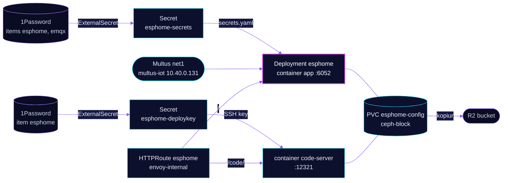

<p align="center">
  
</p>

> **Firmware for the IoT VLAN, built in place.** ESPHome compiles and flashes device firmware from a config that lives on Ceph. The dashboard sits on a fixed address on the IoT VLAN, so it reaches devices there directly, and a code-server editor edits the same files.

## At a glance

<!-- glance:start -->
<!-- Generated by `readme.py sync`; edit the manifests, not this table. -->
| | |
|---|---|
| **Namespace** | `home-automation` |
| **Deployed by** | [`esphome`](../../../main/home-automation/esphome.yaml) (Flux Kustomization) |
| **Helm chart** | `app-template`, values in [`helmrelease.yaml`](app/helmrelease.yaml) |
| **Images** | `ghcr.io/coder/code-server`, `ghcr.io/home-operations/esphome` |
| **Depends on** | `kube-system/multus-networks`, `security/onepassword-store`, `system/kopiur-repository` |
| **Secret** | `esphome-secrets` from onepassword item `emqx`, `esphome` |
| **Secret** | `esphome-deploykey` from onepassword item `esphome` |
| **Backup** | kopiur component on the overlay (skill `kopiur-backups`) |
<!-- glance:end -->

## What it does

- **Serves** the ESPHome dashboard on port 6052 at `esphome.${SECRET_DOMAIN}` on `envoy-internal`. The dashboard compiles and flashes devices over the air.
- **Edits** the same `/config` tree through code-server on port 12321, at `esphome.${SECRET_DOMAIN}/code/`.
- **Renders** `secrets.yaml` into `/config` from ExternalSecret `esphome-secrets`, which reads 1Password items `esphome` and `emqx`. Wi-Fi and MQTT credentials never live in Git.
- **Mounts** the Git deploy key from Secret `esphome-deploykey` (1Password item `esphome`, field `private key`) into code-server, at the SSH key path.
- **Keeps** the `esphome-config` claim (5 GiB) backed up daily to R2 by kopiur.

## Why it is built this way

| Choice | Why |
|---|---|
| **Fixed address on `multus-iot`** | The dashboard sits on the IoT VLAN, so it reaches devices there directly. Multus adds that interface beside the cluster network. |
| **`secrets.yaml` rendered from a template** | ESPHome reads `secrets.yaml` from `/config`. The ExternalSecret writes that file, and Reloader restarts the pod when the Secret changes. |
| **3 GiB compile limit** | ESPHome compiles inside this pod. The idle working set is far smaller than a compile peak, so the limit is not set to the idle size. |
| **Build cache is an `emptyDir`** | Build output rebuilds from the config. Only `/config` is state, and only `/config` is backed up. |
| **Read-only root filesystem, all capabilities dropped** | The root filesystem is read-only, so the app's writable paths are its mounts: `/config` and `/cache`. |

## How it works

<p align="center">
  
</p>

<details>
<summary><b>Resource graph</b>: every object involved, by name</summary>



</details>

In more detail:

1. Flux applies the overlay Kustomization `esphome`, which adds the kopiur component and the `esphome-config` claim. The HelmRelease then installs one app-template controller with two containers that share `/config`.
2. Multus attaches `net1` on `multus-iot` with the static address. The pod keeps its normal `eth0` for the cluster network.
3. The ExternalSecrets render `secrets.yaml` and the deploy key. Reloader rolls the pod when either Secret changes.
4. The HTTPRoute sends `/code/` to code-server with a prefix rewrite and everything else to the dashboard.
5. kopiur snapshots the claim to R2 once a day, at the hour in `KOPIUR_SCHEDULE_R2`.

## Settings that matter

All values are in [`app/helmrelease.yaml`](app/helmrelease.yaml) unless noted.

| Setting | Value | Why |
|---|---|---|
| `containers.app.probes` (liveness, readiness, startup) | all `enabled: false` | Git records no reason. A dashboard that stalls is not restarted (see Known gaps). |
| `pod.annotations` `k8s.v1.cni.cncf.io/networks` | `multus-iot`, `10.40.0.131/22`, pinned MAC | Devices and the dashboard agree on one address. The pinned MAC is a known risk (see Known gaps). |
| `containers.app.resources` | request 5m CPU, 512Mi; limit 3072Mi | The limit covers a compile peak. Shrinking it to the idle size breaks the build. |
| `containers.code-server.resources` | request 320Mi; limit 512Mi | The request is set from the 14-day peak. The limit stays high because the manifest notes a compile can run in this container too. |
| `persistence.deploy-key` `defaultMode` | `256` (octal `0400`) | SSH refuses a private key that other users can read. |
| `persistence.config.existingClaim` | `esphome-config` | The kopiur claim name, set by the overlay's `KOPIUR_CLAIM`. |
| `secret.reloader.stakater.com/reload` | `esphome-secrets,esphome-deploykey` | A rotated Wi-Fi password or key rolls the pod without a manual restart. |

## Operate it

```bash
flux -n home-automation get ks esphome
kubectl -n home-automation get pods -l app.kubernetes.io/name=esphome -o wide
kubectl -n home-automation logs deploy/esphome -c app --tail=50
```

## Known gaps

- **The editor has no SSO gate.** The editor mounts the same `/config` volume as the app, and the Git deploy key. The `/code/` route has no SecurityPolicy, so it is reachable without SSO. Fix: gate it like `hass-code-auth`, or remove the editor.
- **Pinned MAC on `net1`.** The annotation pins `3e:59:e4:f7:43:15`. Home Assistant dropped its MAC pin because a pinned MAC on `bond0.3` makes the new pod's `net1` fail while the old pod's veth still holds it (`address already in use`). This pod was not tested for that race. zigbee2mqtt and matter-server pin MACs too.
- **No probes.** All three probes are disabled, so a wedged dashboard keeps running and no restart is ever triggered.

## Files

| File | Holds |
|---|---|
| [`app/helmrelease.yaml`](app/helmrelease.yaml) | The dashboard and code-server containers, network, route, persistence |
| [`app/externalsecret.yaml`](app/externalsecret.yaml) | `esphome-secrets` (`secrets.yaml`) and `esphome-deploykey` |
| [`app/kustomization.yaml`](app/kustomization.yaml) | Resource list for the app |
| [`../../../main/home-automation/esphome.yaml`](../../../main/home-automation/esphome.yaml) | Flux Kustomization, kopiur component, substitutions |

Upstream: [ESPHome docs](https://esphome.io/) • [ESPHome source](https://github.com/esphome/esphome)

<!-- branded-readme v1 sources=9498650d920c -->
