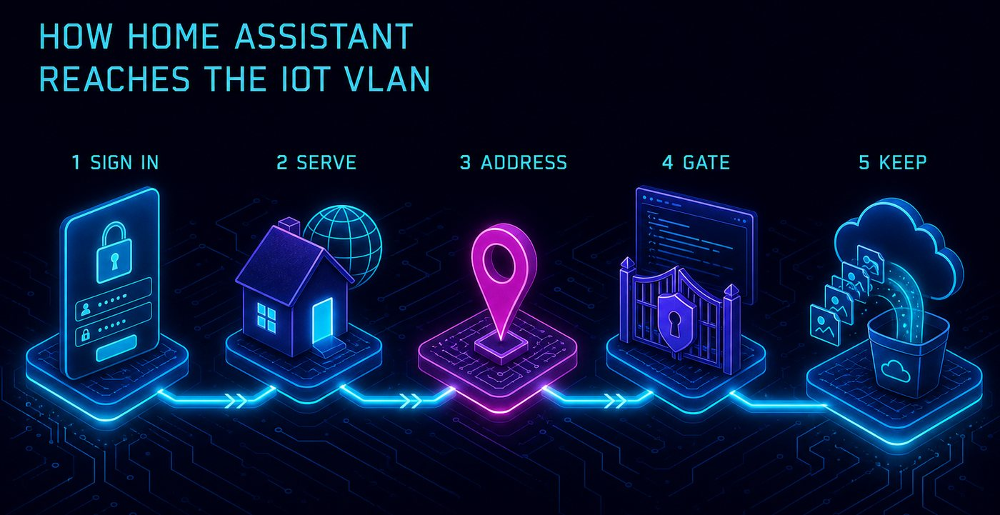
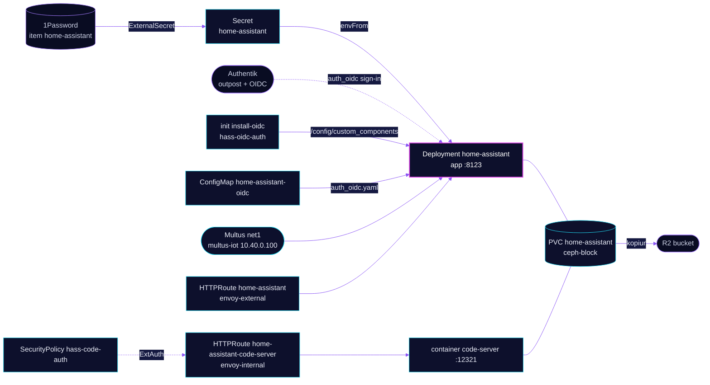

<p align="center">
  
</p>

> **One pod, two front doors, one login each.** Home Assistant runs on a fixed address on the IoT VLAN that IoT devices key on. Its public route is not behind a forward-auth gate, because companion apps cannot follow a browser redirect. Users sign in to Authentik inside Home Assistant instead. The code editor beside it sits behind Authentik at the gateway.

## At a glance

<!-- glance:start -->
<!-- Generated by `readme.py sync`; edit the manifests, not this table. -->
| | |
|---|---|
| **Namespace** | `home-automation` |
| **Deployed by** | [`home-assistant`](../../../main/home-automation/home-assistant.yaml) (Flux Kustomization) |
| **Helm chart** | `app-template`, values in [`helmrelease.yaml`](app/helmrelease.yaml) |
| **Images** | `docker.io/library/busybox`, `ghcr.io/coder/code-server`, `ghcr.io/home-operations/home-assistant` |
| **Depends on** | `kube-system/multus-networks`, `security/onepassword-store`, `system/kopiur-repository` |
| **Secret** | `home-assistant` from onepassword item `home-assistant` |
| **Backup** | kopiur component on the overlay (skill `kopiur-backups`) |
<!-- glance:end -->

## What it does

- **Serves** Home Assistant on port 8123 at `hass.${SECRET_DOMAIN}` on `envoy-external`, so the companion app and cloud integrations reach it from outside.
- **Signs in** through Authentik with the `hass-oidc-auth` custom component, installed into `/config` by an init container. The client is public with PKCE, so no secret is stored here.
- **Serves** code-server on port 12321 at `hass-code.${SECRET_DOMAIN}` on `envoy-internal`. Authentik gates it through SecurityPolicy `hass-code-auth`.
- **Holds** its `/config` on the `home-assistant` claim (5 GiB), backed up daily to R2 by kopiur.
- **Pulls** integration keys (weather, Ecobee, Google, elevation and location) from 1Password item `home-assistant` through ExternalSecret `home-assistant`.

## Why it is built this way

| Choice | Why |
|---|---|
| **Static IP, no MAC pin** | IoT devices key on `10.40.0.100`. A pinned MAC on `bond0.3` makes the replacement pod's `net1` fail while the old pod still holds the MAC. |
| **Authentik inside Home Assistant, not in front of it** | A forward-auth gate redirects `/auth/authorize` and `/auth/token` to a browser login. That breaks the companion app, Google linking and any client using Home Assistant's own token flow. |
| **Local login stays on** | The OIDC component is the front door, and local username and password remain the fallback. The roles map to the Authentik `authentik Admins` group only. |
| **Probes on `/manifest.json`** | The path needs no session, so the probe measures Home Assistant, not the ExtAuth chain on the public route. A check against the public hostname can stay green while the app is down. |
| **Checksummed component** | The init container checks the zip against `OIDC_SHA256`. A failed download or checksum keeps the installed copy, so Home Assistant still boots. |

## How it works

<p align="center">
  
</p>

<p align="center">
  
</p>

<details>
<summary><b>Resource graph</b>: every object involved, by name</summary>



</details>

In more detail:

1. Flux applies the overlay Kustomization `home-assistant`, which adds the kopiur component and the `home-assistant` claim. The HelmRelease installs one controller with two containers, `app` and `code-server`, sharing `/config`.
2. `install-oidc` runs first. It unpacks the component into `/config/custom_components/auth_oidc` and skips the download when the version marker matches.
3. Home Assistant reads `auth_oidc.yaml` from the ConfigMap, which points at the Authentik provider in `terraform/authentik/`.
4. `hass.${SECRET_DOMAIN}` goes straight to port 8123. `hass-code.${SECRET_DOMAIN}` passes ExtAuth first, then reaches code-server.
5. kopiur backs up the config claim to R2 daily.

## Settings that matter

All values are in [`app/helmrelease.yaml`](app/helmrelease.yaml) unless noted.

| Setting | Value | Why |
|---|---|---|
| `pod.annotations` `k8s.v1.cni.cncf.io/networks` | `multus-iot`, `10.40.0.100/16`, no MAC | The IP is the contract with IoT devices. No MAC pin, for the race described above. |
| `HASS_HTTP_TRUSTED_PROXY_1` to `_3`, `HASS_HTTP_USE_X_FORWARDED_FOR` | `10.10.10.0/24` (the node network), `10.50.0.0/24` (the Cilium LoadBalancer pool), `10.42.0.0/16` (the pod CIDR) | Forwarded client addresses are trusted only from these three ranges. Keep them when you edit the env block. |
| `containers.app.probes` | `GET /manifest.json` on 8123 | Measures Home Assistant itself. The startup probe allows about 300 s for a slow first integration load. |
| `containers.app.resources` | request 768Mi, limit 2Gi | The request is set because a limit-only container reserves its full limit on the node. The 30-day peak is well under the request. |
| `install-oidc` `OIDC_VERSION`, `OIDC_SHA256` | pinned, Renovate-annotated | Bump both together. A checksum failure keeps the installed copy, and a fresh claim fails the pod. |
| `route.app` | `hass.${SECRET_DOMAIN}` on `envoy-external` | The companion app, Google linking and the token flow cannot follow a browser SSO redirect. |
| `route.code-server` | `hass-code.${SECRET_DOMAIN}` on `envoy-internal` | code-server runs `--auth none`. Authentik is the only gate. |
| `topologySpreadConstraints` | `maxSkew: 2` by hostname, `ScheduleAnyway`, `nodeTaintsPolicy: Honor` | Spreads replicas across nodes. The talos-3 `PreferNoSchedule` taint keeps the pod off that node by score. |
| `persistence.config.existingClaim` | `${KOPIUR_CLAIM:-home-assistant}` | The overlay does not set `KOPIUR_CLAIM`, so the default applies. A typo here would hide behind the default. |
| [`app/resources/auth_oidc.yaml`](app/resources/auth_oidc.yaml) | public client, PKCE, `roles.admin` and `roles.user` both `authentik Admins` | Any other Authentik account is rejected rather than created as a plain user. |

## Operate it

```bash
flux -n home-automation get ks home-assistant
kubectl -n home-automation get pods -l app.kubernetes.io/name=home-assistant -o wide
kubectl -n home-automation logs deploy/home-assistant -c install-oidc
```

## Invariants

- The `client_id` in [`app/resources/auth_oidc.yaml`](app/resources/auth_oidc.yaml) must match the Authentik provider in `terraform/authentik/home-assistant.tofu`.
- `/config/configuration.yaml` must contain `auth_oidc: !include auth_oidc.yaml`. That line lives on the PVC, not in Git.
- Do not add a SecurityPolicy to the public `home-assistant` route.

## Known gaps

- **A rebuilt config claim loses Authentik sign-in.** The `auth_oidc` include line is on the PVC, not in Git. A restore from kopiur without it leaves Authentik sign-in off until someone adds the line by hand. Skill `home-automation` documents the step, but nothing automates it.

## Files

| File | Holds |
|---|---|
| [`app/helmrelease.yaml`](app/helmrelease.yaml) | Containers, probes, network, routes, persistence |
| [`app/externalsecret.yaml`](app/externalsecret.yaml) | Integration keys from 1Password item `home-assistant` |
| [`app/securitypolicy.yaml`](app/securitypolicy.yaml) | ExtAuth on the code-server route only |
| [`app/resources/auth_oidc.yaml`](app/resources/auth_oidc.yaml) | Settings for the OIDC component, mounted as a ConfigMap |
| [`app/kustomization.yaml`](app/kustomization.yaml) | Resource list and the ConfigMap generator |
| [`../../../main/home-automation/home-assistant.yaml`](../../../main/home-automation/home-assistant.yaml) | Flux Kustomization, kopiur component, substitutions |

Upstream: [Home Assistant docs](https://www.home-assistant.io/docs/) • [hass-oidc-auth](https://github.com/christiaangoossens/hass-oidc-auth)

<!-- branded-readme v1 sources=009f17f65486 -->
