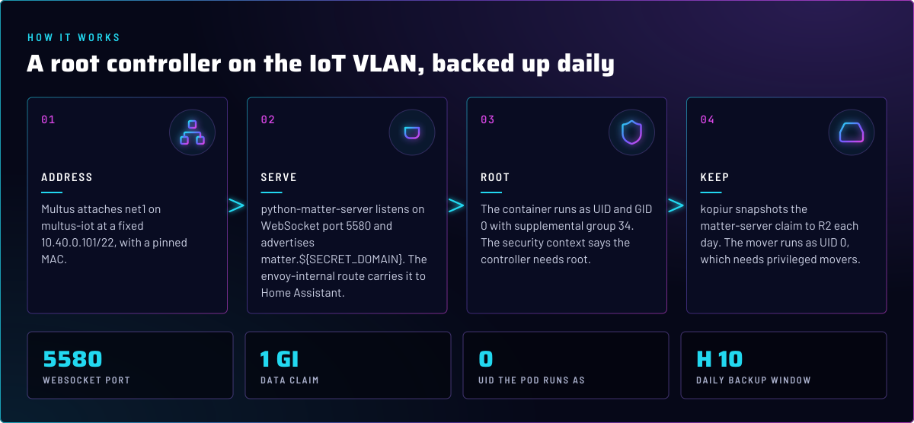
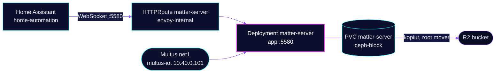

<p align="center">
  
</p>

> **The Matter controller, on the IoT VLAN.** matter-server runs the Python Matter controller that Home Assistant uses to commission and control Matter devices. Home Assistant reaches it over a WebSocket on a fixed address, and the controller's own state lives on a claim that is backed up daily.

## At a glance

<!-- glance:start -->
<!-- Generated by `readme.py sync`; edit the manifests, not this table. -->
| | |
|---|---|
| **Namespace** | `home-automation` |
| **Deployed by** | [`matter-server`](../../../main/home-automation/matter-server.yaml) (Flux Kustomization) |
| **Helm chart** | `app-template`, values in [`helmrelease.yaml`](app/helmrelease.yaml) |
| **Images** | `ghcr.io/home-assistant-libs/python-matter-server` |
| **Depends on** | `kube-system/multus-networks`, `system/kopiur-repository` |
| **Backup** | kopiur component on the overlay (skill `kopiur-backups`) |
<!-- glance:end -->

## What it does

- **Serves** a WebSocket on port 5580 for Home Assistant, advertised as `matter.${SECRET_DOMAIN}`.
- **Attaches** `net1` on `multus-iot` at `10.40.0.101/22`, so the controller has a stable address on the IoT VLAN.
- **Keeps** its data on the `matter-server` claim (1 GiB), backed up daily to R2 by kopiur.
- **Exposes** the route on `envoy-internal` only. Gatus is disabled for it, because a WebSocket is not a useful HTTP probe target.

## Why it is built this way

| Choice | Why |
|---|---|
| **Runs as root** | The container's security context sets UID and GID 0 and `runAsNonRoot: false`. The manifest says it must run as root and gives no reason. |
| **Static IP on the IoT VLAN** | Matter devices in the home sit on the IoT VLAN, so the controller sits there too, at a fixed address. |
| **Root kopiur mover** | `KOPIUR_PUID` and `KOPIUR_PGID` are `0`, so the snapshot mover runs as root too. The overlay notes that this needs privileged movers. |
| **Kustomization `wait: false`** | The standing kopiur Restore stays `Ready=False` by design. Nothing depends on this Kustomization, so waiting on it gains nothing. |

## How it works

<p align="center">
  
</p>

<details>
<summary><b>Resource graph</b>: every object involved, by name</summary>



</details>

In more detail:

1. Flux applies the overlay Kustomization `matter-server`, which adds the kopiur component, the `matter-server` claim and the root backup settings.
2. Multus attaches `net1` on `multus-iot` with the static address, so the pod has an interface on the IoT VLAN.
3. Home Assistant connects to `matter-server` on port 5580 through the internal route.
4. kopiur snapshots the claim to R2 once a day.

## Settings that matter

All values are in [`app/helmrelease.yaml`](app/helmrelease.yaml) unless noted.

| Setting | Value | Why |
|---|---|---|
| `pod.securityContext` | `runAsUser: 0`, `runAsGroup: 0`, `runAsNonRoot: false`, `supplementalGroups: [34]` | The manifest says the controller must run as root. The group 34 has no comment in Git. |
| `pod.annotations` `k8s.v1.cni.cncf.io/networks` | `multus-iot`, `10.40.0.101/22`, pinned MAC | A stable address for the controller. The MAC pin is a known risk (see Known gaps). |
| `env.MATTER_SERVER__APPLICATION_URL` | `matter.${SECRET_DOMAIN}` | The public name the route serves. |
| `route.matter-server` annotation | `gatus.home-operations.com/enabled: "false"` | A WebSocket has no useful HTTP health check. Gatus stays off for it. |
| Overlay `KOPIUR_PUID`, `KOPIUR_PGID` | `"0"` | The data is root-owned, so the mover runs as root. That needs privileged movers. |
| Overlay `KOPIUR_CAPACITY` | `1Gi` | Set explicitly. The overlay comment mentions a 2Gi default that clears this snapshot. |

## Operate it

```bash
flux -n home-automation get ks matter-server
kubectl -n home-automation get pods -l app.kubernetes.io/name=matter-server -o wide
kubectl -n home-automation logs deploy/matter-server --tail=50
```

## Known gaps

- **Pinned MAC on `net1`.** The annotation pins `3e:59:e4:f7:43:11`. Home Assistant dropped its MAC pin because a pinned MAC on `bond0.3` makes the replacement pod's `net1` fail while the old pod still holds the MAC. This pod was not tested for that race. Skill `home-automation` has the detail.
- **Supplemental group 34 has no reason in Git.** The security context adds it without a comment. Someone who knows why should record it next to the setting.

## Files

| File | Holds |
|---|---|
| [`app/helmrelease.yaml`](app/helmrelease.yaml) | Container, security context, network, route, claim |
| [`app/kustomization.yaml`](app/kustomization.yaml) | Resource list |
| [`../../../main/home-automation/matter-server.yaml`](../../../main/home-automation/matter-server.yaml) | Flux Kustomization, kopiur component, root backup substitutions |

Upstream: [python-matter-server](https://github.com/home-assistant-libs/python-matter-server) • [Matter in Home Assistant](https://www.home-assistant.io/integrations/matter/)

<!-- branded-readme v1 sources=7a0f14bcd13a -->
