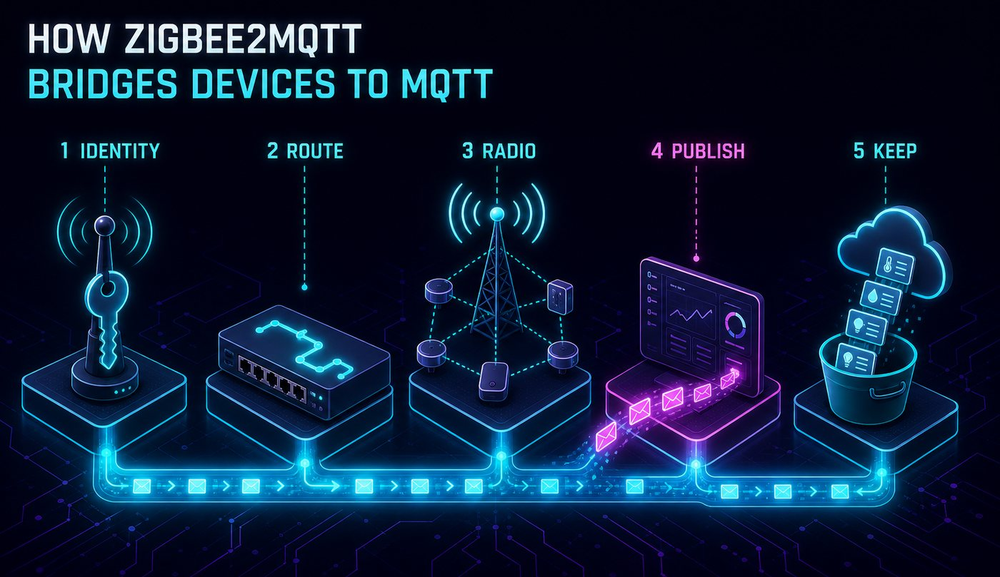
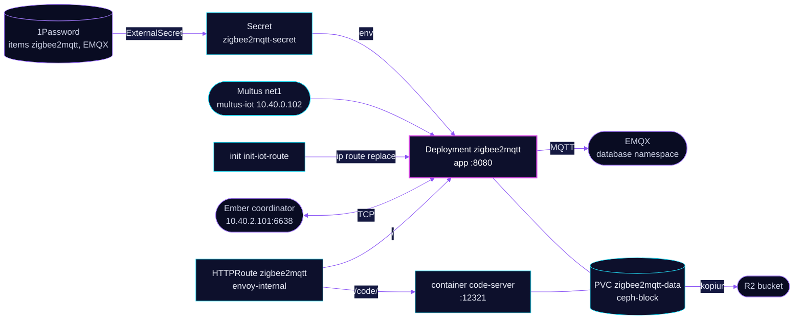

<p align="center">
  
</p>

> **Zigbee on MQTT, network identity in 1Password.** zigbee2mqtt drives an Ember coordinator on the IoT VLAN and publishes every device to EMQX. Three values define the Zigbee network. They come from 1Password, and changing one of them moves the whole network.

## At a glance

<!-- glance:start -->
<!-- Generated by `readme.py sync`; edit the manifests, not this table. -->
| | |
|---|---|
| **Namespace** | `home-automation` |
| **Deployed by** | [`zigbee2mqtt`](../../../main/home-automation/zigbee2mqtt.yaml) (Flux Kustomization) |
| **Helm chart** | `app-template`, values in [`helmrelease.yaml`](app/helmrelease.yaml) |
| **Images** | `docker.io/library/alpine`, `ghcr.io/coder/code-server`, `ghcr.io/koenkk/zigbee2mqtt` |
| **Depends on** | `database/emqx-cluster`, `kube-system/multus-networks`, `security/onepassword-store`, `system/kopiur-repository` |
| **Secret** | `zigbee2mqtt-secret` from onepassword item `EMQX`, `zigbee2mqtt` |
| **Backup** | kopiur component on the overlay (skill `kopiur-backups`) |
<!-- glance:end -->

## What it does

- **Talks** to the Ember coordinator at `10.40.2.101` over TCP port 6638, through a route that the init container adds on `net1`.
- **Publishes** device state to EMQX at `emqx-listeners.database.svc.cluster.local:1883` under the `zigbee2mqtt` base topic, with Home Assistant discovery on `homeassistant/`.
- **Serves** its frontend on port 8080 at `zigbee2mqtt.${SECRET_DOMAIN}` on `envoy-internal`, with code-server at `/code/`.
- **Writes** the three network identity values from ExternalSecret `zigbee2mqtt` (1Password item `zigbee2mqtt`) into its environment. zigbee2mqtt persists them to `/data/configuration.yaml` at every start.
- **Keeps** `/data` on the `zigbee2mqtt-data` claim (5 GiB), backed up daily to R2 by kopiur.

## Why it is built this way

| Choice | Why |
|---|---|
| **Network identity in 1Password** | The PAN ID, extended PAN ID and network key are the Zigbee network. Git does not hold them, and the ExternalSecret supplies them. |
| **Fixed address and an init-container route** | The coordinator is on the IoT VLAN. Multus installs the connected route only in policy table 100, so the init container adds the subnet route to the main table on every start. |
| **Permit join off** | New devices need a deliberate switch-on, so a stray device cannot join the network. |
| **Config comes from env, not a file** | zigbee2mqtt writes its environment into `/data/configuration.yaml` on every start, so the settings live in Git and the file follows them. |
| **Adapter type set explicitly** | The coordinator is reached over TCP, so the adapter type (`ember`) is set rather than auto-detected. |

## How it works

<p align="center">
  
</p>

<p align="center">
  
</p>

<details>
<summary><b>Resource graph</b>: every object involved, by name</summary>



</details>

In more detail:

1. Flux applies the overlay Kustomization `zigbee2mqtt`, which adds the kopiur component and the `zigbee2mqtt-data` claim. The HelmRelease installs one controller with two containers, `app` and `code-server`, sharing `/data`.
2. The `init-iot-route` init container runs as root with only `NET_ADMIN`, and replaces the IoT subnet route in the main table to use `net1`.
3. zigbee2mqtt reads the network identity from the Secret through env, writes it into `/data/configuration.yaml`, and connects to the coordinator.
4. Each device publishes to `zigbee2mqtt/<friendly name>`. Home Assistant reads the discovery messages on `homeassistant/`.
5. kopiur snapshots the data claim to R2 once a day.

## Settings that matter

All values are in [`app/helmrelease.yaml`](app/helmrelease.yaml) unless noted.

| Setting | Value | Why |
|---|---|---|
| `ZIGBEE2MQTT_CONFIG_ADVANCED_CHANNEL` | `20` | The radio channel. Changing it re-forms the network, the same as changing the identity values. |
| `ZIGBEE2MQTT_CONFIG_ADVANCED_PAN_ID`, `_EXT_PAN_ID`, `_NETWORK_KEY` | from Secret keys `zigbee_pan_id`, `zigbee_ext_pan_id`, `zigbee_network_key` | The network identity. Rotating them unpairs every device (skill `home-automation`). |
| `ZIGBEE2MQTT_CONFIG_PERMIT_JOIN` | `false` | No device joins unless someone switches joining on. |
| `ZIGBEE2MQTT_CONFIG_SERIAL_ADAPTER` and `_PORT` | `ember`, `tcp://10.40.2.101:6638` | The coordinator is a network adapter, so the type is set and not auto-detected. |
| `ZIGBEE2MQTT_CONFIG_MQTT_VERSION` | `5` | The MQTT protocol version the bridge speaks, set explicitly. |
| `ZIGBEE2MQTT_CONFIG_HOMEASSISTANT_DISCOVERY_TOPIC` | `homeassistant` | The prefix Home Assistant listens on for discovery. |
| `resources.app` | request 384Mi, limit 384Mi | The request equals the limit, so the reservation matches the ceiling. |
| `pod.annotations` `k8s.v1.cni.cncf.io/networks` | `multus-iot`, `10.40.0.102/22`, pinned MAC | A stable address for the coordinator's route. The MAC pin is a known risk (see Known gaps). |

## Operate it

```bash
flux -n home-automation get ks zigbee2mqtt
kubectl -n home-automation get pods -l app.kubernetes.io/name=zigbee2mqtt -o wide
kubectl -n home-automation logs deploy/zigbee2mqtt -c app --tail=50
```

After an identity change, the pod logs `Adapter network matches config` and `zigbee-herdsman started (resumed)`. Do not print the key or the PAN ID values into a log or a chat.

## Invariants

- The three `zigbee_*` values are the Zigbee network. Editing the 1Password item is a network change, not a secret refresh. Skill `home-automation` has the backup and proof steps before any edit.

## Known gaps

- **The editor has no SSO gate.** The editor mounts the same `/data` volume as the app, which holds the Zigbee network identity. The `/code/` route has no SecurityPolicy, so it is reachable without SSO. Fix: gate it like `hass-code-auth`, or remove the editor.
- **Pinned MAC on `net1`.** The annotation pins `3e:59:e4:f7:43:12`. Home Assistant dropped its MAC pin because a pinned MAC on `bond0.3` makes the replacement pod's `net1` fail while the old pod still holds the MAC. This pod was not tested for that race.

## Files

| File | Holds |
|---|---|
| [`app/helmrelease.yaml`](app/helmrelease.yaml) | Containers, init route, env, network, route, claim |
| [`app/externalsecret.yaml`](app/externalsecret.yaml) | The MQTT login and the three network identity values |
| [`app/kustomization.yaml`](app/kustomization.yaml) | Resource list |
| [`../../../main/home-automation/zigbee2mqtt.yaml`](../../../main/home-automation/zigbee2mqtt.yaml) | Flux Kustomization, kopiur component, substitutions |

Upstream: [Zigbee2MQTT docs](https://www.zigbee2mqtt.io/) • [Home Assistant MQTT discovery](https://www.home-assistant.io/integrations/mqtt/)

<!-- branded-readme v1 sources=61a4eb532d56 -->
