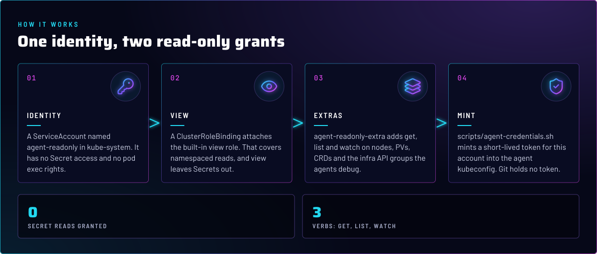
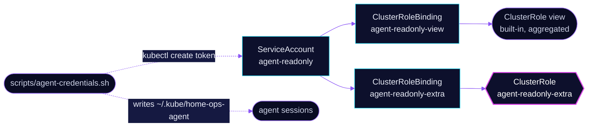

<p align="center">
  
</p>

> **Agents can look, not touch, and never read Secrets.** This ServiceAccount is the identity behind the agent
> kubeconfig. It gets the built-in `view` role plus read-only access to cluster-scoped objects and the infra CRDs
> agents debug. Writes, exec, and Secret reads are not granted.

## At a glance

<!-- glance:start -->
<!-- Generated by `readme.py sync`; edit the manifests, not this table. -->
| | |
|---|---|
| **Namespace** | `kube-system` |
| **Deployed by** | [`agent-readonly`](../../../main/kube-system/agent-readonly.yaml) (Flux Kustomization) |
<!-- glance:end -->

## What it does

- **Identifies** agent sessions as the ServiceAccount `kube-system/agent-readonly`, so their audit trail is separate
  from the owner's admin identity.
- **Grants** the aggregated `view` ClusterRole through `agent-readonly-view`. That covers namespaced reads for every
  workload and CRD that carries the view aggregation label, and excludes Secrets.
- **Adds** `agent-readonly-extra`: `get`, `list` and `watch` on `nodes`, `persistentvolumes`, `namespaces` and
  `customresourcedefinitions`, plus all resources in the infra API groups listed in
  [`clusterrole.yaml`](app/clusterrole.yaml), such as `ceph.rook.io`, `cilium.io`, `monitoring.coreos.com` and
  `kopiur.home-operations.com`.
- **Stays out of** groups whose objects carry credentials: `litellm`, `toolhive`, `tailscale` and `talos.dev`, per the
  comment in the ClusterRole.

## Why it is built this way

| Choice | Why |
|---|---|
| **No Secrets, anywhere** | An agent's context is a transcript. A Secret read would put a credential into it. `view` already excludes Secrets, and the extra role adds none. |
| **Read verbs only** | `get`, `list` and `watch` are the only verbs. No `create`, `patch`, `delete`, no `pods/exec`, no `pods/portforward`. |
| **Built-in `view`, not a hand-written list** | `view` aggregates the Flux, Flux Operator, cert-manager and External Secrets view roles, so new views reach agents without an edit here. |
| **Separate `extra` role** | The cluster-scoped objects and infra CRDs are outside `view`'s namespace model. Keeping them in their own role keeps the grant list reviewable. |
| **Token minted out of band** | `scripts/agent-credentials.sh` creates a short-lived token with `kubectl create token`, default 720 hours, and writes it to `~/.kube/home-ops-agent` outside the checkout. Git holds the identity, never the token. |
| **Talos reader certificate alongside** | The same script writes `~/.talos/home-ops-agent`, a client certificate with the `os:reader` role. That is the read-only Talos side of the same agent identity. |

## How it works

<p align="center">
  
</p>

<details>
<summary><b>Resource graph</b>: every object involved, by name</summary>



</details>

In more detail:

1. Flux applies the ServiceAccount, the ClusterRole and the two ClusterRoleBindings. Nothing in Git creates a token.
2. The owner runs `scripts/agent-credentials.sh` with admin credentials. The script creates a token for the
   ServiceAccount and writes the agent kubeconfig, outside the repo.
3. An agent session uses that kubeconfig. `.mise.toml` points `KUBECONFIG` there by default, so writes fail with
   `Forbidden` unless the owner approves an admin prefix for a specific command.
4. The token expires after the duration in the script. Re-running the script with admin credentials mints a new one.

## Settings that matter

All values are in [`app/`](app/). The token lifetime is set in `scripts/agent-credentials.sh`, not in Git.

| Setting | Value | Why |
|---|---|---|
| `agent-readonly-extra` verbs | `get`, `list`, `watch` | Read-only, by construction. |
| `agent-readonly-extra` secret groups | none | `litellm`, `toolhive`, `tailscale` and `talos.dev` are left out because their objects can carry credentials. |
| `ClusterRoleBinding` `agent-readonly-view` | `view` | Namespaced reads, aggregated, no Secrets. |
| Token lifetime | `AGENT_TOKEN_DURATION`, default `720h` | Short enough that a leaked token expires. Renewal is an owner action. |

## Operate it

Run with the admin kubeconfig, since impersonation needs admin rights:

```bash
flux -n kube-system get ks agent-readonly
kubectl auth can-i get secrets -A --as=system:serviceaccount:kube-system:agent-readonly   # expect no
kubectl auth can-i get nodes --as=system:serviceaccount:kube-system:agent-readonly        # expect yes
kubectl auth can-i delete pods -A --as=system:serviceaccount:kube-system:agent-readonly   # expect no
```

## Files

| File | Holds |
|---|---|
| [`app/serviceaccount.yaml`](app/serviceaccount.yaml) | The `agent-readonly` ServiceAccount |
| [`app/clusterrole.yaml`](app/clusterrole.yaml) | `agent-readonly-extra`: cluster-scoped and infra CRD reads |
| [`app/clusterrolebinding.yaml`](app/clusterrolebinding.yaml) | Binds `view` and `agent-readonly-extra` to the ServiceAccount |
| [`app/kustomization.yaml`](app/kustomization.yaml) | Resource list for the overlay |
| [`../../../main/kube-system/agent-readonly.yaml`](../../../main/kube-system/agent-readonly.yaml) | Flux Kustomization |
| [`scripts/agent-credentials.sh`](../../../../../scripts/agent-credentials.sh) | Mints the token and the Talos certificate (header documents the owner steps) |

Upstream: [Kubernetes RBAC default roles](https://kubernetes.io/docs/reference/access-authn-authz/rbac/#default-roles-and-role-bindings)

<!-- branded-readme v1 sources=c35153b9df1e -->
