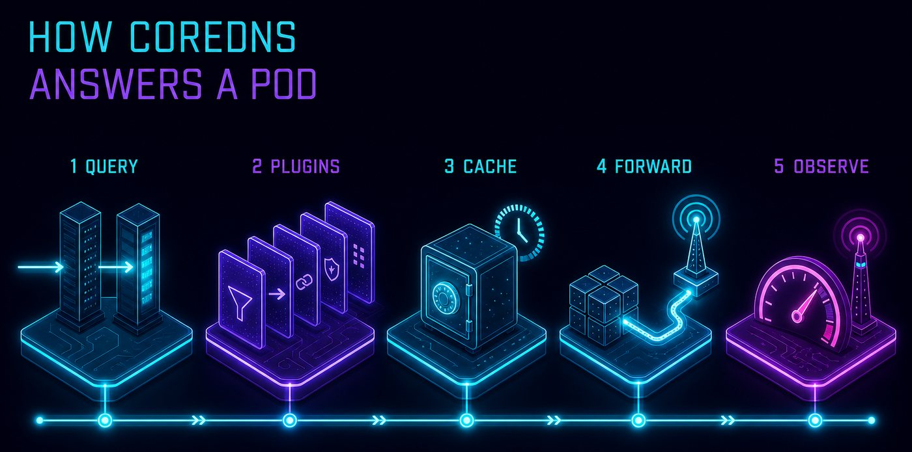
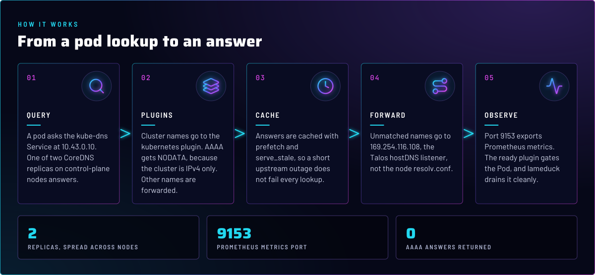
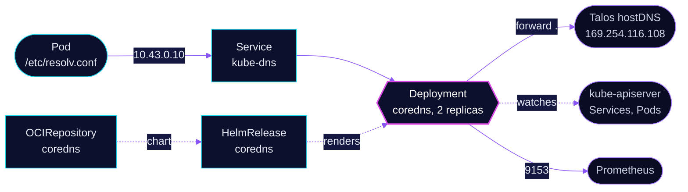

<p align="center">
  
</p>

> **Cluster DNS, two replicas, no surprises.** CoreDNS answers `cluster.local` for every pod on the `kube-dns` Service
> and forwards every other name to the Talos host resolver. It runs on the control plane, so a lookup never waits on a
> workload node.

## At a glance

<!-- glance:start -->
<!-- Generated by `readme.py sync`; edit the manifests, not this table. -->
| | |
|---|---|
| **Namespace** | `kube-system` |
| **Deployed by** | [`coredns`](../../../main/kube-system/coredns.yaml) (Flux Kustomization) |
| **Helm chart** | `coredns` from `oci://ghcr.io/coredns/charts/coredns`, values in [`helmrelease.yaml`](app/helmrelease.yaml) |
| **Images** | `mirror.gcr.io/coredns/coredns` |
<!-- glance:end -->

## What it does

- **Answers** cluster names (`cluster.local`, `in-addr.arpa`, `ip6.arpa`) through the `kubernetes` plugin, from the
  Services and Pods the API server knows about.
- **Serves** the `kube-dns` Service at `10.43.0.10`, the address kubelet hands every pod in `/etc/resolv.conf`.
- **Forwards** everything else to `169.254.116.108`, the Talos hostDNS listener, and caches the result.
- **Exports** Prometheus metrics on port 9153 through the `prometheus` plugin.

## Why it is built this way

| Choice | Why |
|---|---|
| **AAAA answers NODATA** | The cluster is IPv4 only (Cilium `enable-ipv6=false`, no IPv6 egress). Without this, resolvers wait on unreachable IPv6 before falling back to A. |
| **Forward to Talos hostDNS, not `/etc/resolv.conf`** | The node resolver can carry a DHCP search domain. Pinning the upstream keeps the forwarder off that path. |
| **No `autopath`** | `serve_stale` turns autopath answers into NXDOMAIN after about 30 seconds, which breaks external names. Skill `system-namespaces`. |
| **Two replicas, `maxSkew: 1` across hostnames** | One node drain cannot take DNS down. The spread uses `whenUnsatisfiable: DoNotSchedule`. |
| **Control-plane placement with tolerations** | DNS is a dependency of nearly everything, so it is pinned to control-plane nodes. `CriticalAddonsOnly` and the control-plane toleration let it land on those tainted nodes. |

## How it works

<p align="center">
  
</p>

<p align="center">
  
</p>

<details>
<summary><b>Resource graph</b>: every object involved, by name</summary>



</details>

In more detail:

1. Flux applies the `OCIRepository` and the `HelmRelease` from [`app/`](app/). The chart renders a Deployment, the
   `kube-dns` Service (`k8sAppLabelOverride: kube-dns` keeps the label selectors that expect it), a ServiceAccount and
   the Corefile.
2. A pod's lookup for a cluster name hits the `kubernetes` plugin. An AAAA query for any name gets `NOERROR` with no
   records, because the `template` plugin answers `ANY AAAA` before the forwarder sees it.
3. Everything else goes to `forward . /etc/resolv.conf` inside the pod, where `dnsPolicy: None` and the nameserver
   `169.254.116.108` make that file point at Talos hostDNS. The cache keeps answers for prefetch and stale use.
4. Node networking is part of this path. Talos `hostDNS` runs with `forwardKubeDNSToHost: true`, which requires Cilium
   `socketLB.hostNamespaceOnly` (skill `talos-nodes`).

## Settings that matter

All values are in [`app/helmrelease.yaml`](app/helmrelease.yaml) unless noted.

| Setting | Value | Why |
|---|---|---|
| `replicaCount` | `2` | Two replicas so a single drain or crash keeps lookups answered. |
| `topologySpreadConstraints` | `maxSkew: 1`, `kubernetes.io/hostname`, `DoNotSchedule`, `nodeTaintsPolicy: Honor` | One drain cannot take both replicas. `Honor` filters `NoSchedule` only; it does not keep DNS off talos-3 (skill `node-scheduling`). |
| `affinity` | requires `node-role.kubernetes.io/control-plane` | Places DNS on control-plane nodes. Every node in this three-node cluster carries that label. |
| `deployment.dnsPolicy`, `deployment.dnsConfig.nameservers` | `None`, `169.254.116.108` | The forwarder uses Talos hostDNS, not the node's DHCP-supplied resolver chain. |
| `servers[].plugins` `template` | `ANY AAAA`, `rcode NOERROR` | Clients get NODATA at once instead of waiting on an unreachable IPv6 path. |
| `cache` | `prefetch 20`, `serve_stale` | Popular names refresh before expiry, and a brief upstream failure serves the last answer. |
| `health` | `lameduck 5s` | On shutdown the health endpoint reports unhealthy for 5 s before the process exits, so the Service drains the Pod first. |
| `resources` | requests `100m` CPU and `70Mi`; memory limit `170Mi`; no CPU limit | A CPU limit is a CFS quota, and throttling DNS adds latency to every pod. The memory limit has a request beside it (skill `node-scheduling`). |
| `tolerations` | `CriticalAddonsOnly`, `control-plane` `NoSchedule` | Lets DNS run on control-plane nodes that carry the taint. |

## Operate it

```bash
flux -n kube-system get ks coredns
kubectl -n kube-system get deploy coredns
kubectl -n kube-system get pods -l app.kubernetes.io/name=coredns -o wide
kubectl -n kube-system get svc kube-dns                 # CLUSTER-IP is the address pods use
kubectl -n kube-system logs deploy/coredns --tail=50
```

## Files

| File | Holds |
|---|---|
| [`app/helmrelease.yaml`](app/helmrelease.yaml) | Chart values: Corefile, placement, resources |
| [`app/ocirepository.yaml`](app/ocirepository.yaml) | Chart source and version |
| [`app/kustomization.yaml`](app/kustomization.yaml) | Resource list for the overlay |
| [`../../../main/kube-system/coredns.yaml`](../../../main/kube-system/coredns.yaml) | Flux Kustomization |

Upstream: [CoreDNS plugins](https://coredns.io/plugins/) •
[cache plugin](https://coredns.io/plugins/cache/) •
[template plugin](https://coredns.io/plugins/template/)

<!-- branded-readme v1 sources=9c4cc0211d2a -->
