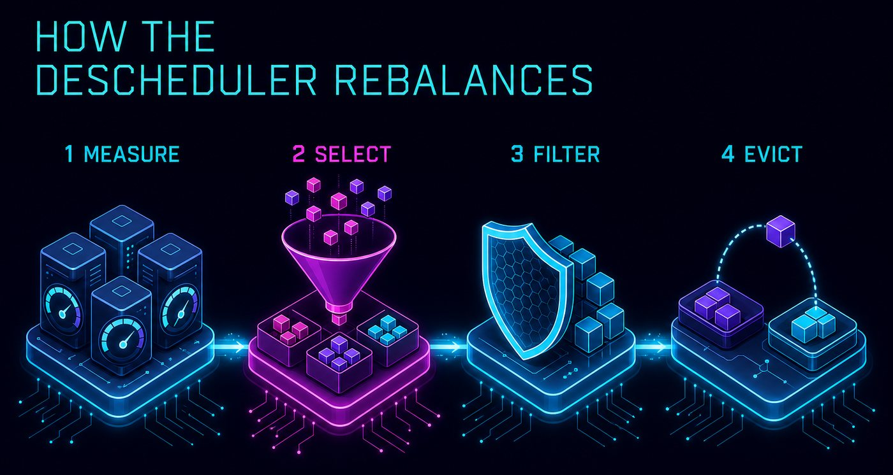
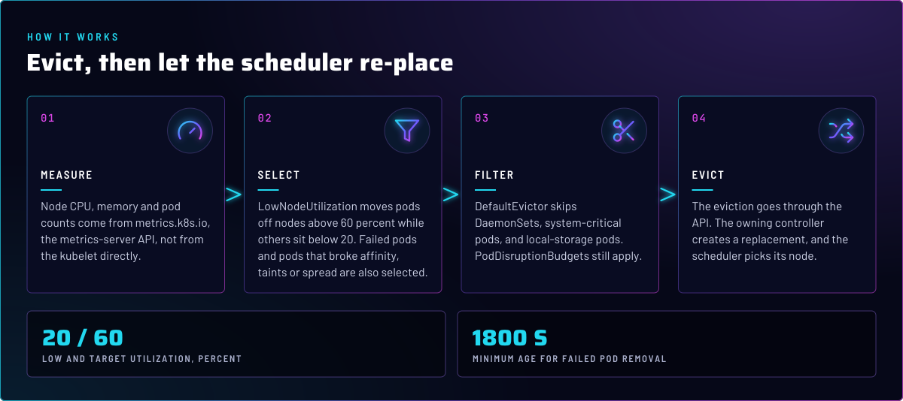
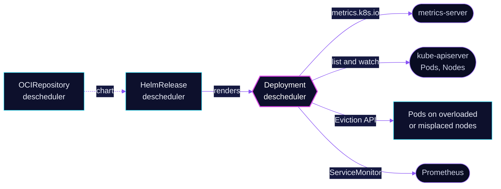

<p align="center">
  
</p>

> **Rebalance without restarts by hand.** The descheduler evicts pods from overloaded nodes, failed pods, and pods that
> broke their affinity, taint or spread rules. Each eviction goes through the API, and the owning controller plus the
> scheduler decide where the replacement lands.

## At a glance

<!-- glance:start -->
<!-- Generated by `readme.py sync`; edit the manifests, not this table. -->
| | |
|---|---|
| **Namespace** | `kube-system` |
| **Deployed by** | [`descheduler`](../../../main/kube-system/descheduler.yaml) (Flux Kustomization) |
| **Helm chart** | `descheduler` from `oci://ghcr.io/home-operations/charts-mirror/descheduler`, values in [`helmrelease.yaml`](app/helmrelease.yaml) |
<!-- glance:end -->

## What it does

- **Moves pods off busy nodes** (`LowNodeUtilization`): when a node is above 60 percent CPU, memory or pod count and
  another sits below 20 percent, pods leave the busy node.
- **Removes failed pods** (`RemoveFailedPods`) with reasons such as `NodeAffinity`, `NodeShutdown` and
  `ContainerStatusUnknown`, once they are 30 minutes old. Job-owned pods are excluded, because their Job owns the retry.
- **Enforces placement rules after the fact**: pods that violate required node affinity, inter-pod anti-affinity,
  `NoSchedule` / `NoExecute` taints, or topology spread constraints are evicted.
- **Exports metrics** on a Service and a ServiceMonitor. Leader election is enabled in Git; the single replica is the chart default, not a value set here.

## Why it is built this way

| Choice | Why |
|---|---|
| **Deployment, not the chart's CronJob** | The chart defaults to a CronJob that runs the descheduling loop per invocation. A Deployment keeps the policy resident and exposes the metrics endpoint. |
| **Measured with `KubernetesMetrics`** | Utilization comes from metrics.k8s.io, so it reflects live usage rather than requests. This ties the descheduler to [metrics-server](../metrics-server/); without it the balancing plugin has no data. |
| **Evict the pods the scheduler cannot fix** | The scheduler only places new pods. Pods that were placed before a rule changed, or that drifted onto a bad node, stay put until something evicts them. |
| **`evictSystemCriticalPods: false`, `evictLocalStoragePods: false`** | System-critical pods and pods with `emptyDir` data are left alone. An eviction would drop the local data. |
| **`PreferNoSchedule` is not evicted** | `RemovePodsViolatingNodeTaints` only evicts `NoSchedule` and `NoExecute` violators. Pods on talos-3 do not leave by this path, and the thresholds do not move them either (skill `node-scheduling`). |

## How it works

<p align="center">
  
</p>

<p align="center">
  
</p>

<details>
<summary><b>Resource graph</b>: every object involved, by name</summary>



</details>

In more detail:

1. Flux applies the chart. The policy lives inline in the HelmRelease as `deschedulerPolicy`, in the
   `descheduler/v1alpha2` API, with one `Default` profile.
2. Each cycle, `LowNodeUtilization` reads node usage from metrics-server. It evicts from nodes above the target
   thresholds, but only when there is a node below the low thresholds to take the pods.
3. `DefaultEvictor` filters the candidates. PodDisruptionBudgets are respected, so an eviction that would break a
   budget is skipped for that cycle.
4. The eviction API removes the pod. Its controller, a Deployment, StatefulSet or DaemonSet, creates a replacement and
   the scheduler places it.

## Settings that matter

All values are in [`app/helmrelease.yaml`](app/helmrelease.yaml) unless noted.

| Setting | Value | Why |
|---|---|---|
| `kind` | `Deployment` | Chart default is `CronJob`. A long-running Deployment with leader election keeps one active process. |
| `deschedulerPolicy.metricsProviders` | `KubernetesMetrics` | Balances on live usage from metrics-server, not on requests. |
| `LowNodeUtilization` `thresholds` / `targetThresholds` | `20` / `60`, for `cpu`, `memory`, `pods` | Nodes below 20 percent receive pods. Nodes above 60 percent give them up. The gap between the two keeps the plugin from oscillating. |
| `DefaultEvictor` `evictSystemCriticalPods` | `false` | Pods in the system-critical priority classes are skipped, which keeps the cluster add-ons in place. |
| `DefaultEvictor` `evictLocalStoragePods` | `false` | Pods with `emptyDir` lose their data on eviction. |
| `DefaultEvictor` `evictFailedBarePods` | `true` | Pods with no owner that failed are removed. Nothing recreates them, so they would stay failed. |
| `RemoveFailedPods` `minPodLifetimeSeconds` | `1800` | Gives the owning controller time to retry a failed pod before the descheduler removes it. |
| `RemoveFailedPods` `excludeOwnerKinds` | `Job` | Job controllers own their failed pods and their retry count. |
| `leaderElection`, `service`, `serviceMonitor` | enabled | Leader election is on, and Prometheus scrapes the Service. The replica count is the chart default (1). |

## Operate it

```bash
flux -n kube-system get hr descheduler
kubectl -n kube-system get deploy descheduler
kubectl -n kube-system logs deploy/descheduler --tail=100 | grep -i evict
kubectl top nodes                                        # the inputs LowNodeUtilization uses
```

## Files

| File | Holds |
|---|---|
| [`app/helmrelease.yaml`](app/helmrelease.yaml) | Chart values and the full descheduler policy |
| [`app/ocirepository.yaml`](app/ocirepository.yaml) | Chart source and version |
| [`app/kustomization.yaml`](app/kustomization.yaml) | Resource list for the overlay |
| [`../../../main/kube-system/descheduler.yaml`](../../../main/kube-system/descheduler.yaml) | Flux Kustomization |

Upstream: [descheduler policy reference](https://github.com/kubernetes-sigs/descheduler#policy-and-strategies) •
[LowNodeUtilization](https://github.com/kubernetes-sigs/descheduler#lownodeutilization)

<!-- branded-readme v1 sources=f7ebd76a5cdd -->
