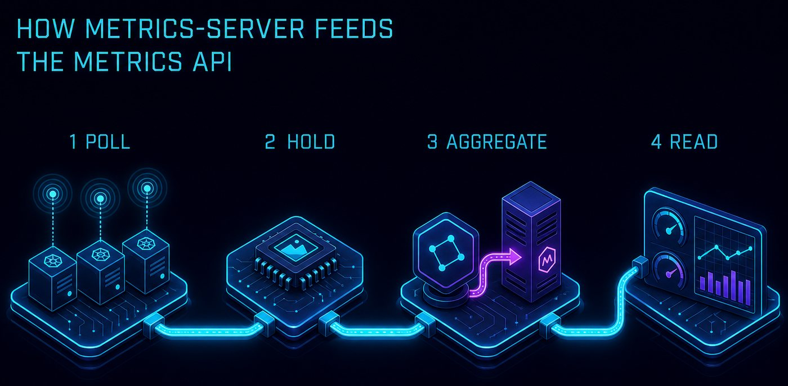
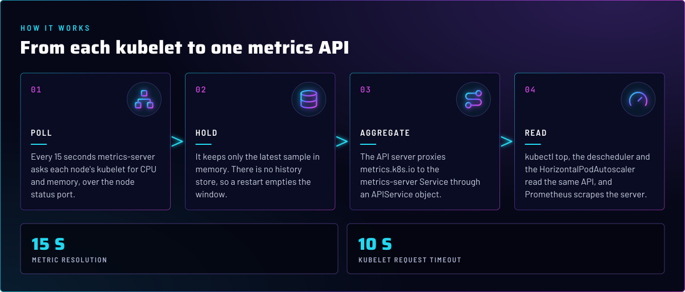
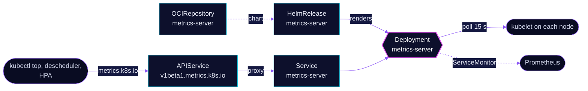

<p align="center">
  
</p>

> **Usage numbers for the API, nothing stored.** metrics-server polls every kubelet for CPU and memory, keeps the
> latest sample in memory, and serves it as `metrics.k8s.io`. It is the input for `kubectl top`, the descheduler's
> `LowNodeUtilization`, and any HorizontalPodAutoscaler on resource metrics.

## At a glance

<!-- glance:start -->
<!-- Generated by `readme.py sync`; edit the manifests, not this table. -->
| | |
|---|---|
| **Namespace** | `kube-system` |
| **Deployed by** | [`metrics-server`](../../../main/kube-system/metrics-server.yaml) (Flux Kustomization) |
| **Helm chart** | `metrics-server` from `oci://ghcr.io/home-operations/charts-mirror/metrics-server`, values in [`helmrelease.yaml`](app/helmrelease.yaml) |
<!-- glance:end -->

## What it does

- **Polls** every node's kubelet every 15 seconds (`--metric-resolution=15s`), with a 10 second request timeout, and
  reads the node status port (`--kubelet-use-node-status-port`).
- **Serves** `metrics.k8s.io` through an `APIService`. The API server proxies `kubectl top` and other clients to the
  `metrics-server` Service.
- **Exports** its own metrics: `metrics.enabled` adds `--authorization-always-allow-paths=/metrics`, so scrapes of
  `/metrics` skip authorization, and a ServiceMonitor feeds Prometheus.

## Why it is built this way

| Choice | Why |
|---|---|
| **`--kubelet-insecure-tls`** | This repo takes the insecure path: metrics-server does not verify kubelet serving certificates. The alternative is `serverTLSBootstrap` with kubelet CSR approval. `talos/machineconfig.yaml.j2` does not set that up, so it is not in place. |
| **`--kubelet-preferred-address-types=InternalIP,ExternalIP,Hostname`** | Scrapes each node by IP first, so scraping does not depend on node-name resolution. |
| **Resource requests `50m` CPU and `64Mi`, memory limit `128Mi`** | The request is what the scheduler reserves. The footprint grows with node and pod count, so the limit sits at twice the request (skill `node-scheduling`). |
| **In-memory only, no history** | Only the latest sample is served. Trend data belongs to Prometheus, which keeps history. |

## How it works

<p align="center">
  
</p>

<p align="center">
  
</p>

<details>
<summary><b>Resource graph</b>: every object involved, by name</summary>



</details>

In more detail:

1. Flux applies the chart from [`app/`](app/). The chart creates the Deployment, the Service, the `APIService` and the
   ServiceMonitor, and the `args` in the HelmRelease add the kubelet flags.
2. Every 15 seconds the server scrapes each node. Node addresses are taken in the order
   `InternalIP`, `ExternalIP`, `Hostname`.
3. The API server sees the `APIService` as available only while metrics-server answers. A dead metrics-server shows up
   as the APIService going unavailable, `kubectl top` failing, and the descheduler losing its utilization inputs.

## Settings that matter

All values are in [`app/helmrelease.yaml`](app/helmrelease.yaml) unless noted.

| Setting | Value | Why |
|---|---|---|
| `args` `--kubelet-insecure-tls` | set | Kubelet serving certificates are not verified. The alternative, `serverTLSBootstrap` with CSR approval, is not set up in Git. |
| `args` `--kubelet-preferred-address-types` | `InternalIP,ExternalIP,Hostname` | Uses node IPs, not names, for scraping. |
| `args` `--kubelet-request-timeout` | `10s` | A slow kubelet fails fast instead of holding a whole scrape cycle. |
| `metrics.enabled`, `serviceMonitor.enabled` | `true` | Prometheus scrapes the server's own health. |
| `resources` | requests `50m` CPU, `64Mi`; memory limit `128Mi` | No CPU limit, so scraping is not throttled. The memory limit has a request beside it (skill `node-scheduling`). |

## Operate it

```bash
flux -n kube-system get hr metrics-server
kubectl get apiservice v1beta1.metrics.k8s.io            # AVAILABLE True
kubectl top nodes
kubectl -n kube-system logs deploy/metrics-server --tail=50
```

## Known gaps

- **Repeated flags.** The chart already renders `--kubelet-preferred-address-types`, `--kubelet-use-node-status-port`
  and `--metric-resolution=15s` through its `defaultArgs` (chart 3.14.0 `values.yaml`, checked with `helm show values`),
  and the HelmRelease `args` repeats all three. The duplicates
  carry the same values, so nothing changes today. Drop them from `args` the next time this file is edited, and keep
  only the flags the chart does not set.

## Files

| File | Holds |
|---|---|
| [`app/helmrelease.yaml`](app/helmrelease.yaml) | Chart values and kubelet flags |
| [`app/ocirepository.yaml`](app/ocirepository.yaml) | Chart source and version |
| [`app/kustomization.yaml`](app/kustomization.yaml) | Resource list for the overlay |
| [`../../../main/kube-system/metrics-server.yaml`](../../../main/kube-system/metrics-server.yaml) | Flux Kustomization |

Upstream: [metrics-server README](https://github.com/kubernetes-sigs/metrics-server) •
[command-line flags](https://github.com/kubernetes-sigs/metrics-server#command-line-flags)

<!-- branded-readme v1 sources=344a766d6631 -->
