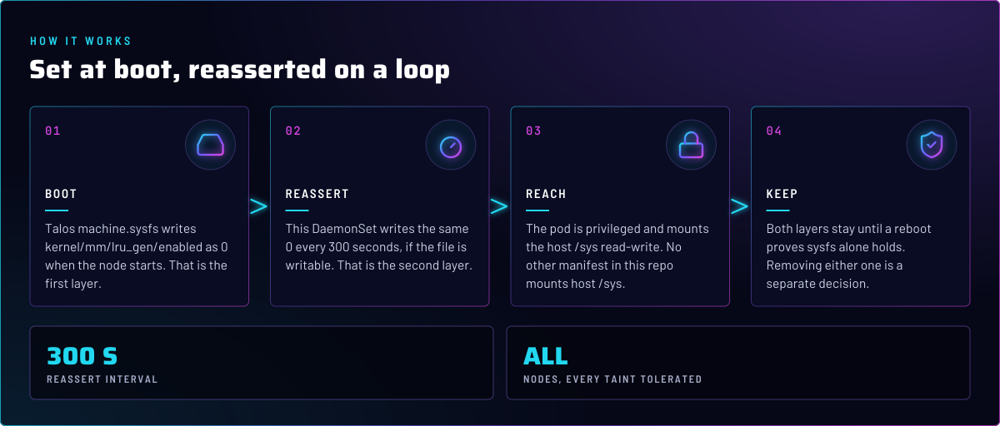
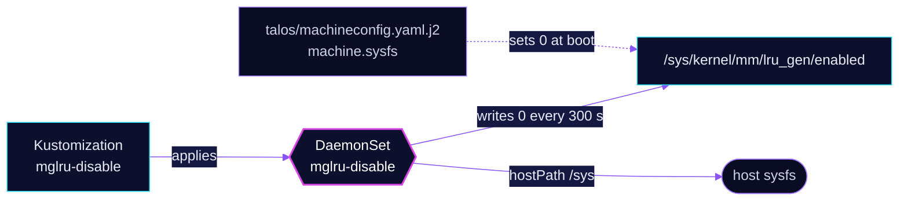

<p align="center">
  
</p>

> **The second of two switches that keep MGLRU off.** Talos sets `kernel/mm/lru_gen/enabled` to `0` at boot. This
> DaemonSet writes the same value every 300 seconds on every node. Neither is removed until a reboot proves the other
> holds on its own.

## At a glance

<!-- glance:start -->
<!-- Generated by `readme.py sync`; edit the manifests, not this table. -->
| | |
|---|---|
| **Namespace** | `kube-system` |
| **Deployed by** | [`mglru-disable`](../../../main/kube-system/mglru-disable.yaml) (Flux Kustomization) |
| **Images** | `docker.io/library/busybox` |
<!-- glance:end -->

## What it does

- **Runs on every node.** The DaemonSet tolerates all taints (`operator: Exists`), so talos-3 and any future node get
  the same reassertion.
- **Writes** `0` to `/sys/kernel/mm/lru_gen/enabled` when the file is writable, then sleeps 300 seconds and repeats.
- **Mounts** the host `/sys` read-write through a `hostPath`, with a privileged container running as root.

## Why it is built this way

| Choice | Why |
|---|---|
| **MGLRU off at all** | A kernel tunable pinned in Git on purpose. This README does not restate the reason; read skill `talos-nodes` before changing it. |
| **Two layers, not one** | `machine.sysfs` applies immediately at boot. This DaemonSet covers the case where the value is reset at runtime. Removing either layer needs a reboot that proves the other one holds (skill `system-namespaces`). |
| **Privileged, hostPath `/sys`** | Writing a sysfs tunable needs root in the host's sysfs namespace. A capability-only pod cannot do it. |
| **`automountServiceAccountToken: false`** | The loop never calls the API, so the pod gets no token. |
| **`priorityClassName: system-node-critical`** | The reassertion should not be evicted under pressure. |
| **Requests `1m` CPU and `16Mi`, memory limit `32Mi`** | A sleep loop with one write needs almost nothing. The memory limit has a request beside it (skill `node-scheduling`). |

## How it works

<p align="center">
  
</p>

<details>
<summary><b>Resource graph</b>: every object involved, by name</summary>



</details>

In more detail:

1. Talos applies `machine.sysfs` from `talos/machineconfig.yaml.j2`, so the switch starts at `0` and is set on the node
   without a reboot (skill `talos-nodes`).
2. Flux applies the DaemonSet. Each pod runs a shell loop: if the file is writable, write `0`, then sleep 300 seconds.
3. A failed write is swallowed (`2>/dev/null || true`), so the loop keeps running and nothing alerts on it.
4. Removing either layer needs a reboot that shows the other one holds `0` on its own (skill `system-namespaces`).

## Settings that matter

All values are in [`app/daemonset.yaml`](app/daemonset.yaml).

| Setting | Value | Why |
|---|---|---|
| `securityContext` | `privileged: true`, `runAsUser: 0` | Needed to write the sysfs tunable. |
| `volumes` | `hostPath` `/sys`, type `Directory` | The tunable lives under the host's sysfs. |
| `tolerations` | `operator: Exists` | Every node, including talos-3 and its `PreferNoSchedule` taint. |
| `hostPID` | `false` | Explicit. The loop needs no other process namespace. |
| `resources` | requests `1m` CPU, `16Mi`; memory limit `32Mi` | A sleep loop. |

## Operate it

```bash
flux -n kube-system get ks mglru-disable
kubectl -n kube-system get ds mglru-disable -o wide     # one pod per node
talosctl -n talos-1 read /sys/kernel/mm/lru_gen/enabled # expect 0
```

## Known gaps

- **Failures are silent.** The write is `echo 0 > ... 2>/dev/null || true`, so a failed reassertion writes nothing to
  the pod log. The DaemonSet keeps reporting Ready while the value drifts. Found while writing; not changed here.
- **Manifest has no schema comment.** `app/daemonset.yaml` starts with `apiVersion`, without the
  `# yaml-language-server: $schema=...` line that every manifest in the repo carries. Found while writing; not changed here.

## Files

| File | Holds |
|---|---|
| [`app/daemonset.yaml`](app/daemonset.yaml) | The reassertion loop |
| [`app/kustomization.yaml`](app/kustomization.yaml) | Resource list for the overlay |
| [`../../../main/kube-system/mglru-disable.yaml`](../../../main/kube-system/mglru-disable.yaml) | Flux Kustomization |
| [`talos/machineconfig.yaml.j2`](../../../../../talos/machineconfig.yaml.j2) | The `machine.sysfs` setting, the first layer |

<!-- branded-readme v1 sources=d770dc7163d4 -->
