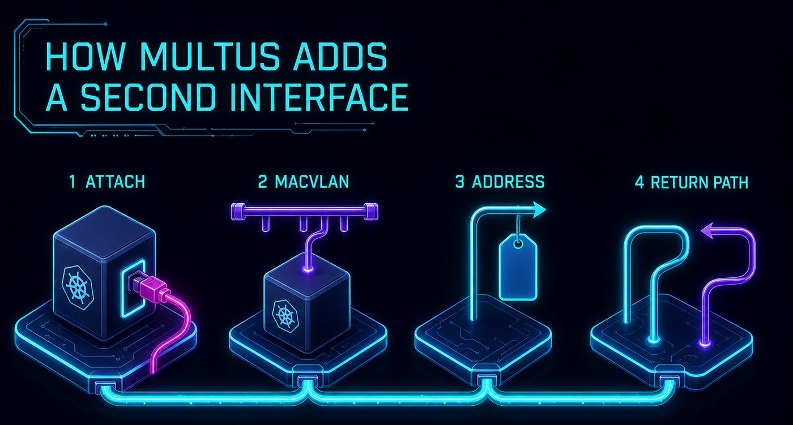
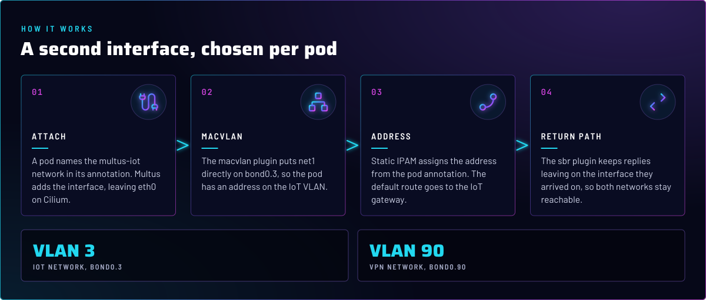
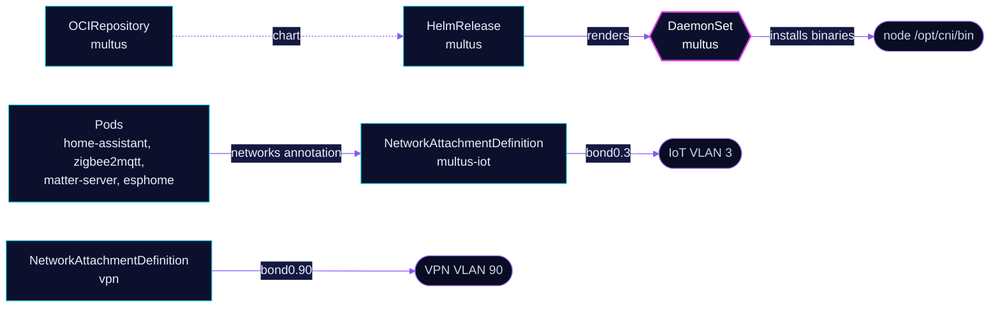

<p align="center">
  
</p>

> **A second NIC for the pods that talk to IoT devices.** Multus is a meta-plugin: Cilium still builds `eth0` for every
> pod, and Multus adds `net1` only where a pod asks for it by name. Four home-automation pods use the IoT network. The
> VPN network is defined here but no pod in Git uses it yet.

## At a glance

<!-- glance:start -->
<!-- Generated by `readme.py sync`; edit the manifests, not this table. -->
| | |
|---|---|
| **Namespace** | `kube-system` |
| **Deployed by** | [`multus`](../../../main/kube-system/multus.yaml), [`multus-networks`](../../../main/kube-system/multus.yaml) (Flux Kustomization) |
| **Helm chart** | `multus` from `oci://ghcr.io/bjw-s-labs/helm/multus`, values in [`helmrelease.yaml`](app/helmrelease.yaml) |
| **Depends on** | `kube-system/multus` |
| **Needed by** | `home-automation/esphome`, `home-automation/home-assistant`, `home-automation/matter-server`, `home-automation/zigbee2mqtt`, `kube-system/multus-networks` |
| **Health checks** | `CustomResourceDefinition/network-attachment-definitions.k8s.cni.cncf.io`, `DaemonSet/multus` |
<!-- glance:end -->

## What it does

- **Runs Multus** as a DaemonSet on every node, delegating to Cilium for the primary interface (`binPath`
  `/opt/cni/bin`, `netPath` `/etc/cni/net.d`, the Talos paths).
- **Defines** two `NetworkAttachmentDefinition`s in `kube-system`: `multus-iot` (macvlan on `bond0.3`, the IoT VLAN)
  and `vpn` (macvlan on `bond0.90`, the VPN VLAN).
- **Serves** `multus-iot` to `home-automation/home-assistant`, `zigbee2mqtt`, `matter-server` and `esphome`. Each pod
  names it in `k8s.v1.cni.cncf.io/networks` with a static `ips` entry.

## Why it is built this way

| Choice | Why |
|---|---|
| **Macvlan on the VLAN sub-interface** | Device discovery and traffic on VLAN 3 need an address on that VLAN. The pod network cannot give one. |
| **Multus as a secondary CNI, Cilium primary** | Cluster networking and policy stay on Cilium. Only the pods that name an attachment get a second interface. |
| **Static IPAM with addresses in the pod annotation** | The address is decided per pod, next to the workload that owns it. The NAD gives routes and the gateway only. |
| **`sbr` after macvlan** | Source-based routing keeps replies on the interface they arrived on. Without it, return traffic for the IoT address could leave through `eth0`. |
| **VPN routes split around private ranges** | The `vpn` NAD sends the default route through 192.168.90.1 as a set of blocks that skips `10.0.0.0/8`, `172.16.0.0/12` and `192.168.0.0/16`, so private networks keep the primary route. |
| **Dedicated-taint toleration as a postRenderer** | The chart hardcodes its own tolerations, and `mergeOverwrite` drops `values` tolerations. The JSON6902 add is the only in-repo path that keeps the DaemonSet on talos-3 (skill `node-scheduling`). |

## How it works

<p align="center">
  
</p>

<p align="center">
  
</p>

<details>
<summary><b>Resource graph</b>: every object involved, by name</summary>



</details>

In more detail:

1. Flux applies `multus` first. The chart installs the DaemonSet and the `NetworkAttachmentDefinition` CRD, and the
   `multus` Kustomization health-checks both. The `multus-networks` Kustomization depends on it and waits, so the NADs
   are created only after the CRD exists.
2. A pod in `home-automation` starts with the Cilium interface only. Its annotation names `multus-iot` in
   `kube-system` and an address, for example `10.40.0.100/16` for Home Assistant.
3. Multus calls macvlan on `bond0.3` to create `net1` in the pod's network namespace, then static IPAM applies the
   address and the default route from the NAD. The `sbr` plugin adds the return-path rules.
4. Traffic to the IoT devices leaves on `net1`. Everything else in the pod, including the cluster API and Services,
   stays on `eth0`.

## Settings that matter

All values are in [`app/helmrelease.yaml`](app/helmrelease.yaml) unless noted. The NADs are in
[`networks/`](networks/).

| Setting | Value | Why |
|---|---|---|
| `cni.binPath`, `cni.netPath` | `/opt/cni/bin`, `/etc/cni/net.d` | Talos keeps the CNI binaries and config there. |
| `postRenderers` JSON6902 toleration | `home-operations.com/dedicated`, `PreferNoSchedule` | Lets the DaemonSet schedule on talos-3. The effect must stay `PreferNoSchedule`; a `NoSchedule` strands drains (skill `node-scheduling`). |
| `multus.resources.requests` | `10m` CPU, `64Mi` memory | An explicit memory request. A limit with no request reserves the whole limit on the node (skill `node-scheduling`). |
| `multus.resources.limits.memory` | `512Mi` | Upper bound for the daemon; the request is the scheduling number. |
| NAD `multus-iot` `master` | `bond0.3` | IoT VLAN sub-interface on the bonded LACP link. |
| NAD `vpn` `master` | `bond0.90` | VPN VLAN sub-interface. |

## Operate it

```bash
flux -n kube-system get ks multus multus-networks
kubectl -n kube-system get ds multus -o wide
kubectl get network-attachment-definitions -n kube-system
kubectl -n home-automation get pod -l app.kubernetes.io/name=home-assistant \
  -o jsonpath='{.items[0].metadata.annotations.k8s\.v1\.cni\.cncf\.io/network-status}'
```

## Known gaps

- **`vpn` has no consumer in Git.** `networks/vpn.yaml` is the only reference to the `vpn` NetworkAttachmentDefinition.
  Either a workload outside this repo uses it, or the object is dead config. Check the live cluster before removing it.
- **Schema comment points at a raw GitHub URL.** `networks/iot.yaml` sets its `yaml-language-server` schema to
  `raw.githubusercontent.com`. The repo convention is `kubernetes-schemas.pages.dev`, which `networks/vpn.yaml` already uses.
  Found while writing; not changed here.

## Files

| File | Holds |
|---|---|
| [`app/helmrelease.yaml`](app/helmrelease.yaml) | Chart values, the toleration postRenderer |
| [`app/ocirepository.yaml`](app/ocirepository.yaml) | Chart source and version |
| [`networks/iot.yaml`](networks/iot.yaml) | `multus-iot` NetworkAttachmentDefinition |
| [`networks/vpn.yaml`](networks/vpn.yaml) | `vpn` NetworkAttachmentDefinition, split default routes |
| [`networks/kustomization.yaml`](networks/kustomization.yaml) | Resource list for the NADs |
| [`../../../main/kube-system/multus.yaml`](../../../main/kube-system/multus.yaml) | Flux Kustomizations `multus` and `multus-networks` |

Upstream: [Multus CNI](https://github.com/k8snetworkplumbingwg/multus-cni) •
[macvlan plugin](https://www.cni.dev/plugins/current/main/macvlan/) •
[sbr plugin](https://www.cni.dev/plugins/current/meta/sbr/)

<!-- branded-readme v1 sources=9def94dc8e90 -->
