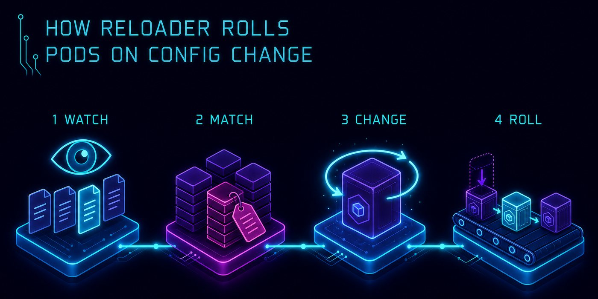
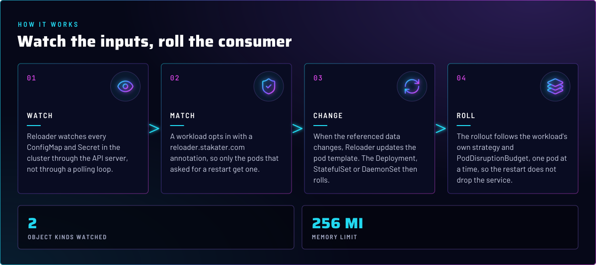
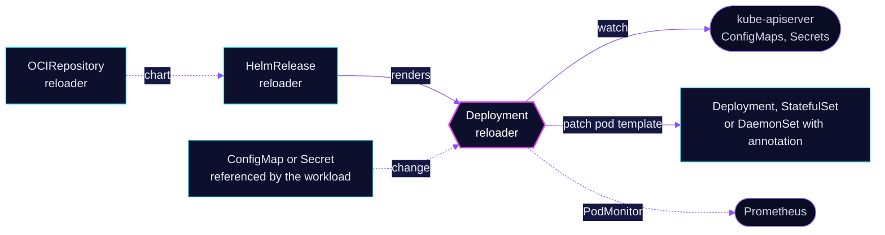

<p align="center">
  
</p>

> **Config changes reach running pods, nothing else restarts.** Reloader watches ConfigMaps and Secrets. A workload that
> opts in by annotation gets a rolling restart when the data it reads changes. No workload restarts unless it asked.

## At a glance

<!-- glance:start -->
<!-- Generated by `readme.py sync`; edit the manifests, not this table. -->
| | |
|---|---|
| **Namespace** | `kube-system` |
| **Deployed by** | [`reloader`](../../../main/kube-system/reloader.yaml) (Flux Kustomization) |
| **Helm chart** | `reloader` from `oci://ghcr.io/stakater/charts/reloader`, values in [`helmrelease.yaml`](app/helmrelease.yaml) |
<!-- glance:end -->

## What it does

- **Watches** every ConfigMap and Secret in the cluster through the API server.
- **Restarts** a Deployment, StatefulSet or DaemonSet when a ConfigMap or Secret it references changes, if the workload
  carries the annotation `reloader.stakater.com/auto: "true"`, or names the specific objects in
  `reloader.stakater.com/reload`.
- **Scopes the trigger** with the typed forms `configmap.reloader.stakater.com/reload` and
  `secret.reloader.stakater.com/reload`, so a ConfigMap change does not restart a workload that reads only a Secret.
- **Exports metrics** through a PodMonitor in `kube-system`.

## Why it is built this way

| Choice | Why |
|---|---|
| **Opt-in by annotation, not `autoReloadAll`** | The chart default is off, and the repo keeps it off. A restart is a visible event, so each workload that wants one says so in its own manifest. |
| **Restart through the workload's own rollout** | Reloader updates the pod template, so the Deployment, StatefulSet or DaemonSet rolls under its strategy and PodDisruptionBudget. A pod is never killed out of band. |
| **Read-only root filesystem** | The controller writes nothing to its image. The chart default is `false`. |
| **Replicas and HA flag** | See Known gaps. |

## How it works

<p align="center">
  
</p>

<p align="center">
  
</p>

<details>
<summary><b>Resource graph</b>: every object involved, by name</summary>



</details>

In more detail:

1. Flux applies the chart. It creates the `reloader` Deployment, RBAC to watch ConfigMaps and Secrets, and a
   PodMonitor.
2. Each consuming workload carries the annotation in its own manifest. Examples are Home Assistant, Paperless-ngx,
   the EMQX cluster, and the 1Password Connect API. `grep -rl --include='*.yaml' reloader.stakater.com kubernetes/apps` lists them all.
3. A change to the referenced ConfigMap or Secret is seen by the controller. It patches the workload's pod template,
   and the workload rolls.
4. The new pods read the new data at start. Nothing else in the namespace is touched.

## Settings that matter

All values are in [`app/helmrelease.yaml`](app/helmrelease.yaml) unless noted.

| Setting | Value | Why |
|---|---|---|
| `reloader.deployment.replicas` | `1` | One controller. Reloader is not on the critical path for serving traffic, and a restart is only delayed, not lost. |
| `reloader.enableHA` | `true` | Enables leader election for multiple replicas. See Known gaps. |
| `reloader.readOnlyRootFileSystem` | `true` | Hardening. The controller writes nothing to its image. The chart default is `false`. |
| `reloader.podMonitor.enabled`, `namespace` | `true`, the release namespace | Metrics scraped by Prometheus. |
| `fullnameOverride` | `reloader` | Keeps the Deployment name stable across chart changes. |
| `reloader.deployment.resources` | requests `10m` CPU, `128Mi`; memory limit `256Mi` | No CPU limit. The memory limit has a request beside it (skill `node-scheduling`). |

## Operate it

```bash
flux -n kube-system get hr reloader
kubectl -n kube-system get deploy reloader
kubectl -n kube-system logs deploy/reloader --tail=50
grep -rl --include='*.yaml' "reloader.stakater.com" kubernetes/apps   # which workloads opt in
```

## Known gaps

- **HA flag with one replica.** `enableHA: true` only matters when `replicas` is above 1, because it turns on leader
  election. With `replicas: 1` the election runs for one candidate. Either raise the replica count, or drop
  `enableHA` the next time this file changes. Found while writing; not changed here.

## Files

| File | Holds |
|---|---|
| [`app/helmrelease.yaml`](app/helmrelease.yaml) | Chart values |
| [`app/ocirepository.yaml`](app/ocirepository.yaml) | Chart source and version |
| [`app/kustomization.yaml`](app/kustomization.yaml) | Resource list for the overlay |
| [`../../../main/kube-system/reloader.yaml`](../../../main/kube-system/reloader.yaml) | Flux Kustomization |

Upstream: [Reloader README](https://github.com/stakater/Reloader) •
[annotation reference](https://github.com/stakater/Reloader#how-to-use)

<!-- branded-readme v1 sources=e6c4f2b2632c -->
