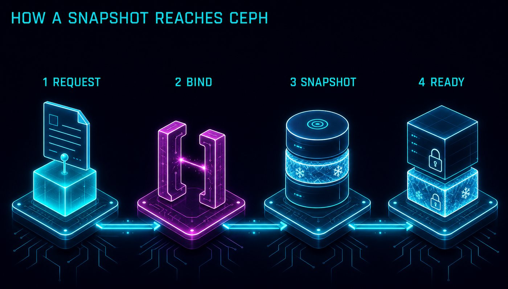
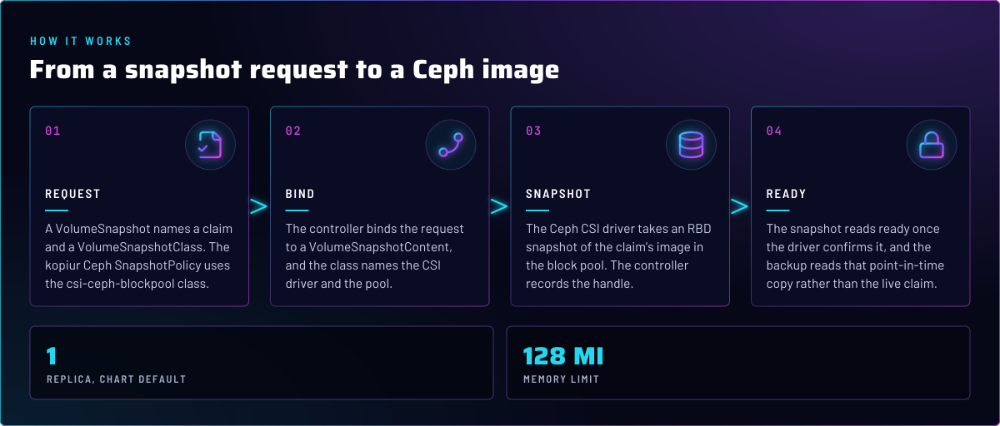
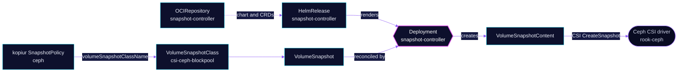

<p align="center">
  
</p>

> **The CSI snapshot bridge for Ceph.** snapshot-controller watches `VolumeSnapshot` objects and drives the CSI
> driver. The only class in use is `csi-ceph-blockpool`, which kopiur's Ceph policy requests. The CRDs ship with the
> controller, so the chart pin keeps both in step.

## At a glance

<!-- glance:start -->
<!-- Generated by `readme.py sync`; edit the manifests, not this table. -->
| | |
|---|---|
| **Namespace** | `kube-system` |
| **Deployed by** | [`snapshot-controller`](../../../main/kube-system/snapshot-controller.yaml) (Flux Kustomization) |
| **Helm chart** | `snapshot-controller` from `oci://ghcr.io/piraeusdatastore/helm-charts/snapshot-controller`, values in [`helmrelease.yaml`](app/helmrelease.yaml) |
| **Needed by** | `system/kopiur` |
| **Health checks** | `Deployment/snapshot-controller` |
<!-- glance:end -->

## What it does

- **Reconciles** `VolumeSnapshot` and `VolumeSnapshotContent` objects. It does not talk to Ceph
  itself; the Ceph CSI driver in `rook-ceph` takes the snapshot.
- **Installs** the snapshot CRDs from the chart (`installCRDs` is on by default and not overridden in Git).
- **Exports** metrics through a ServiceMonitor (`controller.serviceMonitor.create: true`).
- **Serves** the `csi-ceph-blockpool` VolumeSnapshotClass path that kopiur's Ceph `SnapshotPolicy` uses, through the
  class patch in [`rook-ceph`](../../rook-ceph/rook-ceph/cluster/volumesnapshotclass-patch.yaml).

## Why it is built this way

| Choice | Why |
|---|---|
| **Its own app in `kube-system`** | The controller is cluster infrastructure, not a Rook component. Rook owns the CSI driver and the class; this app owns the generic snapshot machinery. |
| **CRDs from the chart** | The CRD schema moves with the controller version. Pinning the chart keeps them in step, and nothing else in Git owns the CRDs. |
| **One replica, no PDB** | The chart defaults. The controller only reconciles snapshot requests. A drain delays them, and does not touch running volumes. |

## How it works

<p align="center">
  
</p>

<p align="center">
  
</p>

<details>
<summary><b>Resource graph</b>: every object involved, by name</summary>



</details>

In more detail:

1. Flux applies the chart. It installs the `VolumeSnapshot*` CRDs, the Deployment and the ServiceMonitor.
2. A `VolumeSnapshot` names a claim and a class. The class `csi-ceph-blockpool` is defined by Rook, and its pool
   parameter is patched in from `rook-ceph`.
3. The controller creates a `VolumeSnapshotContent` and calls the CSI driver's snapshot RPC. The driver takes an RBD
   snapshot of the claim's image.
4. The content reports `readyToUse` when the driver confirms the snapshot. kopiur's Ceph policy then works from that
   point-in-time copy.

## Settings that matter

All values are in [`app/helmrelease.yaml`](app/helmrelease.yaml) unless noted.

| Setting | Value | Why |
|---|---|---|
| `controller.serviceMonitor.create` | `true` | Scrapes the controller's metrics. |
| `controller.resources` | requests `25m` CPU, `32Mi`; memory limit `128Mi` | No CPU limit. The memory limit has a request beside it (skill `node-scheduling`). |
| `installCRDs` | chart default, `true` | Not set in Git. The CRDs install with the chart, so the pin owns them. |

## Operate it

```bash
flux -n kube-system get ks snapshot-controller
kubectl -n kube-system get deploy snapshot-controller
kubectl get volumesnapshotclass                          # csi-ceph-blockpool should be listed
kubectl get volumesnapshot -A                            # READYTOUSE column
```

## Files

| File | Holds |
|---|---|
| [`app/helmrelease.yaml`](app/helmrelease.yaml) | Chart values |
| [`app/ocirepository.yaml`](app/ocirepository.yaml) | Chart source and version |
| [`app/kustomization.yaml`](app/kustomization.yaml) | Resource list for the overlay |
| [`../../../main/kube-system/snapshot-controller.yaml`](../../../main/kube-system/snapshot-controller.yaml) | Flux Kustomization, health check |
| [`../../rook-ceph/rook-ceph/cluster/volumesnapshotclass-patch.yaml`](../../rook-ceph/rook-ceph/cluster/volumesnapshotclass-patch.yaml) | The Ceph VolumeSnapshotClass and its pool parameter |

Upstream: [CSI snapshotter](https://github.com/kubernetes-csi/external-snapshotter) •
[Kubernetes volume snapshots](https://kubernetes.io/docs/concepts/storage/volume-snapshots/)

<!-- branded-readme v1 sources=d572265bb2c2 -->
