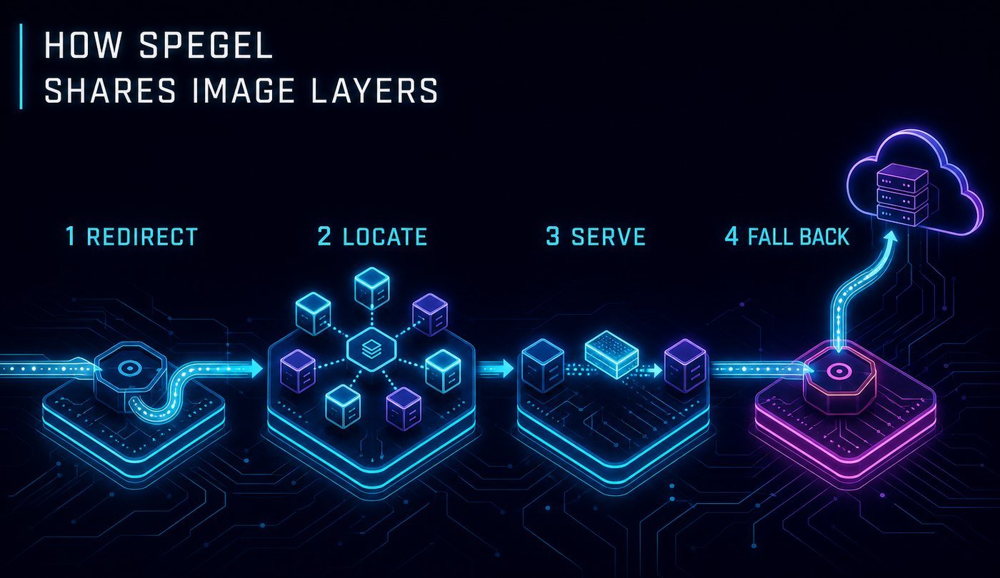
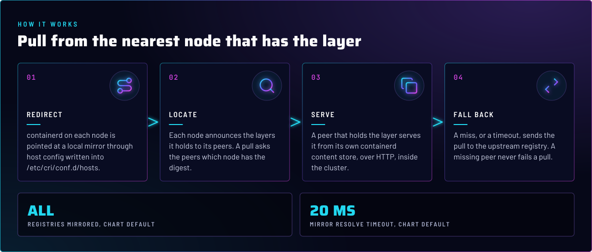
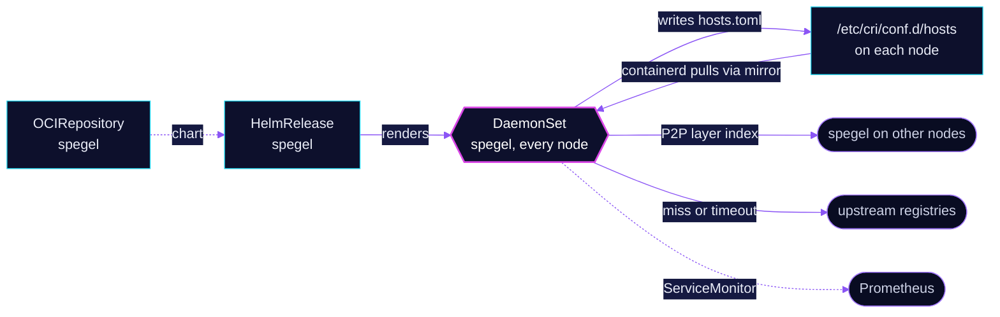

<p align="center">
  
</p>

> **Image pulls stay inside the cluster when they can.** Spegel is a peer-to-peer mirror. Each node serves the layers it
> already has, and containerd asks those peers first. A miss goes to the upstream registry, so a pull never fails
> because a peer is missing.

## At a glance

<!-- glance:start -->
<!-- Generated by `readme.py sync`; edit the manifests, not this table. -->
| | |
|---|---|
| **Namespace** | `kube-system` |
| **Deployed by** | [`spegel`](../../../main/kube-system/spegel.yaml) (Flux Kustomization) |
| **Helm chart** | `spegel` from `oci://ghcr.io/spegel-org/helm-charts/spegel`, values in [`helmrelease.yaml`](app/helmrelease.yaml) |
<!-- glance:end -->

## What it does

- **Redirects** containerd on every node to a local mirror endpoint. The host configuration lives under
  `/etc/cri/conf.d/hosts`, the Talos CRI path.
- **Announces** the image layers each node holds, and resolves a pull to the peers that have the digest.
- **Serves** those layers from the node's own containerd content store, over HTTP inside the cluster.
- **Exports** metrics through a ServiceMonitor (`serviceMonitor.enabled: true`).

## Why it is built this way

| Choice | Why |
|---|---|
| **Mirror every registry** | The chart default leaves `mirroredRegistries` empty, so every pull is tried through the mirror first. A new registry works without a config change. |
| **Talos CRI path, not the chart default** | The chart defaults `containerdRegistryConfigPath` to `/etc/containerd/certs.d`. Talos reads CRI registry config from `/etc/cri/conf.d/hosts`, so the value is overridden. |
| **Keep unpacked layers on Talos** | `talos/machineconfig.yaml.j2` writes `discard_unpacked_layers = false` under `/etc/cri/conf.d/`. With discard on, containerd drops the compressed blobs after unpacking, and spegel has nothing to serve. |
| **Installed by bootstrap before Flux** | `bootstrap/helmfile/apps.yaml` installs spegel right after CoreDNS and before cert-manager, from the same chart and values, so a rebuild's first pulls can already use the mirror. |
| **Tolerates every NoSchedule and NoExecute taint** | The chart's default tolerations cover those effects, so the DaemonSet is not held off any node by a hard taint. |
| **Persistence at `/var/lib/spegel`** | The chart default. The node's peer identity survives Pod restarts. |

## How it works

<p align="center">
  
</p>

<p align="center">
  
</p>

<details>
<summary><b>Resource graph</b>: every object involved, by name</summary>



</details>

In more detail:

1. Bootstrap installs spegel with helmfile, after CoreDNS, from the same chart and values. Flux then reconciles the
   HelmRelease from Git.
2. On each node the DaemonSet mounts the containerd socket at `/run/containerd/containerd.sock` and writes mirror host
   configuration under `/etc/cri/conf.d/hosts`. Containerd reads that path for registry lookups.
3. A pull for an image digest goes to the local spegel first. It asks peers which node has the layers, and fetches from
   one of them.
4. If no peer has the digest, or the lookup times out after `mirrorResolveTimeout` (the chart default, 20 ms), containerd pulls from the
   upstream registry as it did before spegel existed.

## Settings that matter

All values are in [`app/helmrelease.yaml`](app/helmrelease.yaml) unless noted. The Talos half lives in
`talos/machineconfig.yaml.j2`.

| Setting | Value | Why |
|---|---|---|
| `spegel.containerdRegistryConfigPath` | `/etc/cri/conf.d/hosts` | The Talos CRI path. The chart default, `/etc/containerd/certs.d`, does not exist on Talos. |
| `spegel.containerdSock` | `/run/containerd/containerd.sock` | Set explicitly. It matches the chart default, so the socket is visible in Git. |
| `resources` | requests `50m` CPU, `64Mi`; memory limit `256Mi` | No CPU limit, so layer serving is not throttled. The memory limit has a request beside it (skill `node-scheduling`). |
| `serviceMonitor.enabled` | `true` | Prometheus scrapes the mirror's metrics. |
| Talos `/etc/cri/conf.d/20-customization.part` | `discard_unpacked_layers = false` | Keeps compressed layers on disk for spegel to serve. Set in `talos/machineconfig.yaml.j2`, applied by `just talos apply-node`. |

## Operate it

```bash
flux -n kube-system get hr spegel
kubectl -n kube-system get ds spegel -o wide              # one pod per node
kubectl -n kube-system logs ds/spegel --tail=50
```

Talos node check (read-only): `talosctl -n talos-1 read /etc/cri/conf.d/20-customization.part` shows
`discard_unpacked_layers = false`, and `talosctl -n talos-1 read /etc/cri/conf.d/hosts` shows the mirror entries spegel wrote.

## Files

| File | Holds |
|---|---|
| [`app/helmrelease.yaml`](app/helmrelease.yaml) | Chart values: CRI path, socket, resources |
| [`app/ocirepository.yaml`](app/ocirepository.yaml) | Chart source and version |
| [`app/kustomization.yaml`](app/kustomization.yaml) | Resource list for the overlay |
| [`../../../main/kube-system/spegel.yaml`](../../../main/kube-system/spegel.yaml) | Flux Kustomization |
| [`talos/machineconfig.yaml.j2`](../../../../../talos/machineconfig.yaml.j2) | The containerd customization file |

Upstream: [Spegel getting started, Talos](https://spegel.dev/docs/getting-started/#talos) •
[Spegel configuration](https://spegel.dev/docs/)

<!-- branded-readme v1 sources=5fe3704dd45a -->
