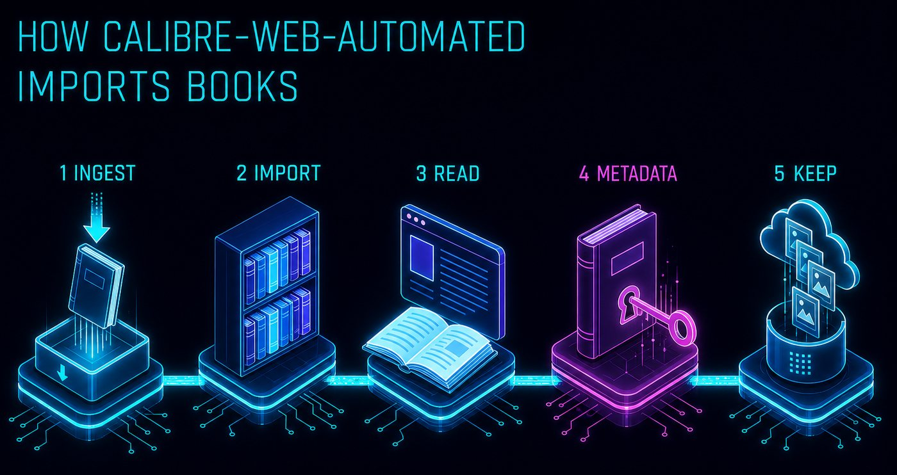
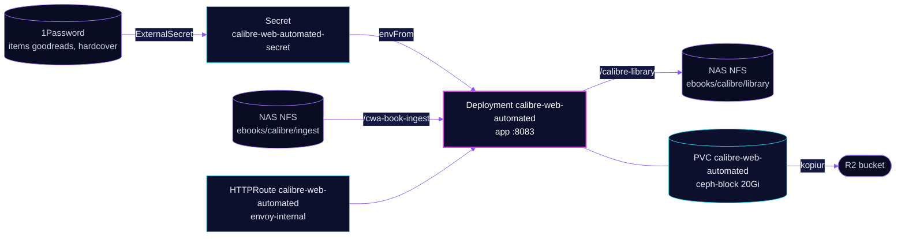

<p align="center">
  
</p>

> **Ingest folder in, library out.** calibre-web-automated watches the NAS ingest folder that the book pipeline writes to, imports each book into a Calibre library on the NAS, and serves that library as a web reader. Only its own config is in a snapshot. The books themselves stay on the NAS.

## At a glance

<!-- glance:start -->
<!-- Generated by `readme.py sync`; edit the manifests, not this table. -->
| | |
|---|---|
| **Namespace** | `media` |
| **Deployed by** | [`calibre-web-automated`](../../../main/media/calibre.yaml) (Flux Kustomization) |
| **Helm chart** | `app-template`, values in [`helmrelease.yaml`](calibre-web-automated/helmrelease.yaml) |
| **Images** | `ghcr.io/crocodilestick/calibre-web-automated` |
| **Depends on** | `system/kopiur-repository` |
| **Secret** | `calibre-web-automated-secret` from onepassword item `goodreads`, `hardcover` |
| **Health checks** | `Deployment/calibre-web-automated` |
<!-- glance:end -->

## What it does

- **Imports** books from the NFS ingest folder `/cwa-book-ingest`, from the NAS export `/mnt/storage/Media/ebooks/calibre/ingest`.
- **Keeps** the Calibre library on the NAS export `/mnt/storage/Media/ebooks/calibre/library`, mounted at `/calibre-library`.
- **Serves** the web reader on port 8083 at `calibre.${SECRET_DOMAIN}` on `envoy-internal`.
- **Pulls** the Goodreads cookie and the Hardcover token from items `goodreads` and `hardcover` through ExternalSecret `calibre-web-automated`.
- **Backs up** the `calibre-web-automated` config claim (20 GiB) daily to R2 through kopiur. The library and the ingest folder are not in that snapshot.

## Why it is built this way

| Choice | Why |
|---|---|
| **Library on NFS, not on Ceph** | The library and the ingest folder are NAS exports, mounted as NFS. The manifest does not record why. The effect is that both sit outside this app's backup. |
| **Only the config claim is snapshotted** | The config claim holds the app's database and settings. The books live on the NAS export, outside this app's backup. |
| **Runs as root with a broad capability set** | The image's s6 init needs root to set up its paths. The manifest comments that `NETWORK_SHARE_MODE` skips privileged steps that do not apply on Kubernetes. The `S6_YES_I_WANT_A_WORLD_WRITABLE_RUN_BECAUSE_KUBERNETES` flag is set without a comment. |
| **Startup probe on `/login`** | The startup probe allows up to about five minutes before liveness counts, so a slow first start is not restarted. |

## How it works

<p align="center">
  
</p>

<p align="center">
  
</p>

<details>
<summary><b>Resource graph</b>: every object involved, by name</summary>



</details>

In more detail:

1. Flux applies the overlay Kustomization `calibre-web-automated`, which adds the PVC component. A second Kustomization, `calibre-web-automated-kopiur`, adds the backup component on its own so a greenfield claim cannot deadlock the app.
2. The pod mounts the ingest and library NFS paths and the config claim. `/cache`, `/tmp` and `/run` are emptyDirs.
3. CWA imports each file it finds in the ingest folder into the library.
4. The route serves the reader on `calibre.${SECRET_DOMAIN}` through `envoy-internal`.
5. kopiur snapshots the config claim to R2 once a day.

## Settings that matter

All values are in [`app/helmrelease.yaml`](calibre-web-automated/helmrelease.yaml) unless noted.

| Setting | Value | Why |
|---|---|---|
| `defaultPodOptions.securityContext` | `runAsUser: 0`, `runAsNonRoot: false`, `fsGroup: 2000` | The image's init needs root to set up its paths. `fsGroup: 2000` sets the claim's group ownership to the app's group. |
| `containers.app.securityContext` | `allowPrivilegeEscalation: true`, `readOnlyRootFilesystem: false`, add `CHOWN`, `SETUID`, `SETGID`, `FOWNER`, `DAC_OVERRIDE` | Required by the image's s6 init. This is the posture the image needs, not a default to copy elsewhere. |
| `PUID`, `PGID` | `2000` | The UID and GID the app runs as after init, the same values the kopiur mover uses. |
| `NETWORK_SHARE_MODE` | `true` | Tells the image to soft-fail privileged steps. The manifest comment says those steps should not exist on Kubernetes anyway. |
| Probes on `/login` | startup: 30 s delay, then up to 30 checks 10 s apart; liveness every 30 s | The startup budget covers a slow first start. |
| `resources.app` | request 200Mi, limit 600Mi | A limit-only container reserves its full limit on the node, so the request is set. |
| Overlay `KOPIUR_CAPACITY` | `20Gi` | Sized for the config claim. |

## Operate it

```bash
flux -n media get ks calibre-web-automated
kubectl -n media get pods -l app.kubernetes.io/name=calibre-web-automated -o wide
kubectl -n media logs deploy/calibre-web-automated -c app --tail=50
```

## Files

| File | Holds |
|---|---|
| [`calibre-web-automated/helmrelease.yaml`](calibre-web-automated/helmrelease.yaml) | Container, security context, probes, NFS mounts, route, config claim |
| [`calibre-web-automated/externalsecret.yaml`](calibre-web-automated/externalsecret.yaml) | Goodreads and Hardcover credentials |
| [`calibre-web-automated/kustomization.yaml`](calibre-web-automated/kustomization.yaml) | Resource list |
| [`../../../main/media/calibre.yaml`](../../../main/media/calibre.yaml) | Two Flux Kustomizations: the app and its kopiur backup |

Upstream: [Calibre-Web-Automated](https://github.com/crocodilestick/Calibre-Web-Automated)

<!-- branded-readme v1 sources=054286e315aa -->
