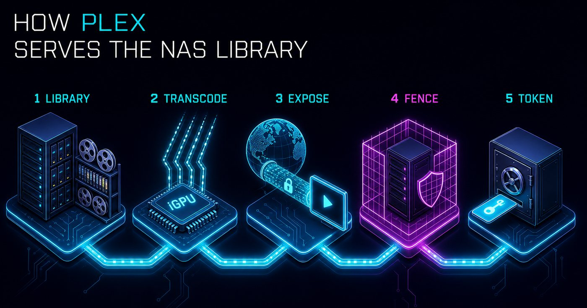
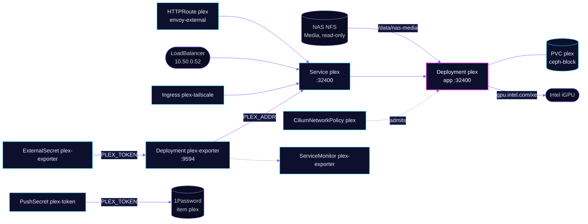

<p align="center">
  
</p>

> **One library, several front doors, one token.** Plex serves the NAS media library read-only and transcodes on the Intel iGPU. Its network policy closes the pod-network path that Plex's own `ALLOWED_NETWORKS` would otherwise open. The token it publishes is the one the other media apps read.

## At a glance

<!-- glance:start -->
<!-- Generated by `readme.py sync`; edit the manifests, not this table. -->
| | |
|---|---|
| **Namespace** | `media` |
| **Deployed by** | [`plex`](../../../main/media/plex.yaml) (Flux Kustomization) |
| **Helm chart** | `app-template`, values in [`helmrelease.yaml`](app/helmrelease.yaml) |
| **Images** | `docker.io/plexinc/pms-docker`, `ghcr.io/axsuul/plex-media-server-exporter` |
| **Depends on** | `rook-ceph/rook-ceph-cluster`, `security/onepassword-store`, `system/intel-device-plugin-gpu`, `system/kopiur-repository` |
| **Secret** | `plex-exporter-secret` from onepassword item `plex` |
| **Pushes to 1Password** | `plex` |
| **Backup** | kopiur component on the overlay (skill `kopiur-backups`) |
<!-- glance:end -->

## What it does

- **Serves** the library from the NAS export `/mnt/storage/Media`, mounted read-only at `/data/nas-media`.
- **Transcodes** on the Intel iGPU through the `gpu.intel.com/xe` resource, with scratch on a 20 GiB `transcode` emptyDir.
- **Exposes** `plex.${SECRET_DOMAIN}` on `envoy-external` for WAN clients, a LoadBalancer on `10.50.0.52` for the LAN, and a Tailscale ingress (`plex-tailscale`) for the tailnet.
- **Publishes** its own token to 1Password item `plex` (field `PLEX_TOKEN`) through PushSecret `plex-token`. The `plex-exporter` Deployment and the Wizarr seed read the same item.
- **Exports** metrics through `plex-exporter` on port 9594, scraped by a ServiceMonitor.
- **Backs up** the `plex` config claim (20 GiB) daily to R2 through kopiur.

## Why it is built this way

| Choice | Why |
|---|---|
| **CiliumNetworkPolicy on the pod** | Plex's `ALLOWED_NETWORKS` includes `10.0.0.0/8`, which covers the pod network. Without the policy, any pod could read Plex's unauthenticated endpoints. Plex cannot subtract a range, so the policy does it at L3. Skill `networking` has the rationale. |
| **Read-only library mount** | Plex scans the library and never writes to it. A bad write from Plex cannot reach the NAS. |
| **iGPU, not a discrete card** | Hardware transcode on the Intel decoder keeps CPU free. The discrete B70 is reserved for the Tdarr and LLM workloads. |
| **One Plex token, in 1Password** | The token is written by PushSecret into an existing item, and the apps that need it read it from there. A generated token would not match the one Plex issued. |
| **Plex starts as root with a capability set** | The manifest runs the container as root and adds `CHOWN`, `SETUID`, `SETGID`, `FOWNER` and `DAC_OVERRIDE` for setup. The server itself runs as `PLEX_UID` and `PLEX_GID`. |

## How it works

<p align="center">
  
</p>

<p align="center">
  
</p>

<details>
<summary><b>Resource graph</b>: every object involved, by name</summary>



</details>

In more detail:

1. Flux applies the overlay Kustomization `plex`, which adds the kopiur component and the `plex` claim. The HelmRelease installs the app-template controller with the iGPU resource and the media mount.
2. The CiliumNetworkPolicy admits the Gateway, Tailscale, plex-exporter, Wizarr, Seerr and CoreDNS, and nothing else from the pod network.
3. Plex reads the library, then transcodes into the emptyDir when a client needs a different format.
4. PushSecret `plex-token` writes the token the server reports into item `plex`. plex-exporter and the Wizarr seed read it from there.
5. kopiur snapshots the config claim to R2 once a day. The library and the transcode scratch are not in the snapshot.

## Settings that matter

All values are in [`app/helmrelease.yaml`](app/helmrelease.yaml) unless noted.

| Setting | Value | Why |
|---|---|---|
| `ADVERTISE_IP` | `https://plex.${SECRET_DOMAIN}:443,http://10.50.0.52:32400` | Clients reach Plex by the public name and by the LAN address. |
| `ALLOWED_NETWORKS` | `10.0.0.0/8,172.16.0.0/12,192.168.0.0/16` | Plex treats these as local and skips auth for them. The CiliumNetworkPolicy is what keeps the pod network out. |
| `probes` | `GET /identity` on 32400 | Plex answers `/identity` without a token, so the probe measures Plex, not the auth layer. |
| `resources.app` | request 512Mi; limit 8Gi, plus `gpu.intel.com/xe: 1` | A limit-only container reserves its full limit, so the request is set. The iGPU resource places the pod on a node with the device. |
| `persistence.transcode` | `emptyDir`, `sizeLimit: 20Gi` | Transcode scratch is disposable and bounded. |
| `persistence.media` | NFS, read-only | Plex never writes to the library. |
| `service.app` | `LoadBalancer`, `lbipam.cilium.io/ips: 10.50.0.52` | A fixed LAN address. |
| `strategy` | not set | See Known gaps. |
| `route.app` `gatus.home-operations.com/endpoint` | `plex.${SECRET_DOMAIN}/identity`, 200 | Gatus checks the public path. |
| Overlay `KOPIUR_CAPACITY` | `20Gi` | Sized for the config claim. |

## Operate it

```bash
flux -n media get ks plex
kubectl -n media get pods -l app.kubernetes.io/name=plex -o wide
kubectl -n media get pods -l app.kubernetes.io/name=plex-exporter
kubectl -n media get ciliumnetworkpolicy plex
```

The Plex token is not generated. The source Secret for PushSecret `plex-token` was created by hand from the running server's preferences, and it is not in Git. If the Secret is missing, the PushSecret does nothing. Check the decoded length of `PLEX_TOKEN` after any change: an empty token still reports `SecretSynced`, and plex-exporter then returns 500 and fires TargetDown. Skill `media-stack` has the procedure.

Library scans and the remote-access settings are application state in Plex's database. A scratch restore drops them. Skill `media-stack` (`references/plex.md`) lists the checks.

## Known gaps

- **Recreate is claimed in a comment, not set.** The HelmRelease comment says Plex "runs Recreate strategy", but no `strategy` key is set, so the app-template default (RollingUpdate) applies. The config claim is RWO on `ceph-block`. A rollout that lands the new pod on another node can wait on the Multi-Attach detach. Either set `strategy: Recreate`, as Wizarr does, or correct the comment.
- **`external-dns.kubernetes.io/target` on the route is not what sets the record.** The route annotation sets `external.${SECRET_DOMAIN}`, but CLAUDE.md states the parent Gateway's annotation decides the DNS record. The Gateway already sets the same target, so the route annotation does nothing. It is harmless but misleading.

## Files

| File | Holds |
|---|---|
| [`app/helmrelease.yaml`](app/helmrelease.yaml) | Server container, iGPU resource, mounts, LoadBalancer, route |
| [`app/ciliumnetworkpolicy.yaml`](app/ciliumnetworkpolicy.yaml) | Pod-network ingress allowlist |
| [`app/tailscale-ingress.yaml`](app/tailscale-ingress.yaml) | Tailnet ingress through the `ts-ingress` ProxyGroup |
| [`app/deployment.yaml`](app/deployment.yaml), [`app/service.yaml`](app/service.yaml), [`app/servicemonitor.yaml`](app/servicemonitor.yaml) | plex-exporter |
| [`app/externalsecret.yaml`](app/externalsecret.yaml) | Exporter token from item `plex` |
| [`app/pushsecret.yaml`](app/pushsecret.yaml) | Writes `PLEX_TOKEN` to item `plex` |
| [`../../../main/media/plex.yaml`](../../../main/media/plex.yaml) | Flux Kustomization, kopiur component, substitutions |

Upstream: [Plex support](https://support.plex.tv/) • [pms-docker image](https://github.com/plexinc/pms-docker) • [plex-media-server-exporter](https://github.com/axsuul/plex-media-server-exporter)

<!-- branded-readme v1 sources=5af1f9cf6664 -->
