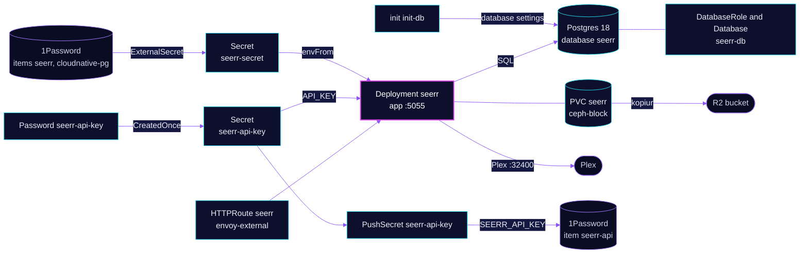

<p align="center">
  
</p>

> **The request front door, on Postgres.** Seerr takes requests from the household and friends, checks Plex for what already exists, and keeps its state in a database on the shared CloudNativePG cluster. Its API key is generated once and stored in 1Password, so the other tools can read it.

## At a glance

<!-- glance:start -->
<!-- Generated by `readme.py sync`; edit the manifests, not this table. -->
| | |
|---|---|
| **Namespace** | `media` |
| **Deployed by** | [`seerr`](../../../main/media/seerr.yaml) (Flux Kustomization) |
| **Helm chart** | `app-template`, values in [`helmrelease.yaml`](app/helmrelease.yaml) |
| **Images** | `docker.io/seerr/seerr`, `ghcr.io/home-operations/postgres-init` |
| **Depends on** | `media/seerr-db`, `rook-ceph/rook-ceph-cluster`, `security/onepassword-store`, `system/kopiur-repository` |
| **Secret** | `seerr-api-key` generated in-cluster by `Password/seerr-api-key` |
| **Secret** | `seerr-secret` from onepassword item `cloudnative-pg`, `seerr` |
| **Pushes to 1Password** | `seerr-api` |
| **Backup** | kopiur component on the overlay (skill `kopiur-backups`) |
<!-- glance:end -->

## What it does

- **Serves** the web UI and API on port 5055 at `seerr.${SECRET_DOMAIN}` on `envoy-external`.
- **Stores** its state in Postgres on the shared `postgres-18` cluster. Database `seerr` and role `seerr` come from the `seerr-db` Kustomization.
- **Generates** its API key once, through the Password generator behind `seerr-api-key`. Seerr reads it as `API_KEY`.
- **Records** that key in 1Password item `seerr-api` (vault `Automation`) through PushSecret `seerr-api-key`, so the ai stack's Seerr MCP can read it back.
- **Scans** Plex at `plex.media.svc.cluster.local:32400` with its own Plex token. That path is admitted by name in the Plex network policy.
- **Backs up** the `seerr` config claim (2 GiB) daily to R2 through kopiur.

## Why it is built this way

| Choice | Why |
|---|---|
| **Postgres, not the bundled SQLite** | The database lives on the shared cluster, which has its own backup and restore path. The config claim then holds settings, not the main database. |
| **Generated API key, not a settings file** | Seerr adopts the key from `API_KEY`, so GitOps owns it and no `settings.json` has to carry it. |
| **`CreatedOnce` on the ExternalSecret** | A regenerated key would reach 1Password but not Seerr until a restart. Deleting the ExternalSecret mints a new key, so the refresh policy keeps it stable. |
| **`PushSecret` with `deletionPolicy: None`** | Pruning the PushSecret never deletes the 1Password item the key lives in. |
| **Read-only root filesystem** | Seerr writes only to `/app/config` and `/tmp`. Both are mounted writable; nothing else is. |

## How it works

<p align="center">
  
</p>

<details>
<summary><b>Resource graph</b>: every object involved, by name</summary>



</details>

In more detail:

1. Flux applies the `seerr-db` Kustomization first. It creates the role and database on `postgres-18` and waits for both to report applied.
2. The `seerr` overlay then applies the app. The init container runs the postgres-init image with the database settings from `seerr-secret` before Seerr starts.
3. The generator makes the API key once. The Secret feeds Seerr's `API_KEY`, and PushSecret writes a copy to 1Password.
4. Seerr serves requests on `seerr.${SECRET_DOMAIN}` and checks Plex over the cluster service.
5. kopiur snapshots the config claim to R2 once a day.

## Settings that matter

All values are in [`app/helmrelease.yaml`](app/helmrelease.yaml) unless noted.

| Setting | Value | Why |
|---|---|---|
| `DB_TYPE`, `DB_HOST`, `DB_PORT` | `postgres`, `postgres-18-rw.database.svc.cluster.local`, `5432` | Points Seerr at the shared cluster's read-write service. The host is literal in Git on purpose. |
| `API_KEY` | from Secret `seerr-api-key` | The key is owned by GitOps. |
| `pod.securityContext` | `runAsUser: 2000`, `runAsNonRoot: true`, `fsGroup: 2000` | Non-root by default. The config claim is group-owned by the app's group. |
| `containers.app.securityContext` | `readOnlyRootFilesystem: true`, all capabilities dropped | Seerr writes only to the mounted `/app/config` and `/tmp`. |
| `resources.app` | request 256Mi; limit 1Gi | A limit-only container reserves its full limit, so the request is set. |
| Overlay `seerr-db` `wait` | `true` | The app must not start before its role and database exist. |
| `PushSecret seerr-api-key` `deletionPolicy` | `None` | Pruning the PushSecret keeps the 1Password item. |
| Overlay `KOPIUR_CAPACITY` | `2Gi` | Sized for the config claim. |

## Operate it

```bash
flux -n media get ks seerr-db seerr
kubectl -n media get pods -l app.kubernetes.io/name=seerr -o wide
kubectl -n database get databaserole,database | grep seerr
```

Quotas, approval mode and default user permissions are application state in Seerr, not Git. Skill `media-stack` (`references/friends.md`) lists them.

## Known gaps

- **The route annotation `external-dns.kubernetes.io/target` is ignored.** The HTTPRoute sets `external.${SECRET_DOMAIN}`, but the parent Gateway's annotation decides the DNS record, and it already sets the same target. The route annotation does nothing. It is harmless but misleading.

## Files

| File | Holds |
|---|---|
| [`app/helmrelease.yaml`](app/helmrelease.yaml) | Container, init-db, route, config claim |
| [`app/externalsecret.yaml`](app/externalsecret.yaml) | Database and Seerr settings from items `seerr` and `cloudnative-pg` |
| [`app/password.yaml`](app/password.yaml) | Generator for the API key |
| [`app/externalsecret-api-key.yaml`](app/externalsecret-api-key.yaml) | Mints the key once, `CreatedOnce` |
| [`app/pushsecret-api-key.yaml`](app/pushsecret-api-key.yaml) | Writes the key to 1Password item `seerr-api` |
| [`../../../main/media/seerr.yaml`](../../../main/media/seerr.yaml) | Flux Kustomizations `seerr` and `seerr-db`, kopiur component |

Upstream: [Seerr](https://github.com/seerr-team/seerr)

<!-- branded-readme v1 sources=92d262b5e449 -->
