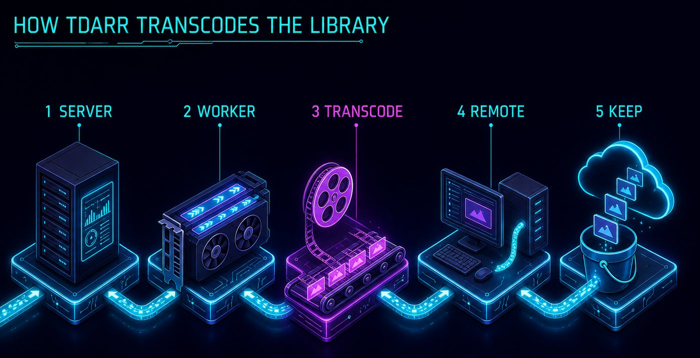
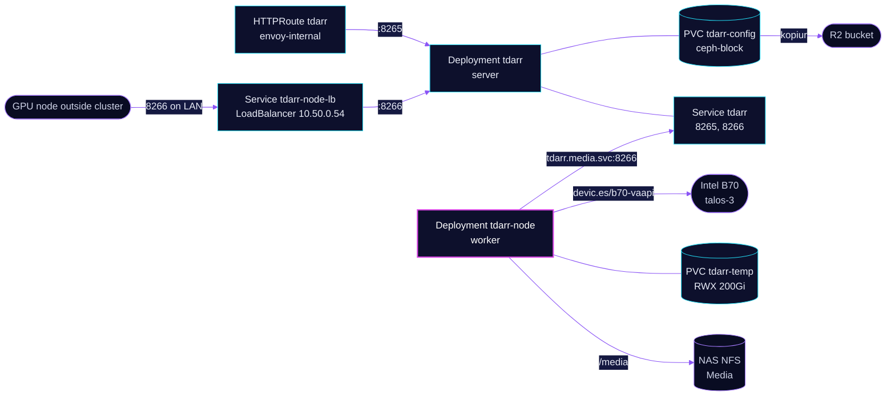

<p align="center">
  
</p>

> **A server that coordinates, a worker that transcodes.** Tdarr's server runs the flows and the web UI. One worker pod takes the B70 and runs GPU transcodes in parallel, with a CPU job alongside. A GPU node outside the cluster can join the same server over the LAN.

## At a glance

<!-- glance:start -->
<!-- Generated by `readme.py sync`; edit the manifests, not this table. -->
| | |
|---|---|
| **Namespace** | `media` |
| **Deployed by** | [`tdarr`](../../../main/media/tdarr.yaml) (Flux Kustomization) |
| **Helm chart** | `app-template`, values in [`helmrelease.yaml`](app/helmrelease.yaml) |
| **Images** | `ghcr.io/haveagitgat/tdarr`, `ghcr.io/haveagitgat/tdarr_node` |
| **Depends on** | `rook-ceph/rook-ceph-cluster`, `system/intel-device-plugin-gpu`, `system/kopiur-repository` |
| **Volume** | `tdarr-temp` 200Gi on `ceph-filesystem-rwx` |
| **Backup** | kopiur component on the overlay (skill `kopiur-backups`) |
<!-- glance:end -->

## What it does

- **Serves** the web UI on port 8265 at `tdarr.${SECRET_DOMAIN}` on `envoy-internal`, and the node connection port 8266 inside the cluster.
- **Runs** one worker pod that requests `devic.es/b70-vaapi: 1`, the B70 on talos-3, and runs two GPU transcode jobs and one CPU job at a time.
- **Exposes** port 8266 on the LAN at `10.50.0.54` through the `tdarr-node-lb` Service, so a GPU node outside the cluster can connect.
- **Reads** the NAS media share at `/media`, and writes intermediates to the `tdarr-temp` RWX claim (200 GiB) at `/temp`.
- **Keeps** the server database and flow state on the `tdarr-config` claim (5 GiB), backed up daily to R2 by kopiur.

## Why it is built this way

| Choice | Why |
|---|---|
| **Server and worker split** | The server coordinates and holds no GPU. The worker holds the GPU and nothing else. A single worker is enough, because the server runs with `internalNode=false`. A DaemonSet would strand a Pending pod on any node without the B70. |
| **Worker pinned by `devic.es/b70-vaapi`** | VA-API needs the card's kernel device names. The `b70-vaapi` group mounts them under those names, which the renamed `b70` group cannot. The discrete card is needed for the codecs in use. The Raptor Lake iGPUs are not enough. |
| **One CPU job kept on** | A GPU-only node turns any VA-API regression into a total outage, with every job failing. Keeping a CPU worker costs speed, not correctness. |
| **`healthcheckgpuWorkers: 0`** | Tdarr builds the GPU health check with the NVIDIA decode flags, which never work on Intel. The CPU health-check worker does the same job. |
| **Authentication off** | Newer Tdarr releases default to requiring a key, and the external Windows node cannot take a key from Git. The service is internal only, so the open behaviour is kept on purpose. |
| **Worker CPU limit at 4** | An unbounded CPU worker starved the control plane on talos-3. The limit leaves cores for the apiserver. |

## How it works

<p align="center">
  
</p>

<p align="center">
  
</p>

<details>
<summary><b>Resource graph</b>: every object involved, by name</summary>



</details>

In more detail:

1. Flux applies the overlay Kustomization `tdarr`, which adds the kopiur component and the `tdarr-config` claim. The HelmRelease waits up to 15 minutes, because the worker's startup probe allows about five minutes for the server heartbeat.
2. The server starts first and listens on 8265 for the UI and 8266 for nodes.
3. The worker pod starts on talos-3 because of the `devic.es/b70-vaapi` request. Its readiness probe asks the server for a recent heartbeat from its own node name.
4. Jobs flow from the server to the worker. The worker reads `/media` and writes to `/temp`.
5. kopiur snapshots the config claim to R2 once a day. The temp claim is never backed up.

## Settings that matter

All values are in [`app/helmrelease.yaml`](app/helmrelease.yaml) unless noted.

| Setting | Value | Why |
|---|---|---|
| `timeout` | `15m` | The worker's startup can take about five minutes for the server heartbeat. The default 5 minute Helm timeout rolled back an upgrade mid-start. |
| `auth` (server) | `"false"` | The service is internal and the external Windows node cannot hold a key from Git. |
| `internalNode` | `"false"` | Keeps the server from running a worker of its own. |
| `transcodegpuWorkers` | `"2"` | Two GPU jobs share the B70 through QSV. |
| `transcodecpuWorkers` | `"1"` | Never 0. A GPU-only node fails every job when VA-API breaks. |
| `healthcheckgpuWorkers` | `"0"` | The GPU health-check command is built for NVIDIA and cannot work on Intel. |
| `healthcheckcpuWorkers` | `"1"` | The CPU health check does the same job. |
| `ffmpegVersion` | `"7"` | The ffmpeg major version the node runs, set in Git rather than the UI. |
| Worker `tolerations` | `home-operations.com/dedicated`, `PreferNoSchedule` | talos-3 carries that taint. The toleration stops a score penalty on the only node this pod can run on. |
| Worker `resources` | request 2 CPU, 2Gi; limit `devic.es/b70-vaapi: 1`, 4 CPU, 12Gi | The CPU limit keeps the worker off the control-plane cores. The memory request stops the limit from being reserved in full. |
| `tdarr-node-lb` `lbipam.cilium.io/ips` | `10.50.0.54` | A fixed LAN address for the external node. |
| `tdarr-temp` `storageClassName` | `ceph-filesystem-rwx` | RWX scratch on CephFS, so the server and worker pods can both use it. |

The worker limits in the environment are the source of truth. The worker's `/app/configs` is an emptyDir, so every pod start reseeds them and UI toggles do not survive a restart. Library scope and flow state live in the server's database. Skill `tdarr-transcoding` has the flow rules.

## Operate it

```bash
flux -n media get ks tdarr
kubectl -n media get pods -l app.kubernetes.io/name=tdarr -o wide
kubectl -n media logs deploy/tdarr -c app --tail=50
kubectl -n media logs deploy/tdarr-node -c app --tail=50
```

## Known gaps

- **The `tdarr-temp` comment points at the wrong fallback.** It says to revert to `ceph-filesystem` once Ceph is fixed. The repository keeps new claims off `ceph-filesystem`, so the comment contradicts the convention (skill `rook-ceph`).
- **Two manifests have no schema comment.** `app/pvc.yaml` and `app/externalservice.yaml` lack the `yaml-language-server` line that the repo convention requires.

## Files

| File | Holds |
|---|---|
| [`app/helmrelease.yaml`](app/helmrelease.yaml) | Server and worker controllers, devices, probes, mounts, route |
| [`app/externalservice.yaml`](app/externalservice.yaml) | LAN LoadBalancer for node connections |
| [`app/pvc.yaml`](app/pvc.yaml) | RWX scratch claim `tdarr-temp` |
| [`app/kustomization.yaml`](app/kustomization.yaml) | Resource list |
| [`../../../main/media/tdarr.yaml`](../../../main/media/tdarr.yaml) | Flux Kustomization, kopiur component, substitutions |

Upstream: [Tdarr docs](https://docs.tdarr.io/)

<!-- branded-readme v1 sources=2fbeac1e5ac0 -->
