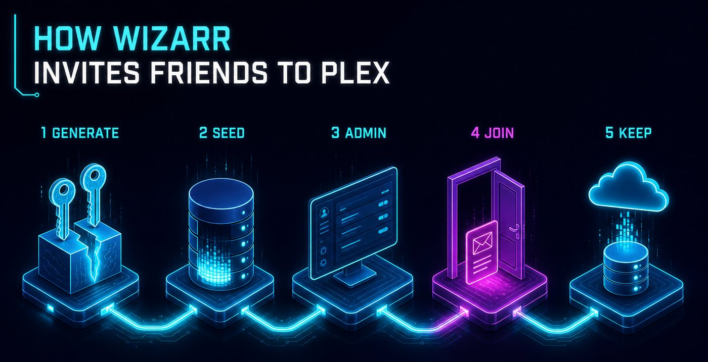
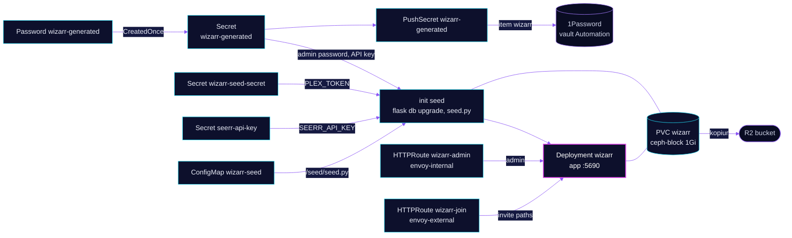

<p align="center">
  
</p>

> **Invites from a seeded database.** Wizarr issues the invite links that give friends a Plex library share. Its admin account, Plex server and Seerr connection are written from GitOps secrets on every start, so a rebuild comes back with them in place. The public side exposes only the invite paths.

## At a glance

<!-- glance:start -->
<!-- Generated by `readme.py sync`; edit the manifests, not this table. -->
| | |
|---|---|
| **Namespace** | `media` |
| **Deployed by** | [`wizarr`](../../../main/media/wizarr.yaml) (Flux Kustomization) |
| **Helm chart** | `app-template`, values in [`helmrelease.yaml`](app/helmrelease.yaml) |
| **Images** | `ghcr.io/wizarrrr/wizarr` |
| **Depends on** | `rook-ceph/rook-ceph-cluster`, `security/onepassword-store`, `system/kopiur-repository` |
| **Secret** | `wizarr-generated` generated in-cluster by `Password/wizarr-generated` |
| **Secret** | `wizarr-seed-secret` from onepassword item `plex` |
| **Pushes to 1Password** | `wizarr` |
| **Backup** | kopiur component on the overlay (skill `kopiur-backups`) |
<!-- glance:end -->

## What it does

- **Seeds** the admin account `admin`, the Plex server `Plex`, the Seerr connection `Seerr` and an API key named `hermes` on every start, through the `seed` init container and `seed.py`.
- **Serves** the admin UI and the health check on port 5690 at `wizarr.${SECRET_DOMAIN}` on `envoy-internal`. LAN and VPN only.
- **Serves** the invite flow at `join.${SECRET_DOMAIN}` on `envoy-external`, and only the invite paths, `/favicon.ico` and `/plex/callback`. Everything else on that host is not routed.
- **Generates** the admin password and the API key once, and records both in 1Password item `wizarr` (vault `Automation`) through PushSecret `wizarr-generated`.
- **Keeps** its SQLite database on the `wizarr` claim (1 GiB, `ceph-block`), backed up daily to R2 by kopiur.

## Why it is built this way

| Choice | Why |
|---|---|
| **Seed from Git, not the setup wizard** | Wizarr has no environment-based setup. Its setup creates database rows, and `seed.py` writes the same rows through Wizarr's own models. A rebuilt database then needs no clicks to become usable. |
| **Two routes, two trust zones** | The admin UI is on the internal gateway. Only the invite paths are on the external one, so the internet never reaches the admin login. |
| **`CreatedOnce` on the ExternalSecret** | The seed sets the admin password only when the admin row is missing. A regenerated password would reach 1Password but not Wizarr. |
| **`Recreate` strategy** | One replica with an RWO database claim. A rolling update could stall on the Multi-Attach detach. |
| **`seed` runs on every start** | It is idempotent. A rotated Plex token or Seerr key follows on the next pod start, and an admin password changed in the UI is left alone. |

## How it works

<p align="center">
  
</p>

<p align="center">
  
</p>

<details>
<summary><b>Resource graph</b>: every object involved, by name</summary>



</details>

In more detail:

1. Flux applies the overlay Kustomization `wizarr`, which adds the kopiur component only. The app's own persistence block creates the claim.
2. The `seed` init container runs the database migration, then `seed.py`. It writes the admin, the Plex server with the token from item `plex`, the Seerr connection and the hermes key.
3. The app container starts on the same image and database.
4. The admin route serves LAN and VPN clients. The join route serves only the invite paths and the Plex callback.
5. kopiur snapshots the database claim to R2 once a day.

## Settings that matter

All values are in [`app/helmrelease.yaml`](app/helmrelease.yaml) unless noted.

| Setting | Value | Why |
|---|---|---|
| `strategy` | `Recreate` | One replica with an RWO claim. Recreate avoids the Multi-Attach stall. |
| `seed` image | the same image and tag as the app | The seed runs on the exact schema the app expects. |
| `seed` args | `flask db upgrade`, then `seed.py` | The migration must run before the seed writes rows. |
| `seed` env `WIZARR_ADMIN_USERNAME` | `admin` | The admin login name. The password comes from a Secret. |
| `seed` env `PLEX_URL`, `SEERR_URL` | in-cluster Services | Keeps the seed and the server on the cluster network. |
| `FLASK_SKIP_SCHEDULER` | `"true"` (seed only) | The seed run does not start Wizarr's background jobs. |
| `persistence.config` | `persistentVolumeClaim`, `ceph-block`, 1Gi | The claim is created here, so this app has no separate `pvc` component. |
| `route.join` paths | invite prefixes, `/favicon.ico`, `/plex/callback` | The only paths the internet can reach. Adding a path needs a route entry and a CI allow-list entry. |
| `route.join` annotation `external-dns.kubernetes.io/target` | `external.${SECRET_DOMAIN}` | See Known gaps. |
| `resources.app` | request 128Mi, limit 512Mi | A limit-only container reserves its full limit, so the request is set. |

## Operate it

```bash
flux -n media get ks wizarr
kubectl -n media get pods -l app.kubernetes.io/name=wizarr -o wide
kubectl -n media logs deploy/wizarr -c seed
curl -s -o /dev/null -w '%{http_code}\n' https://wizarr.${SECRET_DOMAIN}/health
```

Invites, libraries, invite expiry and use limits are application state. Skill `media-stack` (`references/friends.md`) lists the one-time setup in the UI.

## Known gaps

- **The `join` route annotation is ignored.** The route sets `external-dns.kubernetes.io/target: external.${SECRET_DOMAIN}`, but the parent Gateway's annotation decides the DNS record, and it already uses that target. The route annotation does nothing. It is harmless but misleading.

## Files

| File | Holds |
|---|---|
| [`app/helmrelease.yaml`](app/helmrelease.yaml) | Seed and app containers, claim, routes |
| [`app/seed.py`](app/seed.py) | Idempotent seed of the admin, Plex server, Seerr connection and API key |
| [`app/externalsecret.yaml`](app/externalsecret.yaml) | Plex token for the seed, from item `plex` |
| [`app/externalsecret-generated.yaml`](app/externalsecret-generated.yaml) | Generates the admin password and API key, `CreatedOnce` |
| [`app/password.yaml`](app/password.yaml) | Generator definition for the two secrets |
| [`app/pushsecret.yaml`](app/pushsecret.yaml) | Writes them to 1Password item `wizarr` |
| [`app/kustomization.yaml`](app/kustomization.yaml) | Resource list, and the `wizarr-seed` ConfigMap from `seed.py` |
| [`../../../main/media/wizarr.yaml`](../../../main/media/wizarr.yaml) | Flux Kustomization, kopiur component, substitutions |

Upstream: [Wizarr](https://github.com/wizarrrr/wizarr)

<!-- branded-readme v1 sources=8e45cbd24ec0 -->
