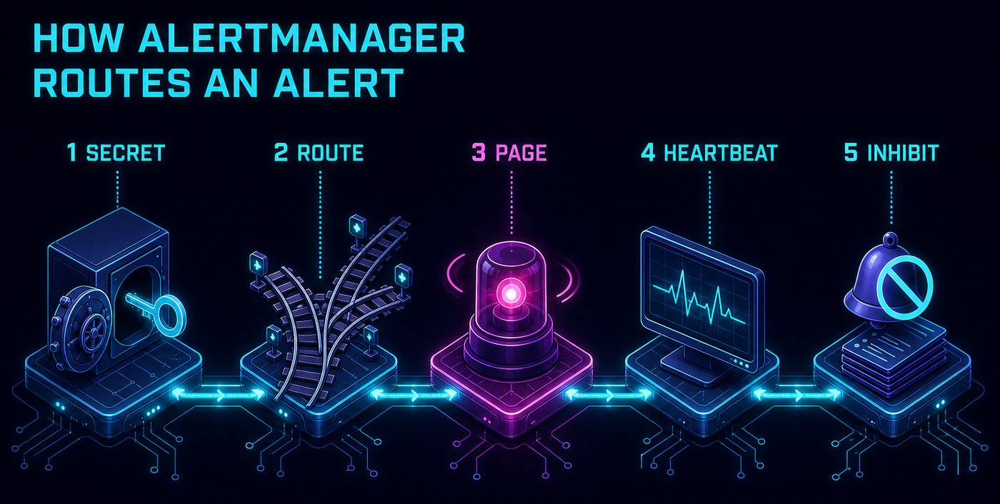
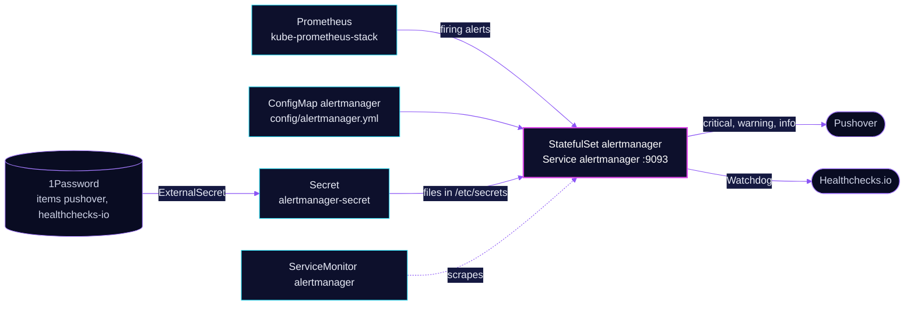

<p align="center">
  
</p>

> **Pages only for critical.** Alertmanager takes every alert Prometheus fires and decides who hears it and how loudly.
> Critical sirens Pushover until it is acknowledged. The Watchdog heartbeat goes to Healthchecks.io, so a silent
> Alertmanager is noticed from outside the cluster.

## At a glance

<!-- glance:start -->
<!-- Generated by `readme.py sync`; edit the manifests, not this table. -->
| | |
|---|---|
| **Namespace** | `monitoring` |
| **Deployed by** | [`alertmanager`](../../../main/monitoring/alertmanager.yaml) (Flux Kustomization) |
| **Helm chart** | `app-template`, values in [`helmrelease.yaml`](app/helmrelease.yaml) |
| **Images** | `quay.io/prometheus/alertmanager` |
| **Depends on** | `security/onepassword-store` |
| **Secret** | `alertmanager-secret` from onepassword item `healthchecks-io`, `pushover` |
<!-- glance:end -->

## What it does

- **Receives** firing alerts from Prometheus on the `alertmanager` Service, port 9093. The kube-prometheus-stack
  chart runs no Alertmanager of its own (`alertmanager.enabled: false`), so this StatefulSet is the only one.
- **Routes** by the `severity` label. `critical` goes to `pushover-critical`, `warning` and any alert with no severity
  go to `pushover-warning`, `info` and `notify` go to `pushover-low`. `Watchdog` goes to `healthchecks-io`, and
  `InfoInhibitor` goes to the `null` receiver.
- **Pages** through Pushover with a title of `[FIRING:n] alertname (namespace)`, and a body that lists severity,
  description and labels.
- **Pings** Healthchecks.io every 5 minutes while the `Watchdog` alert is firing. A resolved Watchdog sends nothing.
- **Keeps** silences and the notification log on a 50 MiB `ceph-block` volume mounted at `/alertmanager`.

## Why it is built this way

| Choice | Why |
|---|---|
| **Severity picks the channel** | Each receiver maps to a Pushover priority: critical is 2 (emergency, repeats until acknowledged), warning is 0 (audible), info is -2 (silent). Only critical may wake someone. The rule author sets the label, so the label is the contract. |
| **Critical repeats every 6 h, and expires at 30 m** | At priority 2 every repeat needs an acknowledgement. A critical can stay true for days on this cluster, so the repeat interval is the one dial that bounds the pages. Alertmanager's default expiry is 1 h; 30 m is set on purpose. |
| **Watchdog does not inherit the root route** | The root route repeats every 12 h. Healthchecks.io expects a ping every 5 minutes with a grace of at least 15, so the Watchdog route sets its own 5 m repeat, and `group_wait: 0s`. |
| **Secrets are read from files on each send** | `token_file`, `user_key_file` and `url_file` are read per send. A rotated ping URL needs no restart, and a missing file fails only its own receiver. Alertmanager still starts and the other receivers still deliver. |
| **Standalone, not the operator's Alertmanager** | The chart's rules match `job="kube-prometheus-stack-alertmanager"`. The ServiceMonitor relabels `job` to that value, because the default Service-name job scrapes fine but leaves those rules inert. |
| **One replica** | No cluster mode is configured. A restart delays notifications until the pod is back. The Healthchecks.io grace (at least 15 minutes) is the window a restart has before the dead-man ping alarms. |

## How it works

<p align="center">
  
</p>

<p align="center">
  
</p>

<details>
<summary><b>Resource graph</b>: every object involved, by name</summary>



</details>

In more detail:

1. Flux applies the ExternalSecret, a ConfigMap generated from `config/alertmanager.yml`, the StatefulSet and the
   ServiceMonitor. The HelmRelease also depends on `rook-ceph/rook-ceph-cluster`, because the StatefulSet's volume is `ceph-block`. The ConfigMap is generated with Flux substitution disabled, so a `${...}` in the config stays
   literal. The Reloader annotation restarts the pod when the ConfigMap or Secret changes.
2. Prometheus evaluates the rules and posts firing alerts to `alertmanager:9093`.
3. Alertmanager groups alerts by `alertname` and `namespace`, waits 30 s for the first group, and matches the route.
   Critical, warning and info each have their own group interval and repeat interval.
4. The receiver sends. A Pushover failure is logged and retried by Alertmanager; it does not stop the other receivers.
5. The Watchdog route pings Healthchecks.io every 5 minutes. Healthchecks.io alerts you when the pings stop.

## Settings that matter

All values are in [`app/helmrelease.yaml`](app/helmrelease.yaml) unless noted.

| Setting | Value | Why |
|---|---|---|
| `controllers.alertmanager.type` | `statefulset` with a 50 Mi `ceph-block` claim at `/alertmanager` | Silences and the notification log must survive a restart. Lose them and every still-firing alert notifies again. |
| `defaultPodOptions.securityContext` | non-root UID and GID 65534, `fsGroupChangePolicy: OnRootMismatch` | Runs as nobody. `OnRootMismatch` avoids re-owning the volume on every start (skill `app-workloads`). |
| `resources` | requests 11m CPU and 50M memory; memory limit 99M | Every memory limit has a request (skill `node-scheduling`). |
| `persistence.secrets` | Secret `alertmanager-secret` at `/etc/secrets` | Receivers read token and URL files from disk, so rotation is a file read, not a restart. |
| `persistence.config` | ConfigMap `alertmanager` at `/etc/alertmanager` | The routes and receivers. Edit `app/config/alertmanager.yml`, not the chart. |
| `route.app.hostnames` | `alertmanager.${SECRET_DOMAIN}` on `envoy-internal` | The UI is internal only. Alerts never leave the cluster through this route. |
| ServiceMonitor `relabelings` (`app/servicemonitor.yaml`) | `job` replaced with `kube-prometheus-stack-alertmanager` | The chart's `alertmanager.rules` match that job name. Without it those rules never evaluate true. |
| `repeat_interval` on `pushover-critical` | `6h` | At priority 2 each repeat is an acknowledgement request. Do not lengthen it to cut noise; skill `observability` owns the rule. |

## Alerts

This directory has no `PrometheusRule` of its own. The alerts below are the ones that exercise this app.

| Alert | Fires when | First look |
|---|---|---|
| `Watchdog` | Always, severity `none`. The heartbeat. | Healthchecks.io reports missed pings. Check the pod, then the `healthchecks-io` receiver errors. |
| `InfoInhibitor` | A namespace has info alerts and no warning or critical (chart rule, severity `none`). | Routes to the `null` receiver by design. It must not page. |

## Operate it

```bash
flux -n monitoring get ks alertmanager
kubectl -n monitoring get statefulset,pod -l app.kubernetes.io/name=alertmanager
kubectl -n monitoring get externalsecret alertmanager-secret   # SecretSynced does not mean the values are non-empty
kubectl -n monitoring logs statefulset/alertmanager --tail=100 | grep -i 'notify'
```

The receiver contract, the Watchdog cadence and the Healthchecks.io check settings are in skill `observability`
([alertmanager.md](../../../../../.agents/skills/observability/references/alertmanager.md)). Read it before changing a route.

## Files

| File | Holds |
|---|---|
| [`app/config/alertmanager.yml`](app/config/alertmanager.yml) | Receivers, routes, inhibit rules, Pushover templates |
| [`app/helmrelease.yaml`](app/helmrelease.yaml) | StatefulSet, volume, probes, route |
| [`app/externalsecret.yaml`](app/externalsecret.yaml) | Pushover keys and the Healthchecks ping URL, from 1Password |
| [`app/servicemonitor.yaml`](app/servicemonitor.yaml) | Scrape, with the `job` relabel |
| [`app/kustomization.yaml`](app/kustomization.yaml), [`app/kustomizeconfig.yaml`](app/kustomizeconfig.yaml) | ConfigMap generator and the name reference that rolls the pod |
| [`../../../main/monitoring/alertmanager.yaml`](../../../main/monitoring/alertmanager.yaml) | Flux Kustomization |

Upstream: [Alertmanager docs](https://prometheus.io/docs/alerting/latest/alertmanager/) •
[Pushover receiver](https://prometheus.io/docs/alerting/latest/configuration/#pushover_config) •
[Healthchecks.io](https://healthchecks.io/docs/)

<!-- branded-readme v1 sources=8a3e053d2dcb -->
