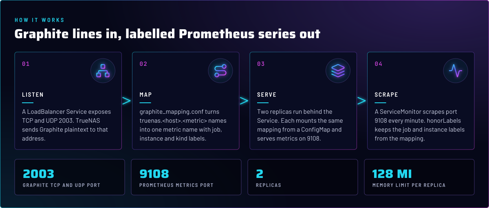
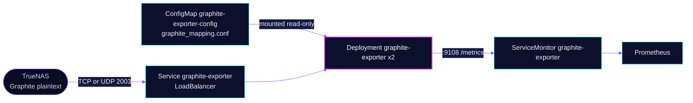

<p align="center">
  
</p>

> **A NAS that speaks Graphite, mapped into Prometheus.** TrueNAS sends its metrics as Graphite plaintext to a
> LoadBalancer address. The exporter maps those names into labelled Prometheus series, and the cluster's Prometheus
> scrapes them from port 9108. The TrueNAS dashboards that used these names were retired, so the mapping is kept
> until the NAS sends again.

## At a glance

<!-- glance:start -->
<!-- Generated by `readme.py sync`; edit the manifests, not this table. -->
| | |
|---|---|
| **Namespace** | `monitoring` |
| **Deployed by** | [`graphite-exporter`](../../../main/monitoring/exporters/graphite-exporter.yaml) (Flux Kustomization) |
| **Helm chart** | `app-template`, values in [`helmrelease.yaml`](graphite-exporter/app/helmrelease.yaml) |
| **Images** | `docker.io/prom/graphite-exporter` |
<!-- glance:end -->

## What it does

- **Listens** for Graphite plaintext on TCP and UDP 2003 through a `LoadBalancer` Service named `graphite-exporter`.
- **Maps** every `truenas.<host>.<...>` name with [`graphite_mapping.conf`](graphite-exporter/app/resources/graphite_mapping.conf), a
  vendored upstream file of about 550 lines of regex rules. Each rule sets a metric name and the `job`, `instance`,
  `kind`, `service` or `op` labels.
- **Serves** the mapped series on port 9108 at `/metrics`, from two replicas.
- **Gets scraped** by a ServiceMonitor every minute, with `honorLabels: true`, so the labels from the mapping are the
  ones Prometheus keeps.

## Why it is built this way

| Choice | Why |
|---|---|
| **A LoadBalancer on 2003, both TCP and UDP** | The NAS sender picks the transport, and the Service serves both on the same port. The address comes from Cilium's LB IPAM. No address pin is set, so the address is not fixed. |
| **The mapping is a ConfigMap, not an image** | The mapping is a file the exporter reads at start. Keeping it in Git lets a reviewed change ship as a ConfigMap edit and a rolling restart, which the Reloader annotation does. |
| **`honorLabels: true`** | The labels come from the mapping (`job: truenas`, `instance: <host>`). Prometheus must keep them, not replace them with pod or Service labels. |
| **Mapping stays at the current file** | Upstream says exporter config v2.1 needs a `netdata.conf` on the TrueNAS host, which is not in Git. Do not bump the mapping without that host file. See [`graphite-exporter/app/resources/Readme.md`](graphite-exporter/app/resources/Readme.md). |
| **Two replicas, rolling update** | One pod can restart without stopping the listener on 2003. |

## How it works

<p align="center">
  
</p>

<details>
<summary><b>Resource graph</b>: every object involved, by name</summary>



</details>

In more detail:

1. Flux applies the ConfigMap, generated from `resources/graphite_mapping.conf` with its name fixed and substitution
   disabled, and the HelmRelease. The overlay is [`graphite-exporter.yaml`](../../../main/monitoring/exporters/graphite-exporter.yaml).
2. The exporter starts with `--graphite.mapping-config=/tmp/graphite_mapping.conf` and listens on `:2003`. The mapping
   is mounted read-only at `/tmp/graphite_mapping.conf`.
3. TrueNAS sends `truenas.<host>.<metric>` lines. The first matching regex rule decides the metric name and labels.
4. The exporter serves the result on 9108, and the ServiceMonitor scrapes both replicas.

## Settings that matter

All values are in [`graphite-exporter/app/helmrelease.yaml`](graphite-exporter/app/helmrelease.yaml) unless noted.

| Setting | Value | Why |
|---|---|---|
| `service.app.type` | `LoadBalancer` | The NAS must reach it from the LAN, not from inside the cluster. |
| `service.app.ports.graphite-tcp` and `graphite-udp` | `2003`, TCP and UDP | The sender can use either transport. |
| `service.app.ports.metrics` | `9108` | The Prometheus endpoint, scraped by the ServiceMonitor. |
| `serviceMonitor.app.endpoints.honorLabels` | `true` | Keeps the mapping's `job` and `instance` labels. |
| `controllers.graphite-exporter.replicas` | `2`, `RollingUpdate` | Survives one pod restart. |
| `pod.securityContext` | UID 1000, GID 3000, non-root | Runs without root. |
| `containers.app.securityContext` | read-only root filesystem, no privilege escalation, drop `ALL` | Nothing writes to the image. |
| `resources` | requests 10m CPU and 48Mi; memory limit 128Mi | Every memory limit has a request. |
| `service.app.annotations` | empty, no `io.cilium/lb-ipam-ips` pin | The address is not fixed. Look up the live one with `kubectl`. |

## Known gaps

- **Replica behaviour is unverified.** Git shows two replicas behind one LoadBalancer, a ServiceMonitor that scrapes both, and
  `honorLabels: true` with a mapping that sets `instance` from the host. If the same sample can reach both replicas, the
  identical series from two targets could collide. Nothing in Git tests this, so check it before relying on the replicas
  for anything beyond restart cover. Found while writing; not changed here.
- **The legacy notes say no sample had arrived.** [`graphite-exporter/app/resources/Readme.md`](graphite-exporter/app/resources/Readme.md) says the
  TrueNAS dashboards were retired because `graphite_last_processed_timestamp_seconds` stayed at 0. Confirm the NAS
  still sends before adding dashboards back.

## Operate it

```bash
flux -n monitoring get ks graphite-exporter
kubectl -n monitoring get svc graphite-exporter          # EXTERNAL-IP is the TrueNAS destination
kubectl -n monitoring get servicemonitor graphite-exporter
```

Then, in Prometheus, `graphite_last_processed_timestamp_seconds` should be above 0 once the NAS has sent a sample.

## Files

| File | Holds |
|---|---|
| [`graphite-exporter/app/helmrelease.yaml`](graphite-exporter/app/helmrelease.yaml) | Deployment, LoadBalancer Service, ServiceMonitor |
| [`graphite-exporter/app/kustomization.yaml`](graphite-exporter/app/kustomization.yaml) | ConfigMap generator for the mapping |
| [`graphite-exporter/app/resources/graphite_mapping.conf`](graphite-exporter/app/resources/graphite_mapping.conf) | The vendored mapping, about 550 lines |
| [`graphite-exporter/app/resources/Readme.md`](graphite-exporter/app/resources/Readme.md) | Legacy notes: upstream source, the retired boards, the netdata gap |
| [`../../../main/monitoring/exporters/graphite-exporter.yaml`](../../../main/monitoring/exporters/graphite-exporter.yaml) | Flux Kustomization |

Upstream: [graphite_exporter](https://github.com/prometheus/graphite_exporter) •
[TrueNAS mapping source](https://github.com/Supporterino/truenas-graphite-to-prometheus)

<!-- branded-readme v1 sources=61bb3ed12f8e -->
